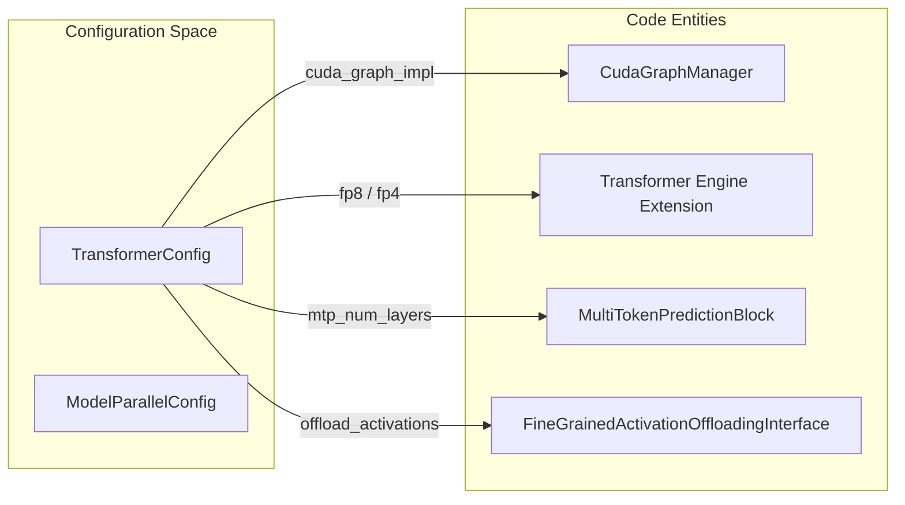

<!-- source: DeepWiki mcp.deepwiki.com · repo NVIDIA/Megatron-LM · page 11 Advanced Features and Optimizations · fetched 2026-10-26 -->

# Advanced Features and Optimizations

Relevant source files

The following files were used as context for generating this wiki page:

- [megatron/core/extensions/transformer_engine.py](megatron/core/extensions/transformer_engine.py)
- [megatron/core/fusions/fused_bias_swiglu.py](megatron/core/fusions/fused_bias_swiglu.py)
- [megatron/core/models/gpt/gpt_model.py](megatron/core/models/gpt/gpt_model.py)
- [megatron/core/tensor_parallel/__init__.py](megatron/core/tensor_parallel/__init__.py)
- [megatron/core/tensor_parallel/layers.py](megatron/core/tensor_parallel/layers.py)
- [megatron/core/tensor_parallel/random.py](megatron/core/tensor_parallel/random.py)
- [megatron/core/transformer/attention.py](megatron/core/transformer/attention.py)
- [megatron/core/transformer/cuda_graphs.py](megatron/core/transformer/cuda_graphs.py)
- [megatron/core/transformer/mlp.py](megatron/core/transformer/mlp.py)
- [megatron/core/transformer/module.py](megatron/core/transformer/module.py)
- [megatron/core/transformer/torch_norm.py](megatron/core/transformer/torch_norm.py)
- [megatron/core/transformer/transformer_block.py](megatron/core/transformer/transformer_block.py)
- [megatron/core/transformer/transformer_config.py](megatron/core/transformer/transformer_config.py)
- [megatron/core/transformer/transformer_layer.py](megatron/core/transformer/transformer_layer.py)
- [megatron/core/transformer/utils.py](megatron/core/transformer/utils.py)
- [megatron/core/utils.py](megatron/core/utils.py)
- [tests/unit_tests/fusions/test_swiglu_fusion.py](tests/unit_tests/fusions/test_swiglu_fusion.py)
- [tests/unit_tests/tensor_parallel/test_random.py](tests/unit_tests/tensor_parallel/test_random.py)
- [tests/unit_tests/transformer/test_cuda_graphs.py](tests/unit_tests/transformer/test_cuda_graphs.py)
- [tests/unit_tests/transformer/test_utils.py](tests/unit_tests/transformer/test_utils.py)

This page provides an overview of advanced optimization techniques and performance features in Megatron-LM. These optimizations enable efficient training and inference of large language models by reducing memory consumption, improving computational throughput, and overlapping communication with computation.

**Scope**: This page introduces the major optimization categories and their integration points in the codebase. For detailed implementation specifics of each optimization technique, see the dedicated sub-pages:
- [Activation Recomputation and Checkpointing](#11.1) — Explain selective activation recomputation strategies and fine-grained activation offloading for memory optimization.
- [CUDA Graph Optimization System](#11.2) — Document the `CudaGraphManager` and graph capture/replay for training.
- [Communication and Computation Overlap](#11.3) — Detail overlap strategies for TP, DP, and pipeline communication with computation.
- [FP8 and FP4 Quantization](#11.4) — Document FP8/FP4 training, parameter quantization, and Transformer Engine integration.
- [Fused Kernels and Custom Operations](#11.5) — Detail fused operations like bias-SwiGLU, bias-dropout-add, fused cross-entropy, and custom CUDA kernels.
- [NCCL and Communication Optimization](#11.6) — Explain NCCL usage, communication primitives, and distributed communication patterns.
- [Fault Tolerance and Recovery](#11.7) — Document the straggler detection system, rerun state machine, and fault tolerance mechanisms.
- [Multi-Token Prediction (MTP)](#11.8) — Document the MTP architecture for predicting multiple future tokens simultaneously, its training integration, and configuration options.
- [Observability and Telemetry](#11.9) — Document the OpenTelemetry integration via `nemo-lens`, span groups, and pipeline-parallel trace correlation.

## Optimization Categories

Megatron-LM implements several major categories of optimizations that work together to achieve high training and inference performance. Recent additions include fine-grained activation offloading and multi-token prediction.

### High-Level Optimization Map

```mermaid
graph TB
    subgraph "Optimization Categories"
        MEMORY["Memory Optimizations"]
        COMPUTE["Compute Optimizations"]
        COMM["Communication Optimizations"]
        PRECISION["Precision Optimizations"]
        GRAPH["Execution Optimizations"]
        MTP_OPT["Architectural Optimizations"]
    end
    
    subgraph "Memory Optimizations"
        RECOMP["Activation Recomputation<br/>checkpointed_forward"]
        OFFLOAD["Fine-Grained Offloading<br/>FineGrainedActivationOffloadingInterface"]
        DIST_OPT["Distributed Optimizer<br/>DistributedOptimizer"]
    end
    
    subgraph "Compute Optimizations"
        FUSED_OPS["Fused Operations<br/>bias_swiglu_impl"]
        TE_FUSED["TE Fused Modules<br/>TELinear / TENorm"]
    end
    
    subgraph "Communication Optimizations"
        OVERLAP["Overlap Strategies<br/>_ParamAndGradBuffer"]
        TP_COMM["TP Communication<br/>tensor_parallel.layers"]
    end
    
    subgraph "Execution Optimizations"
        CUDAGRAPH["CUDA Graphs<br/>CudaGraphManager"]
        RNG_TRACK["Graph-Safe RNG<br/>CudaRNGStatesTracker"]
    end

    subgraph "Architectural Optimizations"
        MTP["Multi-Token Prediction<br/>MultiTokenPredictionBlock"]
    end
    
    MEMORY --> RECOMP
    MEMORY --> OFFLOAD
    MEMORY --> DIST_OPT
    
    COMPUTE --> FUSED_OPS
    COMPUTE --> TE_FUSED
    
    COMM --> OVERLAP
    COMM --> TP_COMM
    
    GRAPH --> CUDAGRAPH
    GRAPH --> RNG_TRACK

    MTP_OPT --> MTP
```

**Diagram: Optimization Categories and Key Code Entities**

Sources: [megatron/core/transformer/cuda_graphs.py:31-33](), [megatron/core/transformer/transformer_block.py:23-32](), [megatron/core/models/gpt/gpt_model.py:32-34](), [megatron/core/transformer/transformer_layer.py:55-62]()

## Configuration and Control Flow

Optimizations are driven by `TransformerConfig`. This configuration object inherits from `ModelParallelConfig` [megatron/core/transformer/transformer_config.py:54-59]() and contains toggles for almost every advanced feature, including CUDA graphs, FP8/FP4 recipes, and MTP settings.

**Diagram: Configuration-to-Optimization Mapping**

Sources: [megatron/core/transformer/transformer_config.py:53-122](), [megatron/core/extensions/transformer_engine.py:132-175](), [megatron/core/transformer/transformer_layer.py:55-62]()

## Key Optimization Integration Points

| Optimization | Config / Flag | Primary Class/Function | Location |
|-------------|------------------|----------------------|-----------|
| CUDA Graphs | `cuda_graph_impl` | `CudaGraphManager` | [megatron/core/transformer/cuda_graphs.py:38-38]() |
| Activation Recomputation | `recompute_granularity` | `checkpointed_forward` | [megatron/core/transformer/transformer_block.py:24-24]() |
| Fine-Grained Offload | `offload_activations` | `FineGrainedActivationOffloadingInterface` | [megatron/core/transformer/transformer_layer.py:55-62]() |
| Multi-Token Prediction | `mtp_num_layers` | `MultiTokenPredictionBlock` | [megatron/core/models/gpt/gpt_model.py:34-35]() |
| Fused SWIGLU | `gated_linear_unit` | `bias_swiglu_impl` | [megatron/core/transformer/mlp.py:25-25]() |
| FP8 Training | `fp8` | `get_fp8_context` | [megatron/core/transformer/transformer_block.py:17-17]() |

Sources: [megatron/core/transformer/transformer_config.py:68-82](), [megatron/core/transformer/cuda_graphs.py:31-40](), [megatron/core/transformer/mlp.py:205-214]()

## Advanced Memory Management

Megatron-LM uses sophisticated memory management beyond standard PyTorch caching to enable training models that exceed single-GPU memory limits.

- **Activation Recomputation**: Controlled via `checkpointed_forward`, this allows the system to trade compute for memory by discarding activations during the forward pass and recomputing them during the backward pass [megatron/core/transformer/transformer_block.py:24-24]().
- **Fine-Grained Activation Offloading**: Implemented via `FineGrainedActivationOffloadingInterface`, this system offloads specific activations (like attention or expert inputs) to CPU memory to further reduce GPU memory pressure [megatron/core/transformer/transformer_layer.py:55-62]().
- **Parameter and Gradient Buffers**: Contiguous buffers manage memory for parameters and gradients, facilitating efficient communication and overlap via bucketing [megatron/core/extensions/transformer_engine.py:91-108]().

Sources: [megatron/core/transformer/transformer_block.py:23-32](), [megatron/core/transformer/attention.py:31-33](), [megatron/core/tensor_parallel/layers.py:136-145]()

## CUDA Graph Optimization

The CUDA graph system provides a mechanism to capture sequences of CUDA kernels into a single graph, significantly reducing CPU overhead for kernel launches.

- **Graph Capture**: The system uses `is_graph_capturing()` to identify when a model is being recorded into a graph [megatron/core/transformer/cuda_graphs.py:98-103]().
- **Stream Management**: Megatron-LM manages a bounded set of distinct streams via `_get_cuda_graph_stream` to avoid implicit stream aliasing and false dependencies [megatron/core/transformer/cuda_graphs.py:106-150]().
- **RNG States**: Standard RNG is not graph-compatible. Megatron-LM uses `CudaRNGStatesTracker` to manage random seeds in a way that remains deterministic during graph replay [megatron/core/transformer/cuda_graphs.py:25-30]().
- **Transformer Engine Integration**: The system integrates with Transformer Engine's graph utilities via `make_graphed_callables` to support FP8 execution within graphs [megatron/core/transformer/cuda_graphs.py:46-51]().

Sources: [megatron/core/transformer/cuda_graphs.py:106-150](), [megatron/core/transformer/cuda_graphs.py:186-197]()

## Multi-Token Prediction (MTP)

MTP is an architectural optimization introduced to improve the efficiency of predicting multiple future tokens.

- **Architecture**: MTP is implemented using `MultiTokenPredictionBlock`. It can use repeated layers or multiple separate layers based on `mtp_use_repeated_layer` [megatron/core/transformer/transformer_config.py:68-83]().
- **Integration**: MTP modules are integrated into the standard `GPTModel` and are processed conditionally based on rank [megatron/core/models/gpt/gpt_model.py:34-38]().
- **Loss Scaling**: The training objective is modified by `mtp_loss_scaling_factor` to balance the standard next-token prediction loss with the multi-token objective [megatron/core/transformer/transformer_config.py:75-80]().

Sources: [megatron/core/transformer/transformer_config.py:68-83](), [megatron/core/models/gpt/gpt_model.py:34-38]()

## Summary

The advanced optimizations in Megatron-LM focus on maximizing GPU utilization and minimizing memory bottlenecks. By combining fine-grained scheduling, CUDA graphs, and precision-specific memory management, the framework scales efficiently to the largest models and most demanding training regimes.

For detailed implementation of each optimization category, refer to the dedicated sub-pages [Activation Recomputation and Checkpointing](#11.1) through [Observability and Telemetry](#11.9).

Sources: [megatron/core/transformer/transformer_config.py:1-122](), [megatron/core/transformer/cuda_graphs.py:1-40]()

---

