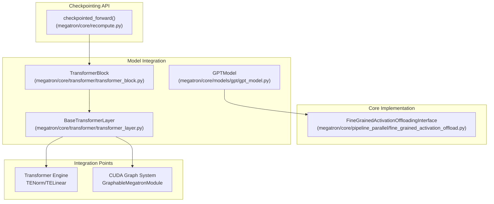
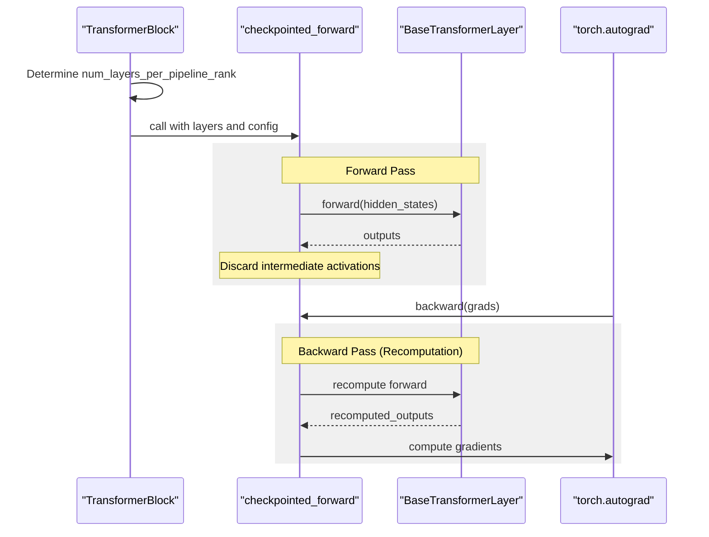
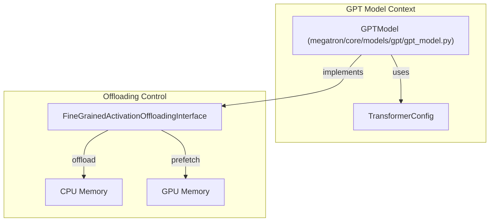

<!-- source: DeepWiki mcp.deepwiki.com · repo NVIDIA/Megatron-LM · page 11.1 Activation Recomputation and Checkpointing · fetched 2026-10-26 -->

# Activation Recomputation and Checkpointing

Relevant source files

The following files were used as context for generating this wiki page:

- [docs/user-guide/features/fine_grained_activation_offloading.md](docs/user-guide/features/fine_grained_activation_offloading.md)
- [megatron/core/extensions/transformer_engine.py](megatron/core/extensions/transformer_engine.py)
- [megatron/core/fusions/fused_bias_swiglu.py](megatron/core/fusions/fused_bias_swiglu.py)
- [megatron/core/models/gpt/gpt_model.py](megatron/core/models/gpt/gpt_model.py)
- [megatron/core/pipeline_parallel/fine_grained_activation_offload.py](megatron/core/pipeline_parallel/fine_grained_activation_offload.py)
- [megatron/core/ssm/causal_conv1d.py](megatron/core/ssm/causal_conv1d.py)
- [megatron/core/tensor_parallel/__init__.py](megatron/core/tensor_parallel/__init__.py)
- [megatron/core/tensor_parallel/layers.py](megatron/core/tensor_parallel/layers.py)
- [megatron/core/tensor_parallel/random.py](megatron/core/tensor_parallel/random.py)
- [megatron/core/transformer/attention.py](megatron/core/transformer/attention.py)
- [megatron/core/transformer/cuda_graphs.py](megatron/core/transformer/cuda_graphs.py)
- [megatron/core/transformer/mlp.py](megatron/core/transformer/mlp.py)
- [megatron/core/transformer/module.py](megatron/core/transformer/module.py)
- [megatron/core/transformer/torch_norm.py](megatron/core/transformer/torch_norm.py)
- [megatron/core/transformer/transformer_block.py](megatron/core/transformer/transformer_block.py)
- [megatron/core/transformer/transformer_config.py](megatron/core/transformer/transformer_config.py)
- [megatron/core/transformer/transformer_layer.py](megatron/core/transformer/transformer_layer.py)
- [megatron/core/transformer/utils.py](megatron/core/transformer/utils.py)
- [megatron/core/utils.py](megatron/core/utils.py)
- [tests/unit_tests/fusions/test_swiglu_fusion.py](tests/unit_tests/fusions/test_swiglu_fusion.py)
- [tests/unit_tests/pipeline_parallel/test_fine_grained_activation_offloading.py](tests/unit_tests/pipeline_parallel/test_fine_grained_activation_offloading.py)
- [tests/unit_tests/ssm/test_causal_conv1d.py](tests/unit_tests/ssm/test_causal_conv1d.py)
- [tests/unit_tests/ssm/test_gated_delta_product.py](tests/unit_tests/ssm/test_gated_delta_product.py)
- [tests/unit_tests/tensor_parallel/test_random.py](tests/unit_tests/tensor_parallel/test_random.py)
- [tests/unit_tests/transformer/test_cuda_graphs.py](tests/unit_tests/transformer/test_cuda_graphs.py)
- [tests/unit_tests/transformer/test_utils.py](tests/unit_tests/transformer/test_utils.py)

## Purpose and Scope

This document describes the activation recomputation and checkpointing system in Megatron-LM, which trades compute for memory by selectively discarding intermediate activations during the forward pass and recomputing them during the backward pass. This technique is essential for training large models that would otherwise exceed GPU memory capacity.

For CUDA graph optimization of checkpointed models, see [CUDA Graph Optimization System](11.2). For distributed optimizer memory management, see [Distributed Optimizer](6.2). For general training pipeline orchestration, see [Training Loop and Orchestration](5.4).

---

## Overview

Activation checkpointing addresses a fundamental memory constraint in deep learning: storing all intermediate activations for backpropagation can consume enormous amounts of memory, especially for large transformer models. The solution is to discard selected activations after the forward pass and recompute them just-in-time during the backward pass.

Megatron-LM implements several checkpointing strategies:

| Strategy | Memory Savings | Compute Overhead | Use Case |
|----------|---------------|------------------|----------|
| `checkpointed_forward` | Moderate | Low | Standard training with tensor parallel distribution |
| `FineGrainedActivationOffload` | High | Low (Latency) | Offloading activations to CPU memory during pipeline parallel execution |

Sources: [megatron/core/transformer/transformer_block.py:24-24](), [megatron/core/pipeline_parallel/fine_grained_activation_offload.py:1-40]()

---

## Architecture Overview

**Diagram: Activation Checkpointing System Architecture**

This diagram shows how the checkpointing strategies integrate with Transformer Engine for FP8 support, CUDA graphs, and fine-grained offloading logic.

Sources: [megatron/core/transformer/transformer_block.py:24-35](), [megatron/core/transformer/transformer_layer.py:31-36](), [megatron/core/models/gpt/gpt_model.py:25-41](), [megatron/core/pipeline_parallel/fine_grained_activation_offload.py:1-40]()

---

## Standard Gradient Checkpointing

### Transformer Block Integration

The `TransformerBlock` uses `checkpointed_forward` to manage activation recomputation across a sequence of layers. It determines the number of layers to build and checkpoint based on the `TransformerConfig`.

**Diagram: Transformer Block Checkpointing Flow**

Sources: [megatron/core/transformer/transformer_block.py:24-24](), [megatron/core/transformer/transformer_block.py:76-160]()

### Key Features

**Interleaved Pipeline Parallelism**: The system calculates layer offsets and counts specifically for interleaved pipeline schedules, ensuring each virtual stage checkpoints the correct layers. This is handled via `get_transformer_layer_offset` [megatron/core/transformer/transformer_layer.py:65-167]() and `get_num_layers_to_build` [megatron/core/transformer/transformer_block.py:76-162]().

**Uneven Pipeline Partitioning**: Megatron-LM supports uneven layer distribution (e.g., more layers in the first or last stage), and the checkpointing logic respects these custom offsets by checking `num_layers_in_first_pipeline_stage` and `num_layers_in_last_pipeline_stage` [megatron/core/transformer/transformer_config.py:96-102]().

Sources: [megatron/core/transformer/transformer_block.py:76-162](), [megatron/core/transformer/transformer_layer.py:65-167](), [megatron/core/transformer/transformer_config.py:96-102]()

---

## Fine-Grained Activation Offloading

Megatron-LM supports offloading activations to CPU memory to further reduce GPU memory pressure. This is particularly useful in Pipeline Parallelism where many microbatches are in flight.

### Implementation Interface

The `FineGrainedActivationOffloadingInterface` (often aliased as `off_interface`) provides methods to tag tensors for offloading. This interface is imported and used across core components like Attention and GPT models.

Sources: [megatron/core/pipeline_parallel/fine_grained_activation_offload.py:1-40](), [megatron/core/transformer/attention.py:31-33](), [megatron/core/models/gpt/gpt_model.py:25-27]()

### Integration in Models

The offloading interface is integrated into the model definitions. For example, in `GPTModel`, the configuration and process groups are set up to support fine-grained memory management during the pipeline execution.

**Diagram: Fine-Grained Offloading Integration**

Sources: [megatron/core/models/gpt/gpt_model.py:98-130](), [megatron/core/pipeline_parallel/fine_grained_activation_offload.py:1-40]()

---

## FP8/FP4 and Quantization Support

When using FP8 or FP4 quantization via Transformer Engine, activation recomputation must handle quantization metadata correctly. The system uses specific context managers to ensure scaling factors and amax values are maintained during recomputation.

- **`get_fp8_context`**: Provides the context for FP8 operations during forward and backward [megatron/core/transformer/transformer_block.py:17-17]().
- **`get_fp4_context`**: Provides the context for FP4 operations [megatron/core/transformer/transformer_block.py:16-16]().

In `MegatronModule`, the `set_is_first_microbatch` method ensures that TE modules update their FP8 parameter cache appropriately when checkpointing is active. This is triggered if `config.fp8` or `config.fp4` is set [megatron/core/transformer/module.py:105-124]().

Sources: [megatron/core/transformer/transformer_block.py:14-17](), [megatron/core/transformer/module.py:105-124](), [megatron/core/extensions/transformer_engine.py:133-175]()

---

## Configuration and Usage

### TransformerConfig Parameters

Activation checkpointing behavior is controlled by `TransformerConfig` parameters:

| Parameter | Type | Description |
|-----------|------|-------------|
| `num_layers` | int | Total number of layers in the model [megatron/core/transformer/transformer_config.py:65-66]() |
| `fp8` | Optional[Fp8Recipe] | Enable FP8 training, affecting recomputation logic [megatron/core/transformer/transformer_config.py:12-12]() |
| `fp4` | Optional[Fp4Recipe] | Enable FP4 training [megatron/core/transformer/transformer_config.py:12-12]() |
| `pipeline_model_parallel_layout` | Optional | Custom definition of pipeline partitioning [megatron/core/transformer/transformer_config.py:104-128]() |

Sources: [megatron/core/transformer/transformer_config.py:54-136](), [megatron/core/transformer/module.py:105-124]()

### Implementation in Transformer Layers

Transformer layers apply checkpointing based on the pipeline layout. Layer selection for checkpointing is determined by the `pipeline_model_parallel_layout` or calculated offsets.

- **`get_num_layers_to_build`**: Determines how many layers are in the current pipeline stage [megatron/core/transformer/transformer_block.py:76-88]().
- **`get_transformer_layer_offset`**: Calculates the global index offset for layers in the current stage [megatron/core/transformer/transformer_layer.py:65-68]().

Sources: [megatron/core/transformer/transformer_block.py:76-168](), [megatron/core/transformer/transformer_layer.py:65-167]()

---

