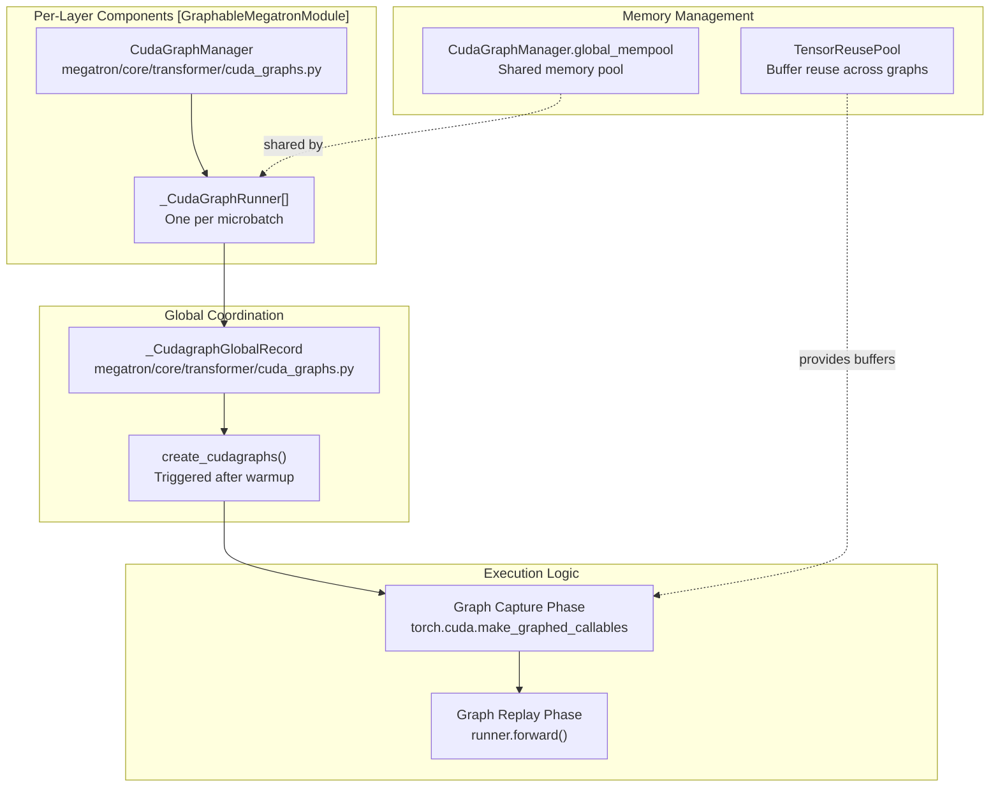
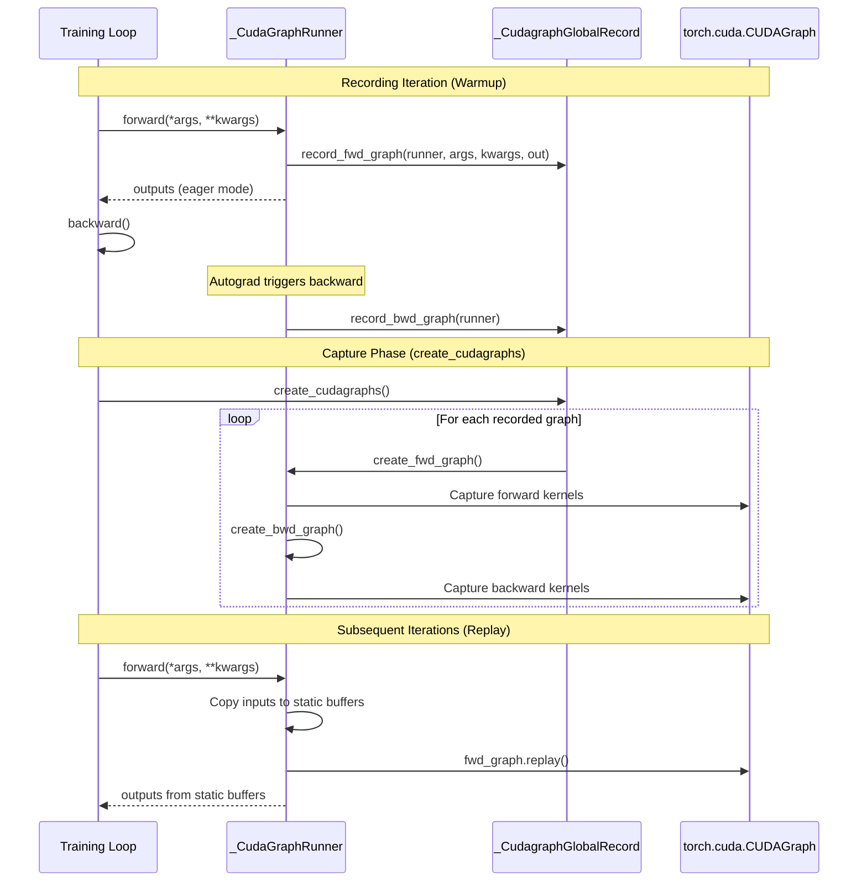
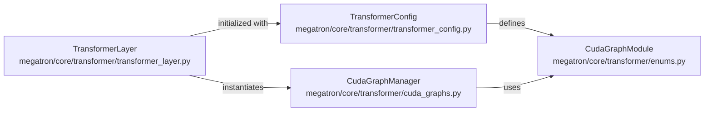

<!-- source: DeepWiki mcp.deepwiki.com · repo NVIDIA/Megatron-LM · page 11.2 CUDA Graph Optimization System · fetched 2026-10-26 -->

# CUDA Graph Optimization System

Relevant source files

The following files were used as context for generating this wiki page:

- [megatron/core/extensions/transformer_engine.py](megatron/core/extensions/transformer_engine.py)
- [megatron/core/fusions/fused_bias_swiglu.py](megatron/core/fusions/fused_bias_swiglu.py)
- [megatron/core/models/gpt/gpt_model.py](megatron/core/models/gpt/gpt_model.py)
- [megatron/core/tensor_parallel/__init__.py](megatron/core/tensor_parallel/__init__.py)
- [megatron/core/tensor_parallel/layers.py](megatron/core/tensor_parallel/layers.py)
- [megatron/core/tensor_parallel/random.py](megatron/core/tensor_parallel/random.py)
- [megatron/core/transformer/attention.py](megatron/core/transformer/attention.py)
- [megatron/core/transformer/cuda_graphs.py](megatron/core/transformer/cuda_graphs.py)
- [megatron/core/transformer/mlp.py](megatron/core/transformer/mlp.py)
- [megatron/core/transformer/module.py](megatron/core/transformer/module.py)
- [megatron/core/transformer/torch_norm.py](megatron/core/transformer/torch_norm.py)
- [megatron/core/transformer/transformer_block.py](megatron/core/transformer/transformer_block.py)
- [megatron/core/transformer/transformer_config.py](megatron/core/transformer/transformer_config.py)
- [megatron/core/transformer/transformer_layer.py](megatron/core/transformer/transformer_layer.py)
- [megatron/core/transformer/utils.py](megatron/core/transformer/utils.py)
- [megatron/core/utils.py](megatron/core/utils.py)
- [tests/functional_tests/test_cases/gpt/gpt3_mcore_te_tp1_pp4_resume_torch_dist_persistent_disable_bias_linear_1node/golden_values_dev_dgx_gb200.json](tests/functional_tests/test_cases/gpt/gpt3_mcore_te_tp1_pp4_resume_torch_dist_persistent_disable_bias_linear_1node/golden_values_dev_dgx_gb200.json)
- [tests/functional_tests/test_cases/moe/gpt3_mcore_te_tp2_pp1_resume_torch_dist_te_8experts2parallel_dist_optimizer_1node/golden_values_dev_dgx_gb200.json](tests/functional_tests/test_cases/moe/gpt3_mcore_te_tp2_pp1_resume_torch_dist_te_8experts2parallel_dist_optimizer_1node/golden_values_dev_dgx_gb200.json)
- [tests/functional_tests/test_cases/moe/gpt3_mcore_te_tp2_pp1_te_8experts2parallel_ddp_average_in_collective/golden_values_dev_dgx_h100.json](tests/functional_tests/test_cases/moe/gpt3_mcore_te_tp2_pp1_te_8experts2parallel_ddp_average_in_collective/golden_values_dev_dgx_h100.json)
- [tests/functional_tests/test_cases/moe/gpt3_mcore_te_tp2_pp1_te_8experts2parallel_ddp_average_in_collective_1node/golden_values_dev_dgx_gb200.json](tests/functional_tests/test_cases/moe/gpt3_mcore_te_tp2_pp1_te_8experts2parallel_ddp_average_in_collective_1node/golden_values_dev_dgx_gb200.json)
- [tests/functional_tests/test_cases/moe/gpt3_mcore_te_tp2_pp1_te_8experts2parallel_overlap_grad_reduce_param_gather_groupedGEMM/golden_values_dev_dgx_h100.json](tests/functional_tests/test_cases/moe/gpt3_mcore_te_tp2_pp1_te_8experts2parallel_overlap_grad_reduce_param_gather_groupedGEMM/golden_values_dev_dgx_h100.json)
- [tests/functional_tests/test_cases/moe/gpt3_mcore_te_tp2_pp1_te_8experts2parallel_overlap_grad_reduce_param_gather_groupedGEMM_1node/golden_values_dev_dgx_gb200.json](tests/functional_tests/test_cases/moe/gpt3_mcore_te_tp2_pp1_te_8experts2parallel_overlap_grad_reduce_param_gather_groupedGEMM_1node/golden_values_dev_dgx_gb200.json)
- [tests/functional_tests/test_cases/moe/gpt3_mcore_te_tp2_pp1_te_a2a_ovlp_8experts_etp1_ep4/golden_values_dev_dgx_h100.json](tests/functional_tests/test_cases/moe/gpt3_mcore_te_tp2_pp1_te_a2a_ovlp_8experts_etp1_ep4/golden_values_dev_dgx_h100.json)
- [tests/functional_tests/test_cases/moe/gpt3_moe_mcore_te_ep8_resume_torch_dist_muon_1node/golden_values_dev_dgx_gb200.json](tests/functional_tests/test_cases/moe/gpt3_moe_mcore_te_ep8_resume_torch_dist_muon_1node/golden_values_dev_dgx_gb200.json)
- [tests/functional_tests/test_cases/moe/gpt3_moe_mcore_te_tp4_ep2_etp2_pp2_resume_torch_dist_dist_optimizer/golden_values_dev_dgx_h100.json](tests/functional_tests/test_cases/moe/gpt3_moe_mcore_te_tp4_ep2_etp2_pp2_resume_torch_dist_dist_optimizer/golden_values_dev_dgx_h100.json)
- [tests/functional_tests/test_cases/moe/gpt3_moe_mcore_te_tp4_ep2_etp2_pp2_resume_torch_dist_dist_optimizer_1node/golden_values_dev_dgx_gb200.json](tests/functional_tests/test_cases/moe/gpt3_moe_mcore_te_tp4_ep2_etp2_pp2_resume_torch_dist_dist_optimizer_1node/golden_values_dev_dgx_gb200.json)
- [tests/functional_tests/test_cases/moe/gpt3_moe_mcore_te_tp4_ep2_etp2_pp2_scoped_cudagraph/golden_values_dev_dgx_h100.json](tests/functional_tests/test_cases/moe/gpt3_moe_mcore_te_tp4_ep2_etp2_pp2_scoped_cudagraph/golden_values_dev_dgx_h100.json)
- [tests/unit_tests/fusions/test_swiglu_fusion.py](tests/unit_tests/fusions/test_swiglu_fusion.py)
- [tests/unit_tests/tensor_parallel/test_random.py](tests/unit_tests/tensor_parallel/test_random.py)
- [tests/unit_tests/transformer/test_cuda_graphs.py](tests/unit_tests/transformer/test_cuda_graphs.py)
- [tests/unit_tests/transformer/test_utils.py](tests/unit_tests/transformer/test_utils.py)
- [tests/unit_tests/transformer/test_vision_cuda_graphs.py](tests/unit_tests/transformer/test_vision_cuda_graphs.py)

## Purpose and Scope

This page documents the CUDA graph optimization system in Megatron-Core, which reduces CPU overhead and improves training/inference throughput by capturing GPU kernel sequences into replayable graphs. CUDA graphs eliminate per-kernel launch overhead by batching multiple operations into a single graph object that can be replayed efficiently.

Key features:
- **Graph Capture and Replay**: Automatic capture of forward and backward passes using `CudaGraphManager` [megatron/core/transformer/cuda_graphs.py:1011-1025]().
- **Memory Management**: Intelligent buffer reuse across graphs via `TensorReusePool` [megatron/core/transformer/cuda_graphs.py:186-216]().
- **RNG State Management**: Graph-safe random number generation using `CudaRNGStatesTracker` with generator-based state persistence [megatron/core/tensor_parallel/random.py:284-315]().
- **Pipeline Parallelism Support**: Multiple runners per layer (`_CudaGraphRunner`) to handle outstanding microbatches in pipelined execution [megatron/core/transformer/cuda_graphs.py:668-685]().
- **Transformer Engine Integration**: Support for TE's native graph capabilities via `TECudaGraphHelper` and FP8 state management, including "skip weight refresh" flags [megatron/core/transformer/cuda_graphs.py:42-56]().
- **Selective Scoping**: Granular control over which model components are graphed (e.g., Attention vs. MLP) to accommodate complex communication patterns [megatron/core/transformer/transformer_config.py:15-27]().

---

## Architecture Overview

The CUDA graph system consists of several components that manage the lifecycle of graph objects from warmup to replay.

Title: CUDA Graph System Architecture

Key components:
- **`_CudaGraphRunner`**: Encapsulates logic for capturing and replaying forward and backward passes for a single microbatch [megatron/core/transformer/cuda_graphs.py:668-786]().
- **`CudaGraphManager`**: Manages multiple runners within a `GraphableMegatronModule` (e.g., `TransformerLayer`) [megatron/core/transformer/cuda_graphs.py:1011-1233]().
- **`_CudagraphGlobalRecord`**: A singleton tracking the global execution order to ensure consistent replay sequence [megatron/core/transformer/cuda_graphs.py:319-335]().
- **`TensorReusePool`**: Prevents deallocation of graph buffers by maintaining strong references [megatron/core/transformer/cuda_graphs.py:186-216]().
- **`GraphableMegatronModule`**: A base class for modules that support CUDA graph capture, such as `GPTModel` and `TransformerLayer` [megatron/core/transformer/module.py:159-181]().

Sources: [megatron/core/transformer/cuda_graphs.py:186-216](), [megatron/core/transformer/cuda_graphs.py:319-475](), [megatron/core/transformer/cuda_graphs.py:668-786](), [megatron/core/transformer/cuda_graphs.py:1011-1233](), [megatron/core/transformer/module.py:159-181]().

---

## Graph Capture and Replay Mechanism

### Capture Workflow

The system utilizes a recording phase (warmup) followed by a dedicated capture phase. This ensures all tensors are correctly placed in static buffers before the graph is finalized.

Title: Graph Capture and Replay Flow

Key phases:
1. **Recording Phase**: During warmup steps, `_CudaGraphRunner` logs its presence and arguments to `_CudagraphGlobalRecord` [megatron/core/transformer/cuda_graphs.py:337-344]().
2. **Capture Phase**: Triggered by `create_cudagraphs()`. It iterates through the global record, creating static buffers for every input/output and capturing streams into `CUDAGraph` objects [megatron/core/transformer/cuda_graphs.py:347-474]().
3. **Replay Phase**: Skips kernel launches; copies input data into static buffers and executes `graph.replay()` [megatron/core/transformer/cuda_graphs.py:564-665]().

Sources: [megatron/core/transformer/cuda_graphs.py:319-474](), [megatron/core/transformer/cuda_graphs.py:564-665]().

---

## Memory Management System

### TensorReusePool
The `TensorReusePool` reduces memory footprint by allowing modules to share physical memory for input/output buffers if they are not active simultaneously [megatron/core/transformer/cuda_graphs.py:186-216]().

### Stream Management
To avoid false dependencies and stream aliasing, MCore maintains a bounded set of distinct streams for graph capture and replay via `_get_cuda_graph_stream()` [megatron/core/transformer/cuda_graphs.py:106-150](). It specifically warns if `CUDA_DEVICE_MAX_CONNECTIONS` is insufficient for workloads involving GTP (Graph-safe Tensor Parallelism) [megatron/core/transformer/cuda_graphs.py:123-142]().

Sources: [megatron/core/transformer/cuda_graphs.py:106-150](), [megatron/core/transformer/cuda_graphs.py:186-216]().

---

## RNG State Management

### Graph-Safe RNG
Standard PyTorch RNG states cannot be updated inside a captured graph. Megatron-Core implements a graph-safe system using `torch.Generator` objects registered with the CUDA graph.

- **Registration**: Generators are registered with the graph via `CUDAGraph.register_generator_state()` during the capture process [megatron/core/transformer/cuda_graphs.py:836-838]().
- **CudaRNGStatesTracker**: Manages states as graphable generators when `use_cudagraphable_rng=True` [megatron/core/tensor_parallel/random.py:284-315]().
- **Conversion**: `convert_cuda_rng_state` allows switching between standard tensor states and graphable generator states to maintain consistency across graph boundaries [megatron/core/tensor_parallel/random.py:169-216]().

Sources: [megatron/core/tensor_parallel/random.py:169-216](), [megatron/core/tensor_parallel/random.py:284-315](), [megatron/core/transformer/cuda_graphs.py:836-838]().

---

## Configuration and Usage

### TransformerConfig Options
CUDA graphs are configured via the `TransformerConfig` object [megatron/core/transformer/transformer_config.py:53-60]().

| Option | Type | Description |
|--------|------|-------------|
| `cuda_graph_impl` | str | Implementation to use: `"local"` (MCore), `"transformer_engine"`, or `None` [megatron/core/transformer/transformer_config.py:246-248](). |
| `cuda_graph_modules` | List[`CudaGraphModule`] | Granular list of components to graph (e.g., `attn`, `mlp`, `moe_router`) [megatron/core/transformer/transformer_config.py:252-254](). |
| `inference_cuda_graph_scope` | `InferenceCudaGraphScope` | Scope for inference graphs: `layer` or `model` [megatron/core/transformer/transformer_config.py:257-259](). |

### Selective Scoping
The `CudaGraphModule` enum defines capture targets [megatron/core/transformer/enums.py:31-31]():
- `attn`: Graphs the attention mechanism.
- `mlp`: Graphs the feed-forward network.
- `moe_router`: Graphs the MoE routing logic.
- `moe_preprocess`: Graphs MoE pre-routing transformations.

This allows users to graph stable computation blocks while leaving communication-heavy or dynamic-shape blocks in eager mode if necessary.

Title: Configuration Entity Relationship

Sources: [megatron/core/transformer/enums.py:31-31](), [megatron/core/transformer/transformer_config.py:246-260](), [megatron/core/transformer/transformer_layer.py:30-36]().

---

