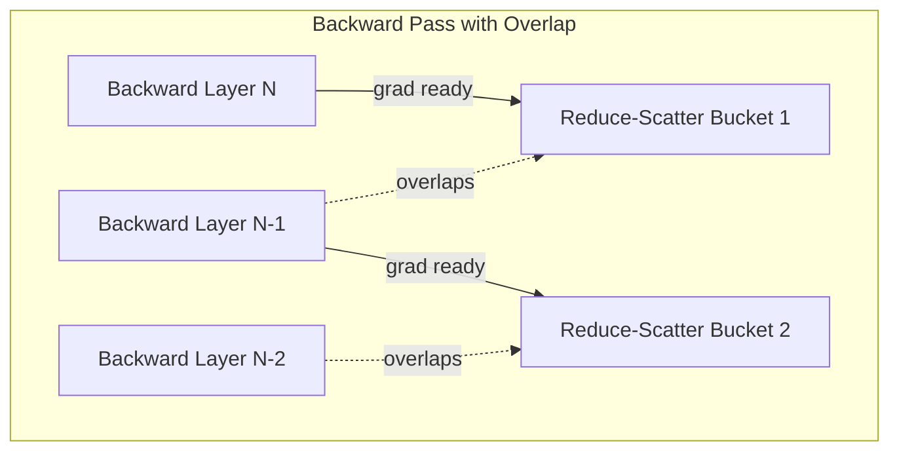
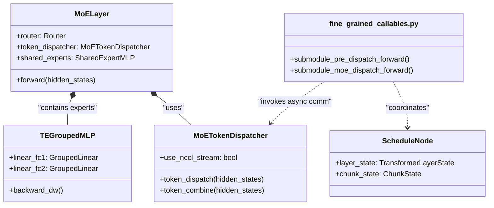

<!-- source: DeepWiki mcp.deepwiki.com · repo NVIDIA/Megatron-LM · page 11.3 Communication and Computation Overlap · fetched 2026-10-26 -->

# Communication and Computation Overlap

Relevant source files

The following files were used as context for generating this wiki page:

- [megatron/core/models/common/fine_grained_callables.py](megatron/core/models/common/fine_grained_callables.py)
- [megatron/core/models/common/model_chunk_schedule_plan.py](megatron/core/models/common/model_chunk_schedule_plan.py)
- [megatron/core/models/gpt/fine_grained_callables.py](megatron/core/models/gpt/fine_grained_callables.py)
- [megatron/core/pipeline_parallel/combined_1f1b.py](megatron/core/pipeline_parallel/combined_1f1b.py)
- [megatron/core/pipeline_parallel/utils.py](megatron/core/pipeline_parallel/utils.py)
- [megatron/core/transformer/moe/README.md](megatron/core/transformer/moe/README.md)
- [megatron/core/transformer/moe/experts.py](megatron/core/transformer/moe/experts.py)
- [megatron/core/transformer/moe/fused_a2a.py](megatron/core/transformer/moe/fused_a2a.py)
- [megatron/core/transformer/moe/moe_layer.py](megatron/core/transformer/moe/moe_layer.py)
- [megatron/core/transformer/moe/moe_utils.py](megatron/core/transformer/moe/moe_utils.py)
- [megatron/core/transformer/moe/paged_stash.py](megatron/core/transformer/moe/paged_stash.py)
- [megatron/core/transformer/moe/router.py](megatron/core/transformer/moe/router.py)
- [megatron/core/transformer/moe/token_dispatcher.py](megatron/core/transformer/moe/token_dispatcher.py)
- [tests/unit_tests/a2a_overlap/test_cuda_graphed_schedule_chunk_1f1b.py](tests/unit_tests/a2a_overlap/test_cuda_graphed_schedule_chunk_1f1b.py)
- [tests/unit_tests/a2a_overlap/test_delay_wgrad_compute.py](tests/unit_tests/a2a_overlap/test_delay_wgrad_compute.py)
- [tests/unit_tests/a2a_overlap/test_fsdp_1f1b_overlap.py](tests/unit_tests/a2a_overlap/test_fsdp_1f1b_overlap.py)
- [tests/unit_tests/a2a_overlap/test_schedule_chunk_1f1b.py](tests/unit_tests/a2a_overlap/test_schedule_chunk_1f1b.py)
- [tests/unit_tests/a2a_overlap/test_schedule_layer_1f1b.py](tests/unit_tests/a2a_overlap/test_schedule_layer_1f1b.py)
- [tests/unit_tests/a2a_overlap/utils.py](tests/unit_tests/a2a_overlap/utils.py)
- [tests/unit_tests/models/test_hybrid_moe_model.py](tests/unit_tests/models/test_hybrid_moe_model.py)
- [tests/unit_tests/transformer/moe/test_aux_loss.py](tests/unit_tests/transformer/moe/test_aux_loss.py)
- [tests/unit_tests/transformer/moe/test_grouped_mlp.py](tests/unit_tests/transformer/moe/test_grouped_mlp.py)
- [tests/unit_tests/transformer/moe/test_paged_stash_runner.py](tests/unit_tests/transformer/moe/test_paged_stash_runner.py)
- [tests/unit_tests/transformer/moe/test_paged_stashing.py](tests/unit_tests/transformer/moe/test_paged_stashing.py)
- [tests/unit_tests/transformer/moe/test_routers.py](tests/unit_tests/transformer/moe/test_routers.py)
- [tests/unit_tests/transformer/moe/test_token_dispatcher.py](tests/unit_tests/transformer/moe/test_token_dispatcher.py)
- [tests/unit_tests/transformer/test_submodule_callables.py](tests/unit_tests/transformer/test_submodule_callables.py)

## Purpose and Scope

This document details the communication and computation overlap strategies implemented in Megatron-LM to hide communication latency behind compute operations. By leveraging asynchronous collectives, contiguous memory buffers, and hardware concurrency, Megatron-LM reduces GPU idle time during data-parallel gradient reductions, pipeline-parallel activations/gradient exchanges, and mixture-of-experts (MoE) token routing.

For details on the contiguous buffer architecture, see [Parameter and Gradient Buffers](#6.4). For general distributed training strategies, see [Parallelism Strategies](#4).

## Data Parallelism (DP) Overlap

### Gradient Reduction Overlap

Gradient reduction overlap allows `reduce-scatter` or `all-reduce` operations to execute concurrently with the backward pass. This is achieved by partitioning model parameters into buckets. As soon as a bucket's gradients are fully computed, a communication collective is launched on a separate stream.

**Diagram: Data Parallel Gradient Overlap Flow**

**Sources**: [megatron/core/distributed/distributed_data_parallel.py:22-42](), [megatron/core/distributed/param_and_grad_buffer.py:159-180]()

#### Implementation via DistributedDataParallel

The `DistributedDataParallel` (DDP) class manages overlap by wrapping parameters in `_ParamAndGradBuffer` objects. Parameters are grouped into `_ParamAndGradBucket` objects, and multiple buckets are aggregated into `_ParamAndGradBucketGroup` to launch asynchronous communications when all gradients in a group are ready.

| Entity | Role | File Location |
|-------|------|---------------|
| `_ParamAndGradBuffer` | Manages contiguous memory for parameters and gradients to enable efficient sharding. | [megatron/core/distributed/param_and_grad_buffer.py:382-390]() |
| `_ParamAndGradBucket` | A subset of parameters/gradients tracked for communication. | [megatron/core/distributed/param_and_grad_buffer.py:72-103]() |
| `_ParamAndGradBucketGroup` | Launches asynchronous `reduce-scatter` or `all-reduce` when gradients are ready. | [megatron/core/distributed/param_and_grad_buffer.py:159-180]() |
| `overlap_grad_reduce` | Configuration flag in `DistributedDataParallelConfig` to enable this behavior. | [megatron/core/distributed/distributed_data_parallel.py:71-72]() |

**Sources**: [megatron/core/distributed/distributed_data_parallel.py:22-109](), [megatron/core/distributed/param_and_grad_buffer.py:72-180]()

## Pipeline Parallelism (PP) Overlap

Pipeline parallelism utilizes microbatching to overlap computation of different microbatches across different pipeline stages.

### Interleaved Pipeline Schedule
The interleaved schedule reduces the pipeline bubble by splitting a transformer block into smaller virtual blocks. This allows stages to start processing the next microbatch sooner.

- **Fine-Grained Callables**: Megatron-LM decomposes the transformer layer into specific callables (e.g., `submodule_pre_dispatch_forward`) to allow the scheduler to insert communication tasks between compute tasks [megatron/core/models/gpt/fine_grained_callables.py:20-51]().
- **Schedule Node Logic**: Advanced overlap is managed via `ScheduleNode` and `TransformerLayerState`, which coordinate execution across CUDA streams [megatron/core/models/gpt/fine_grained_callables.py:67-100]().
- **Fine-Grained Offloading**: `FineGrainedActivationOffloadingInterface` allows overlapping activation offloading to CPU with the forward/backward computation of subsequent layers [megatron/core/models/gpt/fine_grained_callables.py:10-12]().

**Sources**: [megatron/core/models/gpt/fine_grained_callables.py:10-171](), [megatron/core/distributed/distributed_data_parallel.py:101-104]()

## Mixture of Experts (MoE) Overlap

MoE models require significant communication for token routing (Dispatch and Combine). Megatron-LM provides several specialized overlap strategies to hide this latency.

### Flex Dispatcher and Backend Overlap (DeepEP / HybridEP)

The `MoEFlexTokenDispatcher` supports high-performance backends like `DeepEP` and `HybridEP` that are designed for overlap.

- **DeepEP Integration**: Supports H100/B200 architectures for efficient token dispatching [megatron/core/transformer/moe/README.md:33-33]().
- **HybridEP Backend**: Enables asynchronous communication in the Flex Dispatcher for GB200 and H100 [megatron/core/transformer/moe/README.md:16-16]().
- **Asynchronous Stream Management**: The `MoETokenDispatcher` can use a dedicated NCCL stream for All-to-All communication to overlap with shared expert computation [megatron/core/transformer/moe/token_dispatcher.py:80-81]().

**Sources**: [megatron/core/transformer/moe/token_dispatcher.py:63-110](), [megatron/core/transformer/moe/README.md:16-36](), [megatron/core/transformer/moe/fused_a2a.py:22-36]()

### Shared Expert Overlap

In architectures like DeepSeek-V3, "shared experts" (dense MLPs) run alongside routed experts. Megatron-LM overlaps the shared expert GEMM with the `All-to-All` communication of the routed experts.

- **Overlap Strategy**: The `MoELayer` triggers `shared_experts_compute` while the `token_dispatcher` is performing the dispatch All-to-All [megatron/core/models/gpt/fine_grained_callables.py:125-130]().
- **Configurability**: Controlled via `moe_shared_expert_overlap` in `TransformerConfig` [megatron/core/transformer/moe/moe_layer.py:191-191]().

**Sources**: [megatron/core/models/gpt/fine_grained_callables.py:125-148](), [megatron/core/transformer/moe/moe_layer.py:190-192]()

### Delaying Weight Gradients (wgrad)

To further hide communication, Megatron-LM can delay expert weight gradient computation. This allows the backward pass of the communication (Combine) to overlap with the weight gradient computation of the experts.

- **Implementation**: The `delay_wgrad_compute` flag in `TransformerConfig` enables this behavior, particularly useful for hiding EP-A2A communication [megatron/core/transformer/moe/README.md:20-20]().
- **Grouped GEMM Integration**: When using `TEGroupedMLP`, weight gradient computation (`backward_dw`) can be triggered independently of the activation gradients [megatron/core/transformer/moe/experts.py:101-103]().

**Sources**: [megatron/core/transformer/moe/README.md:20-22](), [megatron/core/transformer/moe/experts.py:92-140]()

## Distributed Optimizer Overlap

The `DistributedOptimizer` shards optimizer states across DP ranks and overlaps the `all-gather` of parameters with the forward pass.

- **Contiguous Sharding**: Parameters are sharded into ranges within a contiguous `_ParamAndGradBuffer` [megatron/core/optimizer/distrib_optimizer.py:67-100]().
- **Async All-Gather**: Uses `_LayerwiseAllGatherHandle` to track asynchronous parameter gathers, ensuring the next layer's parameters are ready before computation begins [megatron/core/distributed/param_and_grad_buffer.py:142-158]().

**Sources**: [megatron/core/optimizer/distrib_optimizer.py:102-186](), [megatron/core/distributed/param_and_grad_buffer.py:128-158]()

## Code Entity Mapping

The following diagram maps overlap strategies to specific classes and modules in the Megatron-Core codebase.

**Diagram: MoE Overlap System Code Entities**

**Sources**: [megatron/core/transformer/moe/moe_layer.py:214-230](), [megatron/core/transformer/moe/token_dispatcher.py:63-92](), [megatron/core/transformer/moe/experts.py:183-205](), [megatron/core/models/gpt/fine_grained_callables.py:20-66]()

## Summary of Overlap Configuration

| Feature | Config Attribute | File Pointer |
|---------|------------------|--------------|
| DP Gradient Overlap | `overlap_grad_reduce` | [megatron/core/distributed/distributed_data_parallel.py:71]() |
| MoE Shared Expert Overlap | `moe_shared_expert_overlap` | [megatron/core/transformer/moe/moe_layer.py:191]() |
| MoE Delay Wgrad | `delay_wgrad_compute` | [megatron/core/transformer/moe/experts.py:72]() |
| MoE Flex Dispatcher | `moe_token_dispatcher_type='flex'` | [megatron/core/transformer/moe/token_dispatcher.py:28]() |
| Distributed Optimizer | `use_distributed_optimizer` | [megatron/core/optimizer/distrib_optimizer.py:102]() |

**Sources**: [megatron/core/distributed/distributed_data_parallel.py:71-74](), [megatron/core/transformer/moe/moe_layer.py:190-192](), [megatron/core/transformer/moe/experts.py:67-76](), [megatron/core/optimizer/distrib_optimizer.py:102-121]()

---

