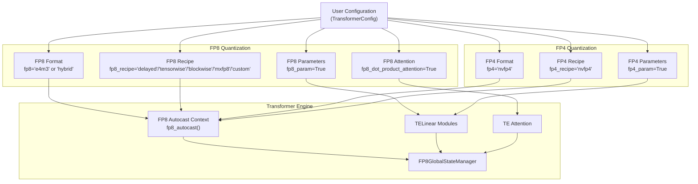
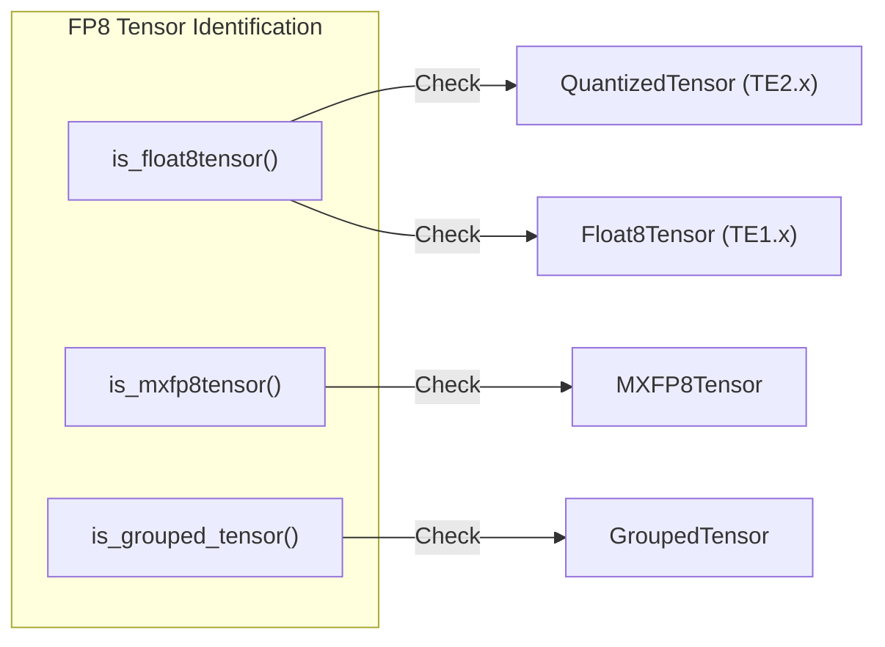
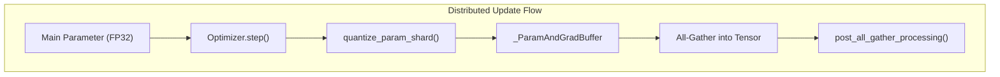

<!-- source: DeepWiki mcp.deepwiki.com · repo NVIDIA/Megatron-LM · page 11.4 FP8 and FP4 Quantization · fetched 2026-10-26 -->

# FP8 and FP4 Quantization

Relevant source files

The following files were used as context for generating this wiki page:

- [megatron/core/distributed/distributed_data_parallel.py](megatron/core/distributed/distributed_data_parallel.py)
- [megatron/core/distributed/param_and_grad_buffer.py](megatron/core/distributed/param_and_grad_buffer.py)
- [megatron/core/enums.py](megatron/core/enums.py)
- [megatron/core/fp4_utils.py](megatron/core/fp4_utils.py)
- [megatron/core/fp8_utils.py](megatron/core/fp8_utils.py)
- [megatron/core/optimizer/__init__.py](megatron/core/optimizer/__init__.py)
- [megatron/core/optimizer/clip_grads.py](megatron/core/optimizer/clip_grads.py)
- [megatron/core/optimizer/cpu_offloading/README.md](megatron/core/optimizer/cpu_offloading/README.md)
- [megatron/core/optimizer/cpu_offloading/__init__.py](megatron/core/optimizer/cpu_offloading/__init__.py)
- [megatron/core/optimizer/cpu_offloading/hybrid_optimizer.py](megatron/core/optimizer/cpu_offloading/hybrid_optimizer.py)
- [megatron/core/optimizer/distrib_optimizer.py](megatron/core/optimizer/distrib_optimizer.py)
- [megatron/core/optimizer/optimizer.py](megatron/core/optimizer/optimizer.py)
- [megatron/core/optimizer/optimizer_config.py](megatron/core/optimizer/optimizer_config.py)
- [megatron/core/transformer/enums.py](megatron/core/transformer/enums.py)
- [tests/unit_tests/distributed/test_param_and_grad_buffer.py](tests/unit_tests/distributed/test_param_and_grad_buffer.py)
- [tests/unit_tests/optimizer/test_distrib_optimizer_grouped_quantized.py](tests/unit_tests/optimizer/test_distrib_optimizer_grouped_quantized.py)
- [tests/unit_tests/test_fp8_param.py](tests/unit_tests/test_fp8_param.py)
- [tests/unit_tests/test_fp8_utils.py](tests/unit_tests/test_fp8_utils.py)
- [tests/unit_tests/test_optimizer.py](tests/unit_tests/test_optimizer.py)
- [tests/unit_tests/test_optimizer_cpu_offloading.py](tests/unit_tests/test_optimizer_cpu_offloading.py)
- [tests/unit_tests/transformer/test_module.py](tests/unit_tests/transformer/test_module.py)

This page documents FP8 and FP4 quantization support in Megatron-LM, including configuration options, recipes, Transformer Engine (TE) integration, and the Kitchen quantization framework. FP8/FP4 training reduces memory footprint and accelerates training on modern GPUs (Hopper and later architectures).

For general mixed-precision training (FP16/BF16), see [Gradient Scaling and Mixed Precision](#6.3). For optimizer-specific quantization features, see [Distributed Optimizer](#6.2).

## Quantization Overview

Megatron-LM supports multiple quantization strategies through Transformer Engine (TE) integration and internal utilities:

**Sources:**
- [megatron/core/fp8_utils.py:122-131]()
- [megatron/core/optimizer/optimizer_config.py:171-183]()

## FP8 Configuration

### OptimizerConfig FP8 Fields

FP8 training behavior is influenced by `OptimizerConfig` fields, particularly when using the distributed optimizer:

| Field | Type | Default | Description |
|-------|------|---------|-------------|
| `fp8_recipe` | Optional[str] | None | The type of fp8 recipe affecting processing logic in the distributed optimizer. [megatron/core/optimizer/optimizer_config.py:171-173]() |
| `reuse_grad_buf_for_mxfp8_param_ag` | bool | False | If True, reuse grad buffer for param All-Gather when using mxfp8. [megatron/core/optimizer/optimizer_config.py:180-183]() |

**Sources:**
- [megatron/core/optimizer/optimizer_config.py:171-183]()

### FP8 Recipes

Recipes determine how scaling factors are computed and applied. Supporting various levels of granularity, the system identifies tensors based on their TE class inheritance:

**Sources:**
- [megatron/core/fp8_utils.py:122-143]()
- [megatron/core/enums.py:26]()

## FP8 and FP4 Parameters

### Parameter Quantization and Buffers

When using quantized parameters (FP8 or FP4), Megatron-LM manages them through the `_ParamAndGradBuffer` system. This ensures that parameters are properly sharded and gathered while maintaining their quantized storage metadata.

The function `_param_uses_quantized_storage` identifies parameters that own TE quantized storage instead of plain tensor storage [megatron/core/distributed/param_and_grad_buffer.py:81-90](). This includes:
- `is_float8tensor(param)` [megatron/core/fp8_utils.py:122-131]()
- `is_nvfp4tensor(param)` [megatron/core/fp4_utils.py:23-29]()
- `is_grouped_tensor_with_quantized_storage(param)` [megatron/core/fp8_utils.py:144-151]()

### Distributed Optimizer Interaction

The `DistributedOptimizer` handles the specifics of sharding and updating these quantized parameters. It utilizes utilities to perform quantization on shards before all-gather operations:

- `quantize_param_shard`: Quantizes a parameter shard to FP8 [megatron/core/fp8_utils.py:193-214]().
- `quantize_nvfp4_param_shard`: Quantizes a parameter shard to NVFP4 [megatron/core/fp4_utils.py:55-58]().
- `dequantize_fp8_tensor`: Converts FP8 tensors back to high precision (BF16/FP32) for optimizer updates [megatron/core/fp8_utils.py:215-225]().

**Sources:**
- [megatron/core/optimizer/distrib_optimizer.py:55-62]()
- [megatron/core/distributed/param_and_grad_buffer.py:30-41]()

### Grouped Quantization

For performance, multiple quantized tensors can be managed as a `GroupedTensor`. This is particularly common in architectures where weights are processed in batches.
- `is_grouped_tensor_with_quantized_storage` checks if a `GroupedTensor` owns quantized primary storage [megatron/core/fp8_utils.py:144-151]().
- `get_grouped_quantized_members` provides views into individual member tensors of a group [megatron/core/fp8_utils.py:173-191]().

**Sources:**
- [megatron/core/fp8_utils.py:144-191]()
- [megatron/core/distributed/param_and_grad_buffer.py:81-90]()

## FP4 Quantization

### FP4 Implementation Details

FP4 support (NVFP4) is integrated into the buffer and optimizer logic. It involves specialized storage modification to handle row-wise packing:

- `modify_nvfp4_rowwise_storage`: Updates the underlying storage for NVFP4 tensors during sharding/gathering [megatron/core/fp4_utils.py:23-29]().
- `get_nvfp4_rowwise_packed_shape`: Computes the required dimensions for packed 4-bit data [megatron/core/fp4_utils.py:19-22]().

The `DistributedDataParallel` module respects these formats during gradient reduction. If `grad_reduce_in_fp32` is enabled in `DistributedDataParallelConfig`, gradients are accumulated in FP32 regardless of the parameter's quantized storage type [megatron/core/distributed/distributed_data_parallel.py:92-93]().

**Sources:**
- [megatron/core/fp4_utils.py:19-58]()
- [megatron/core/distributed/param_and_grad_buffer.py:23-29]()
- [megatron/core/distributed/distributed_data_parallel.py:87-107]()

## Transformer Engine Integration

Megatron-LM relies on `transformer_engine` for the core quantization kernels. If TE is unavailable, the codebase falls back to local implementations or issues warnings [megatron/core/optimizer/optimizer.py:17-39]().

Key integration points:
- `multi_tensor_applier`: Used for efficient scaling and norm calculation across multiple quantized tensors [megatron/core/optimizer/clip_grads.py:11-21]().
- `te_post_all_gather_processing`: Invoked after parameter gathering to finalize quantized state metadata [megatron/core/fp8_utils.py:97-101]().

**Sources:**
- [megatron/core/fp8_utils.py:73-88]()
- [megatron/core/optimizer/optimizer.py:17-39]()

## Key Implementation Files

| File | Purpose |
|------|---------|
| [megatron/core/fp8_utils.py]() | Identification and quantization/dequantization for FP8 tensors. |
| [megatron/core/fp4_utils.py]() | Specialized handling for NVFP4 (4-bit) row-wise packed tensors. |
| [megatron/core/optimizer/optimizer_config.py]() | Defines `fp8_recipe` and precision-aware optimizer settings. |
| [megatron/core/optimizer/distrib_optimizer.py]() | Implements sharded parameter updates for quantized types. |
| [megatron/core/distributed/param_and_grad_buffer.py]() | Manages contiguous memory for params/grads, including quantized storage. |
| [megatron/core/optimizer/clip_grads.py]() | Handles gradient norm calculation and clipping for mixed-precision/quantized training. |

**Sources:**
- [megatron/core/fp8_utils.py:1-225]()
- [megatron/core/fp4_utils.py:1-58]()
- [megatron/core/optimizer/distrib_optimizer.py:113-195]()
- [megatron/core/distributed/param_and_grad_buffer.py:81-110]()

---

