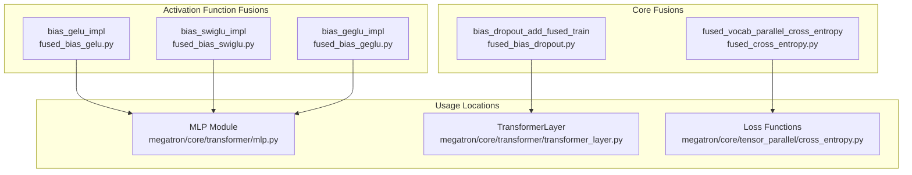
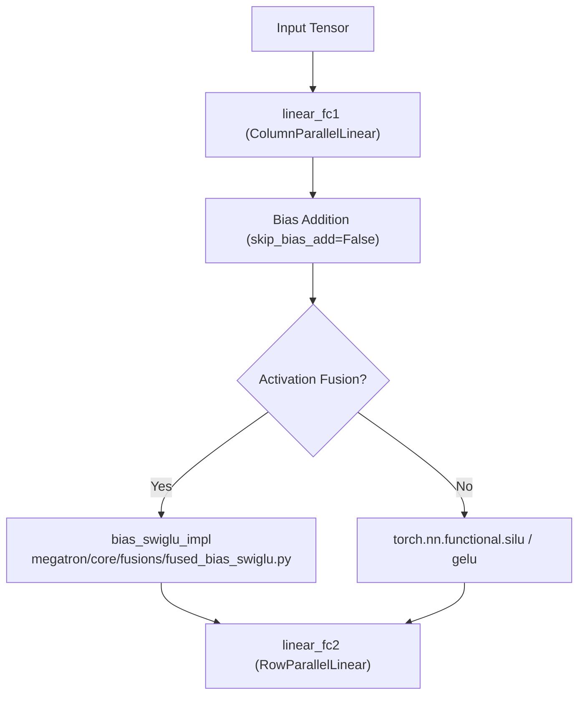
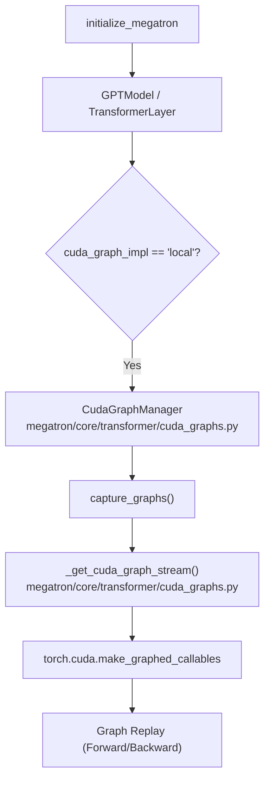

<!-- source: DeepWiki mcp.deepwiki.com · repo NVIDIA/Megatron-LM · page 11.5 Fused Kernels and Custom Operations · fetched 2026-10-26 -->

# Fused Kernels and Custom Operations

Relevant source files

The following files were used as context for generating this wiki page:

- [megatron/core/extensions/transformer_engine.py](megatron/core/extensions/transformer_engine.py)
- [megatron/core/fusions/fused_bias_dropout.py](megatron/core/fusions/fused_bias_dropout.py)
- [megatron/core/fusions/fused_bias_swiglu.py](megatron/core/fusions/fused_bias_swiglu.py)
- [megatron/core/fusions/fused_cross_entropy.py](megatron/core/fusions/fused_cross_entropy.py)
- [megatron/core/models/gpt/gpt_model.py](megatron/core/models/gpt/gpt_model.py)
- [megatron/core/tensor_parallel/__init__.py](megatron/core/tensor_parallel/__init__.py)
- [megatron/core/tensor_parallel/cross_entropy.py](megatron/core/tensor_parallel/cross_entropy.py)
- [megatron/core/tensor_parallel/layers.py](megatron/core/tensor_parallel/layers.py)
- [megatron/core/tensor_parallel/random.py](megatron/core/tensor_parallel/random.py)
- [megatron/core/tensor_parallel/utils.py](megatron/core/tensor_parallel/utils.py)
- [megatron/core/transformer/attention.py](megatron/core/transformer/attention.py)
- [megatron/core/transformer/cuda_graphs.py](megatron/core/transformer/cuda_graphs.py)
- [megatron/core/transformer/identity_op.py](megatron/core/transformer/identity_op.py)
- [megatron/core/transformer/mlp.py](megatron/core/transformer/mlp.py)
- [megatron/core/transformer/module.py](megatron/core/transformer/module.py)
- [megatron/core/transformer/torch_norm.py](megatron/core/transformer/torch_norm.py)
- [megatron/core/transformer/transformer_block.py](megatron/core/transformer/transformer_block.py)
- [megatron/core/transformer/transformer_config.py](megatron/core/transformer/transformer_config.py)
- [megatron/core/transformer/transformer_layer.py](megatron/core/transformer/transformer_layer.py)
- [megatron/core/transformer/utils.py](megatron/core/transformer/utils.py)
- [megatron/core/utils.py](megatron/core/utils.py)
- [tests/unit_tests/fusions/test_bias_dropout_fusion.py](tests/unit_tests/fusions/test_bias_dropout_fusion.py)
- [tests/unit_tests/fusions/test_swiglu_fusion.py](tests/unit_tests/fusions/test_swiglu_fusion.py)
- [tests/unit_tests/tensor_parallel/test_cross_entropy.py](tests/unit_tests/tensor_parallel/test_cross_entropy.py)
- [tests/unit_tests/tensor_parallel/test_random.py](tests/unit_tests/tensor_parallel/test_random.py)
- [tests/unit_tests/transformer/test_cuda_graphs.py](tests/unit_tests/transformer/test_cuda_graphs.py)
- [tests/unit_tests/transformer/test_utils.py](tests/unit_tests/transformer/test_utils.py)

## Purpose and Scope

This page documents the fused kernel implementations and custom CUDA operations used throughout Megatron-LM to optimize performance-critical operations. Fused kernels combine multiple operations into a single CUDA kernel launch, reducing memory bandwidth requirements and kernel launch overhead. This page covers activation function fusions (Bias-GELU, SwiGLU, etc.), dropout-add fusions, fused cross-entropy, and specialized CUDA/Triton kernels.

For general information about optimization strategies, see [Advanced Features and Optimizations](11). For FP8/FP4 quantization specifically, see [FP8 and FP4 Quantization](11.4). For Transformer Engine integration details, see [Transformer Engine Integration](2.6).

---

## Overview of Fused Operations

Megatron-LM implements numerous fused kernels that combine operations to improve computational efficiency. These fusions are categorized into several groups based on their purpose and location in the model architecture.

### System Entity Map: Fusions to Code Entities
The following diagram maps high-level fused operations to their specific implementation functions and the modules that consume them.

Title: Fused Operation Architecture and Code Mapping

Sources: [megatron/core/fusions/fused_bias_dropout.py:70-80](), [megatron/core/fusions/fused_cross_entropy.py:136-148](), [megatron/core/transformer/mlp.py:19-25]()

---

## Bias-Dropout-Add Fusion

The `bias_dropout_add` operation is a critical fusion point in the Transformer block, occurring at the end of both the self-attention and MLP sub-layers where the residual connection is applied.

### Implementation Details
The fusion is implemented using PyTorch's JIT fuser (`@jit_fuser`) to combine bias addition, dropout, and residual addition into a single kernel [megatron/core/fusions/fused_bias_dropout.py:69-73]().

- **Function:** `_bias_dropout_add_func` [megatron/core/fusions/fused_bias_dropout.py:11-59]()
- **In-place Optimization:** During inference or when gradients are not required, the kernel performs in-place additions to save memory [megatron/core/fusions/fused_bias_dropout.py:22-27]().
- **Numerical Precision:** For models using `fp32_residual_connection`, the kernel upcasts the input and bias to match the residual's `fp32` dtype, ensuring precision is maintained across deep stacks [megatron/core/fusions/fused_bias_dropout.py:29-37]().
- **Usage:** In `TransformerLayer`, this fusion is typically invoked via `bias_dropout_add_fused_train` or `bias_dropout_add_fused_inference` [megatron/core/fusions/fused_bias_dropout.py:70-94]().

Sources: [megatron/core/fusions/fused_bias_dropout.py:11-94](), [megatron/core/transformer/transformer_layer.py:30-39]()

---

## Fused Vocab-Parallel Cross Entropy

Calculating cross-entropy loss over a vocabulary sharded across multiple GPUs (Tensor Parallelism) involves multiple communication and computation steps. The fused implementation minimizes these overheads.

### Workflow and Communication
The `fused_vocab_parallel_cross_entropy` function wraps a custom `torch.autograd.Function` that batches operations to reduce the number of `all_reduce` calls [megatron/core/fusions/fused_cross_entropy.py:136-148]().

1. **Logits Max:** Computes the local max and performs a single `all_reduce` (MAX) to get the global maximum for numerical stability [megatron/core/fusions/fused_cross_entropy.py:93-94]().
2. **Predicted Logits & Sum Exp:** Calculates local predicted logits and the sum of exponentials. These are concatenated into a single tensor for a combined `all_reduce` (SUM) [megatron/core/fusions/fused_cross_entropy.py:103-114]().
3. **Loss Calculation:** Computes the final CE loss and stores the softmax results for the backward pass [megatron/core/fusions/fused_cross_entropy.py:116-121]().

Sources: [megatron/core/fusions/fused_cross_entropy.py:87-134](), [megatron/core/tensor_parallel/cross_entropy.py:16-83]()

---

## Activation Function Fusions

Megatron-LM implements numerous fused kernels that combine bias addition with activation functions. These are primarily used in the `MLP` module [megatron/core/transformer/mlp.py:149-164]().

### Bias-GELU, SwiGLU, and GEGLU
The `MLP` module selects the appropriate fusion based on the `TransformerConfig`. For Gated Linear Units (GLU), the implementation uses a stride of 2 to handle interleaved [gate, up] portions across TP ranks [megatron/core/transformer/mlp.py:200-204]().

| Operation | Implementation Function | Logic |
|-----------|-------------------------|-------|
| **BiasGELU** | `bias_gelu_impl` | Fuses `x + bias` with GELU [megatron/core/fusions/fused_bias_gelu.py:24-24](). |
| **BiasSwiGLU** | `bias_swiglu_impl` | Fuses `x + bias` with SwiGLU gating logic [megatron/core/fusions/fused_bias_swiglu.py:25-25](). |
| **BiasGEGLU** | `bias_geglu_impl` | Fuses `x + bias` with GEGLU gating logic [megatron/core/fusions/fused_bias_geglu.py:20-20](). |
| **Weighted SwiGLU** | `weighted_bias_swiglu_impl` | Supports weighted gating, often used in MoE or specialized architectures [megatron/core/transformer/mlp.py:25-25](). |

Title: MLP Activation and Fusion Data Flow

Sources: [megatron/core/transformer/mlp.py:198-230](), [megatron/core/fusions/fused_bias_swiglu.py:20-30](), [megatron/core/transformer/transformer_config.py:31-31]()

---

## CUDA Graphs Integration

Fused kernels are often executed within CUDA Graphs to further reduce CPU overhead. Megatron-Core provides a `CudaGraphManager` to handle the capture and replay of these fused operations [megatron/core/transformer/cuda_graphs.py:177-178]().

### Graphable Modules
Modules like `TransformerLayer` and `GPTModel` can be wrapped to capture their entire forward (and optionally backward) pass into a graph [megatron/core/models/gpt/gpt_model.py:52-52](), [megatron/core/transformer/module.py:159-165]().

- **Local Implementation:** Uses the MCore `CudaGraphManager` to manage capture streams and memory pools [megatron/core/transformer/cuda_graphs.py:106-150](), [megatron/core/transformer/cuda_graphs.py:177-178]().
- **Transformer Engine Integration:** Leverages TE's `make_graphed_callables` for FP8-aware graph capture, ensuring that FP8 parameter caches and amax reductions are handled correctly within the graph [megatron/core/transformer/cuda_graphs.py:46-51]().
- **GTP Integration:** When using GPU-Tenant Parallelism (GTP), the graph capture tracks asynchronous communication streams for all-gather and reduce-scatter operations [megatron/core/transformer/cuda_graphs.py:68-77]().

Title: CUDA Graph Capture and Replay Lifecycle

Sources: [megatron/core/transformer/cuda_graphs.py:106-150](), [megatron/core/transformer/module.py:159-180](), [megatron/core/models/gpt/gpt_model.py:32-32]()

---

## Configuration of Fused Kernels

Fused operations are controlled via the `TransformerConfig` and `ModelParallelConfig` classes.

| Parameter | Default | Purpose |
|-----------|---------|---------|
| `bias_activation_fusion` | `False` | Enable fusion of bias and activation in MLP [megatron/core/transformer/transformer_config.py:171-175]() |
| `bias_dropout_fusion` | `False` | Enable fusion of bias, dropout, and residual add [megatron/core/transformer/transformer_config.py:171-175]() |
| `apply_rope_fusion` | `False` | Use fused RoPE kernels (e.g., from Transformer Engine) [megatron/core/transformer/attention.py:132-136]() |
| `tp_comm_overlap` | `False` | Enable overlapping of Tensor Parallel communication with GEMM kernels [megatron/core/transformer/transformer_config.py:158-161]() |
| `cuda_graph_impl` | `None` | Set to `'local'` to enable Megatron-Core's CUDA graph manager [megatron/core/transformer/transformer_config.py:173-173]() |

Sources: [megatron/core/transformer/transformer_config.py:138-175](), [megatron/core/transformer/attention.py:132-136]()

---

