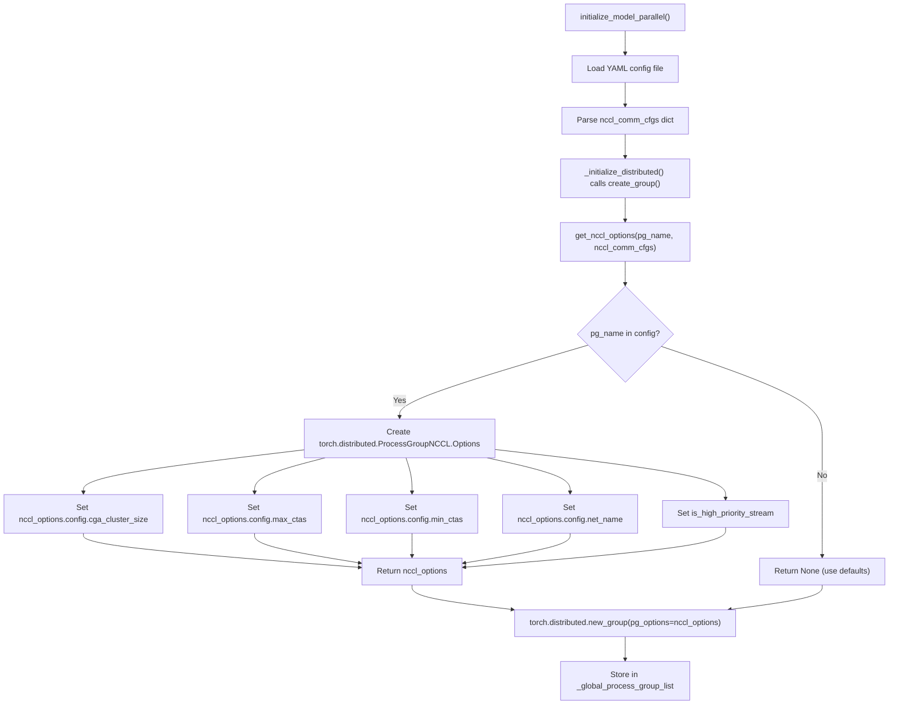
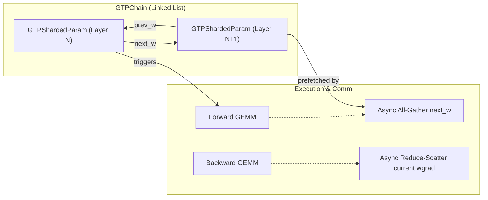
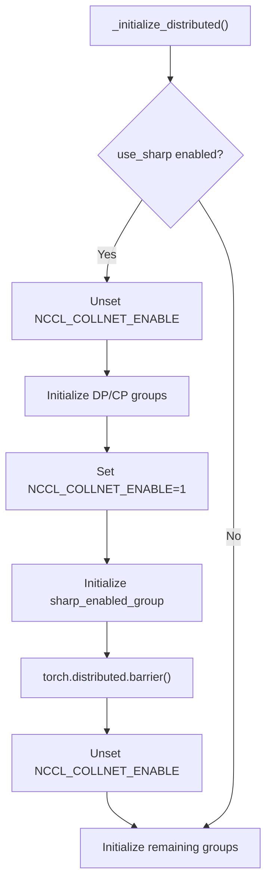

<!-- source: DeepWiki mcp.deepwiki.com · repo NVIDIA/Megatron-LM · page 11.6 NCCL and Communication Optimization · fetched 2026-10-26 -->

# NCCL and Communication Optimization

<details>
<summary>Relevant source files</summary>

The following files were used as context for generating this wiki page:

- [docs/api-guide/core/generalized_tensor_parallel.md](docs/api-guide/core/generalized_tensor_parallel.md)
- [docs/images/generalized_tensor_parallel/0725_gtp_grouped_oneblock_prefetch.png](docs/images/generalized_tensor_parallel/0725_gtp_grouped_oneblock_prefetch.png)
- [megatron/core/process_groups_config.py](megatron/core/process_groups_config.py)
- [megatron/core/tensor_parallel/generalized_tensor_parallelism.py](megatron/core/tensor_parallel/generalized_tensor_parallelism.py)
- [megatron/core/tensor_parallel/gtp_api.py](megatron/core/tensor_parallel/gtp_api.py)
- [megatron/core/tensor_parallel/gtp_cuda_graphs.py](megatron/core/tensor_parallel/gtp_cuda_graphs.py)
- [tests/unit_tests/distributed/test_distributed_data_parallel.py](tests/unit_tests/distributed/test_distributed_data_parallel.py)
- [tests/unit_tests/distributed/test_param_readiness.py](tests/unit_tests/distributed/test_param_readiness.py)
- [tests/unit_tests/generalized_tensor_parallel/gtp_test_utils.py](tests/unit_tests/generalized_tensor_parallel/gtp_test_utils.py)
- [tests/unit_tests/generalized_tensor_parallel/test_gtp_basics.py](tests/unit_tests/generalized_tensor_parallel/test_gtp_basics.py)
- [tests/unit_tests/generalized_tensor_parallel/test_gtp_dcp.py](tests/unit_tests/generalized_tensor_parallel/test_gtp_dcp.py)
- [tests/unit_tests/generalized_tensor_parallel/test_gtp_ddp_param_sync_race.py](tests/unit_tests/generalized_tensor_parallel/test_gtp_ddp_param_sync_race.py)
- [tests/unit_tests/generalized_tensor_parallel/test_gtp_grad_correctness.py](tests/unit_tests/generalized_tensor_parallel/test_gtp_grad_correctness.py)
- [tests/unit_tests/generalized_tensor_parallel/test_gtp_mtp.py](tests/unit_tests/generalized_tensor_parallel/test_gtp_mtp.py)
- [tests/unit_tests/generalized_tensor_parallel/test_gtp_muon_dcp.py](tests/unit_tests/generalized_tensor_parallel/test_gtp_muon_dcp.py)
- [tests/unit_tests/generalized_tensor_parallel/test_gtp_partial_cg.py](tests/unit_tests/generalized_tensor_parallel/test_gtp_partial_cg.py)
- [tests/unit_tests/generalized_tensor_parallel/test_gtp_recompute_chain.py](tests/unit_tests/generalized_tensor_parallel/test_gtp_recompute_chain.py)
- [tests/unit_tests/inference/test_communication_utils.py](tests/unit_tests/inference/test_communication_utils.py)
- [tests/unit_tests/test_hyper_comm_grid.py](tests/unit_tests/test_hyper_comm_grid.py)
- [tests/unit_tests/test_process_groups_config.py](tests/unit_tests/test_process_groups_config.py)
- [tests/unit_tests/transformer/test_transformer_block_custom_pgs.py](tests/unit_tests/transformer/test_transformer_block_custom_pgs.py)

</details>


## Purpose and Scope

This page documents Megatron-LM's NCCL (NVIDIA Collective Communications Library) configuration system and communication optimization techniques. It covers per-group NCCL tuning, SHARP support for InfiniBand acceleration, high-priority communication streams, and tensor-parallel communication overlap strategies. These optimizations are critical for achieving high performance in large-scale distributed training by minimizing communication overhead and maximizing hardware utilization.

A major focus of recent development is **Generalized Tensor Parallelism (GTP)**, which introduces fine-grained, asynchronous weight rematerialization (ZeRO-3 on top of TP) to further optimize memory and communication.

For general information about parallelism strategies, see [Parallelism Strategies](). For pipeline-parallel communication patterns, see [Pipeline Parallelism](). For computation/communication overlap techniques, see [Communication and Computation Overlap]().

---

## NCCL Configuration System

Megatron-LM provides a flexible system for configuring NCCL parameters on a per-process-group basis. This allows fine-tuning of communication performance for different types of parallelism (tensor, pipeline, data, context, expert).

### Configuration File Format

NCCL configurations are specified via a YAML file passed through the `--nccl-communicator-config-path` argument. The file maps process group names to NCCL parameters:

```yaml
dp:
  cga_cluster_size: 4
  max_ctas: 32
  min_ctas: 1
  is_high_priority_stream: true

tp:
  cga_cluster_size: 2
  max_ctas: 16
```

### Supported Process Group Names

| Group Name | Description |
|------------|-------------|
| `dp` | Data parallel group |
| `dp_cp` | Data parallel with context parallel combined |
| `tp` | Tensor parallel group |
| `cp` | Context parallel group |
| `pp` | Pipeline parallel group |
| `ep` | Expert parallel group |
| `mp` | Model parallel group (TP + PP) |
| `gtp_remat` | Generalized Tensor Parallel weight rematerialization group |

Sources: [megatron/core/process_groups_config.py:75-169](), [megatron/core/parallel_state.py:149-184]()

---

## NCCL Options Configuration Flow

The following diagram illustrates how the `parallel_state` module translates user configuration into live NCCL process groups.

### Natural Language to Code Entity Space: NCCL Initialization


Sources: [megatron/core/parallel_state.py:149-184](), [megatron/training/initialize.py:104-109]()

---

## Generalized Tensor Parallelism (GTP)

GTP factors the weight-parallel domain into `TP x GTP_remat`. A weight is sharded `1/(TP * GTP_remat)` along its partition dimension. While the `TP` slice stays sharded through the GEMM, the `GTP_remat` slice is rematerialized just before the GEMM using asynchronous all-gathers [megatron/core/tensor_parallel/generalized_tensor_parallelism.py:5-13]().

### Communication Patterns in GTP
GTP utilizes a prefetch chain to overlap communication with computation. Each `GTPShardedParam` manages its own communication state machine:
*   **All-Gather (AG):** Reconstructs the full TP slice before the GEMM [docs/api-guide/core/generalized_tensor_parallel.md:7-13]().
*   **Reduce-Scatter (RS):** Reduces the gradient back to the sharded form during the backward pass [docs/api-guide/core/generalized_tensor_parallel.md:11-14]().

### Natural Language to Code Entity Space: GTP Prefetch Chain


Sources: [megatron/core/tensor_parallel/generalized_tensor_parallelism.py:107-130](), [docs/api-guide/core/generalized_tensor_parallel.md:80-83]()

---

## High-Priority Streams

High-priority streams ensure communication kernels are scheduled with higher priority by the CUDA kernel scheduler, minimizing exposed communication when overlapped with compute kernels. This is particularly important for Data Parallel (DP) and Expert Parallel (EP) reductions that occur during the backward pass.

### Configuration

High-priority streams can be enabled through the `--high-priority-stream-groups` argument, which is processed during the construction of `ProcessGroupNCCL.Options` in `get_nccl_options`.

Sources: [megatron/core/parallel_state.py:162-164]()

---

## SHARP Support for InfiniBand

SHARP (Scalable Hierarchical Aggregation and Reduction Protocol) offloads collective operations (like `AllReduce`) to InfiniBand switches.

### Implementation Details

Megatron-LM manages SHARP by toggling the `NCCL_COLLNET_ENABLE` environment variable during the initialization of specific process groups. Because of hardware limitations, typically only one communicator group can use SHARP (usually the Data Parallel group).

### SHARP Setup Logic


Sources: [megatron/core/parallel_state.py:844-938]()

---

## Communication Backends

While NCCL is the primary backend, Megatron-LM supports alternatives for specific use cases:

*   **UCC (Unified Collective Communication):** Can be used for pipeline-parallel communication via `pipeline_model_parallel_comm_backend` in `ModelParallelConfig`. It is designed to reduce SM usage on the GPU. [megatron/core/model_parallel_config.py:23-26]()
*   **Gloo:** Used for CPU-side operations (e.g., `_DATA_PARALLEL_GROUP_GLOO`) or as a fallback for specific expert data parallel groups. [megatron/core/parallel_state.py:41](), [megatron/core/parallel_state.py:63]()

Sources: [megatron/core/model_parallel_config.py:23-26](), [megatron/core/parallel_state.py:41-63]()

---

## Pipeline Parallel Point-to-Point Communication

The `P2PCommunicator` handles the complex logic of sending and receiving tensors between pipeline stages. It supports batched operations to reduce overhead and handles shape synchronization when sequence lengths are dynamic.

### Key Primitives in P2P
The implementation uses `torch.distributed.batch_isend_irecv` to group operations, which is more efficient than individual calls.

| Function | Description |
|----------|-------------|
| `_batched_p2p_ops` | Wraps multiple `P2POp` objects into a single batch call. |
| `_p2p_ops` | Handles the ordering of sends and receives to avoid deadlocks (even ranks send then receive, odd ranks receive then send). |

Sources: [megatron/core/pipeline_parallel/p2p_communication.py:17-52](), [megatron/core/pipeline_parallel/p2p_communication.py:55-128](), [megatron/core/pipeline_parallel/p2p_communication.py:140-185]()

---

## Summary of Communication Primitives

Megatron-LM uses the following standard NCCL collectives, often wrapped in utility functions to handle sharding and memory management:

| Primitive | Usage | Key Code Entity |
|-----------|-------|-----------------|
| `AllReduce` | DDP (Dense Params), TP (Grads) | `_reduce` in `tensor_parallel/mappings.py` |
| `ReduceScatter` | Distributed Optimizer Grads / Sequence Parallel / GTP wgrad | `_reduce_scatter_along_first_dim` in `tensor_parallel/mappings.py` |
| `AllGather` | Distributed Optimizer Params / Sequence Parallel / GTP weights | `_gather_along_first_dim` in `tensor_parallel/mappings.py` |
| `P2P (Send/Recv)` | Pipeline Parallelism | `P2PCommunicator` in `pipeline_parallel/p2p_communication.py` |
| `AllToAll` | Expert Parallelism (MoE) | Token Dispatchers |

### Global Memory Buffer
To avoid frequent dynamic memory allocations during collectives, Megatron-LM utilizes a `GlobalMemoryBuffer` via `get_global_memory_buffer()`. This is particularly used in `_gather_along_first_dim` and `_reduce_scatter_along_first_dim` to provide scratch space for communication.

Sources: [megatron/core/tensor_parallel/mappings.py:22-37](), [megatron/core/tensor_parallel/mappings.py:118-156](), [megatron/core/tensor_parallel/mappings.py:159-194](), [megatron/core/parallel_state.py:139-140]()

---

