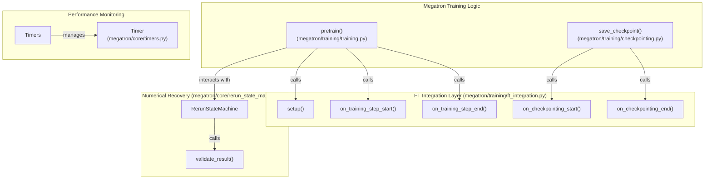

<!-- source: DeepWiki mcp.deepwiki.com · repo NVIDIA/Megatron-LM · page 11.7 Fault Tolerance and Recovery · fetched 2026-10-26 -->

# Fault Tolerance and Recovery

<details>
<summary>Relevant source files</summary>

The following files were used as context for generating this wiki page:

- [megatron/core/dist_checkpointing/tensor_aware_state_dict.py](megatron/core/dist_checkpointing/tensor_aware_state_dict.py)
- [megatron/core/rerun_state_machine.py](megatron/core/rerun_state_machine.py)
- [megatron/core/timers.py](megatron/core/timers.py)
- [megatron/training/__init__.py](megatron/training/__init__.py)
- [megatron/training/datasets/fim_dataset.py](megatron/training/datasets/fim_dataset.py)
- [megatron/training/ft_integration.py](megatron/training/ft_integration.py)
- [tests/unit_tests/data/test_get_batch.py](tests/unit_tests/data/test_get_batch.py)
- [tests/unit_tests/dist_checkpointing/test_rerun_state_machine_ckpt.py](tests/unit_tests/dist_checkpointing/test_rerun_state_machine_ckpt.py)
- [tests/unit_tests/dist_checkpointing/test_strict.py](tests/unit_tests/dist_checkpointing/test_strict.py)

</details>


This document describes Megatron-LM's integration with the NVIDIA Resiliency Extensions fault tolerance package and the internal Megatron Core rerun state machine. These systems provide automatic detection and recovery from hardware rank failures and numerical instabilities during distributed training.

## Overview

The fault tolerance (FT) system in Megatron-LM provides:

- **Automatic failure detection** via timeouts for different training phases [megatron/training/ft_integration.py:14-19]().
- **Section-based monitoring** that tracks setup, training steps, and checkpointing separately [megatron/training/ft_integration.py:121-191]().
- **Dynamic timeout calculation** based on observed execution times [megatron/training/ft_integration.py:21-23]().
- **Checkpoint-based recovery** that resumes training from the last saved state.
- **Rerun State Machine** for numerical stability and error attribution (e.g., NaN detection) [megatron/core/rerun_state_machine.py:23-30]().
- **Straggler Detection** to identify hardware performance degradation.

The FT system requires launching training with the `ft_launcher` tool from the `nvidia-resiliency-ext` package, which manages process coordination and restarts [megatron/training/ft_integration.py:9-33]().

Sources: [megatron/training/ft_integration.py:1-34](), [megatron/core/rerun_state_machine.py:21-30]()

## Architecture

### Core Components and Code Entities

The following diagram bridges the high-level fault tolerance concepts to the specific classes and functions in the Megatron-LM codebase.



**Key Components:**

| Component | Code Entity | Purpose |
|-----------|-------------|---------|
| **FT Client** | `RankMonitorClient` | The underlying monitor from `nvidia-resiliency-ext` [megatron/training/ft_integration.py:83-97]() |
| **Integration Entry** | `ft_integration.setup()` | Initializes the monitor and starts the "setup" section [megatron/training/ft_integration.py:76-120]() |
| **Rerun Controller** | `RerunStateMachine` | Singleton managing re-execution logic for error attribution [megatron/core/rerun_state_machine.py:129-130]() |
| **Timing Infrastructure** | `Timers` | Class for managing a group of `Timer` objects to profile training phases [megatron/core/timers.py:217-219]() |

Sources: [megatron/training/ft_integration.py:52-118](), [megatron/core/rerun_state_machine.py:129-181](), [megatron/core/timers.py:109-214]()

### Section-Based Monitoring

The FT system divides training into three monitored sections, each with independent timeouts [megatron/training/ft_integration.py:14-19]():

1.  **`setup`**: Covers initialization, data loading, and initial checkpoint loading [megatron/training/ft_integration.py:116-120]().
2.  **`step`**: Covers individual training or evaluation iterations (forward, backward, optimizer) [megatron/training/ft_integration.py:130-142]().
3.  **`checkpointing`**: Covers the duration of saving checkpoints to disk [megatron/training/ft_integration.py:173-184]().

Sources: [megatron/training/ft_integration.py:14-33](), [megatron/training/ft_integration.py:121-191]()

## Rerun State Machine

The `RerunStateMachine` is an experimental feature designed to attribute unexpected results (e.g., spiky loss, NaNs) to either transient hardware errors or persistent issues [megatron/core/rerun_state_machine.py:21-30]().

### Rerun States and Transitions

The state machine manages the flow between standard execution and diagnostic re-runs.

```mermaid
graph TD
    "RerunState.NOT_RUNNING_YET" -->|"start iteration"| "RerunState.INITIAL_RUN"
    "RerunState.INITIAL_RUN" -->|"validate_result() fails"| "RerunState.RERUNNING_IN_PLACE"
    "RerunState.RERUNNING_IN_PLACE" -->|"result matches"| "RerunState.WILL_RERUN_FROM_CHECKPOINT"
    "RerunState.RERUNNING_IN_PLACE" -->|"result differs"| "RerunDiagnostic.TRANSIENT_ERROR"
    "RerunState.WILL_RERUN_FROM_CHECKPOINT" -->|"exit 16 & restart"| "RerunState.RERUNNING_FROM_CHECKPOINT"
    "RerunState.RERUNNING_FROM_CHECKPOINT" -->|"result matches initial"| "RerunDiagnostic.PERSISTENT_ERROR"
```

**Diagnostic Outcomes [megatron/core/rerun_state_machine.py:60-71]():**
- `CORRECT_RESULT`: The result was expected given the input.
- `TRANSIENT_ERROR`: The result could not be reproduced on the same GPU (indicates flaky hardware).
- `PERSISTENT_ERROR`: The result was reproduced on the same GPU but not on a different GPU (indicates a faulty node).

**Integration and Determinism:**
To ensure re-runs are valid, the state machine saves and restores Python, NumPy, PyTorch, and CUDA RNG states [megatron/core/rerun_state_machine.py:145-152](). It assumes the iteration execution flow is deterministic relative to this captured state [megatron/core/rerun_state_machine.py:170-176]().

### Checkpointing Contract
The `RerunStateMachine` implements a specific `state_dict` logic to support distributed checkpointing, particularly for the `torch_dist` format. It emits a `ShardedObject` to ensure that even in a steady state (no pending rerun), the checkpoint plan includes the rerun shard, preventing failures when `assume_constant_structure` is enabled [tests/unit_tests/dist_checkpointing/test_rerun_state_machine_ckpt.py:35-57]().

Sources: [megatron/core/rerun_state_machine.py:36-112](), [megatron/core/rerun_state_machine.py:129-181](), [tests/unit_tests/dist_checkpointing/test_rerun_state_machine_ckpt.py:9-107]()

## Fault Tolerance Lifecycle

### Training Loop Hooks
The `ft_integration` module provides hooks called throughout the training lifecycle:

- **`on_training_step_start()`**: Ends the `setup` section and starts the `step` section after a warmup period [megatron/training/ft_integration.py:121-134]().
- **`on_training_step_end()`**: Ends the `step` section and increments the iteration count [megatron/training/ft_integration.py:136-143]().
- **`on_checkpointing_start()`**: Opens the `checkpointing` section to protect I/O-heavy operations [megatron/training/ft_integration.py:169-174]().
- **`on_checkpoint_loaded()`**: Updates the state to indicate a persistent checkpoint has been restored [megatron/training/ft_integration.py:193-205]().

### Timeout Calculation
When `--calc-ft-timeouts` is enabled, the system dynamically adjusts section timeouts based on runtime statistics [megatron/training/ft_integration.py:105-107]().
- **Step Timeouts**: Calculated after a minimum of 16 iterations [megatron/training/ft_integration.py:64-65]().
- **State Persistence**: Calculated timeouts are saved to `ft_state.json` in the checkpoint directory [megatron/training/ft_integration.py:99-100]().

Sources: [megatron/training/ft_integration.py:121-205](), [megatron/training/ft_integration.py:64-112]()

## Tensor-Aware State Management
Megatron Core integrates with `nvidia-resiliency-ext` via `MCoreTensorAwareStateDict` to support fully parallel save/load operations [megatron/core/dist_checkpointing/tensor_aware_state_dict.py:48-57](). This class handles:
- **Sharding Algorithms**: Supports `atomic` and `fully_parallel` sharding [megatron/core/dist_checkpointing/tensor_aware_state_dict.py:61-66]().
- **Redundancy Removal**: Removes redundant data on ranks that are not responsible for saving specific shards, optimizing memory usage during checkpointing [megatron/core/dist_checkpointing/tensor_aware_state_dict.py:86-98]().

Sources: [megatron/core/dist_checkpointing/tensor_aware_state_dict.py:48-152]()

## Error Handling and Exit Codes

The system uses specific exit codes to signal the `ft_launcher` or cluster manager how to handle a failure:

| Exit Code | Constant | Meaning |
|-----------|----------|---------|
| `16` | `EXIT_CODE_RESUME_TO_DISAMBIGUATE` | Reproducible error found; restart on different hardware [megatron/core/rerun_state_machine.py:37](). |
| `17` | `EXIT_CODE_FAILED_ON_RESULT_VALIDATION` | Diagnostic re-run failed to validate the result [megatron/core/rerun_state_machine.py:40](). |

Sources: [megatron/core/rerun_state_machine.py:36-41]()

---

