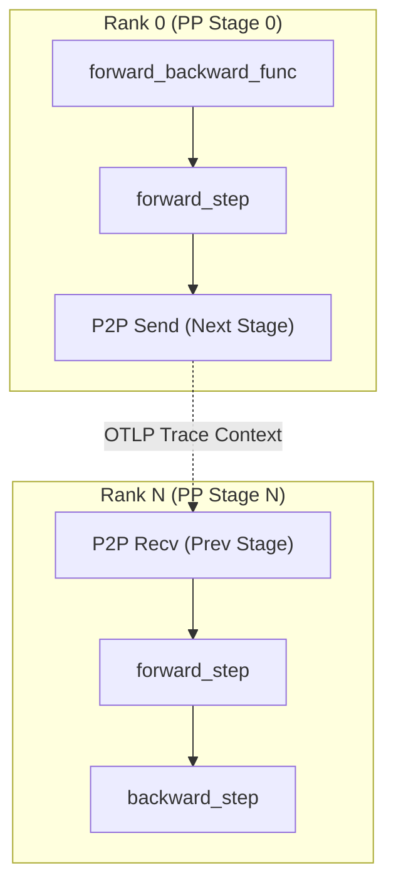
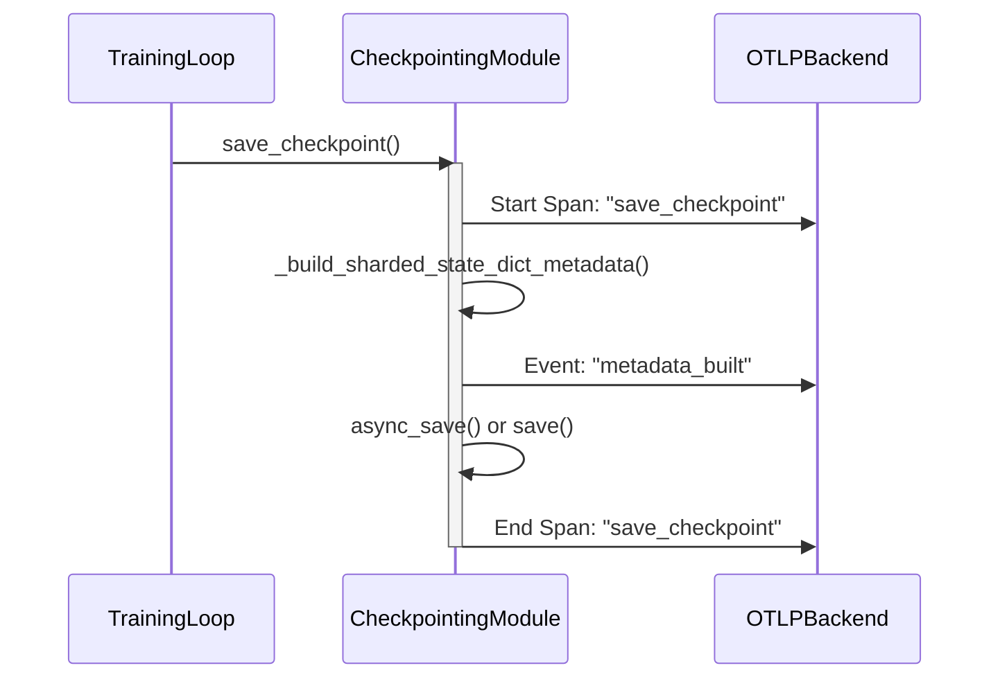

<!-- source: DeepWiki mcp.deepwiki.com · repo NVIDIA/Megatron-LM · page 11.9 Observability and Telemetry · fetched 2026-10-26 -->

# Observability and Telemetry

Relevant source files

The following files were used as context for generating this wiki page:

- [megatron/core/dist_checkpointing/strategies/fully_parallel.py](megatron/core/dist_checkpointing/strategies/fully_parallel.py)
- [megatron/core/dist_checkpointing/tensor_aware_state_dict.py](megatron/core/dist_checkpointing/tensor_aware_state_dict.py)
- [megatron/core/model_parallel_config.py](megatron/core/model_parallel_config.py)
- [megatron/core/parallel_state.py](megatron/core/parallel_state.py)
- [megatron/core/pipeline_parallel/p2p_communication.py](megatron/core/pipeline_parallel/p2p_communication.py)
- [megatron/core/pipeline_parallel/schedules.py](megatron/core/pipeline_parallel/schedules.py)
- [megatron/core/timers.py](megatron/core/timers.py)
- [megatron/training/__init__.py](megatron/training/__init__.py)
- [megatron/training/arguments.py](megatron/training/arguments.py)
- [megatron/training/checkpointing.py](megatron/training/checkpointing.py)
- [megatron/training/config/training_config.py](megatron/training/config/training_config.py)
- [megatron/training/ft_integration.py](megatron/training/ft_integration.py)
- [megatron/training/initialize.py](megatron/training/initialize.py)
- [megatron/training/training.py](megatron/training/training.py)
- [pretrain_gpt.py](pretrain_gpt.py)
- [pretrain_hybrid.py](pretrain_hybrid.py)
- [pretrain_mamba.py](pretrain_mamba.py)
- [tests/unit_tests/dist_checkpointing/test_pipeline_parallel_layout.py](tests/unit_tests/dist_checkpointing/test_pipeline_parallel_layout.py)
- [tests/unit_tests/dist_checkpointing/test_strict.py](tests/unit_tests/dist_checkpointing/test_strict.py)
- [tests/unit_tests/dist_checkpointing/utils.py](tests/unit_tests/dist_checkpointing/utils.py)
- [tests/unit_tests/pipeline_parallel/test_pipeline_layout.py](tests/unit_tests/pipeline_parallel/test_pipeline_layout.py)
- [tests/unit_tests/test_checkpointing.py](tests/unit_tests/test_checkpointing.py)
- [tests/unit_tests/test_parallel_state.py](tests/unit_tests/test_parallel_state.py)

Megatron-LM provides a comprehensive observability stack designed for large-scale distributed training. The system integrates **OpenTelemetry (OTLP)** via `nemo-lens` to provide distributed tracing and metrics, enabling fine-grained performance analysis across thousands of GPUs. The telemetry infrastructure covers training loops, pipeline-parallel trace correlation, span grouping, and specialized instrumentation for Mixture of Experts (MoE) and checkpointing.

## OpenTelemetry Integration

The telemetry system utilizes OpenTelemetry to capture and export traces and metrics to OTLP-compatible backends. The integration is primarily managed through `nemo-lens`, with fallback mechanisms to local Megatron core implementations if the external package is unavailable [megatron/training/checkpointing.py:27-30]().

### Trace Instrumentation
Instrumentation is achieved through decorators and context managers that wrap critical training operations. The system supports:
*   **Managed Spans**: Used to track discrete operations like checkpoint saving or loading [megatron/training/checkpointing.py:28-30]().
*   **Function Tracing**: Automatic tracing of function execution, particularly within the pipeline parallel schedules [megatron/core/pipeline_parallel/schedules.py:44-47]().

### Pipeline-Parallel Trace Correlation
In pipeline-parallel (PP) training, a single global batch is processed across multiple stages. Megatron correlates these traces across ranks to provide a unified view of the request flow through the pipeline.

*Sources: [megatron/core/pipeline_parallel/schedules.py:53-165](), [megatron/core/pipeline_parallel/p2p_communication.py:1-50]()*

## Training Metrics and Logging

Megatron emits a variety of metrics to track model health, throughput, and hardware utilization. These are coordinated through the `megatron.training.training` module.

### Metric Categories
| Category | Code Entity / Function | Description |
| :--- | :--- | :--- |
| **Throughput** | `_TRAIN_START_TIME` | Captures the absolute start time of the process for total runtime calculation [megatron/training/training.py:9](). |
| **Loss & Accuracy** | `MTPLossLoggingHelper` | Specialized logging for Multi-Token Prediction loss [megatron/core/transformer/multi_token_prediction.py:53-56](). |
| **MoE Metrics** | `get_moe_metrics_tracker` | Tracks expert utilization, load balancing, and router behavior [megatron/training/training.py:125-127](). |
| **Hardware** | `get_energy_monitor` | Monitors power consumption during training iterations [megatron/training/training.py:173](). |
| **Stragglers** | `StragglerDetector` | Detects ranks that are consistently slower than the group average [megatron/training/training.py:130](). |

### Logging Flow
The logging system uses a `CustomHandler` to filter and format logs before they are emitted by `logging.INFO` [megatron/training/training.py:34-36](). Rank-specific logging is controlled via `print_rank_0` to prevent stdout flooding in large clusters [megatron/training/utils.py:188]().

*Sources: [megatron/training/training.py:1-195](), [megatron/core/transformer/moe/moe_logging.py:1-50]()*

## Checkpointing Telemetry

Checkpointing is a high-latency operation that requires significant observability. The `megatron.training.checkpointing` module utilizes `one_logger` and OpenTelemetry to track the lifecycle of a checkpoint.

### Checkpoint Span Groups
The system uses `_otel_managed_span` to wrap the entire saving and loading process, providing visibility into metadata serialization and I/O overhead.

*Sources: [megatron/training/checkpointing.py:28-60](), [megatron/training/checkpointing.py:114-117]()*

## Configuration and Extension

Telemetry behavior is configured through CLI arguments defined in `megatron/training/arguments.py`.

### Key Arguments
*   `--one-logger`: Enables the NVIDIA internal logging service [megatron/training/arguments.py:75]().
*   `--straggler-detector`: Enables detection of slow GPU ranks [megatron/training/arguments.py:70]().
*   `--log-progress`: Periodically logs training progress to a file [tests/unit_tests/dist_checkpointing/utils.py:154]().

### Extending Instrumentation
To add new traces, developers should use the `trace_fn` or `managed_span` utilities. For metrics, the `get_timers()` utility provides a global interface for high-resolution timing of specific code blocks [megatron/training/training.py:178]().

*Sources: [megatron/training/arguments.py:45-85](), [megatron/training/training.py:170-180]()*

---

