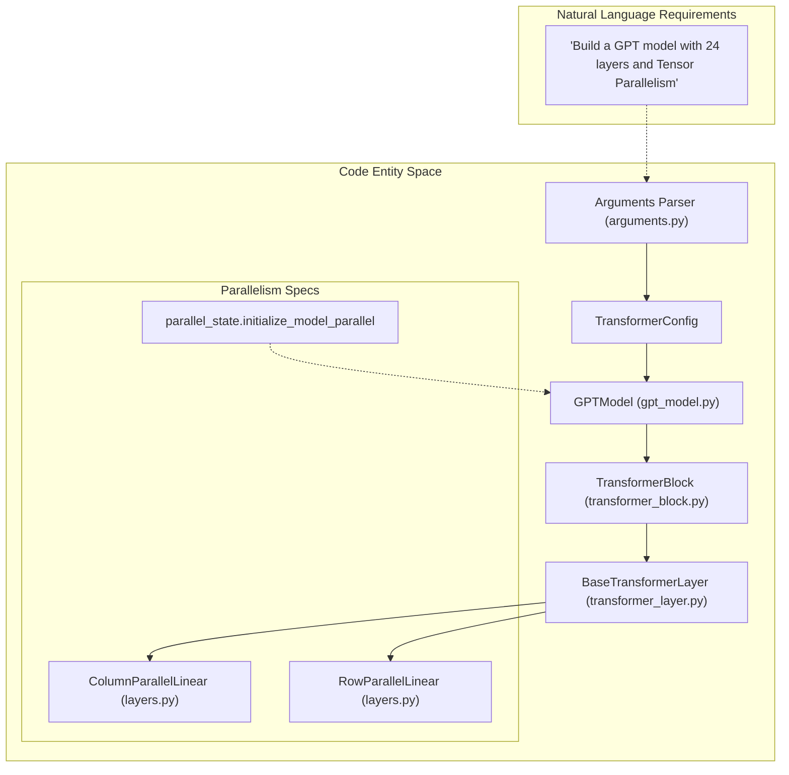
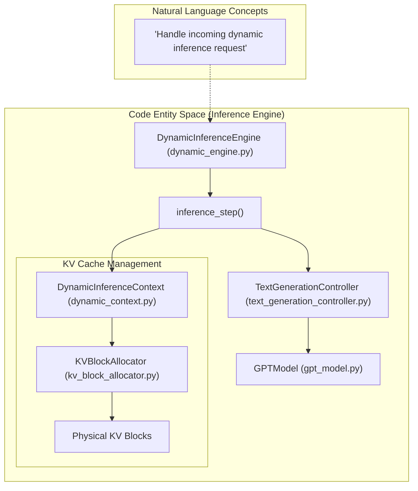

<!-- source: DeepWiki mcp.deepwiki.com · repo NVIDIA/Megatron-LM · page 12 Glossary · fetched 2026-10-26 -->

# Glossary

Relevant source files

The following files were used as context for generating this wiki page:

- [.gitignore](.gitignore)
- [MANIFEST.in](MANIFEST.in)
- [README.md](README.md)
- [examples/run_simple_mcore_train_loop.py](examples/run_simple_mcore_train_loop.py)
- [megatron/core/QuickStart.md](megatron/core/QuickStart.md)
- [megatron/core/README.md](megatron/core/README.md)
- [megatron/core/dist_checkpointing/__init__.py](megatron/core/dist_checkpointing/__init__.py)
- [megatron/core/dist_checkpointing/core.py](megatron/core/dist_checkpointing/core.py)
- [megatron/core/dist_checkpointing/dict_utils.py](megatron/core/dist_checkpointing/dict_utils.py)
- [megatron/core/dist_checkpointing/mapping.py](megatron/core/dist_checkpointing/mapping.py)
- [megatron/core/dist_checkpointing/optimizer.py](megatron/core/dist_checkpointing/optimizer.py)
- [megatron/core/dist_checkpointing/serialization.py](megatron/core/dist_checkpointing/serialization.py)
- [megatron/core/dist_checkpointing/strategies/__init__.py](megatron/core/dist_checkpointing/strategies/__init__.py)
- [megatron/core/dist_checkpointing/strategies/common.py](megatron/core/dist_checkpointing/strategies/common.py)
- [megatron/core/dist_checkpointing/strategies/fully_parallel.py](megatron/core/dist_checkpointing/strategies/fully_parallel.py)
- [megatron/core/dist_checkpointing/strategies/torch.py](megatron/core/dist_checkpointing/strategies/torch.py)
- [megatron/core/dist_checkpointing/utils.py](megatron/core/dist_checkpointing/utils.py)
- [megatron/core/dist_checkpointing/validation.py](megatron/core/dist_checkpointing/validation.py)
- [megatron/core/distributed/distributed_data_parallel.py](megatron/core/distributed/distributed_data_parallel.py)
- [megatron/core/distributed/fsdp/src/megatron_fsdp/package_info.py](megatron/core/distributed/fsdp/src/megatron_fsdp/package_info.py)
- [megatron/core/distributed/param_and_grad_buffer.py](megatron/core/distributed/param_and_grad_buffer.py)
- [megatron/core/extensions/transformer_engine.py](megatron/core/extensions/transformer_engine.py)
- [megatron/core/fp8_utils.py](megatron/core/fp8_utils.py)
- [megatron/core/fusions/fused_bias_swiglu.py](megatron/core/fusions/fused_bias_swiglu.py)
- [megatron/core/inference/config.py](megatron/core/inference/config.py)
- [megatron/core/inference/contexts/dynamic_context.py](megatron/core/inference/contexts/dynamic_context.py)
- [megatron/core/inference/engines/dynamic_engine.py](megatron/core/inference/engines/dynamic_engine.py)
- [megatron/core/inference/inference_request.py](megatron/core/inference/inference_request.py)
- [megatron/core/inference/sampling_params.py](megatron/core/inference/sampling_params.py)
- [megatron/core/inference/text_generation_controllers/text_generation_controller.py](megatron/core/inference/text_generation_controllers/text_generation_controller.py)
- [megatron/core/model_parallel_config.py](megatron/core/model_parallel_config.py)
- [megatron/core/models/common/__init__.py](megatron/core/models/common/__init__.py)
- [megatron/core/models/gpt/gpt_model.py](megatron/core/models/gpt/gpt_model.py)
- [megatron/core/msc_utils.py](megatron/core/msc_utils.py)
- [megatron/core/optimizer/__init__.py](megatron/core/optimizer/__init__.py)
- [megatron/core/optimizer/clip_grads.py](megatron/core/optimizer/clip_grads.py)
- [megatron/core/optimizer/cpu_offloading/README.md](megatron/core/optimizer/cpu_offloading/README.md)
- [megatron/core/optimizer/cpu_offloading/__init__.py](megatron/core/optimizer/cpu_offloading/__init__.py)
- [megatron/core/optimizer/cpu_offloading/hybrid_optimizer.py](megatron/core/optimizer/cpu_offloading/hybrid_optimizer.py)
- [megatron/core/optimizer/distrib_optimizer.py](megatron/core/optimizer/distrib_optimizer.py)
- [megatron/core/optimizer/optimizer.py](megatron/core/optimizer/optimizer.py)
- [megatron/core/optimizer/optimizer_config.py](megatron/core/optimizer/optimizer_config.py)
- [megatron/core/package_info.py](megatron/core/package_info.py)
- [megatron/core/packed_seq_params.py](megatron/core/packed_seq_params.py)
- [megatron/core/parallel_state.py](megatron/core/parallel_state.py)
- [megatron/core/pipeline_parallel/p2p_communication.py](megatron/core/pipeline_parallel/p2p_communication.py)
- [megatron/core/pipeline_parallel/schedules.py](megatron/core/pipeline_parallel/schedules.py)
- [megatron/core/requirements.txt](megatron/core/requirements.txt)
- [megatron/core/tensor_parallel/__init__.py](megatron/core/tensor_parallel/__init__.py)
- [megatron/core/tensor_parallel/layers.py](megatron/core/tensor_parallel/layers.py)
- [megatron/core/tensor_parallel/random.py](megatron/core/tensor_parallel/random.py)
- [megatron/core/transformer/attention.py](megatron/core/transformer/attention.py)
- [megatron/core/transformer/cuda_graphs.py](megatron/core/transformer/cuda_graphs.py)
- [megatron/core/transformer/custom_layers/__init__.py](megatron/core/transformer/custom_layers/__init__.py)
- [megatron/core/transformer/mlp.py](megatron/core/transformer/mlp.py)
- [megatron/core/transformer/module.py](megatron/core/transformer/module.py)
- [megatron/core/transformer/moe/README.md](megatron/core/transformer/moe/README.md)
- [megatron/core/transformer/moe/experts.py](megatron/core/transformer/moe/experts.py)
- [megatron/core/transformer/moe/fused_a2a.py](megatron/core/transformer/moe/fused_a2a.py)
- [megatron/core/transformer/moe/moe_layer.py](megatron/core/transformer/moe/moe_layer.py)
- [megatron/core/transformer/moe/moe_utils.py](megatron/core/transformer/moe/moe_utils.py)
- [megatron/core/transformer/moe/paged_stash.py](megatron/core/transformer/moe/paged_stash.py)
- [megatron/core/transformer/moe/router.py](megatron/core/transformer/moe/router.py)
- [megatron/core/transformer/moe/token_dispatcher.py](megatron/core/transformer/moe/token_dispatcher.py)
- [megatron/core/transformer/torch_norm.py](megatron/core/transformer/torch_norm.py)
- [megatron/core/transformer/transformer_block.py](megatron/core/transformer/transformer_block.py)
- [megatron/core/transformer/transformer_config.py](megatron/core/transformer/transformer_config.py)
- [megatron/core/transformer/transformer_layer.py](megatron/core/transformer/transformer_layer.py)
- [megatron/core/transformer/utils.py](megatron/core/transformer/utils.py)
- [megatron/core/utils.py](megatron/core/utils.py)
- [megatron/inference/utils.py](megatron/inference/utils.py)
- [megatron/rl/agent/api.py](megatron/rl/agent/api.py)
- [megatron/rl/agent/reward_only_agent.py](megatron/rl/agent/reward_only_agent.py)
- [megatron/rl/agent/rollout_pipeline.py](megatron/rl/agent/rollout_pipeline.py)
- [megatron/rl/agent/weighted_multi_task.py](megatron/rl/agent/weighted_multi_task.py)
- [megatron/rl/inference/api.py](megatron/rl/inference/api.py)
- [megatron/rl/inference/megatron.py](megatron/rl/inference/megatron.py)
- [megatron/rl/rl_utils.py](megatron/rl/rl_utils.py)
- [megatron/rl/rollout_granularity.py](megatron/rl/rollout_granularity.py)
- [megatron/rl/sequence_packing_utils.py](megatron/rl/sequence_packing_utils.py)
- [megatron/rl/server/agent/fastapi_env_server.py](megatron/rl/server/agent/fastapi_env_server.py)
- [megatron/training/arguments.py](megatron/training/arguments.py)
- [megatron/training/checkpointing.py](megatron/training/checkpointing.py)
- [megatron/training/config/inference_config.py](megatron/training/config/inference_config.py)
- [megatron/training/config/training_config.py](megatron/training/config/training_config.py)
- [megatron/training/initialize.py](megatron/training/initialize.py)
- [megatron/training/training.py](megatron/training/training.py)
- [pretrain_gpt.py](pretrain_gpt.py)
- [pretrain_hybrid.py](pretrain_hybrid.py)
- [pretrain_mamba.py](pretrain_mamba.py)
- [setup.py](setup.py)
- [tests/unit_tests/a2a_overlap/utils.py](tests/unit_tests/a2a_overlap/utils.py)
- [tests/unit_tests/data/test_multimodal_dataset.py](tests/unit_tests/data/test_multimodal_dataset.py)
- [tests/unit_tests/dist_checkpointing/__init__.py](tests/unit_tests/dist_checkpointing/__init__.py)
- [tests/unit_tests/dist_checkpointing/conftest.py](tests/unit_tests/dist_checkpointing/conftest.py)
- [tests/unit_tests/dist_checkpointing/test_mapping.py](tests/unit_tests/dist_checkpointing/test_mapping.py)
- [tests/unit_tests/dist_checkpointing/test_optimizer.py](tests/unit_tests/dist_checkpointing/test_optimizer.py)
- [tests/unit_tests/dist_checkpointing/test_pipeline_parallel_layout.py](tests/unit_tests/dist_checkpointing/test_pipeline_parallel_layout.py)
- [tests/unit_tests/dist_checkpointing/test_serialization.py](tests/unit_tests/dist_checkpointing/test_serialization.py)
- [tests/unit_tests/dist_checkpointing/test_validation.py](tests/unit_tests/dist_checkpointing/test_validation.py)
- [tests/unit_tests/dist_checkpointing/utils.py](tests/unit_tests/dist_checkpointing/utils.py)
- [tests/unit_tests/distributed/test_param_and_grad_buffer.py](tests/unit_tests/distributed/test_param_and_grad_buffer.py)
- [tests/unit_tests/fusions/test_swiglu_fusion.py](tests/unit_tests/fusions/test_swiglu_fusion.py)
- [tests/unit_tests/inference/contexts/test_dynamic_context.py](tests/unit_tests/inference/contexts/test_dynamic_context.py)
- [tests/unit_tests/inference/engines/test_dynamic_engine.py](tests/unit_tests/inference/engines/test_dynamic_engine.py)
- [tests/unit_tests/inference/test_inference_config.py](tests/unit_tests/inference/test_inference_config.py)
- [tests/unit_tests/inference/test_mtp_cuda_graph_inference.py](tests/unit_tests/inference/test_mtp_cuda_graph_inference.py)
- [tests/unit_tests/inference/text_generation_controllers/test_text_generation_controller.py](tests/unit_tests/inference/text_generation_controllers/test_text_generation_controller.py)
- [tests/unit_tests/models/test_hybrid_moe_model.py](tests/unit_tests/models/test_hybrid_moe_model.py)
- [tests/unit_tests/pipeline_parallel/test_pipeline_layout.py](tests/unit_tests/pipeline_parallel/test_pipeline_layout.py)
- [tests/unit_tests/rl/test_context_parallel.py](tests/unit_tests/rl/test_context_parallel.py)
- [tests/unit_tests/rl/test_rl_utils.py](tests/unit_tests/rl/test_rl_utils.py)
- [tests/unit_tests/rl/test_rollout_generation.py](tests/unit_tests/rl/test_rollout_generation.py)
- [tests/unit_tests/rl/test_sequence_packing_utils.py](tests/unit_tests/rl/test_sequence_packing_utils.py)
- [tests/unit_tests/tensor_parallel/test_random.py](tests/unit_tests/tensor_parallel/test_random.py)
- [tests/unit_tests/test_checkpointing.py](tests/unit_tests/test_checkpointing.py)
- [tests/unit_tests/test_fp8_param.py](tests/unit_tests/test_fp8_param.py)
- [tests/unit_tests/test_fp8_utils.py](tests/unit_tests/test_fp8_utils.py)
- [tests/unit_tests/test_optimizer.py](tests/unit_tests/test_optimizer.py)
- [tests/unit_tests/test_optimizer_cpu_offloading.py](tests/unit_tests/test_optimizer_cpu_offloading.py)
- [tests/unit_tests/test_parallel_state.py](tests/unit_tests/test_parallel_state.py)
- [tests/unit_tests/transformer/moe/test_aux_loss.py](tests/unit_tests/transformer/moe/test_aux_loss.py)
- [tests/unit_tests/transformer/moe/test_grouped_mlp.py](tests/unit_tests/transformer/moe/test_grouped_mlp.py)
- [tests/unit_tests/transformer/moe/test_paged_stash_runner.py](tests/unit_tests/transformer/moe/test_paged_stash_runner.py)
- [tests/unit_tests/transformer/moe/test_paged_stashing.py](tests/unit_tests/transformer/moe/test_paged_stashing.py)
- [tests/unit_tests/transformer/moe/test_routers.py](tests/unit_tests/transformer/moe/test_routers.py)
- [tests/unit_tests/transformer/moe/test_token_dispatcher.py](tests/unit_tests/transformer/moe/test_token_dispatcher.py)
- [tests/unit_tests/transformer/test_cuda_graphs.py](tests/unit_tests/transformer/test_cuda_graphs.py)
- [tests/unit_tests/transformer/test_module.py](tests/unit_tests/transformer/test_module.py)
- [tests/unit_tests/transformer/test_utils.py](tests/unit_tests/transformer/test_utils.py)
- [train_rl.py](train_rl.py)

This page defines codebase-specific terms, jargon, and domain concepts used throughout the Megatron-LM and Megatron Core repositories. It serves as a technical reference for onboarding engineers to understand the mapping between high-level LLM concepts and their specific implementations in the code.

## Core Architecture Terms

### TransformerBlock
A container for a sequence of transformer layers. It handles the allocation of layers across pipeline stages and manages the execution of a stack of layers.
*   **Implementation:** Defined in `megatron/core/transformer/transformer_block.py` [megatron/core/transformer/transformer_block.py:26]().
*   **Key Function:** `get_num_layers_to_build` calculates how many layers a specific pipeline rank should instantiate based on the `PipelineParallelLayerLayout` or uneven pipeline configurations [megatron/core/transformer/transformer_layer.py:65-166]().

### TransformerLayer
The fundamental building block of the transformer, typically consisting of a self-attention block followed by a Feed-Forward Network (MLP), with layer normalization and residual connections.
*   **Implementation:** `BaseTransformerLayer` in `megatron/core/transformer/transformer_layer.py` [megatron/core/transformer/transformer_layer.py:31]().
*   **Data Flow:** The layer manages the "residual branch" and the "main branch" (attention/MLP). It uses `ModuleSpec` to dynamically build sub-components like `SelfAttention` or `MLP` [megatron/core/transformer/transformer_layer.py:34]().

### Multi-Token Prediction (MTP)
An architectural extension where the model predicts multiple future tokens simultaneously rather than just the next token. This is implemented using sequential modules to predict $D$ additional tokens.
*   **Implementation:** `MultiTokenPredictionBlock` in `megatron/core/transformer/multi_token_prediction.py` and integrated into `GPTModel` [megatron/core/models/gpt/gpt_model.py:34-38]().
*   **Configuration:** Controlled via `mtp_num_layers`, `mtp_loss_scaling_factor`, and `mtp_use_repeated_layer` in `TransformerConfig` [megatron/core/transformer/transformer_config.py:68-83]().

### Spec / ModuleSpec
A configuration pattern used to define the structure of a model without hardcoding specific classes. It allows swapping implementations (e.g., using local PyTorch layers vs. Transformer Engine layers) by passing a "specification" of the module.
*   **Implementation:** `ModuleSpec` in `megatron/core/transformer/spec_utils.py` [megatron/core/transformer/spec_utils.py:39]().
*   **Usage:** Used in `GPTModel` to define the `transformer_layer_spec` and `mtp_block_spec` [megatron/core/models/gpt/gpt_model.py:98-122]().

Sources: [megatron/core/transformer/transformer_layer.py:31-166](), [megatron/core/transformer/transformer_config.py:68-83](), [megatron/core/models/gpt/gpt_model.py:34-122](), [megatron/core/transformer/spec_utils.py:39]().

## Parallelism Concepts

### Tensor Parallelism (TP)
A strategy where individual layers (like Linear layers) are split across multiple GPUs. Weights are partitioned, and collective communication (`all-reduce` or `all-gather`/`reduce-scatter`) is used to synchronize results.
*   **Implementation:** Managed in `megatron/core/tensor_parallel/`.
*   **Key Layers:** `ColumnParallelLinear` and `RowParallelLinear` in `megatron/core/tensor_parallel/layers.py` [megatron/core/tensor_parallel/layers.py:9]().

### Pipeline Parallelism (PP)
A strategy where the layers of a model are distributed across different GPUs in a "pipeline." One GPU processes the first few layers, passes the activations to the next GPU, and so on.
*   **Implementation:** `megatron/core/pipeline_parallel/`.
*   **Schedules:** 1F1B (One-Forward, One-Backward) and interleaved schedules are managed in `megatron/core/pipeline_parallel/schedules.py` [megatron/core/pipeline_parallel/schedules.py:157-167]().

### Context Parallelism (CP)
A technique to parallelize the processing of a single sequence across multiple GPUs by splitting the sequence dimension. This is particularly useful for very long sequences.
*   **Group Management:** Initialized in `parallel_state.py` via `_CONTEXT_PARALLEL_GROUP` [megatron/core/parallel_state.py:124]().

### Expert Parallelism (EP)
Used in Mixture-of-Experts (MoE) models. Different "experts" (MLPs) are placed on different GPUs. Tokens are routed to the GPU containing the relevant expert.
*   **Implementation:** Managed in `megatron/core/transformer/moe/`.
*   **State:** Defined by `_EXPERT_MODEL_PARALLEL_GROUP` [megatron/core/parallel_state.py:60]().

Sources: [megatron/core/tensor_parallel/layers.py:9](), [megatron/core/pipeline_parallel/schedules.py:157-167](), [megatron/core/parallel_state.py:60-124]().

## Training & Optimization

### Distributed Data Parallel (DDP)
Megatron's custom DDP implementation that supports overlapping communication (gradient reductions) with computation.
*   **Implementation:** `DistributedDataParallel` in `megatron/core/distributed/` [megatron/training/training.py:47-52]().
*   **Buffers:** Uses `ParamAndGradBuffer` to manage contiguous memory for efficient communication [megatron/core/distributed/param_and_grad_buffer.py:1]().

### Distributed Optimizer
An optimizer that shards the optimizer states (like Adam's momentum and variance) across data-parallel ranks to save memory.
*   **Implementation:** `DistributedOptimizer` in `megatron/core/optimizer/distrib_optimizer.py` [megatron/training/training.py:82]().

### Microbatch
The smallest unit of data processed in a single forward/backward pass. Multiple microbatches make up a "Global Batch." Pipeline parallelism operates by flowing microbatches through the pipeline stages.
*   **Schedules:** The `forward_backward_func` handles the execution of these microbatches [megatron/core/pipeline_parallel/schedules.py:113-121]().

Sources: [megatron/training/training.py:47-82](), [megatron/core/pipeline_parallel/schedules.py:113-121]().

## Inference Terms

### KV Cache
A memory buffer used during inference to store the Key and Value vectors of previously processed tokens, avoiding redundant computation.
*   **Management:** `KVBlockAllocator` in `megatron/core/inference/contexts/kv_block_allocator.py` manages the allocation of these buffers in a paged fashion [megatron/core/inference/contexts/dynamic_context.py:54]().

### Dynamic Inference Engine
An engine designed for high-throughput serving that can handle requests arriving at different times with varying lengths.
*   **Implementation:** `DynamicInferenceEngine` in `megatron/core/inference/engines/dynamic_engine.py` [megatron/core/inference/engines/dynamic_engine.py:27-45]().
*   **Context:** Uses `BaseInferenceContext` (and its subclass `DynamicInferenceContext`) for managing in-flight batching [megatron/core/inference/contexts/dynamic_context.py:29-52]().

Sources: [megatron/core/inference/contexts/dynamic_context.py:29-54](), [megatron/core/inference/engines/dynamic_engine.py:27-45]().

## System Architecture Diagrams

### From Natural Language Space to Code Entity Space: Model Construction
This diagram shows how high-level architectural requirements are translated into specific code entities during model initialization.

Sources: [megatron/core/transformer/transformer_config.py:54-59](), [megatron/core/models/gpt/gpt_model.py:52-122](), [megatron/core/transformer/transformer_layer.py:31](), [megatron/core/tensor_parallel/layers.py:9](), [megatron/training/arguments.py:45]().

### From Natural Language Space to Code Entity Space: Inference Execution
This diagram bridges the concept of "running dynamic inference" to the actual code functions that orchestrate request handling and KV cache management.

Sources: [megatron/core/inference/contexts/dynamic_context.py:54](), [megatron/core/models/gpt/gpt_model.py:52](), [megatron/core/inference/engines/dynamic_engine.py:27-45]().

## Jargon & Abbreviations

| Term | Full Name | Definition | Code Pointer |
| :--- | :--- | :--- | :--- |
| **MPU** | Model Parallel Unit | Module managing distributed process groups and parallel state. | `megatron/core/parallel_state.py` |
| **1F1B** | One Forward, One Backward | A pipeline scheduling algorithm that alternates forward and backward passes. | [megatron/core/pipeline_parallel/schedules.py:157-167]() |
| **VPP** | Virtual Pipeline Parallelism | Optimization where each rank handles multiple non-contiguous stages (chunks). | [megatron/core/transformer/transformer_config.py:122-128]() |
| **GQA** | Grouped Query Attention | Attention variant where multiple query heads share a single KV head. | [megatron/core/transformer/transformer_config.py:141-143]() |
| **MLA** | Multi-Latent Attention | Low-rank KV compression technique. | [megatron/core/transformer/transformer_config.py:39]() |
| **MoE** | Mixture of Experts | Architecture routing tokens to specialized "expert" sub-networks. | `megatron/core/transformer/moe/` |
| **TE** | Transformer Engine | NVIDIA library for optimized transformer kernels and FP8 support. | [megatron/core/extensions/transformer_engine.py:14]() |

Sources: [megatron/core/parallel_state.py:1-5](), [megatron/core/pipeline_parallel/schedules.py:157-167](), [megatron/core/transformer/transformer_config.py:39-143](), [megatron/core/extensions/transformer_engine.py:14]().