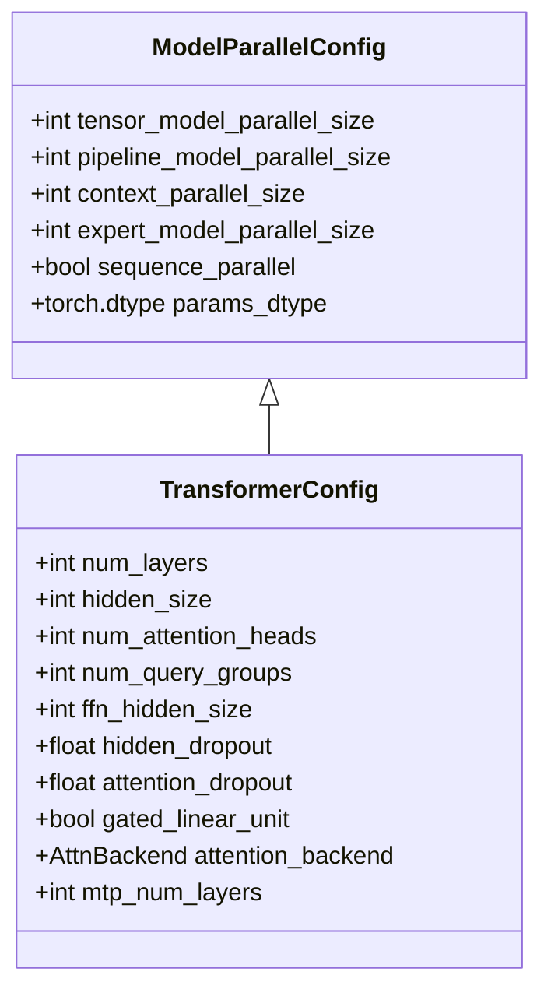
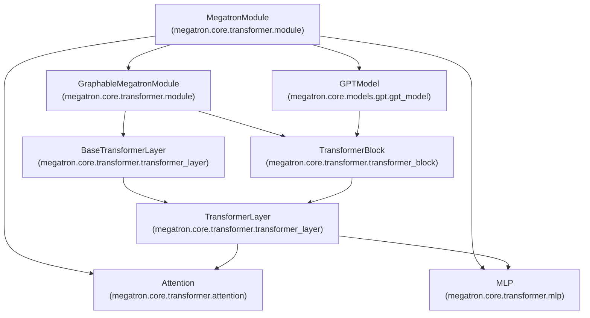
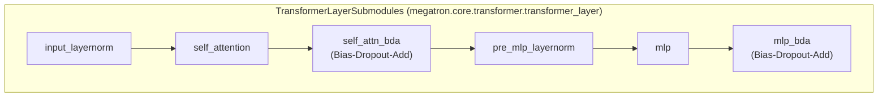

<!-- source: DeepWiki mcp.deepwiki.com · repo NVIDIA/Megatron-LM · page 2 Core Model Architecture · fetched 2026-10-26 -->

# Core Model Architecture

Relevant source files

The following files were used as context for generating this wiki page:

- [gpt_builders.py](gpt_builders.py)
- [mamba_builders.py](mamba_builders.py)
- [megatron/core/extensions/transformer_engine.py](megatron/core/extensions/transformer_engine.py)
- [megatron/core/fusions/fused_bias_swiglu.py](megatron/core/fusions/fused_bias_swiglu.py)
- [megatron/core/models/gpt/gpt_layer_specs.py](megatron/core/models/gpt/gpt_layer_specs.py)
- [megatron/core/models/gpt/gpt_model.py](megatron/core/models/gpt/gpt_model.py)
- [megatron/core/tensor_parallel/__init__.py](megatron/core/tensor_parallel/__init__.py)
- [megatron/core/tensor_parallel/layers.py](megatron/core/tensor_parallel/layers.py)
- [megatron/core/tensor_parallel/random.py](megatron/core/tensor_parallel/random.py)
- [megatron/core/transformer/attention.py](megatron/core/transformer/attention.py)
- [megatron/core/transformer/cuda_graphs.py](megatron/core/transformer/cuda_graphs.py)
- [megatron/core/transformer/mlp.py](megatron/core/transformer/mlp.py)
- [megatron/core/transformer/module.py](megatron/core/transformer/module.py)
- [megatron/core/transformer/multi_latent_attention.py](megatron/core/transformer/multi_latent_attention.py)
- [megatron/core/transformer/torch_norm.py](megatron/core/transformer/torch_norm.py)
- [megatron/core/transformer/transformer_block.py](megatron/core/transformer/transformer_block.py)
- [megatron/core/transformer/transformer_config.py](megatron/core/transformer/transformer_config.py)
- [megatron/core/transformer/transformer_layer.py](megatron/core/transformer/transformer_layer.py)
- [megatron/core/transformer/utils.py](megatron/core/transformer/utils.py)
- [megatron/core/utils.py](megatron/core/utils.py)
- [model_provider.py](model_provider.py)
- [tests/unit_tests/fusions/test_swiglu_fusion.py](tests/unit_tests/fusions/test_swiglu_fusion.py)
- [tests/unit_tests/tensor_parallel/test_random.py](tests/unit_tests/tensor_parallel/test_random.py)
- [tests/unit_tests/transformer/test_cuda_graphs.py](tests/unit_tests/transformer/test_cuda_graphs.py)
- [tests/unit_tests/transformer/test_multi_latent_attention.py](tests/unit_tests/transformer/test_multi_latent_attention.py)
- [tests/unit_tests/transformer/test_utils.py](tests/unit_tests/transformer/test_utils.py)

## Purpose and Scope

This document describes the foundational transformer architecture components in Megatron-LM. It covers the configuration system, base module hierarchy, and core building blocks (attention, MLP, normalization) that compose all transformer models in the framework.

Megatron-LM provides a modular approach where models like GPT, BERT, and T5 are assembled from these common components. This design allows for seamless scaling using various parallelism strategies while maintaining a consistent interface for optimization and checkpointing.

---

## Configuration System

Megatron-LM uses a hierarchical configuration system where `TransformerConfig` extends `ModelParallelConfig` to provide comprehensive model and parallelism settings.

### Configuration Class Hierarchy

Sources: [megatron/core/transformer/transformer_config.py:53-58](), [megatron/core/model_parallel_config.py:17-17]()

### Key Configuration Categories

| Category | Key Parameters | Description |
|----------|---------------|-------------|
| **Architecture** | `num_layers`, `hidden_size`, `num_attention_heads`, `ffn_hidden_size` | Basic transformer dimensions [megatron/core/transformer/transformer_config.py:64-159](). |
| **Attention** | `num_query_groups`, `kv_channels`, `attention_backend`, `softmax_scale` | Attention mechanism configuration [megatron/core/transformer/transformer_config.py:135-163](). |
| **MTP** | `mtp_num_layers`, `mtp_loss_scaling_factor` | Multi-Token Prediction settings for predicting multiple future tokens [megatron/core/transformer/transformer_config.py:67-79](). |
| **Precision** | `fp8`, `fp8_recipe`, `fp4`, `params_dtype` | Mixed precision training settings including FP8/FP4 recipes [megatron/core/transformer/transformer_config.py:333-352](). |
| **Parallelism** | `pipeline_model_parallel_layout`, `account_for_embedding_in_pipeline_split` | Advanced pipeline partitioning and layout definitions [megatron/core/transformer/transformer_config.py:98-126](). |

For details, see [TransformerConfig and ModelParallelConfig](#2.1).

Sources:
[megatron/core/transformer/transformer_config.py:64-163]()
[megatron/core/transformer/transformer_config.py:67-79]()
[megatron/core/transformer/transformer_config.py:333-352]()
[megatron/core/transformer/transformer_config.py:98-126]()
[megatron/core/transformer/transformer_config.py:53-58]()

---

## Module Hierarchy

All transformer components in Megatron-LM inherit from `MegatronModule`, which provides distributed checkpointing support and configuration management.

### Core Module Structure

Sources: [megatron/core/transformer/module.py:29-42](), [megatron/core/transformer/transformer_block.py:32-32](), [megatron/core/transformer/transformer_layer.py:36-40](), [megatron/core/transformer/attention.py:236-241](), [megatron/core/transformer/mlp.py:155-155](), [megatron/core/models/gpt/gpt_model.py:52-52]()

### MegatronModule Base Class

`MegatronModule` provides:
- Configuration storage via `self.config` [megatron/core/transformer/module.py:42-42]().
- Distributed checkpointing through `sharded_state_dict()` which recursively gathers sharded tensors from submodules using `sharded_state_dict_default` [megatron/core/transformer/module.py:58-103]().
- Flag management for training states like `is_first_microbatch` for FP8/FP4 parameter cache updates in TE modules [megatron/core/transformer/module.py:105-121]().

Sources:
[megatron/core/transformer/module.py:42-42]()
[megatron/core/transformer/module.py:58-103]()
[megatron/core/transformer/module.py:105-121]()

---

## TransformerBlock: Layer Container

`TransformerBlock` manages a stack of transformer layers. It handles the logic for determining which layers belong to the current pipeline stage and manages shared resources like final layer normalization.

- **Layer Construction**: Based on `pipeline_model_parallel_layout`, it builds the appropriate number of layers for the current rank [megatron/core/transformer/transformer_block.py:91-94]().
- **Uneven Pipeline Support**: Supports configurations where the first or last stages have a different number of layers [megatron/core/transformer/transformer_block.py:120-146]().
- **Virtual Pipeline Parallelism**: Handles interleaved scheduling by managing multiple model chunks [megatron/core/transformer/transformer_block.py:162-178]().

For details, see [Transformer Layers and Blocks](#2.2).

Sources:
[megatron/core/transformer/transformer_block.py:91-94]()
[megatron/core/transformer/transformer_block.py:120-146]()
[megatron/core/transformer/transformer_block.py:162-178]()

---

## TransformerLayer: Single Layer Structure

A `TransformerLayer` combines attention, MLP, and normalization components with residual connections.

### Layer Component Specification

Sources: [megatron/core/transformer/transformer_layer.py:202-218](), [megatron/core/models/gpt/gpt_layer_specs.py:112-133]()

### Residual Connection Patterns

The layer supports standard Transformer residual patterns:
- **Pre-Normalization**: The input is normalized before being passed to the sublayer (Attention or MLP) [megatron/core/transformer/transformer_layer.py:738-744]().
- **Bias-Dropout-Add Fusion**: Uses optimized kernels like `get_bias_dropout_add` for the residual addition [megatron/core/fusions/fused_bias_dropout.py:7-7]().

Sources:
[megatron/core/transformer/transformer_layer.py:738-744]()
[megatron/core/fusions/fused_bias_dropout.py:7-7]()

---

## Attention Mechanisms

The attention subsystem provides flexible implementations for Self-Attention and Cross-Attention, supporting Grouped Query Attention (GQA) and Multi-Head Attention (MHA).

- **Core Attention**: The framework supports multiple backends (FlashAttention, FusedAttention, Local) via the `CoreAttention` protocol [megatron/core/transformer/attention.py:197-230]().
- **Multi-Latent Attention (MLA)**: Optimized implementation using latent compression for KV caches, supporting RoPE and YaRN [megatron/core/transformer/multi_latent_attention.py:130-158]().

For details, see [Attention Mechanisms](#2.3).

Sources:
[megatron/core/transformer/attention.py:197-230]()
[megatron/core/transformer/multi_latent_attention.py:130-158]()

---

## MLP: Feed-Forward Networks

The MLP module implements the standard position-wise feed-forward network.

- **Gated Linear Units (GLU)**: Support for SwiGLU, GeGLU, and other gated activations. When enabled, the first linear layer (`linear_fc1`) has a stride of 2 to handle interleaved gate and up-projection weights [megatron/core/transformer/mlp.py:205-207]().
- **Fused Activations**: Support for bias-activation fusions (e.g., `bias_swiglu_impl`, `bias_geglu_impl`) to reduce memory bandwidth [megatron/core/transformer/mlp.py:19-25]().

For details, see [MLP and Activation Functions](#2.5).

Sources:
[megatron/core/transformer/mlp.py:205-207]()
[megatron/core/transformer/mlp.py:19-25]()

---

## Positional Embeddings

Megatron-LM supports various positional encoding strategies:
- **Learned Absolute**: Standard absolute positional embeddings [megatron/core/models/gpt/gpt_model.py:110-112]().
- **Rotary (RoPE)**: Rotary Position Embeddings applied to the QK projections, including multimodal variants [megatron/core/models/common/embeddings/rotary_pos_embedding.py:19-22]().
- **YaRN**: Context window extension via YaRN RoPE scaling [megatron/core/models/common/embeddings/yarn_rotary_pos_embedding.py:53-55]().

For details, see [Positional Embeddings](#2.4).

Sources:
[megatron/core/models/gpt/gpt_model.py:110-112]()
[megatron/core/models/common/embeddings/rotary_pos_embedding.py:19-22]()
[megatron/core/models/common/embeddings/yarn_rotary_pos_embedding.py:53-55]()

---

## Transformer Engine Integration

Megatron Core is tightly integrated with [Transformer Engine (TE)](https://github.com/NVIDIA/TransformerEngine).
- **FP8/FP4 Support**: Recipes like `TEQuantizationRecipe` enable training and inference in lower precision using TE's autocast contexts [megatron/core/extensions/transformer_engine.py:133-174]().
- **Fused Operations**: TE provides highly optimized fused kernels for attention and normalization modules like `TENorm` [megatron/core/extensions/transformer_engine.py:125-125]().

For details, see [Transformer Engine Integration](#2.6).

Sources:
[megatron/core/extensions/transformer_engine.py:133-174]()
[megatron/core/extensions/transformer_engine.py:125-125]()

---

