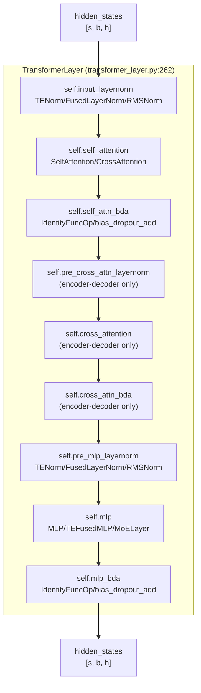
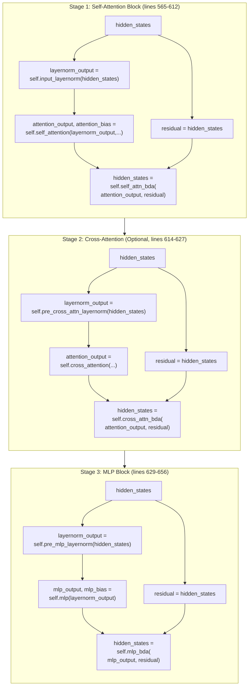
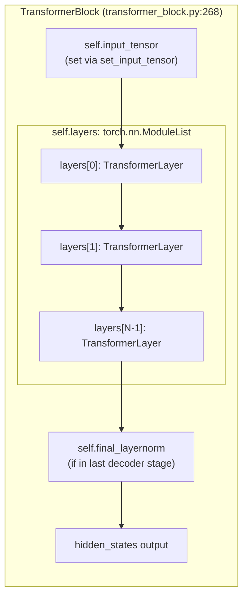

<!-- source: DeepWiki mcp.deepwiki.com · repo NVIDIA/Megatron-LM · page 2.2 Transformer Layers and Blocks · fetched 2026-10-26 -->

# Transformer Layers and Blocks

<details>
<summary>Relevant source files</summary>

The following files were used as context for generating this wiki page:

- [megatron/core/extensions/transformer_engine.py](megatron/core/extensions/transformer_engine.py)
- [megatron/core/fusions/fused_bias_swiglu.py](megatron/core/fusions/fused_bias_swiglu.py)
- [megatron/core/models/gpt/gpt_model.py](megatron/core/models/gpt/gpt_model.py)
- [megatron/core/tensor_parallel/__init__.py](megatron/core/tensor_parallel/__init__.py)
- [megatron/core/tensor_parallel/layers.py](megatron/core/tensor_parallel/layers.py)
- [megatron/core/tensor_parallel/random.py](megatron/core/tensor_parallel/random.py)
- [megatron/core/transformer/__init__.py](megatron/core/transformer/__init__.py)
- [megatron/core/transformer/attention.py](megatron/core/transformer/attention.py)
- [megatron/core/transformer/cuda_graphs.py](megatron/core/transformer/cuda_graphs.py)
- [megatron/core/transformer/dot_product_attention.py](megatron/core/transformer/dot_product_attention.py)
- [megatron/core/transformer/mlp.py](megatron/core/transformer/mlp.py)
- [megatron/core/transformer/module.py](megatron/core/transformer/module.py)
- [megatron/core/transformer/pipeline_parallel_layer_layout.py](megatron/core/transformer/pipeline_parallel_layer_layout.py)
- [megatron/core/transformer/spec_utils.py](megatron/core/transformer/spec_utils.py)
- [megatron/core/transformer/torch_norm.py](megatron/core/transformer/torch_norm.py)
- [megatron/core/transformer/transformer_block.py](megatron/core/transformer/transformer_block.py)
- [megatron/core/transformer/transformer_config.py](megatron/core/transformer/transformer_config.py)
- [megatron/core/transformer/transformer_layer.py](megatron/core/transformer/transformer_layer.py)
- [megatron/core/transformer/utils.py](megatron/core/transformer/utils.py)
- [megatron/core/utils.py](megatron/core/utils.py)
- [tests/unit_tests/fusions/test_swiglu_fusion.py](tests/unit_tests/fusions/test_swiglu_fusion.py)
- [tests/unit_tests/models/test_gpt_model.py](tests/unit_tests/models/test_gpt_model.py)
- [tests/unit_tests/tensor_parallel/test_random.py](tests/unit_tests/tensor_parallel/test_random.py)
- [tests/unit_tests/transformer/__init__.py](tests/unit_tests/transformer/__init__.py)
- [tests/unit_tests/transformer/test_attention.py](tests/unit_tests/transformer/test_attention.py)
- [tests/unit_tests/transformer/test_core_attention.py](tests/unit_tests/transformer/test_core_attention.py)
- [tests/unit_tests/transformer/test_cuda_graphs.py](tests/unit_tests/transformer/test_cuda_graphs.py)
- [tests/unit_tests/transformer/test_mlp.py](tests/unit_tests/transformer/test_mlp.py)
- [tests/unit_tests/transformer/test_spec_customization.py](tests/unit_tests/transformer/test_spec_customization.py)
- [tests/unit_tests/transformer/test_spec_utils.py](tests/unit_tests/transformer/test_spec_utils.py)
- [tests/unit_tests/transformer/test_transformer_block.py](tests/unit_tests/transformer/test_transformer_block.py)
- [tests/unit_tests/transformer/test_transformer_layer.py](tests/unit_tests/transformer/test_transformer_layer.py)
- [tests/unit_tests/transformer/test_utils.py](tests/unit_tests/transformer/test_utils.py)

</details>


This document describes the `TransformerLayer` and `TransformerBlock` classes, which are the core building blocks for constructing transformer models in Megatron Core. A `TransformerLayer` represents a single transformer layer containing attention, MLP, and normalization components. A `TransformerBlock` is a container that holds multiple `TransformerLayer` instances and manages their sequential execution.

For information about the internal attention mechanisms within layers, see [Attention Mechanisms (2.3)](). For MLP implementations, see [MLP and Activation Functions (2.5)](). For configuration of these components, see [TransformerConfig and ModelParallelConfig (2.1)]().

## TransformerLayer Overview

The `TransformerLayer` class [[megatron/core/transformer/transformer_layer.py:262]]() represents a single transformer layer that processes input tensors through a series of submodules: input normalization, self-attention, optional cross-attention, pre-MLP normalization, and an MLP (or MoE layer). Each submodule is configurable through the `TransformerLayerSubmodules` dataclass.

### TransformerLayer Structure



**TransformerLayer Submodule Flow (forward method at line 512)**

Sources: [[megatron/core/transformer/transformer_layer.py:262-390]](), [[megatron/core/transformer/transformer_layer.py:512-659]](), [[megatron/core/transformer/transformer_layer.py:202-244]]()

The `TransformerLayerSubmodules` dataclass [[megatron/core/transformer/transformer_layer.py:202-244]]() defines nine configurable components:

| Submodule Field | Type | Common Implementations | Purpose |
|-----------------|------|------------------------|---------|
| `input_layernorm` | `LayerNormBuilder` | `TENorm`, `FusedLayerNorm`, `WrappedTorchNorm` | Normalization before self-attention |
| `self_attention` | `ModuleSpec` or `type` | `SelfAttention`, `CrossAttention`, `MLASelfAttention` | Self-attention mechanism |
| `self_attn_bda` | `ModuleSpec` or `type` | `IdentityFuncOp`, `bias_dropout_add_fused_train` | Bias-dropout-add after self-attention |
| `pre_cross_attn_layernorm` | `LayerNormBuilder` | `IdentityOp` (decoder-only), norm classes (encoder-decoder) | Normalization before cross-attention |
| `cross_attention` | `ModuleSpec` or `type` | `IdentityOp` (decoder-only), `CrossAttention` (encoder-decoder) | Cross-attention mechanism |
| `cross_attn_bda` | `ModuleSpec` or `type` | `IdentityFuncOp` | Bias-dropout-add after cross-attention |
| `pre_mlp_layernorm` | `LayerNormBuilder` | `TENorm`, `FusedLayerNorm`, `WrappedTorchNorm` | Normalization before MLP |
| `mlp` | `ModuleSpec` or `type` | `MLP`, `TEFusedMLP`, `MoELayer` | Feed-forward network or MoE |
| `mlp_bda` | `ModuleSpec` or `type` | `IdentityFuncOp`, `bias_dropout_add_fused_train` | Bias-dropout-add after MLP |

Sources: [[megatron/core/transformer/transformer_layer.py:202-244]]()

### TransformerLayer Forward Pass

The `forward()` method [[megatron/core/transformer/transformer_layer.py:512-659]]() processes input through three sequential stages:



**Forward Pass Implementation with Residual Connections**

Each stage follows the pattern: `output = bda_func(submodule(layernorm(input)), input)`. Key features:
- **Residual connections**: Original `hidden_states` added back via bias-dropout-add functions.
- **Normalization first**: LayerNorm/RMSNorm applied before each submodule (Pre-LN architecture) unless `apply_residual_connection_post_layernorm` is enabled [[megatron/core/transformer/transformer_config.py:175]]().
- **FP32 Residuals**: Optional movement of residual connections to FP32 for numerical stability [[megatron/core/transformer/transformer_config.py:171]]().

Sources: [[megatron/core/transformer/transformer_layer.py:512-659]](), [[megatron/core/transformer/transformer_config.py:171-176]]()

### Layer Numbering and Offsets

Each `TransformerLayer` has a `layer_number` attribute [[megatron/core/transformer/transformer_layer.py:292]]() that accounts for its global position in the model, including pipeline parallelism offsets. The `get_transformer_layer_offset()` function [[megatron/core/transformer/transformer_layer.py:65]]() calculates the offset based on:

| Configuration | Impact on Offset |
|---------------|------------------|
| `pipeline_model_parallel_size` | Determines number of PP stages. |
| `pipeline_model_parallel_layout` | Custom layout with explicit layer assignments per stage [[megatron/core/transformer/transformer_config.py:104]](). |
| `virtual_pipeline_model_parallel_size` | Interleaved pipeline with multiple virtual chunks per stage [[megatron/core/transformer/transformer_block.py:161]](). |
| `num_layers_in_first_pipeline_stage` | Uneven distribution with custom first stage layer count [[megatron/core/transformer/transformer_config.py:96]](). |

Sources: [[megatron/core/transformer/transformer_layer.py:65-199]](), [[megatron/core/transformer/transformer_config.py:90-128]](), [[megatron/core/transformer/transformer_block.py:161-167]]()

## TransformerBlock Overview

The `TransformerBlock` class [[megatron/core/transformer/transformer_block.py:268]]() is a container that manages multiple `TransformerLayer` instances. It handles sequential execution, quantization context, and final layer normalization.

### TransformerBlock Structure



**TransformerBlock Component Architecture**

Sources: [[megatron/core/transformer/transformer_block.py:268-389]](), [[megatron/core/transformer/transformer_block.py:550-552]]()

### Building Layers with get_num_layers_to_build

The number of layers constructed is determined by `get_num_layers_to_build()` [[megatron/core/transformer/transformer_block.py:76]](), which accounts for pipeline parallelism configuration.

The function handles three distribution strategies:
1. **Custom Pipeline Layout** (lines 91-94): Uses `PipelineParallelLayerLayout` for explicit layer assignments.
2. **Uneven Pipeline Parallelism** (lines 104-146): Different layer counts for first/last stages via `num_layers_in_first_pipeline_stage`.
3. **Even Pipeline Parallelism** (lines 148-159): Uniform distribution across all pipeline stages.

Special handling for embedding/loss layers (lines 150-153): If `account_for_embedding_in_pipeline_split` or `account_for_loss_in_pipeline_split` is True, these are counted in the layer distribution but don't create actual `TransformerLayer` instances in the block.

Sources: [[megatron/core/transformer/transformer_block.py:76-204]](), [[megatron/core/transformer/transformer_config.py:130-136]]()

### TransformerBlock Forward Method

The `forward()` method [[megatron/core/transformer/transformer_block.py:471]]() executes layers sequentially with several optional features:

| Feature | Condition | Implementation |
|---------|-----------|----------------|
| **Quantization Context** | `config.fp8` or `config.fp4` | Uses `get_fp8_context` or `get_fp4_context` per layer [[megatron/core/transformer/transformer_block.py:524-538]](). |
| **CPU Offloading** | `config.cpu_offloading` | Uses `get_cpu_offload_context` from Transformer Engine [[megatron/core/transformer/transformer_block.py:60]](). |
| **Activation Checkpointing** | `config.recompute_granularity == 'full'` | Calls `checkpointed_forward` [[megatron/core/transformer/transformer_block.py:517-520]](). |
| **Final LayerNorm** | Last decoder stage | Applied after all layers [[megatron/core/transformer/transformer_block.py:550-552]](). |

Sources: [[megatron/core/transformer/transformer_block.py:471-758]](), [[megatron/core/transformer/transformer_config.py:392-434]]()

## Composition and Specifications

Megatron Core uses a specification-driven architecture to build models. `TransformerLayer` submodules are defined using `ModuleSpec` [[megatron/core/transformer/spec_utils.py:26]]().

### Multi-Token Prediction (MTP) Integration

Megatron Core supports Multi-Token Prediction via `MultiTokenPredictionBlock`. This is configured via `TransformerConfig.mtp_num_layers` [[megatron/core/transformer/transformer_config.py:68]]() and integrated into the model architecture as additional blocks after the main decoder [[megatron/core/models/gpt/gpt_model.py:245-266]]().

Sources: [[megatron/core/transformer/transformer_config.py:68-85]](), [[megatron/core/models/gpt/gpt_model.py:245-266]]()

## Pipeline Parallelism Integration

`TransformerBlock` integrates with pipeline parallelism through stage assignment and tensor passing.

### Input/Output Tensor Management

The `set_input_tensor()` method [[megatron/core/transformer/transformer_block.py:407]]() is called by pipeline schedules to provide activations from the previous stage:

```python
def set_input_tensor(self, input_tensor: Tensor):
    """Set the input tensor to be used in the forward pass."""
    self.input_tensor = input_tensor
```

In the `forward` pass, if the explicit `hidden_states` argument is `None`, the block uses `self.input_tensor` [[megatron/core/transformer/transformer_block.py:487-490]]().

Sources: [[megatron/core/transformer/transformer_block.py:407-413]](), [[megatron/core/transformer/transformer_block.py:487-490]]()

## Activation Recomputation

`TransformerBlock` and `TransformerLayer` support activation recomputation to trade compute for memory.

- **Full Recomputation**: Checkpoints the entire forward pass of a `TransformerLayer` using `checkpointed_forward` [[megatron/core/transformer/transformer_block.py:517-520]]().
- **Selective Recomputation**: Checkpoints specific submodules like `core_attention` or `mlp` [[megatron/core/transformer/transformer_config.py:420-434]](). This is managed within `TransformerLayer` by checking `config.recompute_modules` [[megatron/core/transformer/transformer_layer.py:394-463]]().

Sources: [[megatron/core/transformer/transformer_block.py:447-469]](), [[megatron/core/transformer/transformer_layer.py:394-463]](), [[megatron/core/transformer/transformer_config.py:392-434]]()

---

