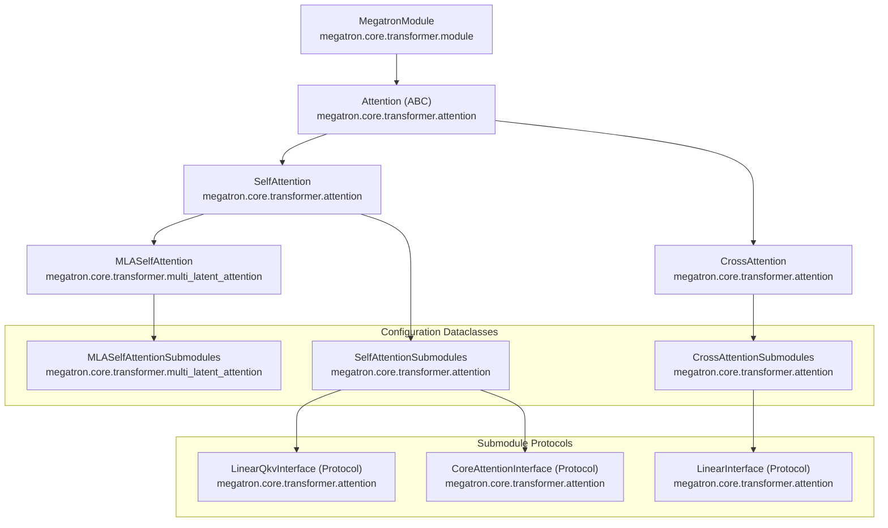
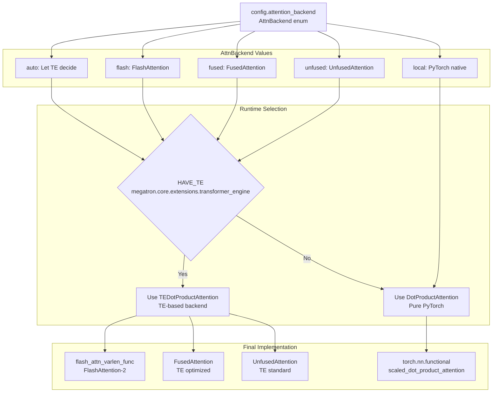
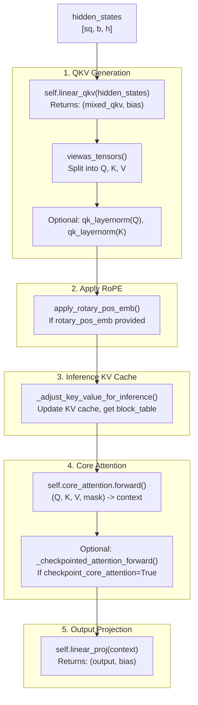
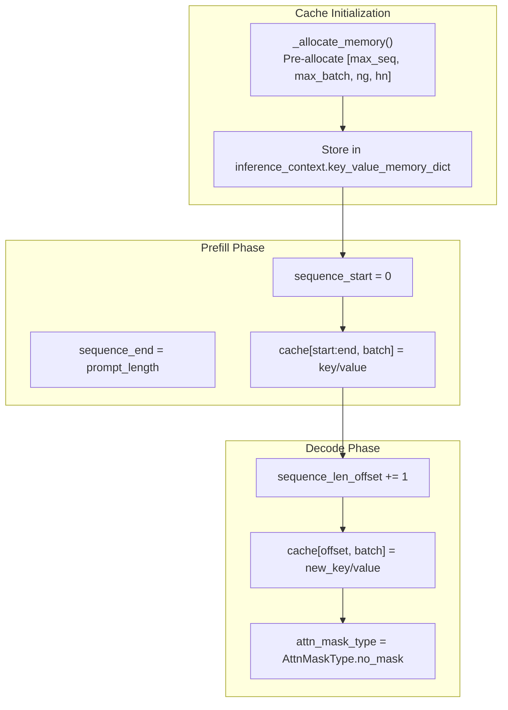

<!-- source: DeepWiki mcp.deepwiki.com · repo NVIDIA/Megatron-LM · page 2.3 Attention Mechanisms · fetched 2026-10-26 -->

# Attention Mechanisms

Relevant source files

The following files were used as context for generating this wiki page:

- [gpt_builders.py](gpt_builders.py)
- [mamba_builders.py](mamba_builders.py)
- [megatron/core/extensions/transformer_engine.py](megatron/core/extensions/transformer_engine.py)
- [megatron/core/fusions/fused_bias_swiglu.py](megatron/core/fusions/fused_bias_swiglu.py)
- [megatron/core/models/gpt/gpt_layer_specs.py](megatron/core/models/gpt/gpt_layer_specs.py)
- [megatron/core/models/gpt/gpt_model.py](megatron/core/models/gpt/gpt_model.py)
- [megatron/core/tensor_parallel/__init__.py](megatron/core/tensor_parallel/__init__.py)
- [megatron/core/tensor_parallel/layers.py](megatron/core/tensor_parallel/layers.py)
- [megatron/core/tensor_parallel/random.py](megatron/core/tensor_parallel/random.py)
- [megatron/core/transformer/__init__.py](megatron/core/transformer/__init__.py)
- [megatron/core/transformer/attention.py](megatron/core/transformer/attention.py)
- [megatron/core/transformer/cuda_graphs.py](megatron/core/transformer/cuda_graphs.py)
- [megatron/core/transformer/dot_product_attention.py](megatron/core/transformer/dot_product_attention.py)
- [megatron/core/transformer/experimental_attention_variant/dsa.py](megatron/core/transformer/experimental_attention_variant/dsa.py)
- [megatron/core/transformer/experimental_attention_variant/dsa_cudnn_kernels.py](megatron/core/transformer/experimental_attention_variant/dsa_cudnn_kernels.py)
- [megatron/core/transformer/experimental_attention_variant/dsa_indexer_loss.py](megatron/core/transformer/experimental_attention_variant/dsa_indexer_loss.py)
- [megatron/core/transformer/experimental_attention_variant/dsa_kernels.py](megatron/core/transformer/experimental_attention_variant/dsa_kernels.py)
- [megatron/core/transformer/experimental_attention_variant/dsa_layout.py](megatron/core/transformer/experimental_attention_variant/dsa_layout.py)
- [megatron/core/transformer/experimental_attention_variant/dsa_masking.py](megatron/core/transformer/experimental_attention_variant/dsa_masking.py)
- [megatron/core/transformer/experimental_attention_variant/dsa_tilelang_kernels.py](megatron/core/transformer/experimental_attention_variant/dsa_tilelang_kernels.py)
- [megatron/core/transformer/experimental_attention_variant/ops/indexer.py](megatron/core/transformer/experimental_attention_variant/ops/indexer.py)
- [megatron/core/transformer/experimental_attention_variant/ops/sparse_mla.py](megatron/core/transformer/experimental_attention_variant/ops/sparse_mla.py)
- [megatron/core/transformer/experimental_attention_variant/ops/tilelang_dsa.py](megatron/core/transformer/experimental_attention_variant/ops/tilelang_dsa.py)
- [megatron/core/transformer/experimental_attention_variant/ops/tilelang_indexer_bwd.py](megatron/core/transformer/experimental_attention_variant/ops/tilelang_indexer_bwd.py)
- [megatron/core/transformer/experimental_attention_variant/ops/tilelang_indexer_fwd.py](megatron/core/transformer/experimental_attention_variant/ops/tilelang_indexer_fwd.py)
- [megatron/core/transformer/experimental_attention_variant/ops/tilelang_indexer_loss.py](megatron/core/transformer/experimental_attention_variant/ops/tilelang_indexer_loss.py)
- [megatron/core/transformer/experimental_attention_variant/ops/tilelang_sparse_mla_bwd.py](megatron/core/transformer/experimental_attention_variant/ops/tilelang_sparse_mla_bwd.py)
- [megatron/core/transformer/mlp.py](megatron/core/transformer/mlp.py)
- [megatron/core/transformer/module.py](megatron/core/transformer/module.py)
- [megatron/core/transformer/multi_latent_attention.py](megatron/core/transformer/multi_latent_attention.py)
- [megatron/core/transformer/pipeline_parallel_layer_layout.py](megatron/core/transformer/pipeline_parallel_layer_layout.py)
- [megatron/core/transformer/spec_utils.py](megatron/core/transformer/spec_utils.py)
- [megatron/core/transformer/torch_norm.py](megatron/core/transformer/torch_norm.py)
- [megatron/core/transformer/transformer_block.py](megatron/core/transformer/transformer_block.py)
- [megatron/core/transformer/transformer_config.py](megatron/core/transformer/transformer_config.py)
- [megatron/core/transformer/transformer_layer.py](megatron/core/transformer/transformer_layer.py)
- [megatron/core/transformer/utils.py](megatron/core/transformer/utils.py)
- [megatron/core/utils.py](megatron/core/utils.py)
- [model_provider.py](model_provider.py)
- [tests/functional_tests/test_cases/gpt/gpt3_mcore_te_tp2_pp2_dsa/model_config.yaml](tests/functional_tests/test_cases/gpt/gpt3_mcore_te_tp2_pp2_dsa/model_config.yaml)
- [tests/unit_tests/fusions/test_swiglu_fusion.py](tests/unit_tests/fusions/test_swiglu_fusion.py)
- [tests/unit_tests/models/test_dsa_gpt_mamba_equivalence.py](tests/unit_tests/models/test_dsa_gpt_mamba_equivalence.py)
- [tests/unit_tests/models/test_gpt_model.py](tests/unit_tests/models/test_gpt_model.py)
- [tests/unit_tests/tensor_parallel/test_random.py](tests/unit_tests/tensor_parallel/test_random.py)
- [tests/unit_tests/transformer/__init__.py](tests/unit_tests/transformer/__init__.py)
- [tests/unit_tests/transformer/experimental_attention_variant/dsa_native_parity_utils.py](tests/unit_tests/transformer/experimental_attention_variant/dsa_native_parity_utils.py)
- [tests/unit_tests/transformer/experimental_attention_variant/test_absorbed_mla.py](tests/unit_tests/transformer/experimental_attention_variant/test_absorbed_mla.py)
- [tests/unit_tests/transformer/experimental_attention_variant/test_attention_variant_dsa.py](tests/unit_tests/transformer/experimental_attention_variant/test_attention_variant_dsa.py)
- [tests/unit_tests/transformer/experimental_attention_variant/test_dsa_backend_tp_sp_parity.py](tests/unit_tests/transformer/experimental_attention_variant/test_dsa_backend_tp_sp_parity.py)
- [tests/unit_tests/transformer/experimental_attention_variant/test_dsa_native_parity.py](tests/unit_tests/transformer/experimental_attention_variant/test_dsa_native_parity.py)
- [tests/unit_tests/transformer/test_attention.py](tests/unit_tests/transformer/test_attention.py)
- [tests/unit_tests/transformer/test_core_attention.py](tests/unit_tests/transformer/test_core_attention.py)
- [tests/unit_tests/transformer/test_cuda_graphs.py](tests/unit_tests/transformer/test_cuda_graphs.py)
- [tests/unit_tests/transformer/test_mlp.py](tests/unit_tests/transformer/test_mlp.py)
- [tests/unit_tests/transformer/test_multi_latent_attention.py](tests/unit_tests/transformer/test_multi_latent_attention.py)
- [tests/unit_tests/transformer/test_spec_customization.py](tests/unit_tests/transformer/test_spec_customization.py)
- [tests/unit_tests/transformer/test_spec_utils.py](tests/unit_tests/transformer/test_spec_utils.py)
- [tests/unit_tests/transformer/test_transformer_block.py](tests/unit_tests/transformer/test_transformer_block.py)
- [tests/unit_tests/transformer/test_transformer_layer.py](tests/unit_tests/transformer/test_transformer_layer.py)
- [tests/unit_tests/transformer/test_utils.py](tests/unit_tests/transformer/test_utils.py)
- [tools/checkpoint/remap_gpt_dsa_to_mamba.py](tools/checkpoint/remap_gpt_dsa_to_mamba.py)

This document covers the attention mechanism implementations in Megatron-Core, focusing on the `Attention` base class, attention protocols, FlashAttention integration, Multi-Latent Attention (MLA), and inference optimizations. For transformer layer configuration, see page 2.1. For Transformer Engine integration details, see page 2.6.

## Architecture Overview

The attention system in Megatron-Core uses a protocol-based architecture that enables flexible implementations. The base `Attention` class (abstract) is specialized into `SelfAttention` and `CrossAttention`, both using configurable submodules for QKV projections, core attention computation, and output projection.

### Attention Class Hierarchy and Protocols

**Class Hierarchy Diagram**

Sources: [megatron/core/transformer/attention.py:139-237](), [megatron/core/transformer/attention.py:239-244](), [megatron/core/transformer/multi_latent_attention.py:112-128]()

### Key Attention Components

The `Attention` base class provides common functionality for both self-attention and cross-attention:

| Component | Type | Purpose | Implementation |
|-----------|------|---------|----------------|
| `core_attention` | Protocol-based | Executes scaled dot-product attention | Built via `CoreAttentionBuilder` |
| `linear_proj` | Module | Output projection after attention | `RowParallelLinear` or `TERowParallelLinear` |
| `checkpoint_core_attention` | bool | Activation checkpointing for attention | Configured via `recompute_granularity` |
| `num_query_groups_per_partition` | int | GQA: KV heads per TP partition | Computed from `num_query_groups` |
| `num_attention_heads_per_partition` | int | Query heads per TP partition | Computed from `num_attention_heads` |

Sources: [megatron/core/transformer/attention.py:246-363]()

## Attention Configuration

Attention behavior is controlled through `TransformerConfig` parameters. The configuration determines both the attention backend (FlashAttention, fused, unfused, or local) and attention-specific features like GQA, sliding window attention, and RoPE.

### Core Attention Configuration Parameters

| Parameter | Type | Default | Purpose |
|-----------|------|---------|---------|
| `attention_backend` | `AttnBackend` | `auto` | Select attention implementation [megatron/core/transformer/transformer_config.py:144]() |
| `softmax_scale` | `Optional[float]` | `None` | Custom attention scaling (default: 1/√d_k) [megatron/core/transformer/transformer_config.py:160]() |
| `num_query_groups` | `Optional[int]` | `None` | Number of KV heads for GQA (None = MHA) [megatron/core/transformer/transformer_config.py:171-174]() |
| `qk_layernorm` | `bool` | `False` | Apply LayerNorm to Q and K projections [megatron/core/transformer/transformer_config.py:252]() |
| `qk_l2_norm` | `bool` | `False` | Apply L2 normalization (Llama 4 style) [megatron/core/transformer/transformer_config.py:255]() |
| `window_size` | `Optional[Tuple[int, int]]` | `None` | Sliding window size (backward, forward) [megatron/core/transformer/transformer_config.py:240]() |
| `multi_latent_attention` | `bool` | `False` | Enable Multi-Latent Attention (DeepSeek style) [megatron/core/transformer/transformer_config.py:258]() |

Sources: [megatron/core/transformer/transformer_config.py:138-355]()

### AttnBackend Enum and Selection

**Backend Selection Flow**

Sources: [megatron/core/transformer/enums.py:60-68](), [megatron/core/extensions/transformer_engine.py:73-86]()

## Multi-Latent Attention (MLA)

MLA is an optimized attention mechanism (introduced by DeepSeek) that compresses Key-Value (KV) cache by projecting them into a low-dimensional latent space.

### MLA Architecture

MLA replaces standard QKV projections with a more complex set of up/down projections:
1.  **KV Compression**: Keys and values are compressed into a single latent vector `c_kv`.
2.  **Decoupled Queries**: Queries are split into a compressed latent part and a decoupled part for Rotary Positional Embeddings (RoPE).
3.  **Absorbed Scaling**: The output projection absorbs parts of the attention scaling.

**MLA Submodule Mapping**

| Submodule | Code Entity | Purpose |
|-----------|-------------|---------|
| `linear_q_proj` | `linear_q_proj` | Initial query projection [megatron/core/transformer/multi_latent_attention.py:121]() |
| `linear_q_up_proj` | `linear_q_up_proj` | Projects latent query to head dimension [megatron/core/transformer/multi_latent_attention.py:123]() |
| `linear_kv_down_proj` | `linear_kv_down_proj` | Compresses KV into latent space [megatron/core/transformer/multi_latent_attention.py:124]() |
| `linear_kv_up_proj` | `linear_kv_up_proj` | Projects latent KV back to heads [megatron/core/transformer/multi_latent_attention.py:125]() |

Sources: [megatron/core/transformer/multi_latent_attention.py:112-128](), [megatron/core/models/gpt/gpt_layer_specs.py:104-132]()

## SelfAttention Submodule Protocols

The `SelfAttention` class implements self-attention using a protocol-based design that allows different implementations for its submodules (QKV projection, core attention, output projection).

### SelfAttention Forward Pass

**Forward Pass Data Flow**

Sources: [megatron/core/transformer/attention.py:702-872]()

## FlashAttention Integration

FlashAttention is integrated through both Transformer Engine and direct flash-attn library usage. The system supports FlashAttention-2 for training and FlashAttention-3 for inference with KV cache.

### FlashAttention Backend Selection

| Mode | FA Version | Kernel Function | Use Case |
|------|-----------|----------------|----------|
| Training | FA2 | `flash_attn_varlen_func` | Variable-length sequences, packed format [megatron/core/transformer/attention.py:116-119]() |
| Inference (prefill) | FA2/FA3 | `flash_attn_varlen_func` | Initial prompt processing [megatron/core/transformer/attention.py:762-856]() |
| Inference (decode) | FA2 | `flash_attn_with_kvcache` | Single-token generation with KV cache [megatron/core/transformer/attention.py:116-119]() |
| Inference (decode) | FA3 | `flash_attn3_with_kvcache` | Optimized H100/Hopper decode [megatron/core/transformer/attention.py:65-68]() |

Sources: [megatron/core/transformer/attention.py:63-119]()

## Inference KV Cache Management

The `_adjust_key_value_for_inference()` method manages KV cache during inference, supporting both static and dynamic batching strategies.

### Static Batching (Pre-allocated Buffers)

Sources: [megatron/core/transformer/attention.py:427-438](), [megatron/core/transformer/attention.py:497-594]()

### Dynamic Batching (Block Tables)

For dynamic inference with variable sequence lengths, block tables enable paged attention:

1.  **Append**: `inference_context.append_key_value_cache()` adds new tokens to the physical cache blocks [megatron/core/transformer/attention.py:595-610]().
2.  **Retrieve**: `get_cache_pointer` retrieves the block table mapping logical positions to physical blocks [megatron/core/transformer/attention.py:612-620]().
3.  **Execute**: FlashAttention kernels use the block table to perform paged attention computation [megatron/core/transformer/attention.py:622-629]().

Sources: [megatron/core/transformer/attention.py:595-629]()

## Attention Optimizations

### CUDA Graph Integration

Attention modules are designed to be compatible with CUDA graphs to reduce CPU overhead during inference. The `CudaGraphScope` enum defines different capture scopes (e.g., `local`, `global`) for managing memory buffers during graph capture.

Sources: [megatron/core/transformer/enums.py:73-77](), [megatron/core/transformer/transformer_config.py:25-27]()

### Activation Checkpointing for Attention

Core attention can be selectively checkpointed to save memory during training:
- **Selective Recompute**: Only recomputes the attention computation (the "core") rather than the entire transformer layer.
- **Implementation**: Managed via `_checkpointed_attention_forward()` which wraps the core attention call in `torch.utils.checkpoint`.

Sources: [megatron/core/transformer/attention.py:334-337](), [megatron/core/transformer/attention.py:387-425]()

### Softmax Variants

Megatron-Core supports several softmax modifications for different model families:
- **Vanilla**: Standard softmax.
- **Off-by-one**: Adds a fixed offset to the denominator (useful for models like BERT).
- **Learnable**: Uses a learnable parameter for the denominator offset.

Sources: [megatron/core/transformer/transformer_config.py:163-166]()

---

