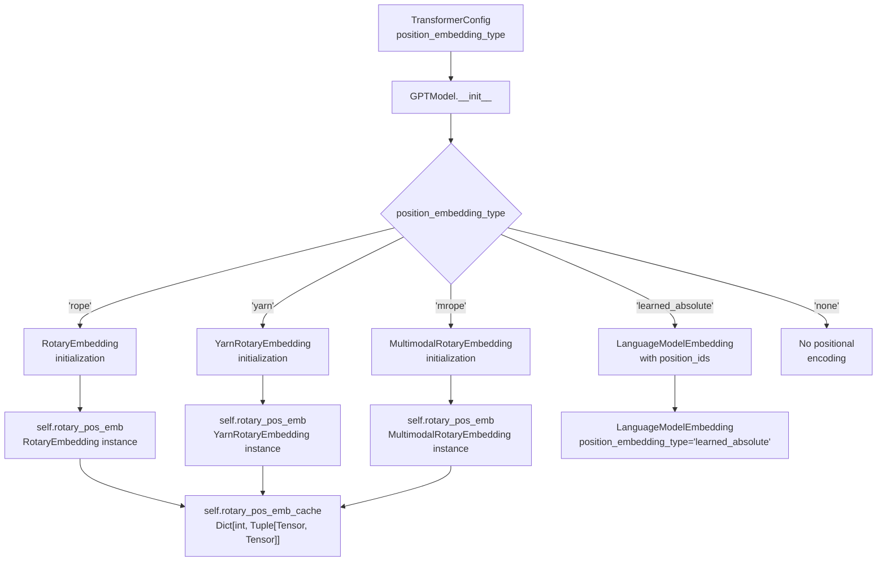
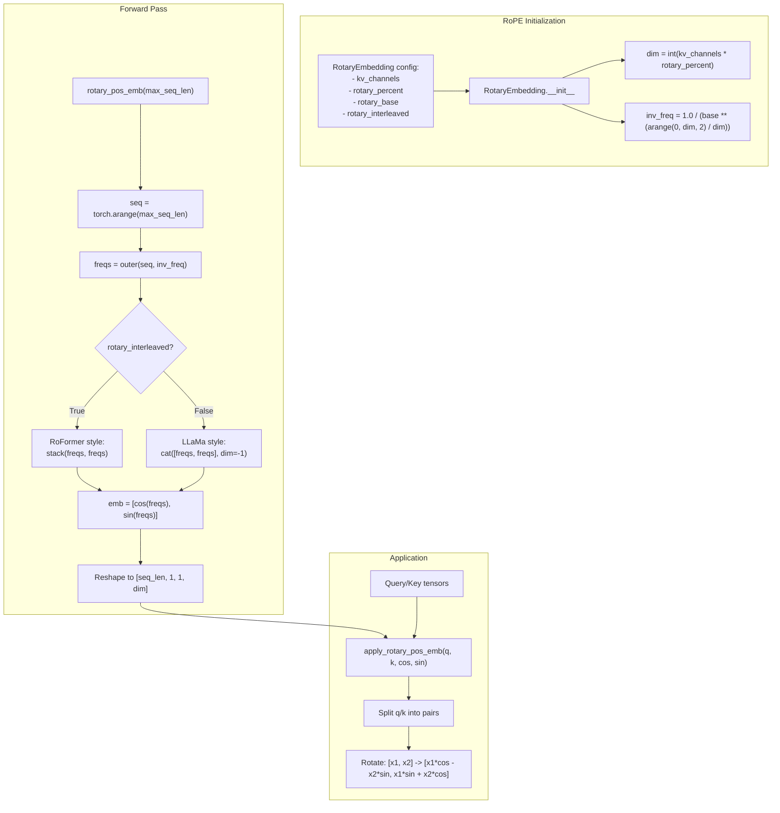
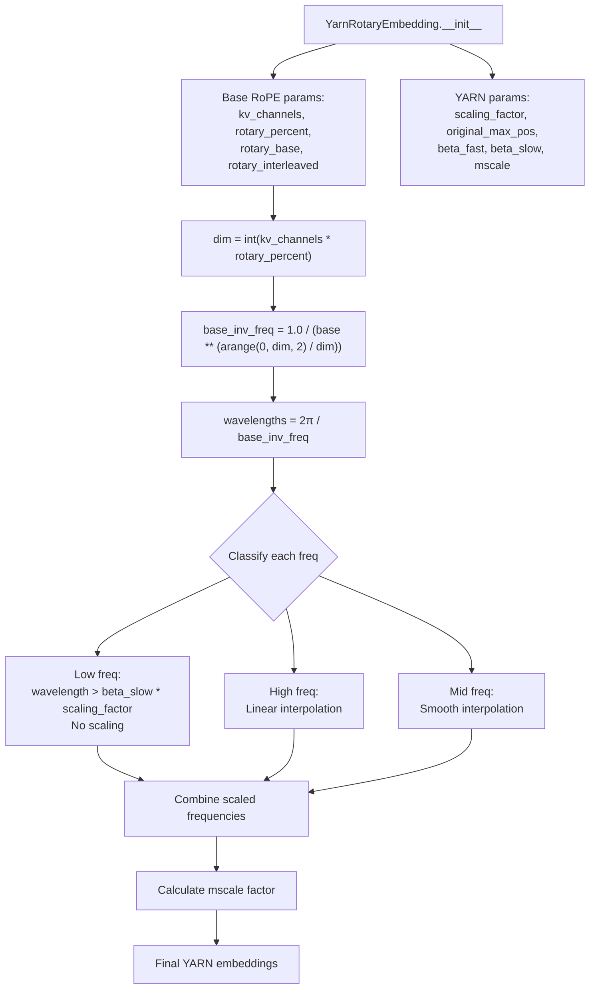
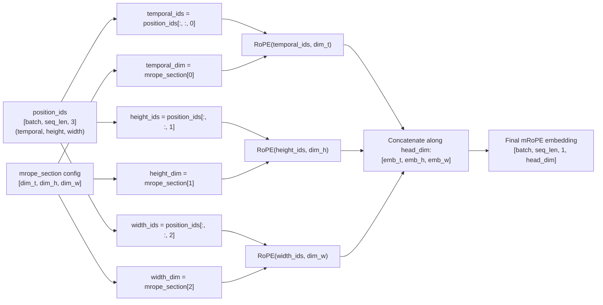
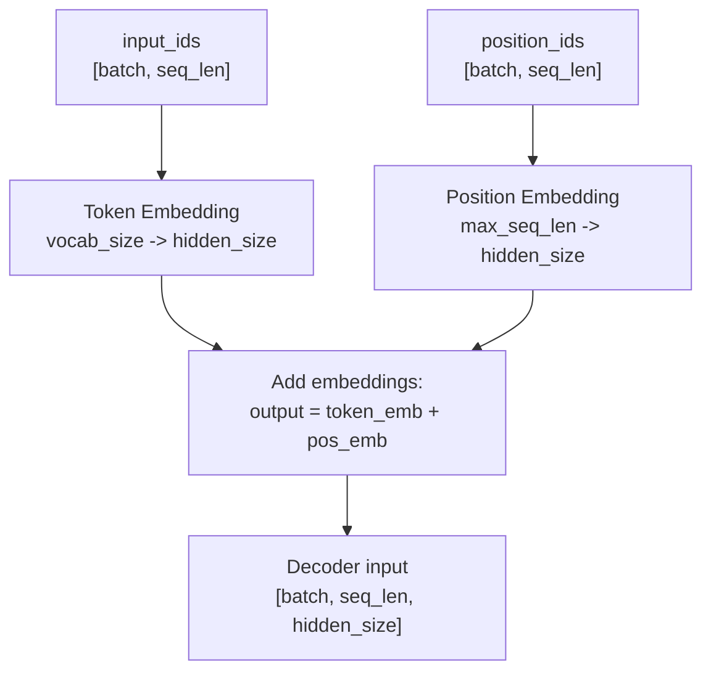
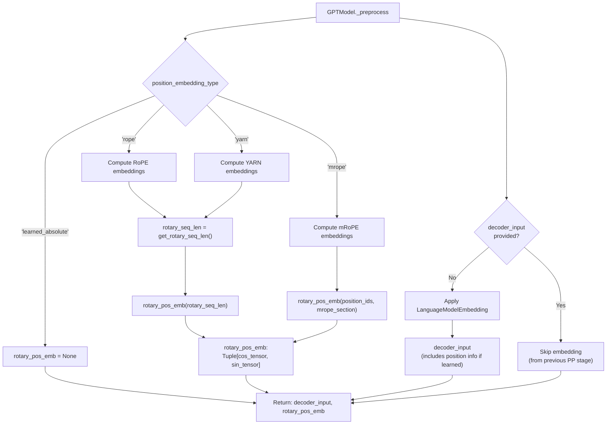
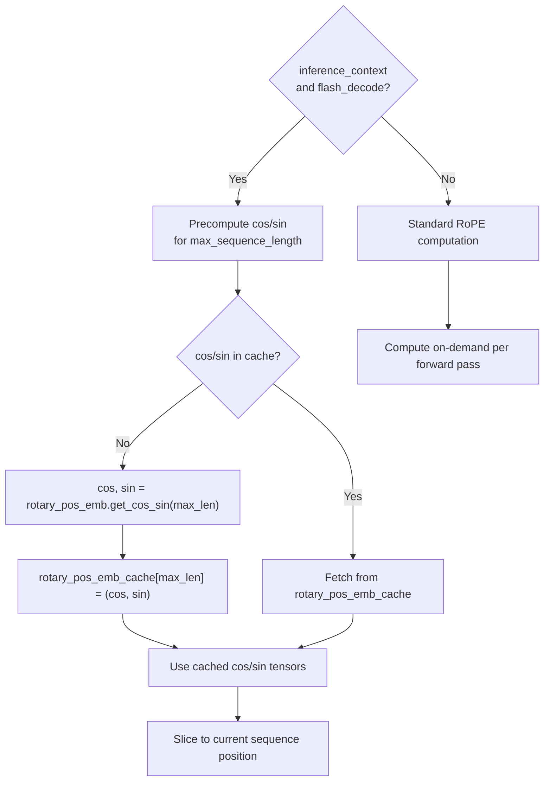
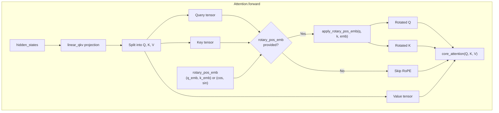

<!-- source: DeepWiki mcp.deepwiki.com · repo NVIDIA/Megatron-LM · page 2.4 Positional Embeddings · fetched 2026-10-26 -->

# Positional Embeddings

<details>
<summary>Relevant source files</summary>

The following files were used as context for generating this wiki page:

- [megatron/core/fusions/fused_indices_converter.py](megatron/core/fusions/fused_indices_converter.py)
- [megatron/core/fusions/fused_mla_yarn_rope_apply.py](megatron/core/fusions/fused_mla_yarn_rope_apply.py)
- [megatron/core/fusions/fused_pad_routing_map.py](megatron/core/fusions/fused_pad_routing_map.py)
- [megatron/core/models/common/embeddings/rope_utils.py](megatron/core/models/common/embeddings/rope_utils.py)
- [megatron/core/models/common/embeddings/rotary_pos_embedding.py](megatron/core/models/common/embeddings/rotary_pos_embedding.py)
- [megatron/core/models/common/embeddings/yarn_rotary_pos_embedding.py](megatron/core/models/common/embeddings/yarn_rotary_pos_embedding.py)
- [megatron/core/transformer/experimental_attention_variant/absorbed_mla.py](megatron/core/transformer/experimental_attention_variant/absorbed_mla.py)
- [tests/unit_tests/fusions/test_mla_yarn_rope_apply.py](tests/unit_tests/fusions/test_mla_yarn_rope_apply.py)
- [tests/unit_tests/transformer/moe/test_multihot_indices_converter.py](tests/unit_tests/transformer/moe/test_multihot_indices_converter.py)

</details>


This document describes the positional embedding implementations in Megatron-LM. Positional embeddings encode sequence position information to enable transformer models to understand token ordering. For information about attention mechanisms that consume these embeddings, see [Attention Mechanisms](2.3). For general model architecture, see [Core Model Architecture](2).

---

## Overview

Megatron-LM supports multiple positional embedding strategies, each with different characteristics for sequence length handling, computational efficiency, and extrapolation capabilities. The system is designed to be modular, allowing different embedding types to be selected via configuration.

**Supported Position Embedding Types:**

| Type | Description | Key Use Case |
|------|-------------|--------------|
| `learned_absolute` | Learned position embeddings added to token embeddings | Standard transformer, fixed max length |
| `rope` | Rotary Position Embedding (RoPE) | Modern LLMs (LLaMa, GPT-NeoX style) |
| `yarn` | YARN (Yet Another RoPE extensioN) | Extended context length with better extrapolation |
| `mrope` | Multimodal RoPE | Vision-language models with spatial position encoding |
| `none` | No positional encoding | Specialized architectures |

Sources: [megatron/core/models/gpt/gpt_model.py:101-103]()

---

## Configuration Parameters

The `TransformerConfig` and model initialization parameters control positional embedding behavior:

### Core Configuration Fields

```python
# Position embedding type selection
position_embedding_type: Literal['learned_absolute', 'rope', 'mrope', 'yarn', 'none']

# RoPE-specific parameters
rotary_percent: float = 1.0          # Fraction of head_dim to apply RoPE to
rotary_base: int = 10000             # Base period for frequency computation
rotary_interleaved: bool = False     # RoFormer (True) vs LLaMa (False) style

# Scaling and interpolation
rope_scaling: bool = False           # Enable RoPE frequency scaling
rope_scaling_factor: float = 8.0     # Scaling factor for frequencies
seq_len_interpolation_factor: Optional[float] = None  # Linear interpolation

# Layer-specific control
no_rope_freq: Optional[Union[int, List[int]]] = None  # Skip RoPE on certain layers

# YARN-specific parameters
yarn_rotary_scaling_factor: float
yarn_original_max_position_embeddings: int
yarn_beta_fast: int = 32
yarn_beta_slow: int = 1
yarn_mscale: float = 1.0
yarn_mscale_all_dim: float = 0.0

# Multimodal RoPE
mrope_section: Optional[List[int]] = None  # Spatial dimension partitioning
```

Sources: [megatron/core/transformer/transformer_config.py:207-261](), [megatron/core/models/gpt/gpt_model.py:67-84]()

---

## Position Embedding Type Selection

### Initialization Flow



**Diagram: Position Embedding Initialization in GPTModel**

Sources: [megatron/core/models/gpt/gpt_model.py:127-205]()

---

## Rotary Position Embeddings (RoPE)

### Architecture and Implementation

RoPE applies rotations to query and key embeddings based on their absolute positions, enabling relative position encoding through dot-product attention. The system supports partial RoPE application (controlled by `rotary_percent`) and two rotation styles.



**Diagram: RoPE Computation and Application Flow**

### RoPE Style: Interleaved vs Non-Interleaved

The `rotary_interleaved` parameter controls how dimensions are paired for rotation:

- **RoFormer style (`rotary_interleaved=True`)**: Rotates pairs of even and odd dimensions: `(d0, d1), (d2, d3), ...` [megatron/core/models/common/embeddings/rotary_pos_embedding.py:170-172]()
- **LLaMa style (`rotary_interleaved=False`)**: Rotates first half with second half: `(d0, d_{n/2}), (d1, d_{n/2+1}), ...` [megatron/core/models/common/embeddings/rotary_pos_embedding.py:168-169]()

Megatron-LM also supports MLA-style interleaving via `mla_rotary_interleaved` where dimensions are interleaved as `0, 2, 4...` and `1, 3, 5...` before rotation [megatron/core/models/common/embeddings/rope_utils.py:135-138]().

Sources: [megatron/core/transformer/transformer_config.py:207-209](), [megatron/core/models/gpt/gpt_model.py:160-171](), [megatron/core/models/common/embeddings/rope_utils.py:135-138]()

### Partial RoPE Application

The `rotary_percent` parameter (default 1.0) controls what fraction of the head dimension receives RoPE:

```python
# Example: With kv_channels=64 and rotary_percent=0.5
# Only the first 32 dimensions get RoPE, remaining 32 are identity
dim = int(kv_channels * rotary_percent)  # 32
# Frequencies computed only for dim=32
```

This allows models to use RoPE for some dimensions while leaving others for learned patterns. [megatron/core/models/common/embeddings/rotary_pos_embedding.py:73-74]()

Sources: [megatron/core/models/gpt/gpt_model.py:69-71]()

### Layer-Selective RoPE with `no_rope_freq`

The `no_rope_freq` parameter enables skipping RoPE on specific layers:

```python
# Option 1: Integer pattern - skip every N-1 layers
no_rope_freq = 4  # Apply RoPE for 3 layers, skip 1, repeat

# Option 2: Explicit list pattern
no_rope_freq = [0, 1, 1, 0]  # Skip layer 1 and 2, apply on 0 and 3
```

Sources: [megatron/core/transformer/transformer_config.py:255-260]()

---

## YARN (Yet Another RoPE extensioN)

YARN extends RoPE for longer context lengths by applying attention-aware scaling to different frequency components. It improves extrapolation to sequences longer than the training length.

### YARN Configuration Parameters

| Parameter | Type | Description |
|-----------|------|-------------|
| `yarn_rotary_scaling_factor` | float | Overall scaling factor for frequencies |
| `yarn_original_max_position_embeddings` | int | Original max sequence length (reference) |
| `yarn_beta_fast` | int | Fast wavelength threshold (default: 32) |
| `yarn_beta_slow` | int | Slow wavelength threshold (default: 1) |
| `yarn_mscale` | float | Magnitude scaling factor for attention scores |
| `yarn_mscale_all_dim` | float | Alternative mscale computation method |

### YARN Initialization Flow



**Diagram: YARN Frequency Scaling Strategy**

YARN applies different scaling to different frequency bands:
- **Low frequencies** (long wavelengths): No interpolation - these capture long-range dependencies well.
- **High frequencies** (short wavelengths): Linear interpolation - these need scaling for longer contexts.
- **Middle frequencies**: Smooth transition between the two regimes using a linear ramp mask [megatron/core/models/common/embeddings/yarn_rotary_pos_embedding.py:128-139]().

Sources: [megatron/core/models/gpt/gpt_model.py:173-192](), [megatron/core/models/common/embeddings/yarn_rotary_pos_embedding.py:13-100](), [megatron/core/models/common/embeddings/yarn_rotary_pos_embedding.py:128-139]()

---

## Multimodal RoPE (mRoPE)

Multimodal RoPE extends RoPE for vision-language models by partitioning the rotation dimensions to encode both temporal and spatial positions.

### mRoPE Section Configuration

The `mrope_section` parameter defines how the head dimension is partitioned:

```python
# Example: For spatial + temporal encoding
mrope_section = [16, 16, 32]  # [temporal, height, width]
# Total must equal head dimension (64 in this case)
```

Each section receives independent rotary embeddings based on different position indices:
- **Temporal section**: Uses sequence position (time dimension).
- **Height section**: Uses vertical spatial coordinate.
- **Width section**: Uses horizontal spatial coordinate.

### mRoPE Forward Flow



**Diagram: Multimodal RoPE Encoding Process**

Sources: [megatron/core/models/gpt/gpt_model.py:193-205](), [megatron/core/models/common/embeddings/rotary_pos_embedding.py:33]()

---

## Learned Absolute Position Embeddings

When `position_embedding_type='learned_absolute'`, positions are encoded through a learned embedding table within the `LanguageModelEmbedding` module.

### Implementation



**Diagram: Learned Absolute Position Embedding Application**

The position embedding table has shape `[max_sequence_length, hidden_size]` and is learned during training. This approach:
- **Advantages**: Simple, effective for fixed-length sequences.
- **Limitations**: Cannot extrapolate beyond `max_sequence_length`, requires more memory for long sequences.

Sources: [megatron/core/models/gpt/gpt_model.py:150-158](), [megatron/core/models/common/embeddings/language_model_embedding.py:14]()

---

## Position Embedding Flow in Model Forward Pass

### Preprocessing Stage

The `GPTModel._preprocess` method handles position embedding preparation before the transformer decoder:



**Diagram: Position Embedding Preparation in GPTModel._preprocess**

Sources: [megatron/core/models/gpt/gpt_model.py:289-455]()

### Inference Mode Optimizations

For inference with `flash_decode` enabled or flashinfer integration:



**Diagram: RoPE Caching Strategy for Inference**

The caching mechanism (via `self.rotary_pos_emb_cache`) avoids recomputing cos/sin tensors for every token generation step during inference. [megatron/core/models/common/embeddings/rotary_pos_embedding.py:177-179]()

Sources: [megatron/core/models/gpt/gpt_model.py:206-207](), [megatron/core/models/gpt/gpt_model.py:344-364]()

---

## Application in Attention Layers

### RoPE Application in Self-Attention

The `Attention` module applies rotary embeddings to query and key tensors before computing attention scores:



**Diagram: RoPE Application in Attention Forward Pass**

### Context Parallelism Support

When context parallelism (CP) is enabled, RoPE frequencies must be correctly sliced to match the sequence segment assigned to each rank. The function `get_pos_emb_on_this_cp_rank` handles this by selecting indices based on the CP rank and group size [megatron/core/models/common/embeddings/rope_utils.py:48-70]().

For THD format (Total sequence length, Heads, Dim), `_get_thd_freqs_on_this_cp_rank` provides a frequency slice that accounts for CP sharding and optional sequence offsets, which is critical for VLMs where spatial positions matter [megatron/core/models/common/embeddings/rope_utils.py:159-196]().

Sources: [megatron/core/models/common/embeddings/rope_utils.py:48-70](), [megatron/core/models/common/embeddings/rope_utils.py:159-196]()

---

## RoPE Fusion Optimizations

### Fused RoPE Kernel

When `apply_rope_fusion=True`, the system attempts to use fused CUDA kernels for RoPE application. This includes support for `fused_apply_rotary_pos_emb` and `fused_apply_rotary_pos_emb_thd` from Transformer Engine [megatron/core/models/common/embeddings/rope_utils.py:20-29]().

### Triton-based Fusions for MLA

For Multi-Latent Attention (MLA), specialized Triton kernels are available for inplace RoPE application. The kernel `_mla_rope_fwd_inplace_kernel` applies rotations to the trailing `emb_dim` elements of a query or KV tensor, supporting both interleaved and non-interleaved layouts [megatron/core/fusions/fused_mla_yarn_rope_apply.py:79-160]().

The `AbsorbedMLASelfAttention` class leverages these fusions to apply RoPE efficiently during the forward pass [megatron/core/transformer/experimental_attention_variant/absorbed_mla.py:44-50]().

Sources: [megatron/core/models/common/embeddings/rope_utils.py:20-29](), [megatron/core/fusions/fused_mla_yarn_rope_apply.py:79-160](), [megatron/core/transformer/experimental_attention_variant/absorbed_mla.py:44-50]()

---

## Configuration-to-Implementation Mapping

```mermaid
graph TD
    subgraph "TransformerConfig Options"
        POS_TYPE["position_embedding_type"]
        ROPE_PERCENT["rotary_percent"]
        ROPE_BASE["rotary_base"]
        ROPE_INTERLEAVED["rotary_interleaved"]
        ROPE_SCALING["rope_scaling"]
        SEQ_INTERP["seq_len_interpolation_factor"]
        NO_ROPE["no_rope_freq"]
        MROPE_SEC["mrope_section"]
        YARN_SCALE["yarn_rotary_scaling_factor"]
        YARN_ORIG["yarn_original_max_position_embeddings"]
        YARN_BETA_F["yarn_beta_fast"]
        YARN_BETA_S["yarn_beta_slow"]
        YARN_MSCALE["yarn_mscale"]
    end
    
    subgraph "GPTModel Implementation"
        POS_TYPE --> CHECK_TYPE{"Check type"}
        
        CHECK_TYPE -->|"'learned_absolute'"| LANG_EMB["LanguageModelEmbedding<br/>position_embedding_type='learned_absolute'"]
        
        CHECK_TYPE -->|"'rope'"| ROPE_CLASS["RotaryEmbedding instance"]
        ROPE_PERCENT --> ROPE_CLASS
        ROPE_BASE --> ROPE_CLASS
        ROPE_INTERLEAVED --> ROPE_CLASS
        ROPE_SCALING --> ROPE_CLASS
        SEQ_INTERP --> ROPE_CLASS
        
        CHECK_TYPE -->|"'yarn'"| YARN_CLASS["YarnRotaryEmbedding instance"]
        ROPE_PERCENT --> YARN_CLASS
        ROPE_BASE --> YARN_CLASS
        ROPE_INTERLEAVED --> YARN_CLASS
        SEQ_INTERP --> YARN_CLASS
        YARN_SCALE --> YARN_CLASS
        YARN_ORIG --> YARN_CLASS
        YARN_BETA_F --> YARN_CLASS
        YARN_BETA_S --> YARN_CLASS
        YARN_MSCALE --> YARN_CLASS
        
        CHECK_TYPE -->|"'mrope'"| MROPE_CLASS["MultimodalRotaryEmbedding instance"]
        ROPE_PERCENT --> MROPE_CLASS
        ROPE_BASE --> MROPE_CLASS
        ROPE_INTERLEAVED --> MROPE_CLASS
        SEQ_INTERP --> MROPE_CLASS
        MROPE_SEC --> MROPE_CLASS
    end
    
    subgraph "Attention Layer Usage"
        ROPE_CLASS --> ATTN_APPLY["Attention.forward<br/>applies rotary_pos_emb"]
        YARN_CLASS --> ATTN_APPLY
        MROPE_CLASS --> ATTN_APPLY
        
        NO_ROPE --> LAYER_CHECK["TransformerLayer checks<br/>layer_number against pattern"]
        LAYER_CHECK --> SKIP_ROPE_LAYER["Skip RoPE for specific layers"]
    end
```



**Diagram: Configuration Parameters to Implementation Classes**

Sources: [megatron/core/transformer/transformer_config.py:207-261](), [megatron/core/models/gpt/gpt_model.py:127-205]()

---

## Key Classes and Functions

### Core Classes

| Class | Location | Purpose |
|-------|----------|---------|
| `RotaryEmbedding` | [megatron/core/models/common/embeddings/rotary_pos_embedding.py:36]() | Standard RoPE implementation |
| `YarnRotaryEmbedding` | [megatron/core/models/common/embeddings/yarn_rotary_pos_embedding.py:21]() | YARN-extended RoPE |
| `MultimodalRotaryEmbedding` | [megatron/core/models/common/embeddings/rotary_pos_embedding.py:33]() | Multimodal RoPE for vision-language |
| `LanguageModelEmbedding` | [megatron/core/models/common/embeddings/language_model_embedding.py:14]() | Token + position embeddings container |

### Key Functions

| Function | Location | Purpose |
|----------|----------|---------|
| `apply_rotary_pos_emb` | [megatron/core/models/common/embeddings/rope_utils.py:39]() | Entry point for applying RoPE rotations |
| `_apply_rotary_pos_emb_bshd` | [megatron/core/models/common/embeddings/rope_utils.py:92]() | RoPE application for [S, B, H, D] format |
| `_apply_rotary_pos_emb_thd` | [megatron/core/models/common/embeddings/rope_utils.py:202]() | RoPE application for [T, H, D] format |
| `get_pos_emb_on_this_cp_rank` | [megatron/core/models/common/embeddings/rope_utils.py:48]() | CP-aware position embedding slicing |

Sources: [megatron/core/models/common/embeddings/rotary_pos_embedding.py:36-176](), [megatron/core/models/common/embeddings/rope_utils.py:39-202]()

---

