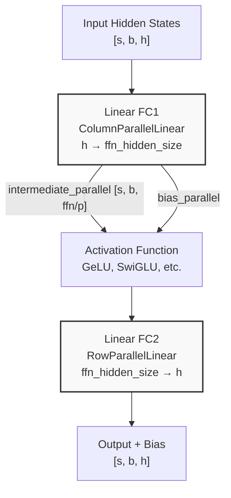
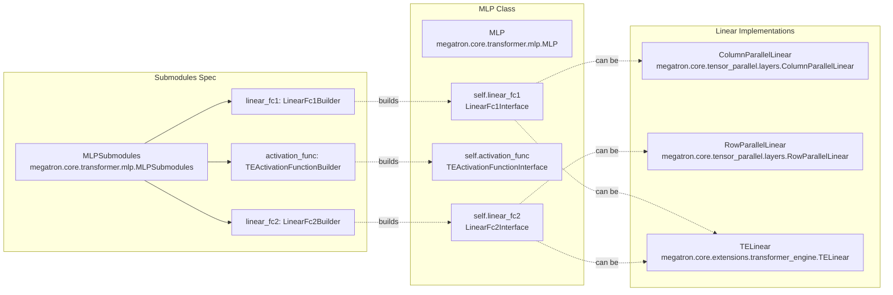
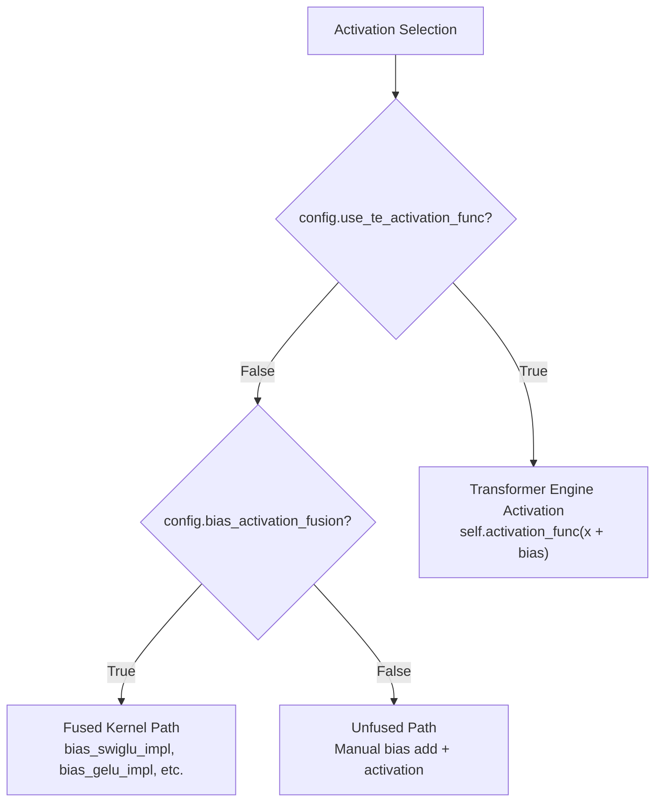
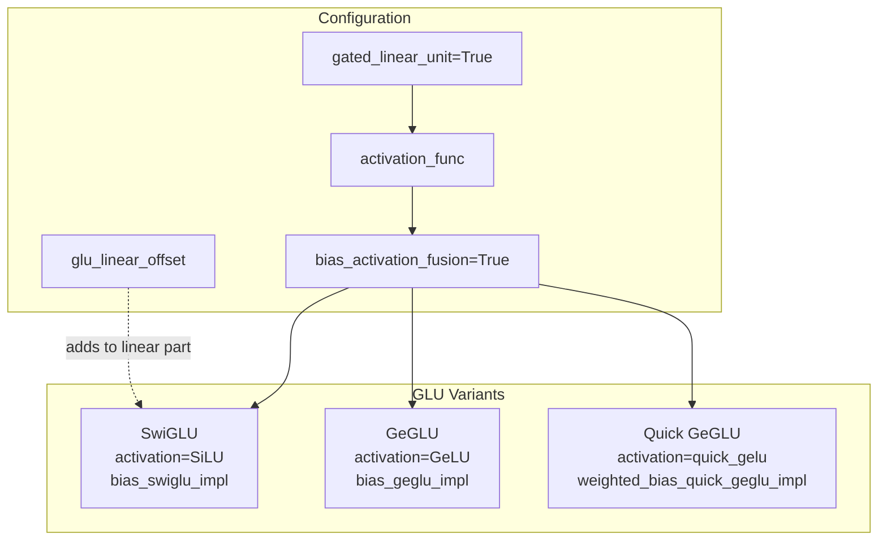

<!-- source: DeepWiki mcp.deepwiki.com · repo NVIDIA/Megatron-LM · page 2.5 MLP and Activation Functions · fetched 2026-10-26 -->

# MLP and Activation Functions

<details>
<summary>Relevant source files</summary>

The following files were used as context for generating this wiki page:

- [examples/multimodal/layer_specs.py](examples/multimodal/layer_specs.py)
- [examples/multimodal/nvlm/internvit.py](examples/multimodal/nvlm/internvit.py)
- [examples/multimodal/radio/radio_g.py](examples/multimodal/radio/radio_g.py)
- [megatron/core/extensions/transformer_engine.py](megatron/core/extensions/transformer_engine.py)
- [megatron/core/extensions/transformer_engine_spec_provider.py](megatron/core/extensions/transformer_engine_spec_provider.py)
- [megatron/core/fusions/fused_bias_dropout.py](megatron/core/fusions/fused_bias_dropout.py)
- [megatron/core/fusions/fused_bias_swiglu.py](megatron/core/fusions/fused_bias_swiglu.py)
- [megatron/core/models/T5/t5_model.py](megatron/core/models/T5/t5_model.py)
- [megatron/core/models/T5/t5_spec.py](megatron/core/models/T5/t5_spec.py)
- [megatron/core/models/backends.py](megatron/core/models/backends.py)
- [megatron/core/models/bert/bert_layer_specs.py](megatron/core/models/bert/bert_layer_specs.py)
- [megatron/core/models/common/embeddings/language_model_embedding.py](megatron/core/models/common/embeddings/language_model_embedding.py)
- [megatron/core/models/gpt/gpt_model.py](megatron/core/models/gpt/gpt_model.py)
- [megatron/core/models/gpt/heterogeneous/heterogeneous_layer_specs.py](megatron/core/models/gpt/heterogeneous/heterogeneous_layer_specs.py)
- [megatron/core/models/gpt/moe_module_specs.py](megatron/core/models/gpt/moe_module_specs.py)
- [megatron/core/tensor_parallel/__init__.py](megatron/core/tensor_parallel/__init__.py)
- [megatron/core/tensor_parallel/layers.py](megatron/core/tensor_parallel/layers.py)
- [megatron/core/tensor_parallel/random.py](megatron/core/tensor_parallel/random.py)
- [megatron/core/transformer/attention.py](megatron/core/transformer/attention.py)
- [megatron/core/transformer/cuda_graphs.py](megatron/core/transformer/cuda_graphs.py)
- [megatron/core/transformer/identity_op.py](megatron/core/transformer/identity_op.py)
- [megatron/core/transformer/mlp.py](megatron/core/transformer/mlp.py)
- [megatron/core/transformer/module.py](megatron/core/transformer/module.py)
- [megatron/core/transformer/moe/shared_experts.py](megatron/core/transformer/moe/shared_experts.py)
- [megatron/core/transformer/torch_norm.py](megatron/core/transformer/torch_norm.py)
- [megatron/core/transformer/transformer_block.py](megatron/core/transformer/transformer_block.py)
- [megatron/core/transformer/transformer_config.py](megatron/core/transformer/transformer_config.py)
- [megatron/core/transformer/transformer_layer.py](megatron/core/transformer/transformer_layer.py)
- [megatron/core/transformer/utils.py](megatron/core/transformer/utils.py)
- [megatron/core/utils.py](megatron/core/utils.py)
- [tests/unit_tests/fusions/test_bias_dropout_fusion.py](tests/unit_tests/fusions/test_bias_dropout_fusion.py)
- [tests/unit_tests/fusions/test_swiglu_fusion.py](tests/unit_tests/fusions/test_swiglu_fusion.py)
- [tests/unit_tests/models/test_t5_model.py](tests/unit_tests/models/test_t5_model.py)
- [tests/unit_tests/tensor_parallel/test_random.py](tests/unit_tests/tensor_parallel/test_random.py)
- [tests/unit_tests/transformer/moe/test_shared_experts.py](tests/unit_tests/transformer/moe/test_shared_experts.py)
- [tests/unit_tests/transformer/test_cuda_graphs.py](tests/unit_tests/transformer/test_cuda_graphs.py)
- [tests/unit_tests/transformer/test_utils.py](tests/unit_tests/transformer/test_utils.py)

</details>


This document describes the Multi-Layer Perceptron (MLP) implementations and activation functions in Megatron-LM. The MLP is the feed-forward network component within each transformer layer, responsible for applying non-linear transformations to hidden states.

For attention mechanisms, see [Attention Mechanisms](2.3). For the complete transformer layer that contains the MLP, see [Transformer Layers and Blocks](2.2). For MoE variants that replace the standard MLP, see [Mixture of Experts (MoE)](3.3).

---

## Overview

The MLP in Megatron-LM takes input with hidden size `h`, projects it to an intermediate size (typically `4*h`), applies a non-linear activation function, and projects back to hidden size `h` [[megatron/core/transformer/mlp.py:157-160]](). The implementation supports:

- Standard activations (GeLU, SiLU, etc.) and gated linear units (SwiGLU, GeGLU) [[megatron/core/transformer/mlp.py:19-25]]().
- Fused kernels for bias-activation combinations [[megatron/core/transformer/mlp.py:264-306]]().
- Tensor parallelism for distributed computation via `ColumnParallelLinear` and `RowParallelLinear` [[megatron/core/transformer/mlp.py:212-245]]().
- Transformer Engine integration for FP8 training and optimized activation modules [[megatron/core/transformer/transformer_config.py:205-207]]().

Sources: [megatron/core/transformer/mlp.py:155-170](), [megatron/core/transformer/transformer_config.py:157-210]()

---

## MLP Architecture

### Basic Structure

The MLP follows a standard two-layer projection pattern. In Megatron-LM, these are typically implemented using `ColumnParallelLinear` (FC1) and `RowParallelLinear` (FC2) to facilitate tensor model parallelism [[megatron/core/transformer/mlp.py:172-182]]().

Title: MLP Data Flow


**Notation:**
- `h`: hidden size [[megatron/core/transformer/mlp.py:166]]()
- `p`: number of tensor model parallel partitions [[megatron/core/transformer/mlp.py:167]]()
- `b`: batch size [[megatron/core/transformer/mlp.py:168]]()
- `s`: sequence length [[megatron/core/transformer/mlp.py:169]]()
- `ffn`: FFN hidden size (typically `4*h`, doubled for gated linear units) [[megatron/core/transformer/mlp.py:194-206]]()

Sources: [megatron/core/transformer/mlp.py:155-170](), [megatron/core/transformer/mlp.py:194-213]()

### Code Entity Mapping

The `MLP` class is a `MegatronModule` that composes linear layers based on a provided `MLPSubmodules` specification [[megatron/core/transformer/mlp.py:138-155]]().

Title: MLP Code Structure and Specs


Sources: [megatron/core/transformer/mlp.py:138-155](), [megatron/core/transformer/mlp.py:212-245](), [megatron/core/extensions/transformer_engine.py:122-124]()

---

## MLP Class Implementation

### Constructor Parameters

The `MLP` class is initialized with the following parameters [[megatron/core/transformer/mlp.py:172-182]]():

| Parameter | Type | Description |
|-----------|------|-------------|
| `config` | `TransformerConfig` | Configuration object containing model parameters |
| `submodules` | `MLPSubmodules` | Specifications for FC1, activation, and FC2 layers |
| `is_expert` | `bool` | Whether this MLP is an expert in MoE (affects TP groups) |
| `input_size` | `Optional[int]` | Input dimension (defaults to `config.hidden_size`) |
| `ffn_hidden_size` | `int` | Intermediate FFN size (required for experts) |
| `tp_group` | `ProcessGroup` | Tensor parallel process group |

Sources: [megatron/core/transformer/mlp.py:172-182]()

### Linear Layers Construction

The MLP constructs two tensor-parallel linear layers. If `config.gated_linear_unit` is `True`, the `ffn_hidden_size` is doubled and a stride of 2 is used for `linear_fc1` to handle interleaved `[gate, up]` projections correctly during weight resharding across different TP sizes [[megatron/core/transformer/mlp.py:205-207]]().

**FC1 (Input Projection):**
- Input: `hidden_size` (or `moe_latent_size` for routed experts) [[megatron/core/transformer/mlp.py:191-220]]()
- Output: `ffn_hidden_size` (doubled for GLU) [[megatron/core/transformer/mlp.py:206]]()
- Implementation: [megatron/core/transformer/mlp.py:216-228]()

**FC2 (Output Projection):**
- Input: `ffn_hidden_size` (original size, not doubled) [[megatron/core/transformer/mlp.py:230]]()
- Output: `hidden_size` [[megatron/core/transformer/mlp.py:231]]()
- Implementation: [megatron/core/transformer/mlp.py:230-245]()

---

## Activation Functions

### Supported Activations

Megatron-LM supports multiple activation functions through `TransformerConfig.activation_func`.

| Activation | Function | Configuration |
|------------|----------|---------------|
| **GeLU** | `torch.nn.functional.gelu` | Default Gaussian Error Linear Unit [[megatron/core/transformer/transformer_config.py:194]]() |
| **SiLU (Swish)** | `torch.nn.functional.silu` | Sigmoid Linear Unit, common in GLU variants [[megatron/core/transformer/transformer_config.py:195]]() |
| **Quick GeLU** | `quick_gelu` | Approximation: `x * sigmoid(1.702 * x)` [[megatron/core/fusions/fused_bias_geglu.py:31]]() |

Sources: [megatron/core/transformer/transformer_config.py:193-195](), [megatron/core/fusions/fused_bias_geglu.py:31]()

### Activation Execution Paths

The MLP forward pass selects an execution path based on fusion and Transformer Engine (TE) configuration [[megatron/core/transformer/mlp.py:264-327]]():

Title: Activation Execution Logic


Sources: [megatron/core/transformer/mlp.py:264-327]()

---

## Gated Linear Units (GLU)

### GLU Concept

Gated Linear Units split the intermediate representation into a "gate" and a "linear" part, applying the activation to the gate before element-wise multiplication [[megatron/core/transformer/mlp.py:205-207]]().

```
GLU(x) = activation(x_gate) * x_linear
```

When `config.gated_linear_unit=True`, the MLP implementation handles the chunking and multiplication [[megatron/core/transformer/mlp.py:308-323]]().

Sources: [megatron/core/transformer/mlp.py:205-207](), [megatron/core/transformer/mlp.py:308-323]()

### GLU Variants

Title: GLU Logic and Fusion


Sources: [megatron/core/transformer/mlp.py:296-306](), [megatron/core/transformer/transformer_config.py:198-202]()

---

## Fused Implementations

### Fused Bias-Activation Kernels

Megatron-LM utilizes custom CUDA kernels to fuse bias addition with activation functions to reduce memory bandwidth overhead [[megatron/core/transformer/mlp.py:19-25]]().

| Kernel Function | Activation | GLU | Description |
|----------------|------------|-----|-------------|
| `bias_gelu_impl` | GeLU | No | Standard fused bias-gelu [[megatron/core/fusions/fused_bias_gelu.py:24]]() |
| `bias_geglu_impl` | GeLU | Yes | Fused bias and GeGLU [[megatron/core/fusions/fused_bias_geglu.py:20]]() |
| `bias_swiglu_impl` | SiLU | Yes | Fused bias and SwiGLU [[megatron/core/fusions/fused_bias_swiglu.py:25]]() |
| `weighted_bias_swiglu_impl` | SiLU | Yes | SwiGLU with per-token expert scaling [[megatron/core/fusions/fused_bias_swiglu.py:25]]() |

Sources: [megatron/core/transformer/mlp.py:264-306](), [megatron/core/fusions/fused_bias_swiglu.py:25](), [megatron/core/fusions/fused_bias_gelu.py:24]()

### Weighted Variants for MoE

Expert MLPs in Mixture of Experts (MoE) often require scaling the output by routing weights. The `weighted_bias_swiglu_impl` kernel applies this scale inside the fused operation for efficiency [[megatron/core/transformer/mlp.py:270-286]]().

Sources: [megatron/core/transformer/mlp.py:270-286](), [megatron/core/fusions/fused_bias_swiglu.py:25]()

---

## Tensor Parallelism in MLP

The MLP utilizes `ColumnParallelLinear` for `fc1` and `RowParallelLinear` for `fc2` [[megatron/core/transformer/mlp.py:216-245]]().

1. **FC1 (ColumnParallel):** Splits the output dimension. Each GPU rank computes a subset of the intermediate hidden states [[megatron/core/tensor_parallel/layers.py:136-144]](). No communication is required for the forward pass until the activation.
2. **FC2 (RowParallel):** Splits the input dimension [[megatron/core/tensor_parallel/layers.py:136-144]](). It takes the sharded intermediate states and performs a reduction to sum the results and produce the final hidden states [[megatron/core/tensor_parallel/layers.py:42-45]]().

Sources: [megatron/core/transformer/mlp.py:212-245](), [megatron/core/tensor_parallel/layers.py:136-166]()

---

## Configuration Options

### TransformerConfig Parameters

| Parameter | Type | Default | Description |
|-----------|------|---------|-------------|
| `ffn_hidden_size` | `Optional[int]` | `None` | Intermediate size (defaults to 4x hidden) [[megatron/core/transformer/transformer_config.py:163]]() |
| `gated_linear_unit` | `bool` | `False` | Enables GLU architecture [[megatron/core/transformer/transformer_config.py:198]]() |
| `activation_func` | `Callable` | `F.gelu` | Activation function used in non-GLU or GLU gate [[megatron/core/transformer/transformer_config.py:194]]() |
| `bias_activation_fusion` | `bool` | `False` | Enables custom fused CUDA kernels [[megatron/core/transformer/transformer_config.py:202]]() |
| `use_te_activation_func` | `bool` | `False` | Uses Transformer Engine's activation modules [[megatron/core/transformer/transformer_config.py:205]]() |
| `glu_linear_offset` | `float` | `0.0` | Offset added to the linear part of GLU [[megatron/core/transformer/transformer_config.py:201]]() |

Sources: [megatron/core/transformer/transformer_config.py:157-210]()

---

## Forward Pass Execution

The forward pass coordinates the two linear projections and the activation function, wrapped in NVTX ranges for profiling [[megatron/core/transformer/mlp.py:246-340]]().

```python
def forward(self, hidden_states, probe_dict=None, per_token_scale=None):
    # [s, b, h] -> [s, b, ffn/p]
    intermediate_parallel, bias_parallel = self.linear_fc1(hidden_states)
    
    # Apply Activation (Fused or Unfused)
    intermediate_parallel = self.apply_activation(intermediate_parallel, bias_parallel, per_token_scale)
    
    # [s, b, ffn/p] -> [s, b, h]
    output, output_bias = self.linear_fc2(intermediate_parallel)
    
    return output, output_bias
```

Sources: [megatron/core/transformer/mlp.py:246-340]()

### Gradient Accumulation Fusion

The MLP supports `backward_dw`, which triggers weight gradient computation in the underlying linear layers [[megatron/core/transformer/mlp.py:58-60]](). This is critical for overlapping gradient communication with computation.

Sources: [megatron/core/transformer/mlp.py:58-60](), [megatron/core/transformer/mlp.py:110-112]()

---

## Sharded State Dict for Checkpointing

The MLP handles state dictionary generation for distributed checkpointing [[megatron/core/transformer/mlp.py:343-414]](). A special `ShardedTensorFactory` logic is used for GLU layers to ensure that weights are correctly partitioned even when the number of tensor parallel ranks changes between save and load [[megatron/core/transformer/mlp.py:365-385]]().

Sources: [megatron/core/transformer/mlp.py:343-414](), [megatron/core/transformer/module.py:58-103]()

---

