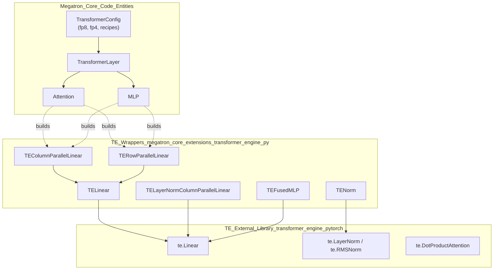
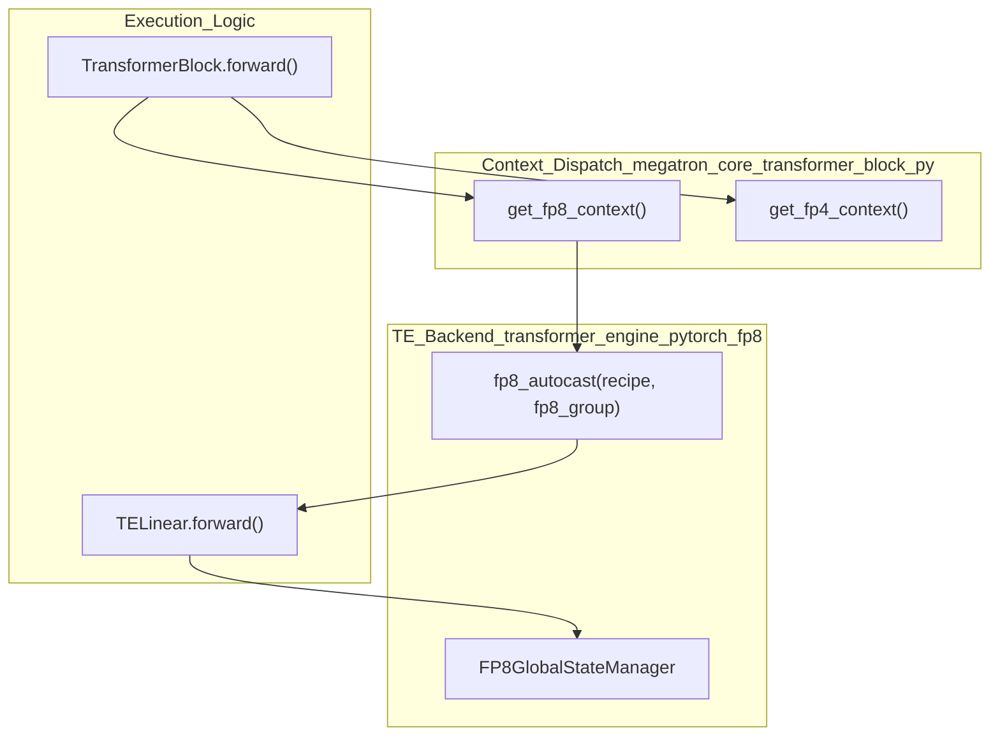

<!-- source: DeepWiki mcp.deepwiki.com · repo NVIDIA/Megatron-LM · page 2.6 Transformer Engine Integration · fetched 2026-10-26 -->

# Transformer Engine Integration

<details>
<summary>Relevant source files</summary>

The following files were used as context for generating this wiki page:

- [megatron/core/enums.py](megatron/core/enums.py)
- [megatron/core/extensions/transformer_engine.py](megatron/core/extensions/transformer_engine.py)
- [megatron/core/fp4_utils.py](megatron/core/fp4_utils.py)
- [megatron/core/fusions/fused_bias_swiglu.py](megatron/core/fusions/fused_bias_swiglu.py)
- [megatron/core/models/gpt/gpt_model.py](megatron/core/models/gpt/gpt_model.py)
- [megatron/core/tensor_parallel/__init__.py](megatron/core/tensor_parallel/__init__.py)
- [megatron/core/tensor_parallel/layers.py](megatron/core/tensor_parallel/layers.py)
- [megatron/core/tensor_parallel/random.py](megatron/core/tensor_parallel/random.py)
- [megatron/core/transformer/attention.py](megatron/core/transformer/attention.py)
- [megatron/core/transformer/cuda_graphs.py](megatron/core/transformer/cuda_graphs.py)
- [megatron/core/transformer/enums.py](megatron/core/transformer/enums.py)
- [megatron/core/transformer/mlp.py](megatron/core/transformer/mlp.py)
- [megatron/core/transformer/module.py](megatron/core/transformer/module.py)
- [megatron/core/transformer/torch_norm.py](megatron/core/transformer/torch_norm.py)
- [megatron/core/transformer/transformer_block.py](megatron/core/transformer/transformer_block.py)
- [megatron/core/transformer/transformer_config.py](megatron/core/transformer/transformer_config.py)
- [megatron/core/transformer/transformer_layer.py](megatron/core/transformer/transformer_layer.py)
- [megatron/core/transformer/utils.py](megatron/core/transformer/utils.py)
- [megatron/core/utils.py](megatron/core/utils.py)
- [tests/unit_tests/fusions/test_swiglu_fusion.py](tests/unit_tests/fusions/test_swiglu_fusion.py)
- [tests/unit_tests/optimizer/test_distrib_optimizer_grouped_quantized.py](tests/unit_tests/optimizer/test_distrib_optimizer_grouped_quantized.py)
- [tests/unit_tests/tensor_parallel/test_random.py](tests/unit_tests/tensor_parallel/test_random.py)
- [tests/unit_tests/transformer/test_cuda_graphs.py](tests/unit_tests/transformer/test_cuda_graphs.py)
- [tests/unit_tests/transformer/test_utils.py](tests/unit_tests/transformer/test_utils.py)

</details>


## Purpose and Scope

This page documents how Megatron-LM integrates with [NVIDIA Transformer Engine](https://github.com/NVIDIA/TransformerEngine) (TE) to provide FP8/FP4 training support, fused kernels, and performance optimizations. Transformer Engine is a library that accelerates transformer model training through low-precision data types (FP8, FP4) and kernel fusion.

The integration provides:
- **Low-precision training**: FP8 and FP4 quantization with multiple scaling recipes `[megatron/core/transformer/transformer_config.py:499-602]()`.
- **Fused operations**: Combined operations like LayerNorm+Linear, bias-dropout-add, and specialized attention kernels `[megatron/core/extensions/transformer_engine.py:1033-1254]()`.
- **Module wrappers**: Drop-in replacements for PyTorch/Megatron layers that leverage TE (`TELinear`, `TENorm`, `TEColumnParallelLinear`, etc.) `[megatron/core/extensions/transformer_engine.py:269-528]()`.
- **Flexible configuration**: Global and per-module quantization control through `QuantizationConfig` and `TEQuantizationParams` `[megatron/core/extensions/transformer_engine.py:163-206]()`.

Sources: `[megatron/core/extensions/transformer_engine.py:1-82]()`, `[megatron/core/transformer/transformer_config.py:499-602]()`

---

## Integration Architecture

### Module Hierarchy

The following diagram illustrates how Megatron Core entities map to Transformer Engine components.

**Figure 1: Natural Language to Code Entity Space - Module Mapping**


The integration works through multiple layers:
1.  **Configuration Layer**: `TransformerConfig` defines FP8/FP4 settings globally `[megatron/core/transformer/transformer_config.py:499-602]()`.
2.  **Specification Layer**: Specification providers (like `TESpecProvider`) create module specifications that build TE-based layers `[megatron/core/extensions/transformer_engine.py:1972-2167]()`.
3.  **Module Layer**: TE wrappers (`TELinear`, `TENorm`, etc.) replace standard PyTorch layers `[megatron/core/extensions/transformer_engine.py:269-1254]()`.
4.  **Context Layer**: `fp8_autocast` manages precision and scaling during forward/backward passes `[megatron/core/extensions/transformer_engine.py:66-67]()`.

Sources: `[megatron/core/extensions/transformer_engine.py:85-266]()`, `[megatron/core/transformer/transformer_config.py:499-602]()`, `[megatron/core/models/gpt/gpt_layer_specs.py:48-52]()`

---

## FP8 and FP4 Precision Support

### Configuration Parameters

Transformer Engine support is configured through `TransformerConfig` `[megatron/core/transformer/transformer_config.py:53]()`:

| Parameter | Type | Description |
|-----------|------|-------------|
| `fp8` | `str` | Enable FP8 training; 'e4m3' or 'hybrid' `[megatron/core/transformer/transformer_config.py:499]()`. |
| `fp8_recipe` | `Fp8Recipe` | Scaling strategy (delayed, tensorwise, mxfp8, blockwise) `[megatron/core/transformer/transformer_config.py:508]()`. |
| `fp8_param` | `bool` | Store parameters in FP8 to save memory `[megatron/core/transformer/transformer_config.py:534]()`. |
| `fp4` | `str` | Enable FP4 training (requires TE >= 2.7.0) `[megatron/core/transformer/transformer_config.py:584]()`. |
| `fp4_recipe` | `Fp4Recipe` | Scaling strategy for FP4 (nvfp4) `[megatron/core/transformer/transformer_config.py:588]()`. |
| `tp_only_amax_red` | `bool` | Reduce FP8 AMAX only in TP/TP-CP domain `[megatron/core/transformer/transformer_config.py:554]()`. |

Sources: `[megatron/core/transformer/transformer_config.py:499-602]()`, `[megatron/core/enums.py:12-13]()`

### FP8/FP4 Context Management

Megatron Core manages low-precision execution through context managers that wrap the forward pass.

**Figure 2: Precision Context Flow and Code Entities**


The `get_fp8_context()` and `get_fp4_context()` functions (imported in `[megatron/core/transformer/transformer_block.py:16-17]()`) set up the `fp8_autocast` environment by retrieving the correct process group for AMAX reduction via `get_amax_reduction_group()` `[megatron/core/extensions/transformer_engine.py:29]()`.

Sources: `[megatron/core/extensions/transformer_engine.py:208-266]()`, `[megatron/core/transformer/transformer_block.py:16-17]()`

---

## TE Module Wrappers

### Core Linear Layers

Megatron provides wrappers around Transformer Engine's linear layers to integrate with its parallelism and configuration systems.

#### TELinear
The base `TELinear` class wraps `te.Linear` `[megatron/core/extensions/transformer_engine.py:269]()`.
- **FP8 parameter storage**: If `config.fp8_param` is True, it handles FP8 weight storage `[megatron/core/extensions/transformer_engine.py:284]()`.
- **Quantization config**: Accepts per-module overrides via `quant_config` `[megatron/core/extensions/transformer_engine.py:276]()`.
- **Communication buffer registration**: Supports overlapping TP communication via `tp_comm_buffer_name` `[megatron/core/extensions/transformer_engine.py:302]()`.

Sources: `[megatron/core/extensions/transformer_engine.py:269-528]()`

#### TEColumnParallelLinear & TERowParallelLinear
These classes adapt TE's linear layers for Megatron's tensor model parallelism:
- `TEColumnParallelLinear`: Splits output features across TP ranks `[megatron/core/extensions/transformer_engine.py:607-841]()`.
- `TERowParallelLinear`: Splits input features across TP ranks and performs reduction at the output `[megatron/core/extensions/transformer_engine.py:844-1030]()`.

Sources: `[megatron/core/extensions/transformer_engine.py:607-1030]()`

### Normalization Layers

#### TENorm
Wraps TE's normalization implementations, supporting both LayerNorm and RMSNorm `[megatron/core/extensions/transformer_engine.py:1257]()`.
- Integrates with `TransformerConfig.normalization` setting.
- Supports `sequence_parallel` `[megatron/core/extensions/transformer_engine.py:1268]()`.
- Fuses residual connections if `has_residual` is enabled `[megatron/core/extensions/transformer_engine.py:1269]()`.

Sources: `[megatron/core/extensions/transformer_engine.py:1257-1375]()`

---

## Module Specifications and Builders

### TESpecProvider
The `TESpecProvider` class implements the specification pattern for building TE-based modules `[megatron/core/extensions/transformer_engine.py:1972]()`. This allows the model to remain agnostic of the specific implementation (TE vs. local PyTorch).

Key builder methods:
- `linear_qkv()`: Returns a `ModuleSpec` for `TEColumnParallelLinear` `[megatron/core/extensions/transformer_engine.py:1987-2007]()`.
- `linear_fc1()`: Returns a `ModuleSpec` for `TEColumnParallelLinear` used in MLP `[megatron/core/extensions/transformer_engine.py:2038-2059]()`.
- `core_attention()`: Returns a `ModuleSpec` for `TEDotProductAttention` `[megatron/core/extensions/transformer_engine.py:2119-2140]()`.

Sources: `[megatron/core/extensions/transformer_engine.py:1972-2167]()`, `[megatron/core/transformer/spec_utils.py:26]()`

---

## Per-Module Quantization

### Quantization Configuration System
Megatron supports per-module quantization overrides, allowing different precision for different layers through `TEQuantizationParams` `[megatron/core/extensions/transformer_engine.py:175]()`.

The `TEQuantizationRecipe` dataclass `[megatron/core/extensions/transformer_engine.py:133]()` defines:
- `fp8_quantization_recipe`: Override for FP8 (e.g., `Fp8Recipe.tensorwise`) `[megatron/core/extensions/transformer_engine.py:136]()`.
- `fp4_quantization_recipe`: Override for FP4 `[megatron/core/extensions/transformer_engine.py:142]()`.
- `override_quantized_autocast`: Whether to change the global quantization recipe for a specific module `[megatron/core/extensions/transformer_engine.py:152]()`.

Sources: `[megatron/core/extensions/transformer_engine.py:91-206]()`, `[megatron/core/quantization/quant_config.py:14]()`

---

## Fused Operations

### Saving Original Inputs
For FP8/FP4 training with certain recipes, TE modules save quantized tensors. To avoid redundant memory usage, Megatron uses `set_save_original_input()` `[megatron/core/transformer/attention.py:127]()`.

In `Attention.__init__`, if TE is used for projection layers:
```python
if HAVE_TE and isinstance(self.linear_proj, TELinear):
    if (config.fp8 and config.fp8_recipe != 'delayed') or config.fp4:
        set_save_original_input(self.linear_proj)
```
This optimization ensures that the original input is preserved for the backward pass without extra copies when quantization scales are active `[megatron/core/extensions/transformer_engine.py:127]()`.

Sources: `[megatron/core/transformer/attention.py:121-129]()`, `[megatron/core/extensions/transformer_engine.py:127]()`

### CUDA Graph Integration
Transformer Engine modules are compatible with Megatron's CUDA graph capture system. The `CudaGraphScope` enum `[megatron/core/transformer/enums.py:25]()` helps define the capture boundaries. Megatron modules check `config.cuda_graph_impl == "local"` to initialize graph managers `[megatron/core/transformer/module.py:173-175]()`.

For TE-specific graphs, the `CudaGraphManager` utilizes `transformer_engine.pytorch.graph` utilities such as `make_graphed_callables`, `save_fp8_tensors`, and `restore_fp8_tensors` `[megatron/core/transformer/cuda_graphs.py:47-50]()`. It also manages TE's global state flags like `set_skip_fp8_weight_update_tensor` (via `FP8GlobalStateManager`) to prevent redundant weight refreshes during replay `[megatron/core/transformer/cuda_graphs.py:45-53]()`.

Sources: `[megatron/core/transformer/module.py:159-181]()`, `[megatron/core/transformer/enums.py:22-27]()`, `[megatron/core/transformer/cuda_graphs.py:42-93]()`

---

