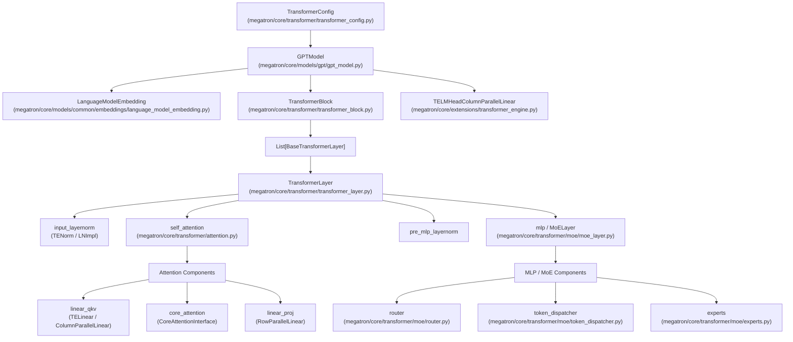
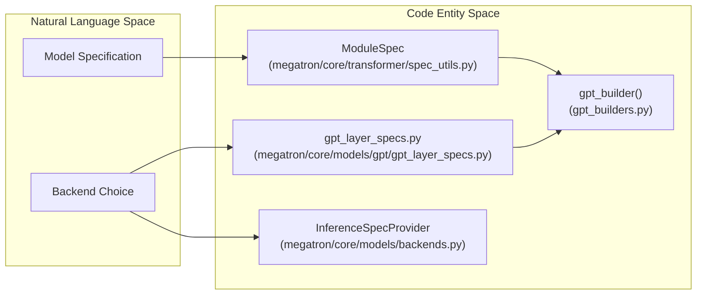

<!-- source: DeepWiki mcp.deepwiki.com · repo NVIDIA/Megatron-LM · page 3 Model Implementations · fetched 2026-10-26 -->

# Model Implementations

Relevant source files

The following files were used as context for generating this wiki page:

- [gpt_builders.py](gpt_builders.py)
- [mamba_builders.py](mamba_builders.py)
- [megatron/core/fusions/fused_layer_norm.py](megatron/core/fusions/fused_layer_norm.py)
- [megatron/core/models/bert/bert_lm_head.py](megatron/core/models/bert/bert_lm_head.py)
- [megatron/core/models/bert/bert_model.py](megatron/core/models/bert/bert_model.py)
- [megatron/core/models/bert/pooler.py](megatron/core/models/bert/pooler.py)
- [megatron/core/models/common/language_module/language_module.py](megatron/core/models/common/language_module/language_module.py)
- [megatron/core/models/gpt/gpt_layer_specs.py](megatron/core/models/gpt/gpt_layer_specs.py)
- [megatron/core/transformer/multi_latent_attention.py](megatron/core/transformer/multi_latent_attention.py)
- [model_provider.py](model_provider.py)
- [tests/unit_tests/models/test_bert_model.py](tests/unit_tests/models/test_bert_model.py)
- [tests/unit_tests/transformer/test_multi_latent_attention.py](tests/unit_tests/transformer/test_multi_latent_attention.py)

## Purpose and Scope

This page documents the model implementations in Megatron-LM, focusing on the architecture and building blocks used to construct transformer-based language models. It covers the foundational components (`TransformerConfig`, `TransformerBlock`, `TransformerLayer`, `Attention`, `MLP`) and the specification system used to assemble them into complete models like GPT, BERT, and T5.

For details on specific model architectures:
- GPT models: see [GPT Models](#3.1)
- BERT and T5 models: see [BERT and T5 Models](#3.2)
- Mixture of Experts (MoE) layers: see [Mixture of Experts (MoE)](#3.3)
- Mamba and SSM models: see [Mamba and SSM Models](#3.4)
- Multimodal models: see [Multimodal Models](#3.5)
- Elastification and Flextron: see [Elastification and Flextron](#3.6)

---

## Model Architecture Overview

Megatron-LM models are built hierarchically from configuration objects to reusable components. The central pattern is: `TransformerConfig` drives the construction of a `Model` (e.g., `GPTModel` or `BertModel`), which contains a `TransformerBlock`, which is a stack of `TransformerLayer` instances, each composed of `Attention` and `MLP` submodules.

### Model Construction Hierarchy

The following diagram maps high-level model concepts to specific code entities within the `megatron/core/transformer` and `megatron/core/models` directories.

**Sources:**
- [megatron/core/models/gpt/gpt_model.py:47-154]()
- [megatron/core/transformer/transformer_block.py:25-35]()
- [megatron/core/transformer/transformer_layer.py:37-42]()
- [megatron/core/transformer/attention.py:37-37]()

---

## Core Building Blocks

### TransformerConfig

`TransformerConfig` [megatron/core/transformer/transformer_config.py:53-53]() is the central configuration object that drives all model construction. It defines architecture parameters, parallelism settings, precision options, and optimization choices.

**Key Configuration Categories:**

| Category | Key Parameters |
|----------|----------------|
| Architecture | `num_layers`, `hidden_size`, `num_attention_heads` [megatron/core/transformer/transformer_config.py:64-136]() |
| Attention | `num_query_groups`, `kv_channels`, `attention_backend` [megatron/core/transformer/transformer_config.py:138-163]() |
| Multi-Token Prediction | `mtp_num_layers`, `mtp_loss_scaling_factor` [megatron/core/transformer/transformer_config.py:67-79]() |
| Precision | `fp16`, `bf16`, `fp8`, `params_dtype` [megatron/core/transformer/transformer_config.py:200-250]() |

**Sources:**
- [megatron/core/transformer/transformer_config.py:53-170]()

### TransformerBlock and Layer

The `TransformerBlock` [megatron/core/transformer/transformer_block.py:25-25]() manages a stack of `TransformerLayer` instances. It calculates the number of layers to build based on pipeline parallel rank and stage [megatron/core/transformer/transformer_block.py:69-152](). A `TransformerLayer` [megatron/core/transformer/transformer_layer.py:39-39]() combines self-attention and MLP/MoE submodules.

**Architecture Flow:**
1. Input is normalized via `input_layernorm` (e.g., `TENorm` [megatron/core/models/gpt/gpt_layer_specs.py:50-50]() or `FusedLayerNorm` [megatron/core/fusions/fused_layer_norm.py:30-30]()).
2. Self-attention is computed using the `self_attention` submodule [megatron/core/models/gpt/gpt_layer_specs.py:118-132]().
3. Residual connection and dropout are applied via `self_attn_bda` [megatron/core/models/gpt/gpt_layer_specs.py:133-133]().
4. MLP (or `MoELayer`) computation occurs [megatron/core/models/gpt/gpt_layer_specs.py:135-135](), followed by a final residual connection `mlp_bda`.

**Sources:**
- [megatron/core/transformer/transformer_block.py:25-170]()
- [megatron/core/transformer/transformer_layer.py:37-42]()
- [megatron/core/models/gpt/gpt_layer_specs.py:79-168]()

### Attention and MLA

The architecture supports standard `SelfAttention` and optimized variants like `MultiLatentAttention` (MLA). MLA [megatron/core/transformer/multi_latent_attention.py:130-130]() uses latent compression for KV caches to reduce memory footprint and is configured via `MLATransformerConfig` [megatron/core/transformer/transformer_config.py:42-42](). It supports advanced positional embeddings like `YarnRotaryEmbedding` [megatron/core/transformer/multi_latent_attention.py:188-190]().

**Sources:**
- [megatron/core/transformer/multi_latent_attention.py:130-200]()
- [megatron/core/models/gpt/gpt_layer_specs.py:104-137]()

---

## Model Specification System

Megatron-LM uses a **specification system** (`ModuleSpec`) [megatron/core/transformer/spec_utils.py:30-30]() to decouple model architecture definitions from their instantiation. This allows switching between backends (Transformer Engine, Local PyTorch, or Inference Optimized) without changing the core model logic.

### Specification Mapping to Code Entities

**Sources:**
- [megatron/core/transformer/spec_utils.py:30-30]()
- [megatron/core/models/gpt/gpt_layer_specs.py:8-30]()
- [gpt_builders.py:25-105]()

---

## Supported Model Families

### GPT Models
Decoder-only models implemented in `GPTModel` [megatron/core/models/gpt/gpt_model.py:3-3](). They support advanced features like Multi-Token Prediction (MTP) [megatron/core/transformer/multi_token_prediction.py:23-28]() and rotary position embeddings (RoPE). Construction is typically handled via `gpt_builder` [gpt_builders.py:25-25]().
For details, see [GPT Models](#3.1).

### BERT and T5 Models
Encoder-only and Encoder-Decoder architectures. `BertModel` [megatron/core/models/bert/bert_model.py:31-31]() uses a `Pooler` [megatron/core/models/bert/pooler.py:11-11]() for pooling specific token hidden states and a `BertLMHead` [megatron/core/models/bert/bert_lm_head.py:19-19]() for masked language modeling.
For details, see [BERT and T5 Models](#3.2).

### Mixture of Experts (MoE)
Conditional computation models where tokens are routed to a subset of experts. MoE modules are integrated into GPT specs via `get_moe_module_spec_for_backend` [megatron/core/models/gpt/gpt_layer_specs.py:13-13]().
For details, see [Mixture of Experts (MoE)](#3.3).

### Mamba and SSM Models
State Space Model implementations and hybrid Mamba-Transformer models. These are built using `hybrid_builder` re-exported in `mamba_builders.py` [mamba_builders.py:14-15]().
For details, see [Mamba and SSM Models](#3.4).

### Multimodal Models
Architectures combining vision and language, including LLaVA and NVLM. These models involve vision encoders (like CLIP ViT) and multimodal projectors to bridge modalities.
For details, see [Multimodal Models](#3.5).

### Elastification and Flextron
The Flextron system provides budget-aware routing and elastic training capabilities for MoE models, allowing for dynamic adjustment of computation.
For details, see [Elastification and Flextron](#3.6).

**Sources:**
- [megatron/core/models/gpt/gpt_model.py:47-154]()
- [megatron/core/models/bert/bert_model.py:31-160]()
- [gpt_builders.py:25-105]()
- [mamba_builders.py:1-15]()

---

