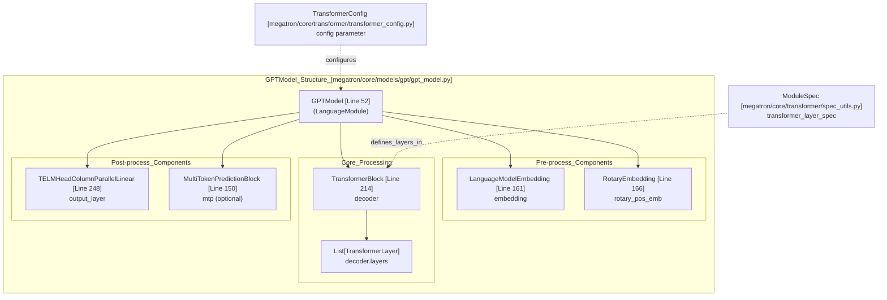
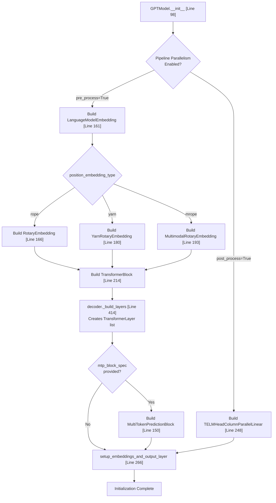
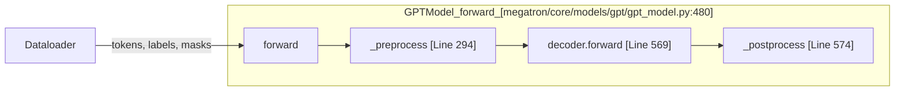

<!-- source: DeepWiki mcp.deepwiki.com · repo NVIDIA/Megatron-LM · page 3.1 GPT Models · fetched 2026-10-26 -->

# GPT Models

Relevant source files

The following files were used as context for generating this wiki page:

- [examples/academic_paper_scripts/detxoify_lm/generate_samples_gpt.py](examples/academic_paper_scripts/detxoify_lm/generate_samples_gpt.py)
- [examples/bert/README.md](examples/bert/README.md)
- [examples/bert/train_bert_340m_distributed.sh](examples/bert/train_bert_340m_distributed.sh)
- [examples/gpt3/README.md](examples/gpt3/README.md)
- [examples/gpt3/train_gpt3_175b_distributed.sh](examples/gpt3/train_gpt3_175b_distributed.sh)
- [examples/mimo/model_providers/__init__.py](examples/mimo/model_providers/__init__.py)
- [examples/mimo/training/builder.py](examples/mimo/training/builder.py)
- [examples/t5/train_t5_220m_distributed.sh](examples/t5/train_t5_220m_distributed.sh)
- [gpt_builders.py](gpt_builders.py)
- [hybrid_builders.py](hybrid_builders.py)
- [mamba_builders.py](mamba_builders.py)
- [megatron/core/extensions/transformer_engine.py](megatron/core/extensions/transformer_engine.py)
- [megatron/core/fusions/fused_bias_swiglu.py](megatron/core/fusions/fused_bias_swiglu.py)
- [megatron/core/models/gpt/gpt_layer_specs.py](megatron/core/models/gpt/gpt_layer_specs.py)
- [megatron/core/models/gpt/gpt_model.py](megatron/core/models/gpt/gpt_model.py)
- [megatron/core/tensor_parallel/__init__.py](megatron/core/tensor_parallel/__init__.py)
- [megatron/core/tensor_parallel/layers.py](megatron/core/tensor_parallel/layers.py)
- [megatron/core/tensor_parallel/random.py](megatron/core/tensor_parallel/random.py)
- [megatron/core/transformer/attention.py](megatron/core/transformer/attention.py)
- [megatron/core/transformer/cuda_graphs.py](megatron/core/transformer/cuda_graphs.py)
- [megatron/core/transformer/mlp.py](megatron/core/transformer/mlp.py)
- [megatron/core/transformer/module.py](megatron/core/transformer/module.py)
- [megatron/core/transformer/multi_latent_attention.py](megatron/core/transformer/multi_latent_attention.py)
- [megatron/core/transformer/torch_norm.py](megatron/core/transformer/torch_norm.py)
- [megatron/core/transformer/transformer_block.py](megatron/core/transformer/transformer_block.py)
- [megatron/core/transformer/transformer_config.py](megatron/core/transformer/transformer_config.py)
- [megatron/core/transformer/transformer_layer.py](megatron/core/transformer/transformer_layer.py)
- [megatron/core/transformer/utils.py](megatron/core/transformer/utils.py)
- [megatron/core/utils.py](megatron/core/utils.py)
- [megatron/elastification/pretrain_hybrid_flex.py](megatron/elastification/pretrain_hybrid_flex.py)
- [megatron/training/models/base.py](megatron/training/models/base.py)
- [megatron/training/models/dist_utils.py](megatron/training/models/dist_utils.py)
- [megatron/training/models/gpt.py](megatron/training/models/gpt.py)
- [megatron/training/models/hybrid.py](megatron/training/models/hybrid.py)
- [model_provider.py](model_provider.py)
- [tests/unit_tests/__init__.py](tests/unit_tests/__init__.py)
- [tests/unit_tests/fusions/test_swiglu_fusion.py](tests/unit_tests/fusions/test_swiglu_fusion.py)
- [tests/unit_tests/tensor_parallel/test_random.py](tests/unit_tests/tensor_parallel/test_random.py)
- [tests/unit_tests/training/models/test_dist_utils.py](tests/unit_tests/training/models/test_dist_utils.py)
- [tests/unit_tests/training/models/test_gpt_builder.py](tests/unit_tests/training/models/test_gpt_builder.py)
- [tests/unit_tests/training/models/test_hybrid_builder.py](tests/unit_tests/training/models/test_hybrid_builder.py)
- [tests/unit_tests/transformer/test_cuda_graphs.py](tests/unit_tests/transformer/test_cuda_graphs.py)
- [tests/unit_tests/transformer/test_full_cuda_graph.py](tests/unit_tests/transformer/test_full_cuda_graph.py)
- [tests/unit_tests/transformer/test_multi_latent_attention.py](tests/unit_tests/transformer/test_multi_latent_attention.py)
- [tests/unit_tests/transformer/test_utils.py](tests/unit_tests/transformer/test_utils.py)

This page documents the GPT (Generative Pre-trained Transformer) model implementation in Megatron Core. It covers the `GPTModel` class architecture, layer specification system, model construction workflow, and training/inference interfaces.

---

## GPTModel Class Overview

The `GPTModel` class implements a decoder-only transformer architecture for autoregressive language modeling. It orchestrates three main components: an embedding layer, a transformer decoder block, and an output layer. Note that `GPTModel` is currently marked as deprecated in favor of `HybridModel` for new features [megatron/core/models/gpt/gpt_model.py:123-129]().

### Structural Composition
The diagram below bridges the natural language concepts of a transformer to the specific code entities in the Megatron-LM repository.

Title: GPTModel Structural Composition

**GPTModel Class Hierarchy**

The `GPTModel` class extends `LanguageModule` and `GraphableMegatronModule` [megatron/core/models/gpt/gpt_model.py:52]() and is initialized with architecture settings defined in `TransformerConfig` [megatron/core/transformer/transformer_config.py:54](). Key parameters include:
- `transformer_layer_spec: ModuleSpec` - Specifies the module structure to use for transformer layers [megatron/core/models/gpt/gpt_model.py:58-59]().
- `vocab_size: int` - Vocabulary size for embeddings [megatron/core/models/gpt/gpt_model.py:60-61]().
- `max_sequence_length: int` - Maximum sequence length for positional embedding [megatron/core/models/gpt/gpt_model.py:62-63]().
- `pre_process: bool` - Whether to include the embedding layer (typically the first pipeline stage) [megatron/core/models/gpt/gpt_model.py:64-65]().
- `post_process: bool` - Whether to include the output head (typically the last pipeline stage) [megatron/core/models/gpt/gpt_model.py:66-67]().

Sources: [megatron/core/models/gpt/gpt_model.py:52-154](), [megatron/core/transformer/transformer_config.py:54-142]()

---

## Model Construction Flow

The GPT model construction follows a multi-stage initialization process controlled by pipeline parallelism settings and specifications.

Title: GPTModel Initialization Logic

### Key Initialization Steps

1. **Embedding Layer Construction**:
   Constructed when `pre_process=True` [megatron/core/models/gpt/gpt_model.py:160](). It uses `LanguageModelEmbedding` to handle token and positional embeddings [megatron/core/models/gpt/gpt_model.py:161-162]().

2. **Rotary Position Embeddings**:
   Constructed based on `position_embedding_type`. Supports standard `RotaryEmbedding` [megatron/core/models/gpt/gpt_model.py:166](), `YarnRotaryEmbedding` for long context [megatron/core/models/gpt/gpt_model.py:180](), and `MultimodalRotaryEmbedding` [megatron/core/models/gpt/gpt_model.py:193]().

3. **Decoder Block Construction**:
   The `TransformerBlock` is instantiated with the provided `transformer_layer_spec` [megatron/core/models/gpt/gpt_model.py:214-222](). It manages the distribution of `TransformerLayer` instances across pipeline stages [megatron/core/transformer/transformer_block.py:414-445]().

4. **Output Layer Construction**:
   Constructed when `post_process=True` [megatron/core/models/gpt/gpt_model.py:230](). It typically uses `TELMHeadColumnParallelLinear` if Transformer Engine is available [megatron/core/models/gpt/gpt_model.py:248]().

Sources: [megatron/core/models/gpt/gpt_model.py:160-266](), [megatron/core/transformer/transformer_block.py:414-445]()

---

## Transformer Layer and Block Structure

The `TransformerBlock` acts as a container for multiple `TransformerLayer` objects.

### Layer Offset and Count
In pipeline-parallel training, each rank only builds a subset of the total layers. The number of layers is determined by `get_num_layers_to_build` [megatron/core/transformer/transformer_block.py:76](). The starting index for these layers is calculated via `get_transformer_layer_offset` [megatron/core/transformer/transformer_layer.py:65](). Megatron supports custom pipeline layouts via `PipelineParallelLayerLayout` [megatron/core/transformer/transformer_config.py:104]().

### Heterogeneous Layer Configurations
Megatron Core supports heterogeneous transformer configurations where different stages or layers can have different layouts. This is defined in `TransformerConfig` via `pipeline_model_parallel_layout`, which can be a string (e.g., `'Et*3|(tt|)*29,m|L'`) or a list of layer types per stage [megatron/core/transformer/transformer_config.py:104-128]().

### TransformerLayer Submodules
A standard `TransformerLayer` consists of:
- **Input LayerNorm**: Normalizes hidden states before attention [megatron/core/transformer/transformer_layer.py:321]().
- **Self-Attention**: Implemented via the attention module specified in the `ModuleSpec`, such as `SelfAttention` [megatron/core/transformer/attention.py:257]() or `MLASelfAttention` [megatron/core/transformer/multi_latent_attention.py:130]().
- **MLP**: The feed-forward network, supporting configurations like SwiGLU or GeLU [megatron/core/transformer/mlp.py:155]().

Sources: [megatron/core/transformer/transformer_block.py:76-160](), [megatron/core/transformer/transformer_layer.py:65-168](), [megatron/core/transformer/transformer_config.py:104-128]()

---

## Training and Forward Pass

The training flow for GPT models involves batch preparation followed by a sequenced forward pass through the model's components.

Title: Data Flow and Batch Handling

### Batch Processing
The forward pass accepts `input_ids`, `position_ids`, and `attention_mask` [megatron/core/models/gpt/gpt_model.py:480-484](). It supports variable sequence lengths through `PackedSeqParams` [megatron/core/models/gpt/gpt_model.py:488]().

### Multi-Token Prediction (MTP)
Megatron-LM supports Multi-Token Prediction to extend the prediction scope beyond the next token [megatron/core/transformer/transformer_config.py:68-73](). 
- `MultiTokenPredictionBlock` [megatron/core/transformer/multi_token_prediction.py:34]() handles the sequential prediction of additional tokens.
- Loss is weighted by `mtp_loss_scaling_factor` [megatron/core/transformer/transformer_config.py:75]() and processed using `process_mtp_loss` [megatron/core/transformer/multi_token_prediction.py:37]().

### Multi-Latent Attention (MLA)
Megatron-LM supports Multi-Latent Attention (MLA) for efficient scaling. 
- `MLATransformerConfig` extends the base config with MLA-specific parameters like `qk_head_dim` and `v_head_dim` [megatron/core/transformer/transformer_config.py:113]().
- The `MLASelfAttention` module implements the compressed KV cache mechanism [megatron/core/transformer/multi_latent_attention.py:130]().

Sources: [megatron/core/models/gpt/gpt_model.py:480-574](), [megatron/core/transformer/transformer_config.py:68-113](), [megatron/core/transformer/multi_latent_attention.py:130-160]()

---

## Inference and CUDA Graphs

For high-performance inference, GPT models support CUDA graph capture to reduce CPU overhead and kernel launch latency.

### CUDA Graph Capture
The `GraphableMegatronModule` base class allows capturing the forward passes of a model [megatron/core/transformer/module.py:158](). 
- `CudaGraphScope`: Defines the granularity of graph capture (e.g., `full_iteration`) [megatron/core/transformer/enums.py:25]().
- `is_graph_capturing()`: Utility to check if a graph is currently being recorded [megatron/core/transformer/cuda_graphs.py:29]().

### Transformer Engine (TE) Integration
GPT models leverage Transformer Engine for optimized kernels and FP8 support.
- `TELinear`: Provides optimized linear layers with built-in quantization support [megatron/core/extensions/transformer_engine.py:65]().
- `get_gpt_layer_with_transformer_engine_spec`: A utility to generate a layer specification that uses TE components [megatron/core/models/gpt/gpt_layer_specs.py:179]().

Sources: [megatron/core/transformer/module.py:158-180](), [megatron/core/transformer/cuda_graphs.py:29-32](), [megatron/core/extensions/transformer_engine.py:62-68](), [megatron/core/models/gpt/gpt_layer_specs.py:179-185]()

---

