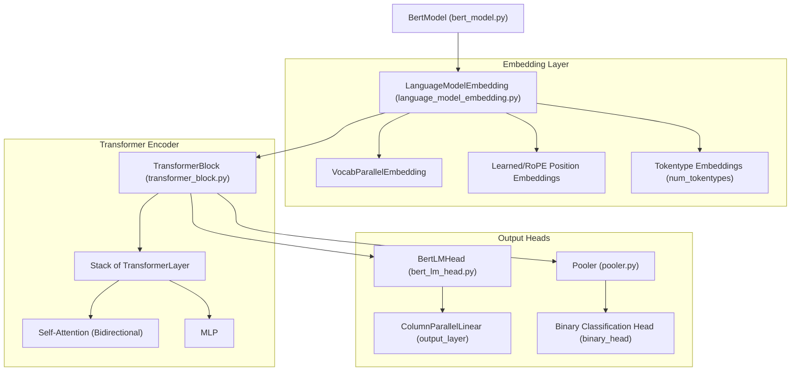
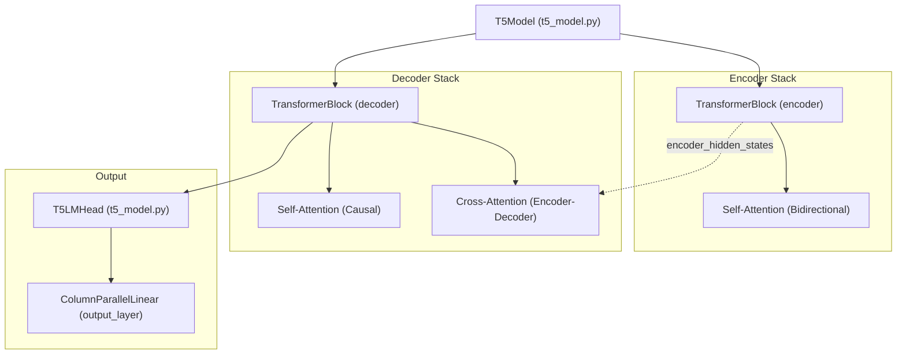

<!-- source: DeepWiki mcp.deepwiki.com · repo NVIDIA/Megatron-LM · page 3.2 BERT and T5 Models · fetched 2026-10-26 -->

# BERT and T5 Models

Relevant source files

The following files were used as context for generating this wiki page:

- [examples/multimodal/layer_specs.py](examples/multimodal/layer_specs.py)
- [examples/multimodal/nvlm/internvit.py](examples/multimodal/nvlm/internvit.py)
- [examples/multimodal/radio/radio_g.py](examples/multimodal/radio/radio_g.py)
- [megatron/core/extensions/transformer_engine_spec_provider.py](megatron/core/extensions/transformer_engine_spec_provider.py)
- [megatron/core/fusions/fused_layer_norm.py](megatron/core/fusions/fused_layer_norm.py)
- [megatron/core/models/T5/t5_model.py](megatron/core/models/T5/t5_model.py)
- [megatron/core/models/T5/t5_spec.py](megatron/core/models/T5/t5_spec.py)
- [megatron/core/models/backends.py](megatron/core/models/backends.py)
- [megatron/core/models/bert/bert_layer_specs.py](megatron/core/models/bert/bert_layer_specs.py)
- [megatron/core/models/bert/bert_lm_head.py](megatron/core/models/bert/bert_lm_head.py)
- [megatron/core/models/bert/bert_model.py](megatron/core/models/bert/bert_model.py)
- [megatron/core/models/bert/pooler.py](megatron/core/models/bert/pooler.py)
- [megatron/core/models/common/embeddings/language_model_embedding.py](megatron/core/models/common/embeddings/language_model_embedding.py)
- [megatron/core/models/common/language_module/language_module.py](megatron/core/models/common/language_module/language_module.py)
- [megatron/core/models/gpt/heterogeneous/heterogeneous_layer_specs.py](megatron/core/models/gpt/heterogeneous/heterogeneous_layer_specs.py)
- [megatron/core/models/gpt/moe_module_specs.py](megatron/core/models/gpt/moe_module_specs.py)
- [megatron/core/transformer/moe/shared_experts.py](megatron/core/transformer/moe/shared_experts.py)
- [tests/unit_tests/models/test_bert_model.py](tests/unit_tests/models/test_bert_model.py)
- [tests/unit_tests/models/test_t5_model.py](tests/unit_tests/models/test_t5_model.py)
- [tests/unit_tests/transformer/moe/test_shared_experts.py](tests/unit_tests/transformer/moe/test_shared_experts.py)

## Purpose and Scope

This document describes the BERT and T5 model implementations in Megatron-LM, which are built on the core transformer architecture components. BERT is an encoder-only model designed for bidirectional language understanding tasks, while T5 is an encoder-decoder model for text-to-text generation. Both models utilize foundational transformer components but differ in their architectural patterns, pretraining objectives, and specific output heads.

For decoder-only GPT models, see [GPT Models](#3.1). For the underlying transformer layers and attention mechanisms, see [Transformer Layers and Blocks](#2.2) and [Attention Mechanisms](#2.3).

---

## BERT Model Architecture

### Overview and Model Structure

BERT (Bidirectional Encoder Representations from Transformers) is implemented in the `BertModel` class [megatron/core/models/bert/bert_model.py:31](). It uses bidirectional attention to process input sequences, making it suitable for tasks requiring full context understanding such as masked language modeling (MLM) and next sentence prediction (NSP).

The model architecture follows this hierarchical structure:

**BERT Architecture and Code Entity Mapping**

**Sources:** [megatron/core/models/bert/bert_model.py:31-160](), [megatron/core/models/bert/bert_lm_head.py:19-50](), [megatron/core/models/bert/pooler.py:11-52](), [megatron/core/models/common/embeddings/language_model_embedding.py:15-91]()

### Layer Specifications

BERT models use `ModuleSpec` to define the implementation of transformer layers. Megatron-LM provides primary specifications in `bert_layer_specs.py`:

| Specification | Description | Usage |
|---------------|-------------|-------|
| `get_bert_layer_with_transformer_engine_spec()` | Spec using Transformer Engine (TE) for FP8 support and fused kernels. | [megatron/core/models/bert/bert_layer_specs.py:84-92]() |
| `bert_layer_local_spec` | Local spec using only Megatron Core components (no TE dependency). | [megatron/core/models/bert/bert_layer_specs.py:107-134]() |

**Sources:** [megatron/core/models/bert/bert_layer_specs.py:45-134]()

### Model Components and Classes

| Class | File | Role |
|-------|------|------|
| `BertModel` | [megatron/core/models/bert/bert_model.py:31]() | Main model container, manages embeddings, encoder, and heads. |
| `BertLMHead` | [megatron/core/models/bert/bert_lm_head.py:19]() | Processes encoder hidden states (`Dense` + `GELU` + `LayerNorm`) before vocab projection [megatron/core/models/bert/bert_lm_head.py:44-50](). |
| `Pooler` | [megatron/core/models/bert/pooler.py:11]() | Extracts and transforms the first token (`[CLS]`) representation for classification via `tanh` activation [megatron/core/models/bert/pooler.py:49-51](). |
| `LanguageModelEmbedding` | [megatron/core/models/common/embeddings/language_model_embedding.py:15]() | Handles token, position, and tokentype embedding lookups [megatron/core/models/common/embeddings/language_model_embedding.py:115-158](). |

**Sources:** [megatron/core/models/bert/bert_model.py:113-159](), [megatron/core/models/bert/bert_lm_head.py:19-50](), [megatron/core/models/bert/pooler.py:11-52]()

---

## T5 Model Architecture

T5 (Text-to-Text Transfer Transformer) is an encoder-decoder model implemented in `T5Model` [megatron/core/models/T5/t5_model.py:86]().

### Overview and Model Structure

The T5 architecture consists of an encoder stack and a decoder stack. The decoder includes cross-attention layers that attend to the encoder's final hidden states.

**T5 Architecture and Data Flow**

**Sources:** [megatron/core/models/T5/t5_model.py:86-173](), [megatron/core/models/T5/t5_spec.py:56-125]()

### Implementation Details

T5 supports multiple position embedding types including `learned_absolute`, `rope`, and `relative` [megatron/core/models/T5/t5_model.py:149-151](). For relative position embeddings, it uses the `RelativePositionEmbedding` class [megatron/core/models/T5/t5_model.py:14]().

Layer specifications for T5 are defined in `t5_spec.py`, providing both Transformer Engine and Local variants:
- `encoder_model_with_transformer_engine_default_spec` [megatron/core/models/T5/t5_spec.py:56]()
- `decoder_model_with_transformer_engine_default_spec` [megatron/core/models/T5/t5_spec.py:86]()
- `encoder_model_with_local_spec` [megatron/core/models/T5/t5_spec.py:128]()
- `decoder_model_with_local_spec` [megatron/core/models/T5/t5_spec.py:163]()

**Sources:** [megatron/core/models/T5/t5_model.py:136-220](), [megatron/core/models/T5/t5_spec.py:56-184]()

---

## Shared Utilities and Loss Computation

### LanguageModule Base Class

Both BERT and T5 inherit from `LanguageModule` [megatron/core/models/common/language_module/language_module.py:37](), which provides shared utilities for loss calculation and attention backend management.

| Function | Description |
|----------|-------------|
| `_set_attention_backend` | Configures `NVTE` environment variables (e.g., `NVTE_FLASH_ATTN`) based on `AttnBackend` configuration [megatron/core/models/common/language_module/language_module.py:108-149](). |
| `_setup_mtp_cuda_graphs` | Wraps multi-token prediction steps with `CudaGraphManager` if configured [megatron/core/models/common/language_module/language_module.py:67-79](). |

### BERT Specifics

The BERT implementation includes a `_sanity_check_attention_and_get_attn_mask_dimension` method to ensure the attention backend matches the layer specification [megatron/core/models/bert/bert_model.py:202](). For instance, when using `AttnBackend.local`, it expects the mask dimension to be `b1ss` [megatron/core/models/bert/bert_model.py:221]().

**Sources:** [megatron/core/models/common/language_module/language_module.py:37-149](), [megatron/core/models/bert/bert_model.py:202-230]()

---

## Summary of Key Classes

| Class | File | Purpose |
|-------|------|---------|
| `BertModel` | [megatron/core/models/bert/bert_model.py:31]() | Core BERT implementation inheriting from `LanguageModule`. |
| `T5Model` | [megatron/core/models/T5/t5_model.py:86]() | Core T5 implementation with encoder/decoder stack management. |
| `BertLMHead` | [megatron/core/models/bert/bert_lm_head.py:19]() | BERT-specific output head with dense layer and normalization. |
| `T5LMHead` | [megatron/core/models/T5/t5_model.py:27]() | T5-specific output head using `ColumnParallelLinear`. |
| `Pooler` | [megatron/core/models/bert/pooler.py:11]() | Extracts sequence-level representations for classification tasks. |
| `LanguageModule` | [megatron/core/models/common/language_module/language_module.py:37]() | Base class providing common helper functions for loss and attention. |
| `SharedExpertMLP` | [megatron/core/transformer/moe/shared_experts.py:102]() | MLP layer specifically for shared experts in MoE configurations, supporting communication overlap [megatron/core/transformer/moe/shared_experts.py:163-184](). |

**Sources:** [megatron/core/models/bert/bert_model.py:31](), [megatron/core/models/T5/t5_model.py:86](), [megatron/core/models/bert/bert_lm_head.py:19](), [megatron/core/models/T5/t5_model.py:27](), [megatron/core/models/bert/pooler.py:11](), [megatron/core/models/common/language_module/language_module.py:37](), [megatron/core/transformer/moe/shared_experts.py:102]()

---

