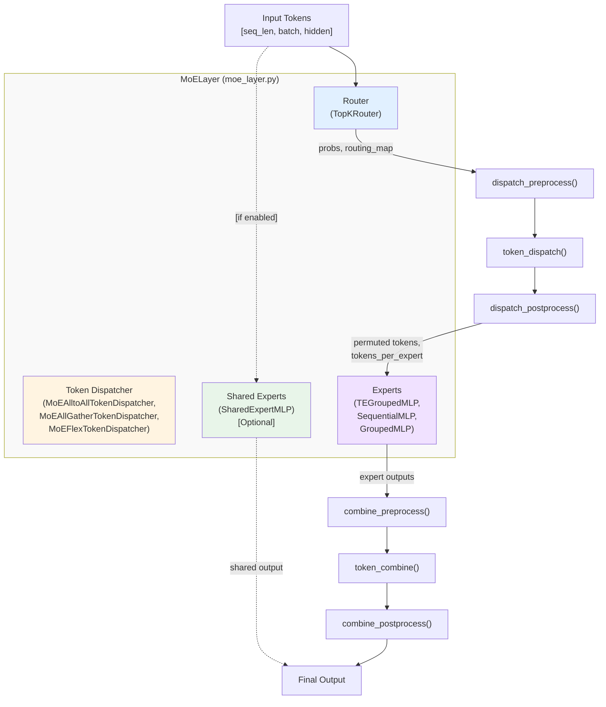

<!-- source: DeepWiki mcp.deepwiki.com · repo NVIDIA/Megatron-LM · page 3.3 Mixture of Experts (MoE) · fetched 2026-10-26 -->

# Mixture of Experts (MoE)

Relevant source files

The following files were used as context for generating this wiki page:

- [megatron/core/transformer/moe/README.md](megatron/core/transformer/moe/README.md)
- [megatron/core/transformer/moe/experts.py](megatron/core/transformer/moe/experts.py)
- [megatron/core/transformer/moe/fused_a2a.py](megatron/core/transformer/moe/fused_a2a.py)
- [megatron/core/transformer/moe/moe_layer.py](megatron/core/transformer/moe/moe_layer.py)
- [megatron/core/transformer/moe/moe_utils.py](megatron/core/transformer/moe/moe_utils.py)
- [megatron/core/transformer/moe/paged_stash.py](megatron/core/transformer/moe/paged_stash.py)
- [megatron/core/transformer/moe/router.py](megatron/core/transformer/moe/router.py)
- [megatron/core/transformer/moe/token_dispatcher.py](megatron/core/transformer/moe/token_dispatcher.py)
- [tests/unit_tests/a2a_overlap/utils.py](tests/unit_tests/a2a_overlap/utils.py)
- [tests/unit_tests/models/test_hybrid_moe_model.py](tests/unit_tests/models/test_hybrid_moe_model.py)
- [tests/unit_tests/transformer/moe/test_aux_loss.py](tests/unit_tests/transformer/moe/test_aux_loss.py)
- [tests/unit_tests/transformer/moe/test_grouped_mlp.py](tests/unit_tests/transformer/moe/test_grouped_mlp.py)
- [tests/unit_tests/transformer/moe/test_paged_stash_runner.py](tests/unit_tests/transformer/moe/test_paged_stash_runner.py)
- [tests/unit_tests/transformer/moe/test_paged_stashing.py](tests/unit_tests/transformer/moe/test_paged_stashing.py)
- [tests/unit_tests/transformer/moe/test_routers.py](tests/unit_tests/transformer/moe/test_routers.py)
- [tests/unit_tests/transformer/moe/test_token_dispatcher.py](tests/unit_tests/transformer/moe/test_token_dispatcher.py)

## Purpose and Scope

This page provides an overview of the Mixture of Experts (MoE) architecture in Megatron-LM, covering the high-level design, data flow, and core components. MoE enables scaling model capacity by routing tokens to a subset of specialized expert networks, achieving better parameter efficiency than dense models.

For detailed information on specific subsystems, see:
- [MoE Router and Load Balancing](#3.3.1) — Explain the routing mechanisms (top-k, sinkhorn), gating functions, and auxiliary loss for load balancing.
- [Token Dispatcher and Communication](#3.3.2) — Detail the token dispatching strategies (AlltoAll, AllGather, Flex) and communication patterns for expert parallelism.
- [Expert Computation](#3.3.3) — Document expert implementations including `SequentialMLP`, `GroupedMLP`, and inference-optimized variants.
- [Shared Experts and MoE Optimizations](#3.3.4) — Explain shared expert mechanisms, communication-computation overlap, fine-grained activation offloading, and MoE-specific optimizations.

For information on Expert Parallelism (EP), see [Expert Parallelism](#4.6).

## MoE Architecture Overview

The MoE system in Megatron-LM consists of four primary components that work together to route tokens through expert networks:

**MoE System Architecture**

Sources: [megatron/core/transformer/moe/moe_layer.py:153-160](), [megatron/core/transformer/moe/moe_layer.py:214-250]()

## Data Flow Through MoE Layer

The forward pass through an MoE layer follows a structured pipeline with distinct phases for routing, dispatching, computation, and combining:

**MoE Forward Pass Pipeline**

```mermaid
graph LR
    subgraph Route["1. Route"]
        Input["hidden_states<br/>[S, B, H]"]
        RouterFwd["router.forward()"]
        Input --> RouterFwd
        RouterFwd --> Probs["probs<br/>[S*B, num_experts]"]
        RouterFwd --> RoutingMap["routing_map<br/>[S*B, num_experts]"]
    end
    
    subgraph Preprocess["2. Preprocess"]
        DispPrep["dispatch_preprocess()"]
        Probs --> DispPrep
        RoutingMap --> DispPrep
        Input --> DispPrep
        DispPrep --> PrepTokens["preprocessed tokens"]
        DispPrep --> PrepProbs["preprocessed probs"]
    end
    
    subgraph Dispatch["3. Dispatch"]
        TokenDisp["token_dispatch()"]
        PrepTokens --> TokenDisp
        PrepProbs --> TokenDisp
        TokenDisp --> DispTokens["dispatched tokens<br/>[via AlltoAll/AllGather]"]
        TokenDisp --> DispProbs["dispatched probs"]
    end
    
    subgraph PostDisp["4. Dispatch Postprocess"]
        DispPost["dispatch_postprocess()"]
        DispTokens --> DispPost
        DispProbs --> DispPost
        DispPost --> PermTokens["permuted_tokens<br/>[num_tokens, H]"]
        DispPost --> TokensPerExp["tokens_per_expert<br/>[num_local_experts]"]
        DispPost --> PermProbs["permuted_probs"]
    end
    
    subgraph ExpertComp["5. Expert Computation"]
        ExpertsFwd["experts.forward()"]
        PermTokens --> ExpertsFwd
        TokensPerExp --> ExpertsFwd
        PermProbs --> ExpertsFwd
        ExpertsFwd --> ExpertOut["expert_output<br/>[num_tokens, H]"]
    end
    
    subgraph CombPrep["6. Combine Preprocess"]
        CombPre["combine_preprocess()"]
        ExpertOut --> CombPre
        CombPre --> PrepCombine["prepared output"]
    end
    
    subgraph Combine["7. Combine"]
        TokenComb["token_combine()"]
        PrepCombine --> TokenComb
        TokenComb --> Combined["combined tokens<br/>[via AlltoAll/ReduceScatter]"]
    end
    
    subgraph PostComb["8. Postprocess"]
        CombPost["combine_postprocess()"]
        Combined --> CombPost
        CombPost --> Output["output<br/>[S, B, H]"]
    end
```

Sources: [megatron/core/transformer/moe/moe_layer.py:404-515](), [megatron/core/transformer/moe/token_dispatcher.py:99-206]()

## Core Components

### MoELayer

`MoELayer` is the main orchestration class that coordinates routing, dispatching, expert computation, and output combining. It inherits from `BaseMoELayer` and implements the complete MoE forward pass.

**Key attributes:**
- `router`: Instance of `RouterInterface` (typically `TopKRouter`) [megatron/core/transformer/moe/moe_layer.py:197]()
- `token_dispatcher`: Instance of `MoETokenDispatcher` subclass [megatron/core/transformer/moe/moe_layer.py:200]()
- `experts`: Expert implementation (`TEGroupedMLP`, `SequentialMLP`, or `GroupedMLP`) [megatron/core/transformer/moe/moe_layer.py:198]()
- `shared_experts`: Optional `SharedExpertMLP` for shared capacity [megatron/core/transformer/moe/moe_layer.py:199]()
- `num_local_experts`: Number of experts hosted on the current device [megatron/core/transformer/moe/moe_layer.py:187]()

Sources: [megatron/core/transformer/moe/moe_layer.py:214-515]()

### Router

The router determines which experts process each token. `TopKRouter` is the primary implementation, computing routing probabilities and selecting top-K experts while supporting load balancing.

**Routing workflow:**
1. `gating()`: Compute logits via linear projection [megatron/core/transformer/moe/router.py:90-112]()
2. `routing()`: Apply score function and select top-K experts [megatron/core/transformer/moe/router.py:115-126]()
3. Auxiliary losses: `switch_load_balancing_loss_func` [megatron/core/transformer/moe/moe_utils.py:63-150]() and `z_loss_func` [megatron/core/transformer/moe/moe_utils.py:153-180]() for stability.

Sources: [megatron/core/transformer/moe/router.py:144-270](), [megatron/core/transformer/moe/moe_utils.py:63-180]()

### Token Dispatcher

Token dispatchers handle communication and permutation. Megatron-LM supports standard and highly optimized dispatchers:

| Dispatcher | Communication Pattern | Best Use Case |
|------------|----------------------|---------------|
| `MoEAllGatherTokenDispatcher` | AllGather + ReduceScatter | TP-only or small EP configurations [megatron/core/transformer/moe/moe_layer.py:26]() |
| `MoEAlltoAllTokenDispatcher` | AlltoAll (EP) | Standard Expert Parallelism [megatron/core/transformer/moe/moe_layer.py:27]() |
| `MoEFlexTokenDispatcher` | DeepEP / HybridEP | Optimized dispatch for H100/B200 [megatron/core/transformer/moe/moe_layer.py:28]() |

Sources: [megatron/core/transformer/moe/token_dispatcher.py:63-206](), [megatron/core/transformer/moe/fused_a2a.py:71-163]()

### Experts

Experts execute the feed-forward computation. Megatron-LM provides several implementations:

| Implementation | Execution | Precision | Best For |
|----------------|-----------|-----------|----------|
| `SequentialMLP` | Loop over experts | BF16/FP16 | Debugging, legacy |
| `GroupedMLP` | Grouped GEMM | BF16/FP16 | High performance BF16 |
| `TEGroupedMLP` | TE GroupedLinear | FP8/FP4 | Maximum throughput [megatron/core/transformer/moe/experts.py:183]() |

Sources: [megatron/core/transformer/moe/experts.py:183-208]()

### Shared Experts

`SharedExpertMLP` provides a dense MLP layer processed by all tokens in addition to the routed experts. This improves model quality and can be overlapped with MoE communication [megatron/core/transformer/moe/shared_experts.py:152-180]().

Sources: [megatron/core/transformer/moe/shared_experts.py:96-180](), [megatron/core/transformer/moe/moe_layer.py:190-191]()

## MoE Utilities

The `moe_utils.py` module provides essential utility functions used throughout the MoE system:

### Key Utility Functions

| Function | Purpose | File Location |
|----------|---------|---------------|
| `switch_load_balancing_loss_func()` | Compute auxiliary load balancing loss | [megatron/core/transformer/moe/moe_utils.py:63-150]() |
| `z_loss_func()` | Compute z-loss for router stability | [megatron/core/transformer/moe/moe_utils.py:153-180]() |
| `topk_routing_with_score_function()` | Perform top-K routing logic | [megatron/core/transformer/moe/moe_utils.py:656-795]() |
| `permute()` | Permute tokens based on routing map | [megatron/core/transformer/moe/moe_utils.py:292-413]() |
| `unpermute()` | Restore original token order | [megatron/core/transformer/moe/moe_utils.py:416-515]() |

Sources: [megatron/core/transformer/moe/moe_utils.py:1-795]()

---

