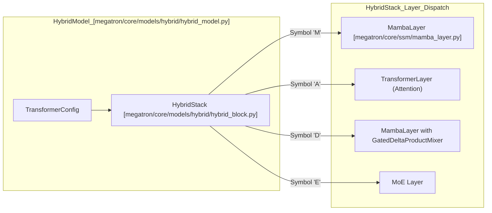

<!-- source: DeepWiki mcp.deepwiki.com · repo NVIDIA/Megatron-LM · page 3.4 Mamba and SSM Models · fetched 2026-10-26 -->

# Mamba and SSM Models

Relevant source files

The following files were used as context for generating this wiki page:

- [megatron/core/inference/contexts/attention_context/mamba_metadata.py](megatron/core/inference/contexts/attention_context/mamba_metadata.py)
- [megatron/core/inference/contexts/kv_block_allocator.py](megatron/core/inference/contexts/kv_block_allocator.py)
- [megatron/core/inference/contexts/mamba_slot_allocator.py](megatron/core/inference/contexts/mamba_slot_allocator.py)
- [megatron/core/models/gpt/experimental_attention_variant_module_specs.py](megatron/core/models/gpt/experimental_attention_variant_module_specs.py)
- [megatron/core/models/hybrid/hybrid_block.py](megatron/core/models/hybrid/hybrid_block.py)
- [megatron/core/models/hybrid/hybrid_layer_allocation.py](megatron/core/models/hybrid/hybrid_layer_allocation.py)
- [megatron/core/models/hybrid/hybrid_layer_specs.py](megatron/core/models/hybrid/hybrid_layer_specs.py)
- [megatron/core/models/hybrid/hybrid_model.py](megatron/core/models/hybrid/hybrid_model.py)
- [megatron/core/models/mamba/mamba_layer_specs.py](megatron/core/models/mamba/mamba_layer_specs.py)
- [megatron/core/models/mamba/mamba_model.py](megatron/core/models/mamba/mamba_model.py)
- [megatron/core/recompute.py](megatron/core/recompute.py)
- [megatron/core/ssm/gated_delta_net/__init__.py](megatron/core/ssm/gated_delta_net/__init__.py)
- [megatron/core/ssm/gated_delta_net/common.py](megatron/core/ssm/gated_delta_net/common.py)
- [megatron/core/ssm/gated_delta_net/gdn.py](megatron/core/ssm/gated_delta_net/gdn.py)
- [megatron/core/ssm/gated_delta_net/gdn2.py](megatron/core/ssm/gated_delta_net/gdn2.py)
- [megatron/core/ssm/gated_delta_product.py](megatron/core/ssm/gated_delta_product.py)
- [megatron/core/ssm/gdp_context_parallel.py](megatron/core/ssm/gdp_context_parallel.py)
- [megatron/core/ssm/mamba_block.py](megatron/core/ssm/mamba_block.py)
- [megatron/core/ssm/mamba_context_parallel.py](megatron/core/ssm/mamba_context_parallel.py)
- [megatron/core/ssm/mamba_hybrid_layer_allocation.py](megatron/core/ssm/mamba_hybrid_layer_allocation.py)
- [megatron/core/ssm/mamba_layer.py](megatron/core/ssm/mamba_layer.py)
- [megatron/core/ssm/mamba_mixer.py](megatron/core/ssm/mamba_mixer.py)
- [megatron/core/ssm/mlp_layer.py](megatron/core/ssm/mlp_layer.py)
- [megatron/core/ssm/ops/gdp/__init__.py](megatron/core/ssm/ops/gdp/__init__.py)
- [megatron/core/ssm/ops/gdp/chunk.py](megatron/core/ssm/ops/gdp/chunk.py)
- [megatron/core/ssm/ops/gdp/chunk_h.py](megatron/core/ssm/ops/gdp/chunk_h.py)
- [megatron/core/ssm/ops/gdp/chunk_o.py](megatron/core/ssm/ops/gdp/chunk_o.py)
- [megatron/core/ssm/ops/gdp/common.py](megatron/core/ssm/ops/gdp/common.py)
- [megatron/core/ssm/ops/gdp/cumsum.py](megatron/core/ssm/ops/gdp/cumsum.py)
- [megatron/core/ssm/ops/gdp/fused_recurrent.py](megatron/core/ssm/ops/gdp/fused_recurrent.py)
- [megatron/core/ssm/ops/gdp/scaled_dot_kkt.py](megatron/core/ssm/ops/gdp/scaled_dot_kkt.py)
- [megatron/core/ssm/ops/gdp/solve_tril.py](megatron/core/ssm/ops/gdp/solve_tril.py)
- [megatron/core/ssm/ops/gdp/wy_fast.py](megatron/core/ssm/ops/gdp/wy_fast.py)
- [megatron/core/ssm/packed_seq_helpers.py](megatron/core/ssm/packed_seq_helpers.py)
- [megatron/core/transformer/mla_qk_norm_config.py](megatron/core/transformer/mla_qk_norm_config.py)
- [megatron/core/transformer/multi_token_prediction.py](megatron/core/transformer/multi_token_prediction.py)
- [megatron/elastification/__init__.py](megatron/elastification/__init__.py)
- [megatron/elastification/arguments.py](megatron/elastification/arguments.py)
- [megatron/elastification/flextron_config.py](megatron/elastification/flextron_config.py)
- [megatron/elastification/flextron_elasticity_hooks.py](megatron/elastification/flextron_elasticity_hooks.py)
- [megatron/elastification/flextron_utils.py](megatron/elastification/flextron_utils.py)
- [megatron/elastification/loss_func.py](megatron/elastification/loss_func.py)
- [megatron/elastification/memory_config.py](megatron/elastification/memory_config.py)
- [megatron/elastification/memory_profiles.yaml](megatron/elastification/memory_profiles.yaml)
- [megatron/elastification/router/__init__.py](megatron/elastification/router/__init__.py)
- [tests/unit_tests/elastification/test_loss_func.py](tests/unit_tests/elastification/test_loss_func.py)
- [tests/unit_tests/inference/contexts/attention_metadata/test_mamba_metadata.py](tests/unit_tests/inference/contexts/attention_metadata/test_mamba_metadata.py)
- [tests/unit_tests/inference/contexts/test_dynamic_prefix_caching.py](tests/unit_tests/inference/contexts/test_dynamic_prefix_caching.py)
- [tests/unit_tests/inference/contexts/test_kv_block_allocator.py](tests/unit_tests/inference/contexts/test_kv_block_allocator.py)
- [tests/unit_tests/models/test_experimental_attention_variant_module_specs.py](tests/unit_tests/models/test_experimental_attention_variant_module_specs.py)
- [tests/unit_tests/models/test_hybrid_model.py](tests/unit_tests/models/test_hybrid_model.py)
- [tests/unit_tests/ssm/test_gated_delta_net.py](tests/unit_tests/ssm/test_gated_delta_net.py)
- [tests/unit_tests/ssm/test_hybrid_block.py](tests/unit_tests/ssm/test_hybrid_block.py)
- [tests/unit_tests/ssm/test_hybrid_layer_allocation.py](tests/unit_tests/ssm/test_hybrid_layer_allocation.py)
- [tests/unit_tests/ssm/test_mamba_context_parallel.py](tests/unit_tests/ssm/test_mamba_context_parallel.py)
- [tests/unit_tests/ssm/test_mamba_layer.py](tests/unit_tests/ssm/test_mamba_layer.py)
- [tests/unit_tests/ssm/test_mamba_mixer.py](tests/unit_tests/ssm/test_mamba_mixer.py)
- [tests/unit_tests/transformer/test_multi_token_prediction.py](tests/unit_tests/transformer/test_multi_token_prediction.py)

Megatron-LM provides a high-performance implementation of State Space Models (SSMs), specifically focusing on the Mamba architecture and its integration into hybrid Transformer-Mamba models. These models offer linear scaling with sequence length and efficient state management for long-context tasks.

## Mamba Architecture Overview

The Mamba implementation in Megatron Core is built around the selective state space model mechanism. It replaces or complements the standard attention mechanism with a Mamba mixer that utilizes parallel associative scans and causal convolutions.

### Key Components

1.  **Hybrid Model**: The top-level class `HybridModel` [megatron/core/models/hybrid/hybrid_model.py:56-56]() coordinates the embedding, the stack of SSM/Transformer layers, and the output head. Note that `MambaModel` is now a deprecated wrapper for `HybridModel` [megatron/core/models/mamba/mamba_model.py:12-12]().
2.  **Mamba Mixer**: The core computation block `MambaMixer` [megatron/core/ssm/mamba_mixer.py:142-142]() implements the selective SSM logic, including the $B$, $C$, and $\Delta$ projections, the discrete-time SSM transition, and the $D$ skip connection.
3.  **Hybrid Stack**: A container `HybridStack` [megatron/core/models/hybrid/hybrid_block.py:5-5]() (previously `MambaStack`) that manages a sequence of layers (Mamba, Attention, MLP, or MoE), handling pipeline parallelism and virtual pipeline stages.
4.  **Mamba Layer**: The individual layer unit `MambaLayer` [megatron/core/ssm/mamba_layer.py:59-59]() which wraps the `MambaMixer` with normalization and residual connections.

### Data Flow: Mamba Layer

The following diagram illustrates the data flow through a single Mamba layer, mapping architectural concepts to Megatron Core class entities.

**Mamba Layer Data Flow**

```mermaid
graph TD
    subgraph "MambaLayer_[megatron/core/ssm/mamba_layer.py]"
        Input["Input Tensor [s, b, h]"] --> LN["norm [LayerNormBuilder]"]
        LN --> Mixer["mixer [MambaMixer]"]
        Mixer --> BDA["mamba_bda [bias_dropout_add]"]
        Input --> BDA
        BDA --> Output["Output Tensor"]
    end

    subgraph "MambaMixer_[megatron/core/ssm/mamba_mixer.py]"
        MixerIn["Mixer Input"] --> InProj["in_proj [ModuleSpec]"]
        InProj --> Split["Split (x, z)"]
        Split -- "x path" --> Conv["causal_conv1d_fn"]
        Conv --> Act["SiLU Activation"]
        Act --> SSM["mamba_chunk_scan_combined"]
        Split -- "z path" --> Gating["RMSNormGated Branch"]
        SSM --> OutProj["out_proj [ModuleSpec]"]
    end
```

Sources: [megatron/core/ssm/mamba_layer.py:59-170](), [megatron/core/ssm/mamba_mixer.py:142-210](), [megatron/core/ssm/mamba_layer.py:36-53]()

## Hybrid Mamba-Transformer Models

Megatron-LM supports hybrid models where layers alternate between Mamba, Self-Attention, MLP, and Mixture of Experts (MoE). This is controlled via the `hybrid_layer_pattern`.

### Configuration and Allocation

The `HybridModel` [megatron/core/models/hybrid/hybrid_model.py:56-130]() uses a pattern-based approach for model construction:
*   **Hybrid Layer Pattern**: A string defining the sequence of layers. For example, `"M*M*"` represents Mamba layers, while patterns like `"M-M-|M-M*-"` define pipeline segments [megatron/core/models/hybrid/hybrid_model.py:65-73]().
*   **Layer Symbols**: The symbols used in patterns identify the layer type: `MAMBA` ('M'), `ATTENTION` ('A'), `MLP` ('L'), `MOE` ('E'), and `GATED_DELTA_PRODUCT` ('D') [megatron/core/models/hybrid/hybrid_layer_allocation.py:18-24]().
*   **Multi-Token Prediction (MTP)**: The pattern also supports MTP depth specifications, e.g., `"M*M*/MM/MM"` where "MM" defines MTP patterns for additional depths [megatron/core/models/hybrid/hybrid_model.py:71-71]().

**Hybrid Model Architecture Mapping**

Sources: [megatron/core/models/hybrid/hybrid_model.py:56-130](), [megatron/core/models/hybrid/hybrid_block.py:5-5](), [megatron/core/ssm/mamba_layer.py:59-170]()

## SSM Layer Implementation Details

The SSM implementation relies on specialized kernels for performance, specifically the `mamba_ssm`, `causal_conv1d`, and `flash-linear-attention` (FLA) libraries.

### MambaMixer Internal Logic
The `MambaMixer` performs the following steps:
1.  **Input Projection**: Projects the input to a higher dimension using `in_proj`. This is configured via `MambaMixerSubmodules` [megatron/core/ssm/mamba_mixer.py:133-140]().
2.  **Causal Convolution**: Applies a 1D convolution to capture local context via `causal_conv1d_fn` [megatron/core/ssm/mamba_mixer.py:61-61]().
3.  **Selective Scan**: Executes the core SSM recurrence using `mamba_chunk_scan_combined` for $O(L)$ efficiency [megatron/core/ssm/mamba_mixer.py:71-74]().
4.  **Output Projection**: Projects the mixer output back to the model dimension using `out_proj` [megatron/core/ssm/mamba_mixer.py:139-139]().

### Gated Delta Product (GDP)
The `GatedDeltaProductMixer` [megatron/core/ssm/gated_delta_product.py:143-143]() is a sequence mixer variant that uses the gated delta rule. It projects each token into an output gate and terms (V, K, Q, beta, decay) for Householder updates [megatron/core/ssm/gated_delta_product.py:151-155](). It leverages the `fla` library for chunked operations [megatron/core/ssm/gated_delta_product.py:78-79]().

### Inference and State Management
Mamba layers require persistent state (convolutional and SSM states) during inference.
*   **State Shapes**: The `MambaLayer` provides `mamba_state_shapes_per_request()` to define required buffer sizes [megatron/core/ssm/mamba_layer.py:118-120]().
*   **Metadata Management**: `MambaMetadata` [megatron/core/inference/contexts/attention_context/mamba_metadata.py:14-14]() manages the tensors required for Mamba layers during inference, including request-to-slot mapping and chunk boundaries for varlen kernels [megatron/core/inference/contexts/attention_context/mamba_metadata.py:65-98]().
*   **Context Parallelism**: Mamba supports Context Parallelism (CP) via `MambaContextParallel` [megatron/core/ssm/mamba_context_parallel.py:24-24](), which handles the necessary communications to maintain state continuity across ranks.

### Multi-Token Prediction (MTP)
Hybrid models can be extended with MTP blocks [megatron/core/transformer/multi_token_prediction.py:27-27](). These blocks predict multiple future tokens by rolling input tensors along the sequence dimension [megatron/core/transformer/multi_token_prediction.py:138-163]() and applying dedicated MTP layers that share embeddings with the main model [megatron/core/transformer/multi_token_prediction.py:68-100]().

| Component | Class Name | File Path |
| :--- | :--- | :--- |
| **Model** | `HybridModel` | [megatron/core/models/hybrid/hybrid_model.py]() |
| **Mixer** | `MambaMixer` | [megatron/core/ssm/mamba_mixer.py]() |
| **GDP Mixer** | `GatedDeltaProductMixer` | [megatron/core/ssm/gated_delta_product.py]() |
| **Layer** | `MambaLayer` | [megatron/core/ssm/mamba_layer.py]() |
| **MTP Block** | `MultiTokenPredictionBlock` | [megatron/core/transformer/multi_token_prediction.py]() |
| **Metadata** | `MambaMetadata` | [megatron/core/inference/contexts/attention_context/mamba_metadata.py]() |

Sources: [megatron/core/models/hybrid/hybrid_model.py:56-130](), [megatron/core/ssm/mamba_mixer.py:142-210](), [megatron/core/ssm/mamba_layer.py:59-170](), [megatron/core/transformer/multi_token_prediction.py:27-163](), [megatron/core/ssm/gated_delta_product.py:143-180](), [megatron/core/inference/contexts/attention_context/mamba_metadata.py:14-153]()

---

