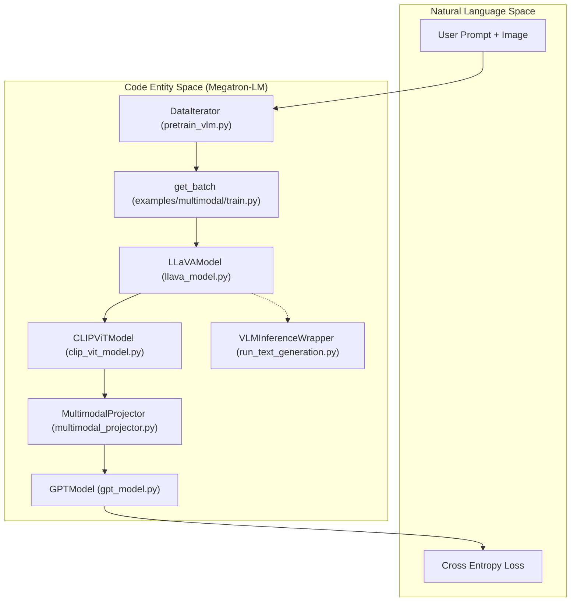
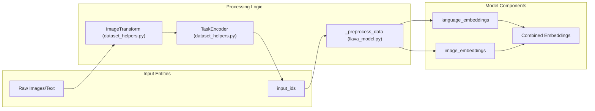

<!-- source: DeepWiki mcp.deepwiki.com · repo NVIDIA/Megatron-LM · page 3.5 Multimodal Models · fetched 2026-10-26 -->

# Multimodal Models

Relevant source files

The following files were used as context for generating this wiki page:

- [.github/CODEOWNERS](.github/CODEOWNERS)
- [examples/mimo/model_providers/nemotron_moe_vlm.py](examples/mimo/model_providers/nemotron_moe_vlm.py)
- [examples/mimo/model_providers/radio_encoder.py](examples/mimo/model_providers/radio_encoder.py)
- [examples/mimo/pretrain_mimo.py](examples/mimo/pretrain_mimo.py)
- [examples/mimo/scripts/run_hetero_nemotron_20l_mock_train.sh](examples/mimo/scripts/run_hetero_nemotron_20l_mock_train.sh)
- [examples/mimo/training/args.py](examples/mimo/training/args.py)
- [examples/mimo/training/data.py](examples/mimo/training/data.py)
- [examples/mimo/training/grad_sync.py](examples/mimo/training/grad_sync.py)
- [examples/mimo/training/runtime.py](examples/mimo/training/runtime.py)
- [examples/mimo/training/topology.py](examples/mimo/training/topology.py)
- [examples/multimodal/config.py](examples/multimodal/config.py)
- [examples/multimodal/dataloader_provider.py](examples/multimodal/dataloader_provider.py)
- [examples/multimodal/dataset_helpers.py](examples/multimodal/dataset_helpers.py)
- [examples/multimodal/image_processing.py](examples/multimodal/image_processing.py)
- [examples/multimodal/layer_scaling.py](examples/multimodal/layer_scaling.py)
- [examples/multimodal/model.py](examples/multimodal/model.py)
- [examples/multimodal/model_converter/radio_converter.py](examples/multimodal/model_converter/radio_converter.py)
- [examples/multimodal/multimodal_args.py](examples/multimodal/multimodal_args.py)
- [examples/multimodal/run_text_generation.py](examples/multimodal/run_text_generation.py)
- [examples/multimodal/train.py](examples/multimodal/train.py)
- [megatron/core/models/audio/__init__.py](megatron/core/models/audio/__init__.py)
- [megatron/core/models/audio/audio_feature_config.py](megatron/core/models/audio/audio_feature_config.py)
- [megatron/core/models/audio/audio_processor.py](megatron/core/models/audio/audio_processor.py)
- [megatron/core/models/audio/audio_projector.py](megatron/core/models/audio/audio_projector.py)
- [megatron/core/models/audio/nemo_audio_checkpoint.py](megatron/core/models/audio/nemo_audio_checkpoint.py)
- [megatron/core/models/audio/nemo_audio_preprocessing.py](megatron/core/models/audio/nemo_audio_preprocessing.py)
- [megatron/core/models/audio/nemo_transformer_audio_model.py](megatron/core/models/audio/nemo_transformer_audio_model.py)
- [megatron/core/models/audio/nemo_transformer_encoder.py](megatron/core/models/audio/nemo_transformer_encoder.py)
- [megatron/core/models/audio/packed_audio.py](megatron/core/models/audio/packed_audio.py)
- [megatron/core/models/mimo/model/base.py](megatron/core/models/mimo/model/base.py)
- [megatron/core/models/mimo/optimizer.py](megatron/core/models/mimo/optimizer.py)
- [megatron/core/models/multimodal/llava_model.py](megatron/core/models/multimodal/llava_model.py)
- [megatron/core/models/vision/clip_vit_model.py](megatron/core/models/vision/clip_vit_model.py)
- [megatron/core/models/vision/multimodal_projector.py](megatron/core/models/vision/multimodal_projector.py)
- [megatron/core/models/vision/radio.py](megatron/core/models/vision/radio.py)
- [pretrain_vlm.py](pretrain_vlm.py)
- [tests/unit_tests/models/mimo/test_mimo_hetero_grid_args.py](tests/unit_tests/models/mimo/test_mimo_hetero_grid_args.py)
- [tests/unit_tests/models/mimo/test_mimo_mock_data.py](tests/unit_tests/models/mimo/test_mimo_mock_data.py)
- [tests/unit_tests/models/test_audio_modules.py](tests/unit_tests/models/test_audio_modules.py)
- [tests/unit_tests/models/test_llava_model.py](tests/unit_tests/models/test_llava_model.py)
- [tests/unit_tests/models/test_nemo_audio_preprocessor.py](tests/unit_tests/models/test_nemo_audio_preprocessor.py)
- [tests/unit_tests/models/test_nemo_audio_processor.py](tests/unit_tests/models/test_nemo_audio_processor.py)
- [tests/unit_tests/test_mimo_hetero_topology.py](tests/unit_tests/test_mimo_hetero_topology.py)

Megatron-LM provides a robust framework for training and deploying large-scale multimodal models, with a primary focus on Vision-Language Models (VLMs). The architecture supports modular integration of diverse encoders (e.g., CLIP ViT, RADIO) and language decoders (e.g., Llama, Mistral, Nemotron, and Mamba) through specialized projection layers. Beyond standard VLMs, Megatron-LM introduces the **MIMO (Multimodal In/Out)** framework, designed to handle arbitrary combinations of modalities (including audio) and complex pipeline parallel configurations.

## Architecture Overview

The multimodal implementation in Megatron-LM is built on top of Megatron Core (MCore) modules. A typical multimodal model consists of a vision backbone, a multimodal projector, and a language model.

### Vision-Language Integration
The integration is primarily handled by the `LLaVAModel` class [megatron/core/models/multimodal/llava_model.py:57-146](), which orchestrates the interaction between:
*   **Vision Model**: Typically a CLIP-based Vision Transformer (ViT) [megatron/core/models/vision/clip_vit_model.py:26-56]() or specialized backbones like SigLIP, InternViT, and RADIO [megatron/core/models/vision/clip_vit_model.py:58-64]().
*   **Multimodal Projector**: A module (usually a 2-layer MLP) that maps vision hidden states to the language model's input space [megatron/core/models/vision/multimodal_projector.py:20]().
*   **Language Model**: A decoder-only transformer such as GPT [megatron/core/models/multimodal/llava_model.py:13]() or a hybrid model like Nemotron-5 [examples/multimodal/model.py:101-106]().

### Data Pipeline and Processing
Multimodal training requires specialized data handling to manage image tiling, aspect ratio matching, and sequence packing.
*   **Image Processing**: The `ImageTransform` class [examples/multimodal/dataset_helpers.py:11]() and associated functions handle resizing and tiling for high-resolution images, supporting different aspect ratio strategies [examples/multimodal/dataset_helpers.py:11]().
*   **Sequence Packing**: To maximize computational efficiency, the `greedy_knapsack` algorithm [examples/multimodal/dataset_helpers.py:103-142]() is used to pack multiple samples into a single sequence, filling the `dataloader_seq_length` [examples/multimodal/dataset_helpers.py:158-160]().

## Code-to-System Mapping

The following diagrams illustrate how high-level multimodal concepts map to specific classes and files within the Megatron-LM codebase.

### Vision-Language Pipeline Mapping

**Sources:** [megatron/core/models/multimodal/llava_model.py:57-146](), [examples/multimodal/train.py:36-152](), [pretrain_vlm.py:45-69](), [examples/multimodal/run_text_generation.py:192-205]()

### Multimodal Input Processing Flow

**Sources:** [examples/multimodal/dataset_helpers.py:11-142](), [examples/multimodal/dataset_helpers.py:145-178](), [megatron/core/models/multimodal/llava_model.py:147-157]()

## Supported Model Families

Megatron-LM supports several state-of-the-art multimodal architectures through configurable model providers [examples/multimodal/model.py:18-38]():

| Model Type | Description | Key Components |
| :--- | :--- | :--- |
| **LLaVA** | Large Language-and-Vision Assistant | CLIP ViT + MLP Projector + Llama/Mistral [megatron/core/models/multimodal/llava_model.py:57]() |
| **NVLM** | NVIDIA Vision Language Model | InternViT backbones + specialized layer specs [examples/multimodal/model.py:138-143]() |
| **RADIO** | Reference-Agnostic Distilled Image Optimization | RADIO ViT encoders for high-performance vision [megatron/core/models/vision/radio.py:32]() |
| **MIMO** | Multimodal In/Out | Flexible framework for multi-modal inputs and outputs [megatron/core/models/mimo/model/base.py:25]() |
| **Hybrid** | Mamba-Transformer Hybrids | Nemotron-5 hybrid models with multimodal support [examples/multimodal/model.py:101-106]() |

## Distributed Multimodal Training

Training large multimodal models requires complex parallelism strategies, especially when the vision and language components have different scaling properties.

### Context Parallelism (CP)
Megatron-LM supports Context Parallelism for multimodal sequences, requiring specialized padding logic to ensure sequence lengths are divisible by the CP size [examples/multimodal/train.py:126-141](). The `get_padding` function [megatron/core/models/multimodal/context_parallel.py:15-18]() calculates necessary adjustments for sharded inputs.

### Pipeline Parallelism (PP)
In pipeline parallel configurations, the encoder (vision model) typically resides on the first stage, while the decoder (language model) is distributed across subsequent stages [pretrain_vlm.py:61-64](). This is controlled by `add_encoder` and `add_decoder` flags in the model provider [pretrain_vlm.py:45-53]().

## Detailed Documentation

For in-depth technical details on specific multimodal subsystems, refer to the following child pages:

### [LLaVA and Vision-Language Models](#3.5.1)
Covers the detailed implementation of the `LLaVAModel`, including the `CLIPViTModel` encoder [megatron/core/models/vision/clip_vit_model.py:26](), the `MultimodalProjector` logic [megatron/core/models/vision/multimodal_projector.py](), and the standard VLM training workflow used in `pretrain_vlm.py`. For details, see [LLaVA and Vision-Language Models](#3.5.1).

### [MIMO: Multimodal In/Out Architecture](#3.5.2)
Documents the advanced MIMO framework designed for models that process and generate multiple modalities (Audio, Vision, Text) simultaneously [megatron/core/models/mimo/model/base.py:25](). It explains the use of modality-specific submodules, integrated audio models [megatron/core/models/audio/nemo_transformer_audio_model.py](), and optimized pipeline parallelism communication using the `ColocatedBridgeCommunicator` [megatron/core/models/mimo/comm/colocated_communicator.py:11](). For details, see [MIMO: Multimodal In/Out Architecture](#3.5.2).

**Sources:**
* [megatron/core/models/multimodal/llava_model.py:57-157]()
* [megatron/core/models/vision/clip_vit_model.py:26-154]()
* [examples/multimodal/train.py:36-152]()
* [pretrain_vlm.py:45-155]()
* [examples/multimodal/model.py:18-155]()
* [examples/multimodal/dataset_helpers.py:11-178]()
* [examples/multimodal/run_text_generation.py:157-205]()
* [megatron/core/models/mimo/model/base.py:25-150]()
* [megatron/core/models/vision/radio.py:32-166]()

---

