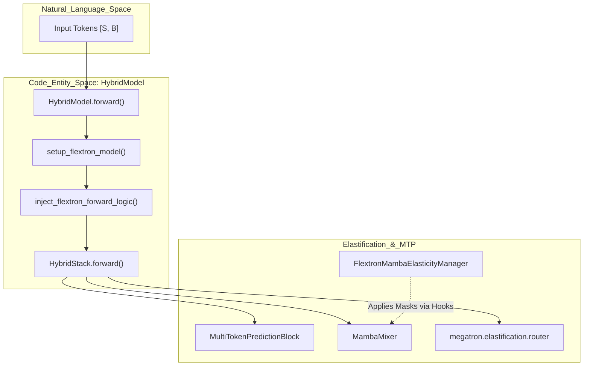
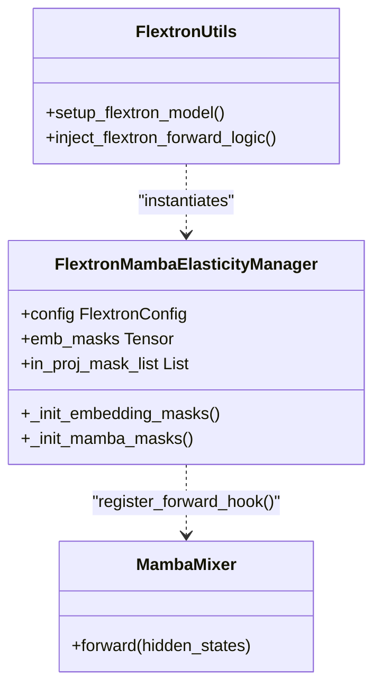

<!-- source: DeepWiki mcp.deepwiki.com · repo NVIDIA/Megatron-LM · page 3.6 Elastification and Flextron · fetched 2026-10-26 -->

# Elastification and Flextron

Relevant source files

The following files were used as context for generating this wiki page:

- [examples/academic_paper_scripts/detxoify_lm/generate_samples_gpt.py](examples/academic_paper_scripts/detxoify_lm/generate_samples_gpt.py)
- [examples/mimo/model_providers/__init__.py](examples/mimo/model_providers/__init__.py)
- [examples/mimo/training/builder.py](examples/mimo/training/builder.py)
- [hybrid_builders.py](hybrid_builders.py)
- [megatron/core/ssm/mamba_context_parallel.py](megatron/core/ssm/mamba_context_parallel.py)
- [megatron/core/ssm/mlp_layer.py](megatron/core/ssm/mlp_layer.py)
- [megatron/elastification/__init__.py](megatron/elastification/__init__.py)
- [megatron/elastification/arguments.py](megatron/elastification/arguments.py)
- [megatron/elastification/flextron_config.py](megatron/elastification/flextron_config.py)
- [megatron/elastification/flextron_elasticity_hooks.py](megatron/elastification/flextron_elasticity_hooks.py)
- [megatron/elastification/flextron_utils.py](megatron/elastification/flextron_utils.py)
- [megatron/elastification/loss_func.py](megatron/elastification/loss_func.py)
- [megatron/elastification/memory_config.py](megatron/elastification/memory_config.py)
- [megatron/elastification/memory_profiles.yaml](megatron/elastification/memory_profiles.yaml)
- [megatron/elastification/pretrain_hybrid_flex.py](megatron/elastification/pretrain_hybrid_flex.py)
- [megatron/elastification/router/__init__.py](megatron/elastification/router/__init__.py)
- [megatron/training/models/base.py](megatron/training/models/base.py)
- [megatron/training/models/dist_utils.py](megatron/training/models/dist_utils.py)
- [megatron/training/models/gpt.py](megatron/training/models/gpt.py)
- [megatron/training/models/hybrid.py](megatron/training/models/hybrid.py)
- [tests/unit_tests/elastification/test_loss_func.py](tests/unit_tests/elastification/test_loss_func.py)
- [tests/unit_tests/ssm/test_mamba_context_parallel.py](tests/unit_tests/ssm/test_mamba_context_parallel.py)
- [tests/unit_tests/ssm/test_mamba_layer.py](tests/unit_tests/ssm/test_mamba_layer.py)
- [tests/unit_tests/ssm/test_mamba_mixer.py](tests/unit_tests/ssm/test_mamba_mixer.py)
- [tests/unit_tests/training/models/test_dist_utils.py](tests/unit_tests/training/models/test_dist_utils.py)
- [tests/unit_tests/training/models/test_gpt_builder.py](tests/unit_tests/training/models/test_gpt_builder.py)
- [tests/unit_tests/training/models/test_hybrid_builder.py](tests/unit_tests/training/models/test_hybrid_builder.py)
- [tests/unit_tests/transformer/test_full_cuda_graph.py](tests/unit_tests/transformer/test_full_cuda_graph.py)

The Flextron system in Megatron-LM provides a framework for "elastification"—the ability to train and deploy models with dynamic computational budgets. This is achieved through a combination of advanced Mixture of Experts (MoE) routing, budget-aware dispatching, and a hybrid-flex pretraining workflow. Additionally, Flextron introduces Multi-Token Prediction (MTP) and elasticity hooks that allow for masking components of the model architecture at runtime without structural modifications [megatron/elastification/flextron_elasticity_hooks.py:3-9]().

## System Architecture

Flextron is built upon the core MoE and Hybrid Model infrastructure but introduces specialized dispatchers, routers, and elasticity managers that handle varying expert capacities and heterogeneous resource allocation. It integrates closely with `HybridModel` to support mixed architectures (e.g., Mamba and Transformer) with elastification logic [megatron/elastification/pretrain_hybrid_flex.py:84-116]().

### Core Components

| Component | Code Entity | Responsibility |
| :--- | :--- | :--- |
| **Configuration** | `FlextronConfig` | Defines elastification parameters, budget constraints, and masking ratios [megatron/elastification/flextron_config.py:1-40](). |
| **Elasticity Hooks** | `FlextronMambaElasticityManager` | Applies elasticity masking through PyTorch hooks to modules like `MambaMixer` [megatron/elastification/flextron_elasticity_hooks.py:37-43](). |
| **Hybrid Stack** | `HybridStack` | Orchestrates a sequence of heterogeneous layers (Mamba, Attention, MLP, MoE) defined by a pattern [megatron/core/models/hybrid/hybrid_block.py:51-74](). |
| **MTP Block** | `MultiTokenPredictionBlock` | Implements parallel prediction heads for multiple future tokens to improve training efficiency [megatron/core/transformer/multi_token_prediction.py:236-241](). |
| **Model Setup** | `setup_flextron_model` | Initializes the Flextron-specific state and logic within a `HybridModel` [megatron/elastification/flextron_utils.py:101-103](). |

### Flextron Data Flow and Code Entities

The following diagram illustrates how tokens move from the input space through the elastification and hybrid layers, specifically focusing on how the Hybrid Model integrates these components during pretraining.

**Figure 1: Flextron Hybrid Routing and Layer Logic**

**Sources:** [megatron/core/models/hybrid/hybrid_model.py:55-101](), [megatron/core/models/hybrid/hybrid_block.py:51-74](), [megatron/core/transformer/multi_token_prediction.py:236-241](), [megatron/elastification/flextron_elasticity_hooks.py:37-43](), [megatron/elastification/pretrain_hybrid_flex.py:98-104](), [megatron/elastification/router/__init__.py:1]()

## Multi-Token Prediction (MTP)

MTP is a core feature of the Flextron elastification suite, allowing the model to predict $n$ future tokens simultaneously rather than just the next token. This is implemented via the `MultiTokenPredictionBlock` [megatron/core/transformer/multi_token_prediction.py:236-241]().

### MTP Implementation Details
*   **Layer Structure**: Each MTP depth consists of a specialized layer that combines the current hidden state with the embedding of the previous prediction [megatron/core/transformer/multi_token_prediction.py:246-260]().
*   **Tensor Rolling**: To align targets for multiple depths, Flextron uses `roll_tensor`, which supports **Context Parallelism (CP)** by exchanging boundary elements between CP ranks using `ring_exchange` logic [megatron/core/transformer/multi_token_prediction.py:137-162]().
*   **Loss Processing**: The `process_mtp_loss` function handles the calculation of cross-entropy across all MTP depths, potentially using a different `mtp_grad_scale_func` than the main decoder [megatron/core/transformer/multi_token_prediction.py:657-674]().
*   **MTP Layer Offset**: The system uses `get_mtp_layer_offset` to determine the starting layer index for MTP blocks within a pipeline-parallel stage [megatron/core/models/gpt/gpt_layer_specs.py:23-28]().

**Sources:** [megatron/core/transformer/multi_token_prediction.py:137-162](), [megatron/core/transformer/multi_token_prediction.py:236-260](), [megatron/core/transformer/multi_token_prediction.py:657-674](), [megatron/core/models/gpt/gpt_layer_specs.py:23-28]()

## Elasticity Hooks and Masking

The `FlextronMambaElasticityManager` (and similar managers for Attention and MLP) provides a non-invasive way to simulate smaller models within a larger "super-model" during training or inference [megatron/elastification/flextron_elasticity_hooks.py:3-9]().

### Masking Logic
The manager initializes masks for embedding dimensions (`emb_masks`) and internal layer widths (`in_proj_mask_list`, `conv1d_mask_list`) [megatron/elastification/flextron_elasticity_hooks.py:58-72](). These are applied via `register_forward_hook` to the `MambaMixer` or other transformer components.

**Figure 2: Elasticity Hook Interaction**

**Sources:** [megatron/elastification/flextron_elasticity_hooks.py:37-72](), [megatron/elastification/pretrain_hybrid_flex.py:99-104](), [megatron/core/ssm/mamba_mixer.py:12-56]()

## Hybrid-Flex Pretraining Workflow

The `pretrain_hybrid_flex.py` script extends standard pretraining to support elastic models. It includes logic to freeze specific parts of the model, such as the router or the backbone, to facilitate budget-aware training [megatron/elastification/pretrain_hybrid_flex.py:106-114]().

### Batch Processing and Context Parallelism
Flextron supports complex data loading scenarios, including **Supervised Fine-Tuning (SFT)** and inter-document masking [megatron/elastification/pretrain_hybrid_flex.py:180-182]().
*   **get_batch**: Generates and broadcasts batches across tensor-parallel and context-parallel ranks [megatron/elastification/pretrain_hybrid_flex.py:172-205]().
*   **Sequence Balancing**: When `dataloader_inter_document_masking` is enabled, it uses `get_batch_on_this_cp_rank` with per-sequence balancing to ensure even distribution of tokens across context-parallel groups [megatron/elastification/pretrain_hybrid_flex.py:218-224]().

### Distributed Initialization
The system leverages `unimodal_build_distributed_models` to wrap the `HybridModel` for distributed training, supporting DDP and FSDP wrappers [megatron/training/models/dist_utils.py:44-59](). It also supports `LayerWiseDistributedOptimizer` for more granular gradient management [megatron/training/models/dist_utils.py:16-19]().

### Layer Allocation Patterns
Flextron relies on a flexible layer allocation system defined by a `hybrid_layer_pattern` [megatron/core/models/hybrid/hybrid_layer_allocation.py:41-47]().
*   `M`: Mamba Layer [megatron/core/models/hybrid/hybrid_layer_allocation.py:17]()
*   `*`: Attention Layer [megatron/core/models/hybrid/hybrid_layer_allocation.py:19]()
*   `-`: MLP Layer [megatron/core/models/hybrid/hybrid_layer_allocation.py:21]()
*   `/`: MTP Depth Separator [megatron/core/models/hybrid/hybrid_layer_allocation.py:24]()
*   `|`: Pipeline Parallel (PP) Boundary [megatron/core/models/hybrid/hybrid_layer_allocation.py:23]()

**Sources:** [megatron/elastification/pretrain_hybrid_flex.py:106-224](), [megatron/core/models/hybrid/hybrid_layer_allocation.py:14-66](), [megatron/training/models/dist_utils.py:44-59](), [megatron/training/models/dist_utils.py:16-19]()

## Mamba Context Parallelism

Flextron integrates Mamba-specific context parallelism via `MambaContextParallel`. This class handles the collective operations (All-to-All) required to shard sequence dimensions across GPUs while maintaining the stateful nature of SSMs [megatron/core/ssm/mamba_context_parallel.py:30-62]().

*   **Collective Operations**: The `pre_conv_ssm` and `post_conv_ssm` methods handle sharding and gathering activations before and after the Mamba convolution and SSM kernels [megatron/core/ssm/mamba_context_parallel.py:140-166]().
*   **Head Partitioning**: Ensures that each context parallel rank receives a valid number of heads and groups [megatron/core/ssm/mamba_context_parallel.py:106-117]().

**Sources:** [megatron/core/ssm/mamba_context_parallel.py:30-62](), [megatron/core/ssm/mamba_context_parallel.py:106-166]()

---

