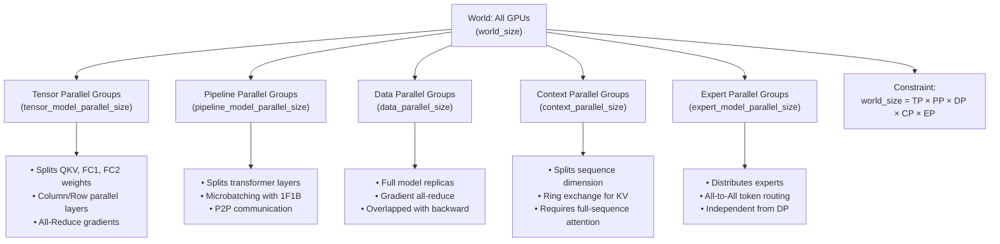
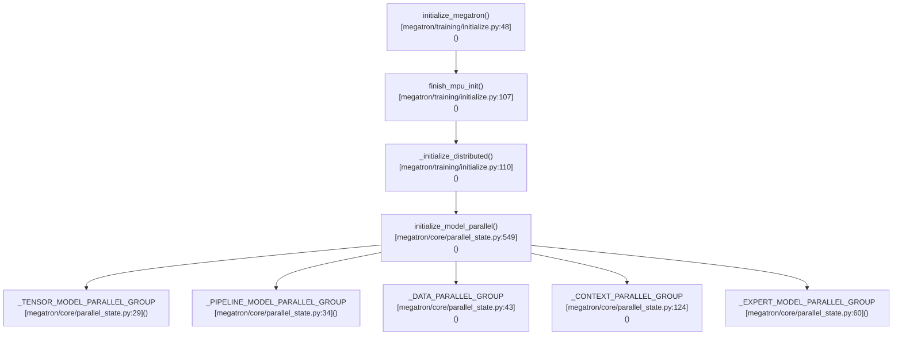
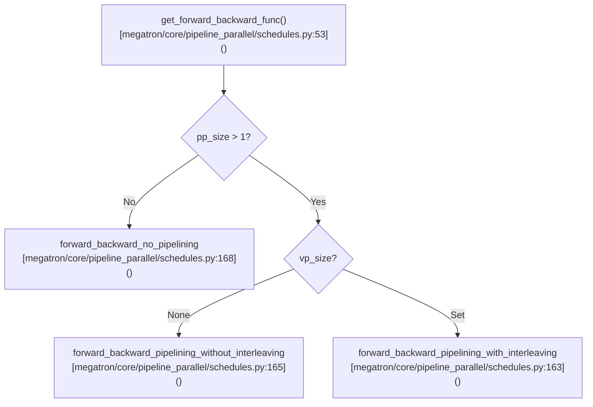

<!-- source: DeepWiki mcp.deepwiki.com · repo NVIDIA/Megatron-LM · page 4 Parallelism Strategies · fetched 2026-10-26 -->

# Parallelism Strategies

<details>
<summary>Relevant source files</summary>

The following files were used as context for generating this wiki page:

- [megatron/core/dist_checkpointing/strategies/fully_parallel.py](megatron/core/dist_checkpointing/strategies/fully_parallel.py)
- [megatron/core/model_parallel_config.py](megatron/core/model_parallel_config.py)
- [megatron/core/parallel_state.py](megatron/core/parallel_state.py)
- [megatron/core/pipeline_parallel/p2p_communication.py](megatron/core/pipeline_parallel/p2p_communication.py)
- [megatron/core/pipeline_parallel/schedules.py](megatron/core/pipeline_parallel/schedules.py)
- [megatron/core/process_groups_config.py](megatron/core/process_groups_config.py)
- [megatron/training/arguments.py](megatron/training/arguments.py)
- [megatron/training/checkpointing.py](megatron/training/checkpointing.py)
- [megatron/training/config/training_config.py](megatron/training/config/training_config.py)
- [megatron/training/initialize.py](megatron/training/initialize.py)
- [megatron/training/training.py](megatron/training/training.py)
- [pretrain_gpt.py](pretrain_gpt.py)
- [pretrain_hybrid.py](pretrain_hybrid.py)
- [pretrain_mamba.py](pretrain_mamba.py)
- [tests/unit_tests/dist_checkpointing/test_pipeline_parallel_layout.py](tests/unit_tests/dist_checkpointing/test_pipeline_parallel_layout.py)
- [tests/unit_tests/dist_checkpointing/utils.py](tests/unit_tests/dist_checkpointing/utils.py)
- [tests/unit_tests/distributed/test_distributed_data_parallel.py](tests/unit_tests/distributed/test_distributed_data_parallel.py)
- [tests/unit_tests/inference/test_communication_utils.py](tests/unit_tests/inference/test_communication_utils.py)
- [tests/unit_tests/pipeline_parallel/test_pipeline_layout.py](tests/unit_tests/pipeline_parallel/test_pipeline_layout.py)
- [tests/unit_tests/test_checkpointing.py](tests/unit_tests/test_checkpointing.py)
- [tests/unit_tests/test_hyper_comm_grid.py](tests/unit_tests/test_hyper_comm_grid.py)
- [tests/unit_tests/test_parallel_state.py](tests/unit_tests/test_parallel_state.py)
- [tests/unit_tests/test_process_groups_config.py](tests/unit_tests/test_process_groups_config.py)
- [tests/unit_tests/transformer/test_transformer_block_custom_pgs.py](tests/unit_tests/transformer/test_transformer_block_custom_pgs.py)

</details>


This page documents the distributed training strategies that enable Megatron-LM to scale to thousands of GPUs. Megatron-LM supports five orthogonal parallelism dimensions that can be composed: Tensor Parallelism (TP), Pipeline Parallelism (PP), Data Parallelism (DP), Context Parallelism (CP), and Expert Parallelism (EP). These strategies partition the model, data, and computation across GPUs to enable training models with trillions of parameters.

For implementation details of specific parallelism types, see:
- [Parallel State Management](#4.1) — Explain the `parallel_state` module, process group initialization, and `ProcessGroupCollection`.
- [Tensor Parallelism](#4.2) — Detail tensor model parallelism including column/row parallel layers and communication patterns.
- [Pipeline Parallelism](#4.3) — Document pipeline parallel schedules (1F1B, interleaved), virtual pipeline stages, P2P communication, and the custom pipeline layout API.
- [Data Parallelism and DistributedDataParallel](#4.4) — Explain the DDP implementation with gradient bucketing, hooks, and communication overlap.
- [Context and Sequence Parallelism](#4.5) — Document context parallelism for long sequences including communication strategies and ring exchanges.
- [Expert Parallelism](#4.6) — Explain expert model parallelism and how it differs from data parallelism in MoE models.
- [Fully Sharded Data Parallelism (FSDP)](#4.7) — Document the Megatron-FSDP implementation, custom FSDP adapter, DTensor integration, and how FSDP interacts with other parallelism strategies.

## Overview of Parallelism Dimensions

Megatron-LM's parallelism strategies divide the total number of GPUs (`world_size`) into orthogonal dimensions. The constraint is managed by the configuration in `ModelParallelConfig` [megatron/core/model_parallel_config.py:46-150]():

```
world_size = tensor_model_parallel_size × pipeline_model_parallel_size × 
             context_parallel_size × expert_model_parallel_size × data_parallel_size
```

Each dimension serves a specific purpose:

| Dimension | Abbreviation | Purpose | Memory Impact | Communication Pattern |
|-----------|--------------|---------|---------------|----------------------|
| Tensor Parallelism | TP | Splits individual tensors (weights, activations) across GPUs | Reduces per-GPU memory for large layers | All-Reduce within TP group |
| Pipeline Parallelism | PP | Splits layers vertically across pipeline stages | Reduces per-GPU memory proportionally | P2P Send/Recv between stages |
| Data Parallelism | DP | Replicates full model, different data batches | No memory reduction | All-Reduce gradients across DP group |
| Context Parallelism | CP | Splits sequence length across GPUs | Reduces activation memory for long sequences | Ring exchange or All-Gather KV |
| Expert Parallelism | EP | Distributes MoE experts across GPUs | Reduces expert parameter memory | All-to-All for token routing |

**Parallelism Dimension Composition**



Sources: [megatron/core/model_parallel_config.py:55-150](), [megatron/core/parallel_state.py:28-156]()

## Process Group Initialization

The `parallel_state` module is responsible for initializing all process groups at the start of training. Process groups define which GPUs communicate with each other for different parallelism strategies. The `initialize_megatron` function [megatron/training/initialize.py:48-168]() orchestrates this setup.

**Key Components:**

| Component | File | Purpose |
|-----------|-----------|---------|
| `initialize_model_parallel()` | [megatron/core/parallel_state.py:549-972]() | Main entry point for creating all process groups |
| `ProcessGroupCollection` | [megatron/core/process_groups_config.py:112-166]() | Centralized access to all process groups |
| `initialize_megatron()` | [megatron/training/initialize.py:48-168]() | High-level training initialization including MPU |

**Process Group Creation Flow**



Sources: [megatron/core/parallel_state.py:549-972](), [megatron/training/initialize.py:48-168](), [megatron/core/process_groups_config.py:112-166]()

## Tensor Parallelism (TP)

Tensor Parallelism splits individual tensors (weights and activations) horizontally across GPUs within a layer. This reduces per-GPU memory for large layers without changing the model architecture. Megatron also supports Generalized Tensor Parallelism (GTP) via `gtp_weight_remat_size` [megatron/core/model_parallel_config.py:67-76]().

**Core Components:**
- `_TENSOR_MODEL_PARALLEL_GROUP`: Intra-layer model parallel group [megatron/core/parallel_state.py:29]().
- `tensor_model_parallel_size`: Configuration for the degree of splitting [megatron/core/model_parallel_config.py:55-57]().

Sources: [megatron/core/parallel_state.py:29](), [megatron/core/model_parallel_config.py:55-76](), [megatron/core/parallel_state.py:90-94]()

## Pipeline Parallelism (PP)

Pipeline Parallelism splits the model's layers vertically into stages, with each stage assigned to different GPUs. Megatron supports interleaved pipeline schedules to reduce the "pipeline bubble" via the `virtual_pipeline_model_parallel_size` [megatron/core/model_parallel_config.py:86-92]().

**Schedule Selection**

The appropriate forward-backward function is retrieved via `get_forward_backward_func` [megatron/core/pipeline_parallel/schedules.py:53-171]().



Sources: [megatron/core/pipeline_parallel/schedules.py:53-171](), [megatron/core/model_parallel_config.py:83-92](), [megatron/core/pipeline_parallel/p2p_communication.py:140-185]()

## Data Parallelism (DP)

Data Parallelism replicates the model on each GPU. Megatron-LM provides a custom `DistributedDataParallel` (DDP) implementation [megatron/training/training.py:47-49]() and integrates with Distributed Optimizer for memory efficiency [megatron/training/training.py:82]().

**DP State Management:**
- `_DATA_PARALLEL_GROUP`: The standard group for gradient synchronization [megatron/core/parallel_state.py:43]().
- `_TENSOR_AND_DATA_PARALLEL_GROUP`: Combined group used for MoE and FP8 training [megatron/core/parallel_state.py:47]().

Sources: [megatron/core/parallel_state.py:43-47](), [megatron/training/training.py:47-52]()

## Context Parallelism (CP)

Context Parallelism splits the sequence dimension across GPUs to handle very long sequences. This is managed by the `context_parallel_size` parameter [megatron/core/model_parallel_config.py:100]().

**CP Groups:**
- `_CONTEXT_PARALLEL_GROUP`: Primary group for sequence dimension splitting [megatron/core/parallel_state.py:124]().
- `_HYBRID_DP_CP_GROUPS`: Used to balance workloads when using variable sequence lengths with `hybrid_context_parallel` [megatron/core/parallel_state.py:131](), [megatron/core/model_parallel_config.py:120-125]().

Sources: [megatron/core/parallel_state.py:123-144](), [megatron/core/model_parallel_config.py:100-125]()

## Expert Parallelism (EP)

Expert Parallelism distributes MoE experts across GPUs, allowing the model to have more parameters than can fit on a single GPU's memory.

**Expert Parallel States:**
Megatron defines specific groups to manage the hierarchy of MoE parallelism [megatron/core/parallel_state.py:49-84]():
- `_EXPERT_MODEL_PARALLEL_GROUP`: Splits the number of experts across the group [megatron/core/parallel_state.py:60]().
- `_EXPERT_TENSOR_PARALLEL_GROUP`: Splits internal expert tensors [megatron/core/parallel_state.py:62]().
- `_EXPERT_DATA_PARALLEL_GROUP`: Replicates expert weights [megatron/core/parallel_state.py:71]().

Sources: [megatron/core/parallel_state.py:49-84](), [megatron/core/model_parallel_config.py:127-146]()

## Fully Sharded Data Parallelism (FSDP)

Megatron Core supports FSDP as an alternative to standard DDP. This is controlled via configuration and integrates with the `parallel_state` management.

| Component | Description |
|-----------|-------------|
| `FullyShardedDataParallel` | Custom FSDP adapter for Megatron modules [megatron/training/training.py:53-57](). |
| `TorchFullyShardedDataParallelConfig` | Configuration for FSDP parameters [megatron/training/training.py:50](). |
| `preprocess_state_dict_for_uneven_dtensor` | Utility for sharded state dict management in FSDP [megatron/training/checkpointing.py:64-66](). |

Sources: [megatron/training/training.py:47-57](), [megatron/training/checkpointing.py:63-79](), [megatron/core/dist_checkpointing/strategies/fully_parallel.py:46-167]()

---

