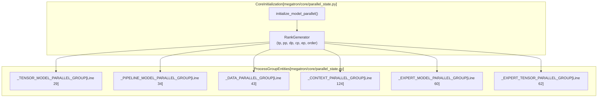
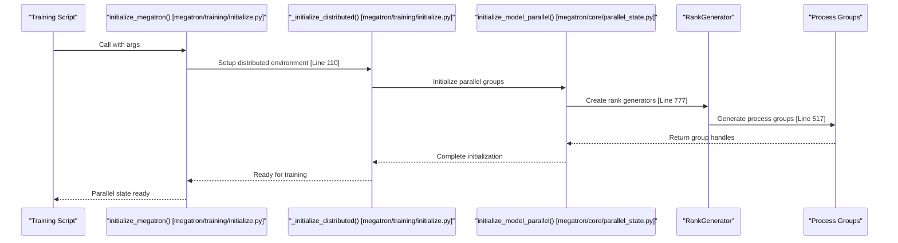
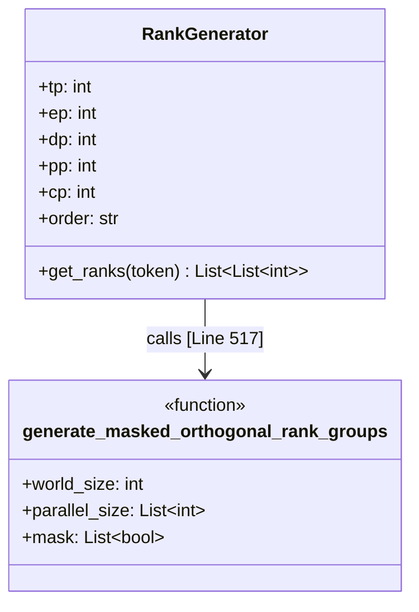

<!-- source: DeepWiki mcp.deepwiki.com · repo NVIDIA/Megatron-LM · page 4.1 Parallel State Management · fetched 2026-10-26 -->

# Parallel State Management

<details>
<summary>Relevant source files</summary>

The following files were used as context for generating this wiki page:

- [megatron/core/dist_checkpointing/strategies/fully_parallel.py](megatron/core/dist_checkpointing/strategies/fully_parallel.py)
- [megatron/core/model_parallel_config.py](megatron/core/model_parallel_config.py)
- [megatron/core/parallel_state.py](megatron/core/parallel_state.py)
- [megatron/core/pipeline_parallel/p2p_communication.py](megatron/core/pipeline_parallel/p2p_communication.py)
- [megatron/core/pipeline_parallel/schedules.py](megatron/core/pipeline_parallel/schedules.py)
- [megatron/core/process_groups_config.py](megatron/core/process_groups_config.py)
- [megatron/training/arguments.py](megatron/training/arguments.py)
- [megatron/training/checkpointing.py](megatron/training/checkpointing.py)
- [megatron/training/config/training_config.py](megatron/training/config/training_config.py)
- [megatron/training/initialize.py](megatron/training/initialize.py)
- [megatron/training/training.py](megatron/training/training.py)
- [pretrain_gpt.py](pretrain_gpt.py)
- [pretrain_hybrid.py](pretrain_hybrid.py)
- [pretrain_mamba.py](pretrain_mamba.py)
- [tests/unit_tests/dist_checkpointing/test_pipeline_parallel_layout.py](tests/unit_tests/dist_checkpointing/test_pipeline_parallel_layout.py)
- [tests/unit_tests/dist_checkpointing/utils.py](tests/unit_tests/dist_checkpointing/utils.py)
- [tests/unit_tests/distributed/test_distributed_data_parallel.py](tests/unit_tests/distributed/test_distributed_data_parallel.py)
- [tests/unit_tests/inference/test_communication_utils.py](tests/unit_tests/inference/test_communication_utils.py)
- [tests/unit_tests/pipeline_parallel/test_pipeline_layout.py](tests/unit_tests/pipeline_parallel/test_pipeline_layout.py)
- [tests/unit_tests/test_checkpointing.py](tests/unit_tests/test_checkpointing.py)
- [tests/unit_tests/test_hyper_comm_grid.py](tests/unit_tests/test_hyper_comm_grid.py)
- [tests/unit_tests/test_parallel_state.py](tests/unit_tests/test_parallel_state.py)
- [tests/unit_tests/test_process_groups_config.py](tests/unit_tests/test_process_groups_config.py)
- [tests/unit_tests/transformer/test_transformer_block_custom_pgs.py](tests/unit_tests/transformer/test_transformer_block_custom_pgs.py)

</details>


The parallel state management system in [megatron/core/parallel_state.py]() coordinates distributed training across multiple parallelism dimensions. The primary entry point is `initialize_model_parallel()`, which creates process groups, assigns ranks, and maintains global state for tensor parallelism (TP), pipeline parallelism (PP), data parallelism (DP), context parallelism (CP), and expert parallelism (EP).

Key components:
- `initialize_model_parallel()` - Main initialization function [megatron/core/parallel_state.py:550-707]()
- `RankGenerator` - Generates orthogonal rank groups [megatron/core/parallel_state.py:449-525]()
- `ProcessGroupCollection` - Encapsulates groups for complex distributed operations [megatron/core/process_groups_config.py:27-141]()
- Global process group variables (e.g., `_TENSOR_MODEL_PARALLEL_GROUP`, `_DATA_PARALLEL_GROUP`) [megatron/core/parallel_state.py:28-149]()
- Getter functions (e.g., `get_tensor_model_parallel_group()`, `get_data_parallel_rank()`) [megatron/core/parallel_state.py:1393-1722]()

For specific parallelism strategies, see [Tensor Parallelism](4.2), [Pipeline Parallelism](4.3), [Data Parallelism and DistributedDataParallel](4.4), [Context and Sequence Parallelism](4.5), and [Expert Parallelism](4.6).

## Overview of Parallelism Dimensions

Megatron-LM supports five orthogonal parallelism dimensions coordinated through `initialize_model_parallel()`:

**Parallelism Dimensions and Process Groups**

| Dimension | Global Variable | Size Parameter | Getter Function |
|-----------|----------------|----------------|-----------------|
| Tensor Parallelism (TP) | `_TENSOR_MODEL_PARALLEL_GROUP` | `tensor_model_parallel_size` | `get_tensor_model_parallel_group()` |
| Pipeline Parallelism (PP) | `_PIPELINE_MODEL_PARALLEL_GROUP` | `pipeline_model_parallel_size` | `get_pipeline_model_parallel_group()` |
| Data Parallelism (DP) | `_DATA_PARALLEL_GROUP` | Computed from world_size | `get_data_parallel_group()` |
| Context Parallelism (CP) | `_CONTEXT_PARALLEL_GROUP` | `context_parallel_size` | `get_context_parallel_group()` |
| Expert Parallelism (EP) | `_EXPERT_MODEL_PARALLEL_GROUP` | `expert_model_parallel_size` | `get_expert_model_parallel_group()` |

### Code Entity Space: Parallel State Variables
The following diagram maps the logical parallelism dimensions to the internal Python variables managed in `parallel_state.py`.


Sources: [megatron/core/parallel_state.py:28-149](), [megatron/core/parallel_state.py:550-707]()

## Core Initialization Flow

The parallel state initialization follows a structured sequence during training startup, typically triggered by `initialize_megatron` in the training entry point.


Sources: [megatron/training/initialize.py:48-169](), [megatron/core/parallel_state.py:468-487](), [megatron/core/parallel_state.py:777-808]()

## Process Group Initialization

The `initialize_model_parallel()` function at [megatron/core/parallel_state.py:550-707]() creates all necessary process groups. It supports advanced features like NVIDIA SHARP and hierarchical context parallelism.

**Function Signature Highlights:**
```python
def initialize_model_parallel(
    tensor_model_parallel_size: int = 1,
    pipeline_model_parallel_size: int = 1,
    virtual_pipeline_model_parallel_size: Optional[int] = None,
    context_parallel_size: int = 1,
    expert_model_parallel_size: int = 1,
    expert_tensor_parallel_size: Optional[int] = None,
    order: str = "tp-cp-ep-dp-pp",
    # ... other options
) -> None
```

### RankGenerator System

The `RankGenerator` class at [megatron/core/parallel_state.py:449-525]() creates orthogonal rank groups using mathematical rank mapping. It is essential for determining which global ranks belong to which specific sub-groups (e.g., which 8 GPUs form a TP group).

**Code Entity Space: Rank Generation Logic**



**Rank Mapping Algorithm:**
The mapping relies on `decompose()` and `recompose()` helpers to convert between a multi-dimensional index (TP, PP, DP, etc.) and the flat global rank.
- `global_rank = sum(idx[i] * stride[i])` [megatron/core/parallel_state.py:253-359]()
- The `order` argument (default `"tp-cp-ep-dp-pp"`) defines the stride of each dimension, effectively controlling the locality of ranks (e.g., whether TP ranks are adjacent or spread across nodes).

Sources: [megatron/core/parallel_state.py:253-359](), [megatron/core/parallel_state.py:449-525]()

## ProcessGroupCollection

The `ProcessGroupCollection` defined in [megatron/core/process_groups_config.py:27-141]() is a dataclass used to manage related process groups across different parallelism domains. It provides a unified container for transformer model parallelism, gradient communication, and finalization.

Key features:
- Stores various process groups like `tp`, `pp`, `dp`, `cp`, `ep`, and combined groups like `tp_cp` or `tp_dp_cp` [megatron/core/process_groups_config.py:71-140]().
- Includes a metaclass `ProcessGroupHelperMeta` to protect certain attributes like `virtual_pipeline_model_parallel_size` from direct assignment [megatron/core/process_groups_config.py:14-25]().
- The method `use_mpu_process_groups()` allows for easy initialization of the collection using the global states from the `parallel_state` module [megatron/core/process_groups_config.py:168-190]().
- Pipeline schedules use this collection to determine communication paths [megatron/core/pipeline_parallel/schedules.py:53-163]().

Sources: [megatron/core/process_groups_config.py:27-141](), [megatron/core/pipeline_parallel/schedules.py:53-163]()

## Global State Variables

Parallel state is maintained through global module-level variables at [megatron/core/parallel_state.py:28-149]().

### Rank Tracking and Dynamic Variables
The module caches ranks and world sizes to avoid repeated `torch.distributed` calls:
- `_MPU_TENSOR_MODEL_PARALLEL_RANK`: Current rank in TP group [megatron/core/parallel_state.py:94]().
- `_MPU_DATA_PARALLEL_WORLD_SIZE`: Total number of DP replicas [megatron/core/parallel_state.py:92]().
- `_VIRTUAL_PIPELINE_MODEL_PARALLEL_RANK`: Used for interleaved pipeline schedules [megatron/core/parallel_state.py:86]().

### Expert Parallelism Groups
For Mixture-of-Experts (MoE), specialized groups are created to handle expert sharding:
- `_EXPERT_MODEL_PARALLEL_GROUP`: Groups sharding experts [megatron/core/parallel_state.py:60]().
- `_EXPERT_TENSOR_PARALLEL_GROUP`: Tensor parallelism within an expert [megatron/core/parallel_state.py:62]().
- `_EXPERT_DATA_PARALLEL_GROUP`: Data parallelism for expert weights [megatron/core/parallel_state.py:71]().

Sources: [megatron/core/parallel_state.py:28-149](), [megatron/core/parallel_state.py:86-95]()

## Process Group Access Functions

Getter functions safely access these globals and include assertions to ensure the system is initialized.

| Function | Code Entity Returned | Purpose |
|----------|----------------------|---------|
| `get_tensor_model_parallel_group()` | `_TENSOR_MODEL_PARALLEL_GROUP` | Intra-layer model parallelism [megatron/core/parallel_state.py:1393]() |
| `get_pipeline_model_parallel_group()` | `_PIPELINE_MODEL_PARALLEL_GROUP` | Inter-layer pipeline parallelism [megatron/core/parallel_state.py:1403]() |
| `get_data_parallel_group()` | `_DATA_PARALLEL_GROUP` | Standard data parallelism [megatron/core/parallel_state.py:1413]() |
| `get_context_parallel_group()` | `_CONTEXT_PARALLEL_GROUP` | Sequence/Context parallelism [megatron/core/parallel_state.py:1469]() |
| `get_expert_model_parallel_group()` | `_EXPERT_MODEL_PARALLEL_GROUP` | Expert sharding group [megatron/core/parallel_state.py:1439]() |

Sources: [megatron/core/parallel_state.py:1393-1722]()

## Cleanup and Destruction

To support multiple runs or unit tests within the same process, the module provides destruction functions that reset the global state.
- `destroy_model_parallel()`: Resets all process group variables to `None` [megatron/core/parallel_state.py:1800-1850]().
- Resetting logic is critical for isolation in unit tests like `test_initialize_and_destroy_model_parallel` [tests/unit_tests/test_parallel_state.py:20-53]().

Sources: [megatron/core/parallel_state.py:1800-1850](), [tests/unit_tests/test_parallel_state.py:20-53]()

---

