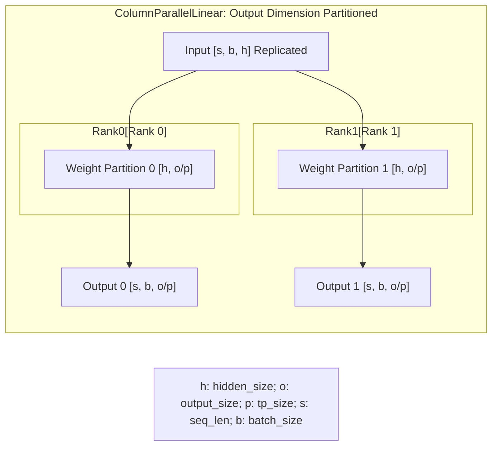
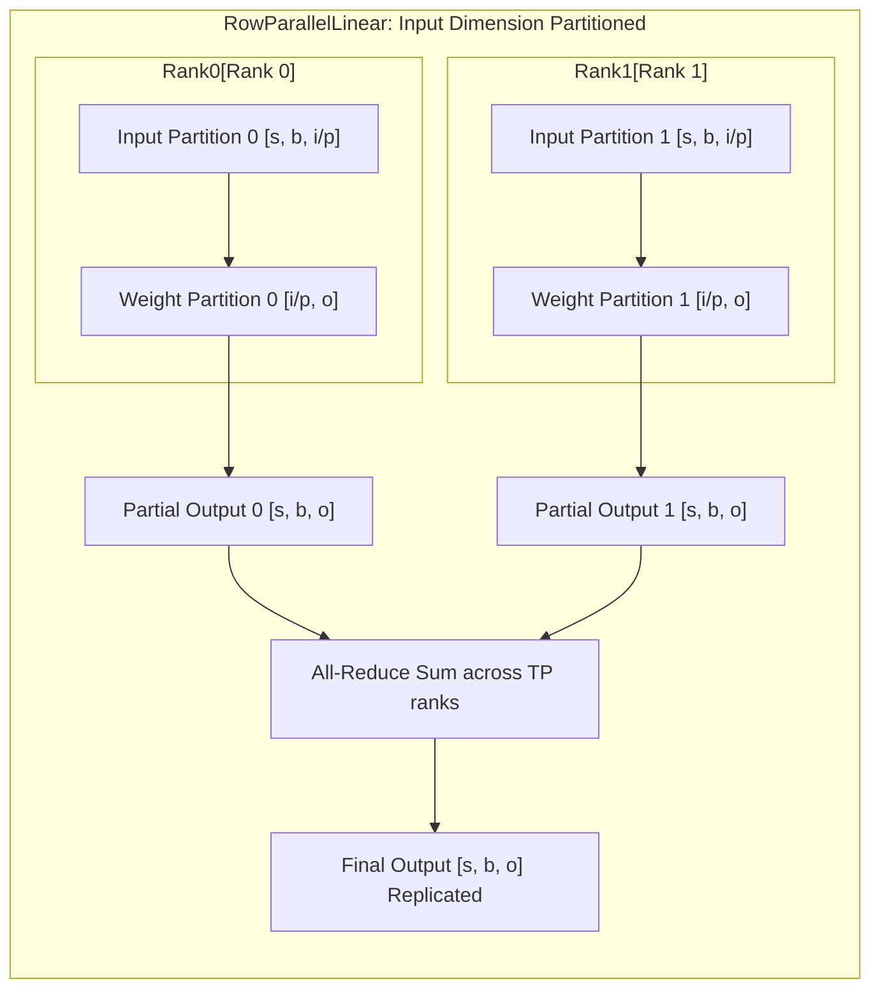
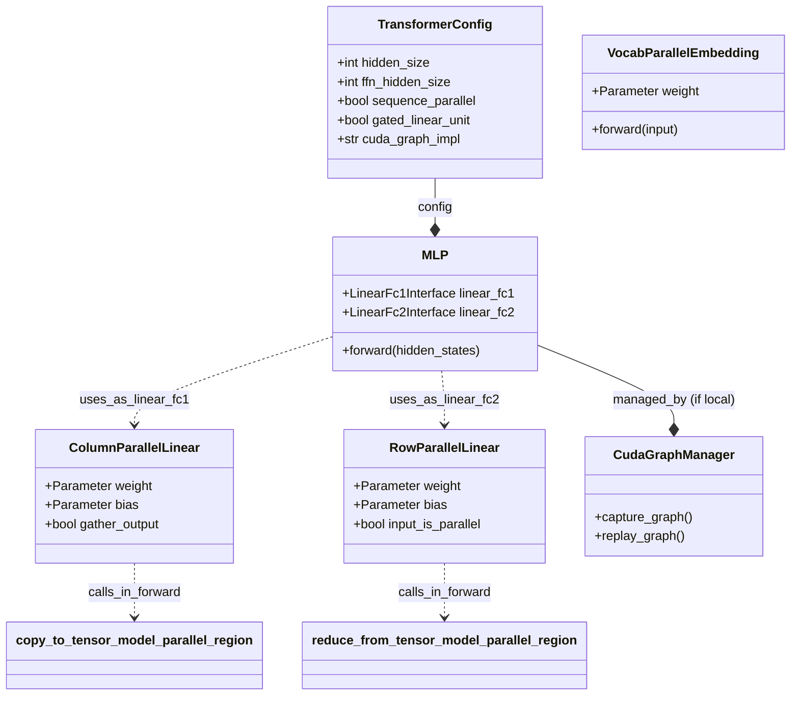

<!-- source: DeepWiki mcp.deepwiki.com · repo NVIDIA/Megatron-LM · page 4.2 Tensor Parallelism · fetched 2026-10-26 -->

# Tensor Parallelism

Relevant source files

The following files were used as context for generating this wiki page:

- [megatron/core/extensions/transformer_engine.py](megatron/core/extensions/transformer_engine.py)
- [megatron/core/fusions/fused_bias_swiglu.py](megatron/core/fusions/fused_bias_swiglu.py)
- [megatron/core/fusions/fused_cross_entropy.py](megatron/core/fusions/fused_cross_entropy.py)
- [megatron/core/models/gpt/gpt_model.py](megatron/core/models/gpt/gpt_model.py)
- [megatron/core/tensor_parallel/__init__.py](megatron/core/tensor_parallel/__init__.py)
- [megatron/core/tensor_parallel/cross_entropy.py](megatron/core/tensor_parallel/cross_entropy.py)
- [megatron/core/tensor_parallel/layers.py](megatron/core/tensor_parallel/layers.py)
- [megatron/core/tensor_parallel/random.py](megatron/core/tensor_parallel/random.py)
- [megatron/core/tensor_parallel/utils.py](megatron/core/tensor_parallel/utils.py)
- [megatron/core/transformer/attention.py](megatron/core/transformer/attention.py)
- [megatron/core/transformer/cuda_graphs.py](megatron/core/transformer/cuda_graphs.py)
- [megatron/core/transformer/mlp.py](megatron/core/transformer/mlp.py)
- [megatron/core/transformer/module.py](megatron/core/transformer/module.py)
- [megatron/core/transformer/torch_norm.py](megatron/core/transformer/torch_norm.py)
- [megatron/core/transformer/transformer_block.py](megatron/core/transformer/transformer_block.py)
- [megatron/core/transformer/transformer_config.py](megatron/core/transformer/transformer_config.py)
- [megatron/core/transformer/transformer_layer.py](megatron/core/transformer/transformer_layer.py)
- [megatron/core/transformer/utils.py](megatron/core/transformer/utils.py)
- [megatron/core/utils.py](megatron/core/utils.py)
- [tests/unit_tests/fusions/test_swiglu_fusion.py](tests/unit_tests/fusions/test_swiglu_fusion.py)
- [tests/unit_tests/tensor_parallel/test_cross_entropy.py](tests/unit_tests/tensor_parallel/test_cross_entropy.py)
- [tests/unit_tests/tensor_parallel/test_random.py](tests/unit_tests/tensor_parallel/test_random.py)
- [tests/unit_tests/transformer/test_cuda_graphs.py](tests/unit_tests/transformer/test_cuda_graphs.py)
- [tests/unit_tests/transformer/test_utils.py](tests/unit_tests/transformer/test_utils.py)

## Purpose and Scope

Tensor Parallelism (TP) is an intra-layer model parallelism strategy that splits tensors (weights and activations) across multiple GPU ranks within individual transformer layers. This document details the implementation of tensor parallelism in Megatron Core, including:

- Core tensor parallel layer implementations (`ColumnParallelLinear`, `RowParallelLinear`, `VocabParallelEmbedding`).
- Communication primitives and mapping operations in `megatron/core/tensor_parallel/mappings.py`.
- Integration with transformer components like Attention and MLP.
- Data flow and weight initialization strategies.
- CUDA Graph support for tensor parallel regions.

For inter-layer splitting, see [Pipeline Parallelism](). For parallel state initialization, see [Parallel State Management]().

**Sources:** [megatron/core/tensor_parallel/layers.py:1-5](), [megatron/core/transformer/transformer_config.py:32-54]()

---

## Overview: Intra-Layer Model Parallelism

Tensor Parallelism partitions the weights and computation of individual layers across `tensor_model_parallel_size` GPU ranks. Unlike pipeline parallelism which partitions layers across ranks, TP partitions tensors *within* each layer. This enables training of models whose individual layer weights or activations cannot fit on a single GPU.

### Key Characteristics

- **Partitioning Dimension**: Weights are split along specific dimensions (input or output dimension).
- **Communication**: Requires collective operations (all-reduce, all-gather, reduce-scatter) during forward and backward passes.
- **Granularity**: Operates at the level of individual linear layers and embeddings.
- **Memory Efficiency**: Reduces per-GPU memory for weights but introduces communication overhead.

**Sources:** [megatron/core/tensor_parallel/layers.py:95-112](), [megatron/core/transformer/transformer_config.py:138-161]()

---

## Core Tensor Parallel Layers

### ColumnParallelLinear

`ColumnParallelLinear` splits the weight matrix along the output dimension (column-wise). Each rank computes a partial output using its weight partition.

**Implementation Details:**
- **Weight Partitioning**: The weight is sharded along the output dimension. Attributes like `tensor_model_parallel` and `partition_dim` are set to track this sharding [megatron/core/tensor_parallel/layers.py:136-145]().
- **Input Handling**: If `input_is_parallel` is false, the input is replicated across the TP group using `copy_to_tensor_model_parallel_region` [megatron/core/tensor_parallel/layers.py:39]().
- **Output Handling**: If `gather_output` is true, an all-gather is performed to reconstruct the full output tensor. If false (typical for FC1 in MLP), the output remains sharded for the next layer [megatron/core/transformer/mlp.py:216-225]().

**Sources:** [megatron/core/tensor_parallel/layers.py:136-150](), [megatron/core/transformer/mlp.py:216-225]()

---

### RowParallelLinear

`RowParallelLinear` splits the weight matrix along the input dimension (row-wise). Each rank computes a partial result using its input and weight partitions, then results are aggregated.

**Implementation Details:**
- **Input Handling**: Assumes input is already partitioned (e.g., from a `ColumnParallelLinear` output).
- **Communication**: Typically uses `reduce_from_tensor_model_parallel_region` (all-reduce) to sum partial results [megatron/core/tensor_parallel/layers.py:42]().
- **Sequence Parallelism**: If sequence parallelism is enabled, it uses `reduce_scatter_to_sequence_parallel_region` to shard the output along the sequence dimension instead of replicating it [megatron/core/tensor_parallel/layers.py:43]().

**Sources:** [megatron/core/tensor_parallel/layers.py:38-45](), [megatron/core/tensor_parallel/layers.py:136-145]()

---

### VocabParallelEmbedding

`VocabParallelEmbedding` partitions the vocabulary dimension across TP ranks. Each rank stores only a subset of the embedding table.

**Key Logic:**
- **Range Mapping**: Uses `VocabUtility` to determine which slice of the vocabulary is handled by the current rank [megatron/core/tensor_parallel/layers.py:47]().
- **Forward Pass**: Indices outside the local rank's range are masked/zeroed out before the embedding lookup, and an all-gather or all-reduce is performed to gather the result depending on configuration.

**Sources:** [megatron/core/tensor_parallel/layers.py:47](), [megatron/core/tensor_parallel/utils.py:1-20]()

---

## Communication Primitives and Mappings

Megatron Core defines custom autograd functions in `mappings.py` to handle communication during the forward and backward passes of tensor parallel layers.

| Operation | Forward Pass | Backward Pass |
|-----------|-------------|---------------|
| `copy_to_tensor_model_parallel_region` | Identity | All-Reduce |
| `reduce_from_tensor_model_parallel_region` | All-Reduce | Identity |
| `scatter_to_tensor_model_parallel_region` | Split/Scatter | All-Gather |
| `gather_from_tensor_model_parallel_region` | All-Gather | Split/Scatter |
| `reduce_scatter_to_sequence_parallel_region` | Reduce-Scatter | All-Gather |
| `gather_from_sequence_parallel_region` | All-Gather | Reduce-Scatter |

**Sources:** [megatron/core/tensor_parallel/mappings.py:38-45]()

---

## Transformer Integration

### MLP Block
The MLP block uses a combination of `ColumnParallelLinear` (FC1) and `RowParallelLinear` (FC2).

- **FC1**: Projects from `hidden_size` to `ffn_hidden_size`. Weights are split column-wise. For GLU/SwiGLU, `stride=2` is used to store interleaved [gate, up] portions to ensure correct weight resharding across different TP sizes [megatron/core/transformer/mlp.py:202-211]().
- **Activation**: Applied element-wise on the sharded output of FC1.
- **FC2**: Projects back to `hidden_size`. Weights are split row-wise. It performs an all-reduce (or reduce-scatter) to aggregate results [megatron/core/transformer/mlp.py:233-248]().

**Sources:** [megatron/core/transformer/mlp.py:155-250]()

### Attention Block
- **LinearQKV**: A module builder that constructs sharded Query, Key, and Value layers. It often uses `TELinear` from Transformer Engine if available to benefit from fused kernels and FP8 support [megatron/core/transformer/attention.py:121-127](), [megatron/core/extensions/transformer_engine.py:112]().
- **LinearProj**: Aggregates the output of the attention mechanism, typically using a row-parallel implementation to project back to the model's hidden size [megatron/core/transformer/attention.py:232-245]().

**Sources:** [megatron/core/transformer/attention.py:121-245](), [megatron/core/extensions/transformer_engine.py:109-125]()

---

## CUDA Graph Integration

Megatron Core supports capturing tensor parallel operations within CUDA Graphs to reduce CPU overhead.

- **CudaGraphManager**: Manages the capture and replay of graphs. It interacts with the `MegatronModule` to handle the `is_first_microbatch` flag, which triggers weight cache updates in Transformer Engine [megatron/core/transformer/cuda_graphs.py:177-180](), [megatron/core/transformer/module.py:105-124]().
- **Local Capture**: The `cuda_graph_impl="local"` setting allows for capturing individual modules (like Attention or MLP) as separate graphs [megatron/core/transformer/transformer_config.py:173-180](), [megatron/core/transformer/module.py:172-180]().
- **Stream Management**: Uses a bounded pool of CUDA streams to avoid false dependencies and implicit aliasing [megatron/core/transformer/cuda_graphs.py:106-150]().

**Sources:** [megatron/core/transformer/cuda_graphs.py:106-180](), [megatron/core/transformer/module.py:105-180](), [megatron/core/transformer/transformer_config.py:173-180]()

---

## Weight Initialization

Weights must be initialized consistently across TP ranks to maintain model symmetry.

- **GPU Initialization**: `_initialize_affine_weight_gpu` uses the `get_cuda_rng_tracker` to fork the random state. This ensures that even though weights are sharded, the initialization logic (like `init_method`) is applied consistently across the TP group [megatron/core/tensor_parallel/layers.py:169-182]().
- **CPU Initialization**: `_initialize_affine_weight_cpu` initializes a master weight on CPU, then shards and copies the relevant chunk to each rank's GPU. It uses `set_tensor_model_parallel_attributes` to tag the resulting parameters [megatron/core/tensor_parallel/layers.py:184-200]().
- **Expert Weights**: For Mixture-of-Experts (MoE), expert parameters are marked with `allreduce=False` to select the expert topology [megatron/core/extensions/transformer_engine.py:91-125]().

**Sources:** [megatron/core/tensor_parallel/layers.py:169-200](), [megatron/core/extensions/transformer_engine.py:91-125](), [megatron/core/tensor_parallel/random.py:25-32]()

---

## Code Entity Map: Layers and Configs

The following diagram maps high-level transformer components to the specific tensor parallel implementations and configurations used in the code.

**Sources:** [megatron/core/transformer/transformer_config.py:54-139](), [megatron/core/transformer/mlp.py:155-175](), [megatron/core/transformer/cuda_graphs.py:177-180]()

---

