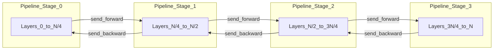
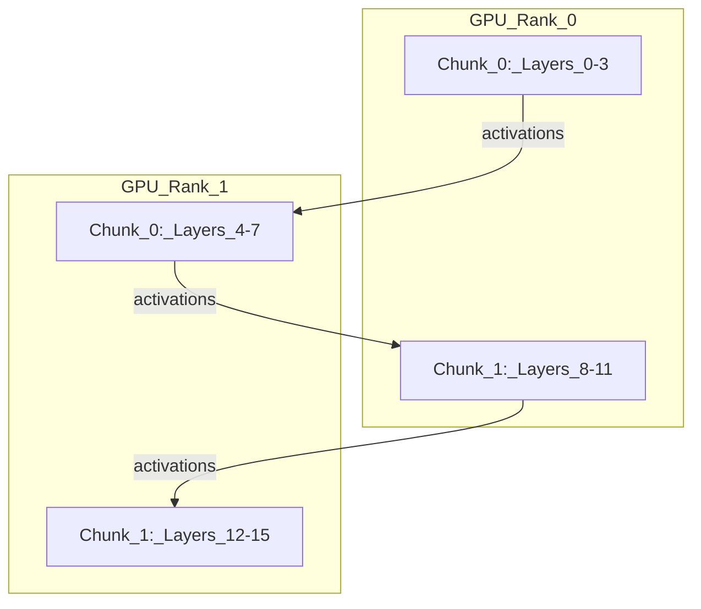
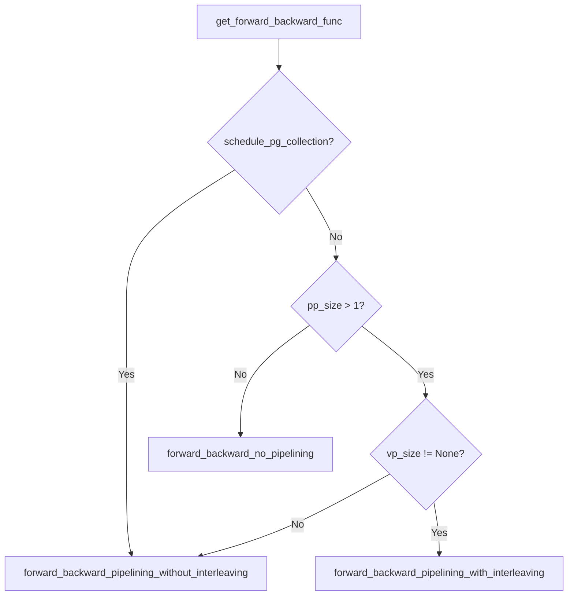
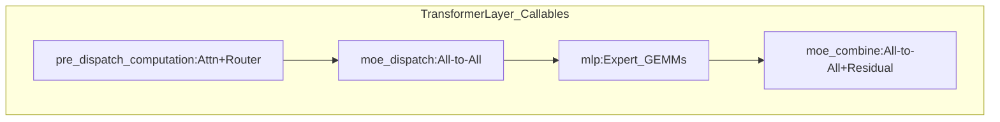
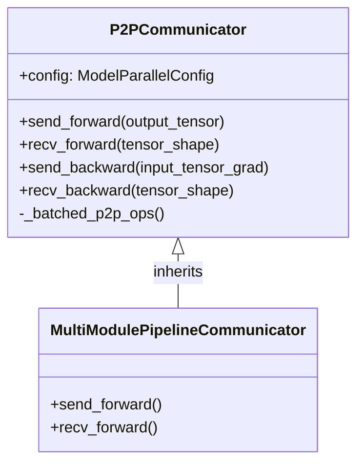

<!-- source: DeepWiki mcp.deepwiki.com · repo NVIDIA/Megatron-LM · page 4.3 Pipeline Parallelism · fetched 2026-10-26 -->

# Pipeline Parallelism

<details>
<summary>Relevant source files</summary>

The following files were used as context for generating this wiki page:

- [megatron/core/dist_checkpointing/strategies/fully_parallel.py](megatron/core/dist_checkpointing/strategies/fully_parallel.py)
- [megatron/core/hyper_comm_grid.py](megatron/core/hyper_comm_grid.py)
- [megatron/core/model_parallel_config.py](megatron/core/model_parallel_config.py)
- [megatron/core/models/common/fine_grained_callables.py](megatron/core/models/common/fine_grained_callables.py)
- [megatron/core/models/common/model_chunk_schedule_plan.py](megatron/core/models/common/model_chunk_schedule_plan.py)
- [megatron/core/models/gpt/fine_grained_callables.py](megatron/core/models/gpt/fine_grained_callables.py)
- [megatron/core/parallel_state.py](megatron/core/parallel_state.py)
- [megatron/core/pipeline_parallel/bridge_communicator.py](megatron/core/pipeline_parallel/bridge_communicator.py)
- [megatron/core/pipeline_parallel/combined_1f1b.py](megatron/core/pipeline_parallel/combined_1f1b.py)
- [megatron/core/pipeline_parallel/multimodule_communicator.py](megatron/core/pipeline_parallel/multimodule_communicator.py)
- [megatron/core/pipeline_parallel/p2p_communication.py](megatron/core/pipeline_parallel/p2p_communication.py)
- [megatron/core/pipeline_parallel/schedules.py](megatron/core/pipeline_parallel/schedules.py)
- [megatron/core/pipeline_parallel/utils.py](megatron/core/pipeline_parallel/utils.py)
- [megatron/training/arguments.py](megatron/training/arguments.py)
- [megatron/training/checkpointing.py](megatron/training/checkpointing.py)
- [megatron/training/config/training_config.py](megatron/training/config/training_config.py)
- [megatron/training/initialize.py](megatron/training/initialize.py)
- [megatron/training/training.py](megatron/training/training.py)
- [pretrain_gpt.py](pretrain_gpt.py)
- [pretrain_hybrid.py](pretrain_hybrid.py)
- [pretrain_mamba.py](pretrain_mamba.py)
- [tests/unit_tests/a2a_overlap/test_cuda_graphed_schedule_chunk_1f1b.py](tests/unit_tests/a2a_overlap/test_cuda_graphed_schedule_chunk_1f1b.py)
- [tests/unit_tests/a2a_overlap/test_delay_wgrad_compute.py](tests/unit_tests/a2a_overlap/test_delay_wgrad_compute.py)
- [tests/unit_tests/a2a_overlap/test_fsdp_1f1b_overlap.py](tests/unit_tests/a2a_overlap/test_fsdp_1f1b_overlap.py)
- [tests/unit_tests/a2a_overlap/test_schedule_chunk_1f1b.py](tests/unit_tests/a2a_overlap/test_schedule_chunk_1f1b.py)
- [tests/unit_tests/a2a_overlap/test_schedule_layer_1f1b.py](tests/unit_tests/a2a_overlap/test_schedule_layer_1f1b.py)
- [tests/unit_tests/dist_checkpointing/test_pipeline_parallel_layout.py](tests/unit_tests/dist_checkpointing/test_pipeline_parallel_layout.py)
- [tests/unit_tests/dist_checkpointing/utils.py](tests/unit_tests/dist_checkpointing/utils.py)
- [tests/unit_tests/pipeline_parallel/test_bridge_communicator.py](tests/unit_tests/pipeline_parallel/test_bridge_communicator.py)
- [tests/unit_tests/pipeline_parallel/test_multimodule_communicator.py](tests/unit_tests/pipeline_parallel/test_multimodule_communicator.py)
- [tests/unit_tests/pipeline_parallel/test_multimodule_schedules.py](tests/unit_tests/pipeline_parallel/test_multimodule_schedules.py)
- [tests/unit_tests/pipeline_parallel/test_pipeline_layout.py](tests/unit_tests/pipeline_parallel/test_pipeline_layout.py)
- [tests/unit_tests/pipeline_parallel/test_schedules.py](tests/unit_tests/pipeline_parallel/test_schedules.py)
- [tests/unit_tests/test_checkpointing.py](tests/unit_tests/test_checkpointing.py)
- [tests/unit_tests/test_parallel_state.py](tests/unit_tests/test_parallel_state.py)
- [tests/unit_tests/transformer/test_submodule_callables.py](tests/unit_tests/transformer/test_submodule_callables.py)

</details>


This document describes the pipeline parallelism implementation in Megatron-LM, which partitions transformer layers across multiple GPUs to enable training of models that exceed single-GPU memory capacity. For tensor parallelism within layers, see [4.2 Tensor Parallelism](). For data parallelism across replicas, see [4.4 Data Parallelism and DistributedDataParallel]().

## Purpose and Scope

Pipeline parallelism (PP) divides a model's layers into sequential stages distributed across different GPUs. Each stage processes a portion of the model, passing activations forward and gradients backward through point-to-point (P2P) communication. This document covers:

- Schedule selection and execution functions.
- Forward-backward pass scheduling strategies (1F1B, interleaved).
- P2P communication primitives for activation and gradient exchange.
- Virtual pipeline parallelism for improved efficiency.
- Integration with microbatching and fine-grained scheduling for MoE/MTP.

**Sources:** [megatron/core/pipeline_parallel/schedules.py:1-154](), [megatron/core/model_parallel_config.py:83-92]()

## Core Concepts

### Pipeline Stages and Ranks

In pipeline parallelism, the model is divided into `pipeline_model_parallel_size` stages. Each GPU rank owns one or more consecutive layers.

Title: Pipeline Stage Data Flow


- **First stage** (`is_pp_first_stage()`): Receives input from data loader, no input tensor from previous stage. [megatron/core/pipeline_parallel/utils.py:105-105]()
- **Last stage** (`is_pp_last_stage()`): Computes loss, no output tensor sent to next stage. [megatron/core/pipeline_parallel/utils.py:106-106]()
- **Intermediate stages**: Receive activations from previous stage, send to next stage.

**Sources:** [megatron/core/pipeline_parallel/schedules.py:16-21](), [megatron/core/pipeline_parallel/utils.py:104-109](), [megatron/core/parallel_state.py:33-34]()

### Microbatches

A global batch is divided into microbatches. Pipeline stages process different microbatches concurrently to hide communication latency. The number of microbatches is managed by the `num_microbatches_calculator`.

| Microbatch Phase | Purpose |
|------------|---------|
| Warmup | Fills pipeline stages with forward passes |
| Steady State | Overlaps forward and backward passes (1F1B) |
| Cooldown | Drains pipeline with remaining backward passes |

**Sources:** [megatron/core/pipeline_parallel/schedules.py:113-115](), [megatron/core/num_microbatches_calculator.py:68-74]()

### Virtual Pipeline Parallelism

When `virtual_pipeline_model_parallel_size` is set, each GPU owns multiple non-contiguous model chunks (virtual stages). This improves pipeline efficiency by reducing the pipeline bubble.

Title: Interleaved Pipeline Layout


Each GPU alternates between processing its model chunks, allowing better overlap. This is managed by `_VIRTUAL_PIPELINE_MODEL_PARALLEL_RANK` and `_VIRTUAL_PIPELINE_MODEL_PARALLEL_WORLD_SIZE`. [megatron/core/parallel_state.py:86-87]()

**Sources:** [megatron/core/pipeline_parallel/schedules.py:157-163](), [megatron/core/model_parallel_config.py:86-92](), [megatron/core/parallel_state.py:86-87]()

## Schedule Selection

### get_forward_backward_func

The `get_forward_backward_func` function selects the appropriate schedule based on pipeline configuration.

Title: Pipeline Schedule Selection Logic


**Function signature:**
```python
def get_forward_backward_func(pp_size: Optional[int] = None, vp_size: Optional[int] = None, schedule_pg_collection: Optional[MultiModuleProcessGroupCollection] = None)
```

**Returns:** One of three schedule functions:
- `forward_backward_no_pipelining`: Single-stage or PP disabled. [megatron/core/pipeline_parallel/schedules.py:167]()
- `forward_backward_pipelining_without_interleaving`: Standard 1F1B schedule. [megatron/core/pipeline_parallel/schedules.py:165]()
- `forward_backward_pipelining_with_interleaving`: Interleaved 1F1B with virtual stages. [megatron/core/pipeline_parallel/schedules.py:163]()

**Sources:** [megatron/core/pipeline_parallel/schedules.py:53-167]()

## Forward-Backward Schedules

### forward_step and backward_step

These core functions execute a single forward or backward pass for one microbatch.

- **forward_step**:
  1. Sets input tensor via `model.set_input_tensor(input_tensor)`.
  2. Calls user-provided `forward_step_func(data_iterator, model)`. [megatron/core/pipeline_parallel/schedules.py:97-100]()
  3. Returns `(output_tensor, loss_func)` tuple.
  4. Sets MoE loss scaling via `MoEAuxLossAutoScaler`. [megatron/core/pipeline_parallel/schedules.py:28-28]()

- **backward_step**:
  1. Retains gradients on input tensors if required.
  2. Calls `torch.autograd.backward()`.

**Sources:** [megatron/core/pipeline_parallel/schedules.py:28-153]()

### Fine-Grained Scheduling (MoE and MTP)

For Mixture of Experts (MoE) and Multi-Token Prediction (MTP), Megatron uses a fine-grained scheduling plan to overlap communication (All-to-All) with computation (GEMMs).

- **TransformerLayer Callables**: Divides the transformer layer's operations into a sequence of smaller functions: `pre_dispatch_computation`, `moe_dispatch`, `mlp`, and `moe_combine`. [megatron/core/models/gpt/fine_grained_callables.py:20-51]()
- **ScheduleNode**: Represents a computational unit that can run on specific streams to overlap computation and communication. [megatron/core/models/gpt/fine_grained_callables.py:67-72]()

Title: Fine-Grained Node Execution Flow


**Sources:** [megatron/core/models/gpt/fine_grained_callables.py:20-140]()

## P2P Communication

### P2PCommunicator Class

The `P2PCommunicator` class manages point-to-point tensor exchanges between adjacent pipeline stages.

Title: P2P Communication Code Entities


- **_batched_p2p_ops**: Uses `torch.distributed.batch_isend_irecv` to execute multiple P2P operations atomically, preventing deadlocks.
- **send_forward / recv_forward**: Facilitates the movement of activation tensors during the forward pass. [megatron/core/pipeline_parallel/p2p_communication.py:103-103]()

**Sources:** [megatron/core/pipeline_parallel/p2p_communication.py:15-103](), [megatron/core/pipeline_parallel/schedules.py:14-15]()

## Custom Pipeline Layout API

The `PipelineParallelLayerLayout` class allows users to define custom mappings of layers to pipeline stages, which is particularly useful for heterogeneous models or specialized architectures like MTP.

- **PipelineParallelLayerLayout**: Encapsulates the logic for how layers are distributed across pipeline ranks and virtual stages. [megatron/training/arguments.py:17-17]()
- **mtp_on_this_rank**: A utility to determine if a rank participates in Multi-Token Prediction based on the pipeline layout and layer configuration. [pretrain_gpt.py:53-56]()

**Sources:** [megatron/training/arguments.py:17-17](), [pretrain_gpt.py:53-56](), [megatron/core/model_parallel_config.py:78-92]()

---

