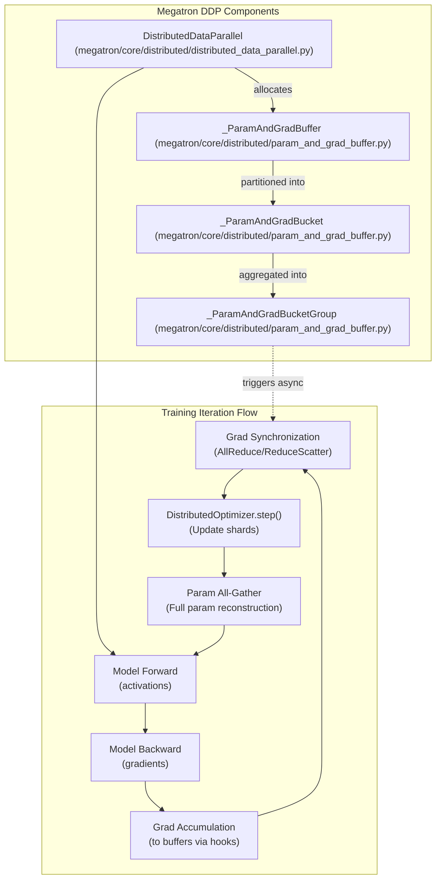
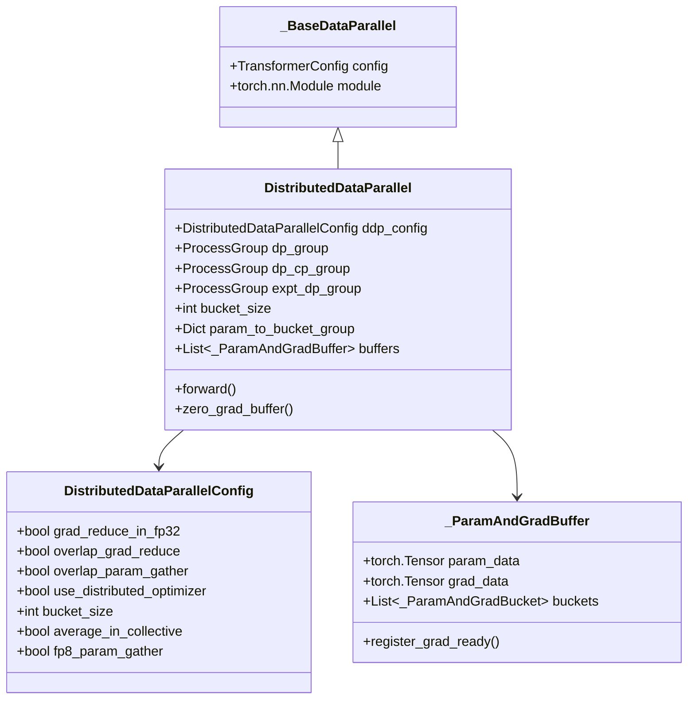
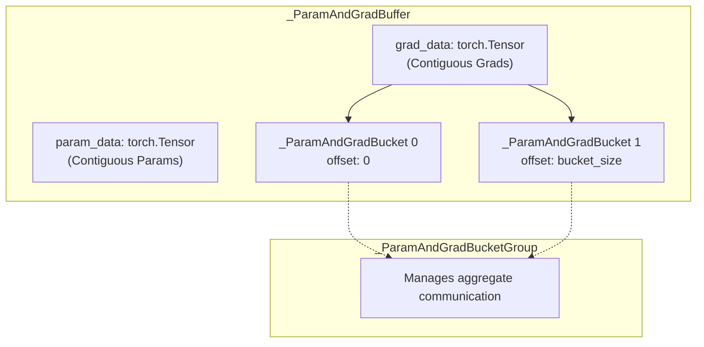
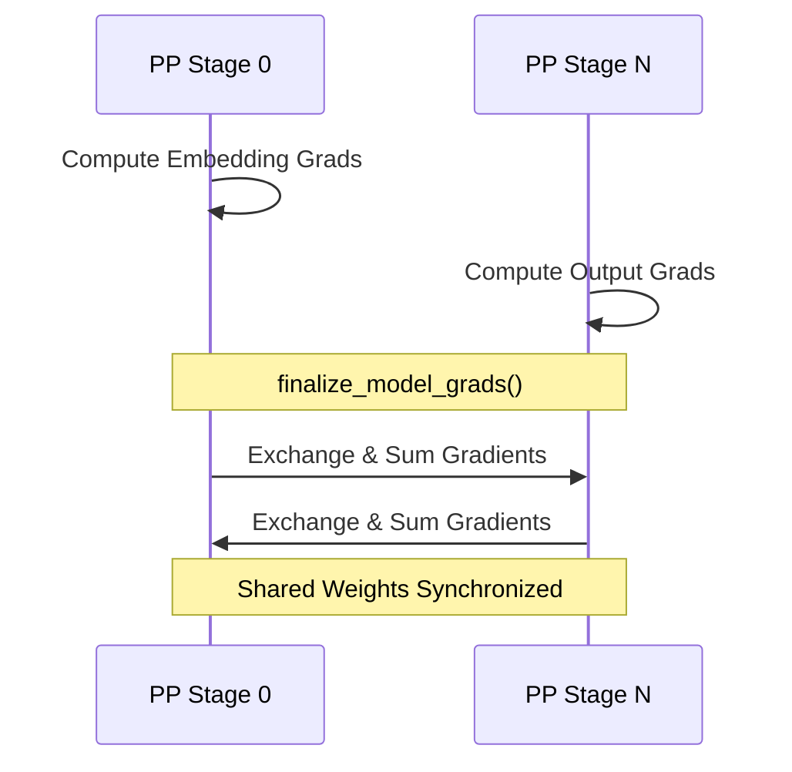

<!-- source: DeepWiki mcp.deepwiki.com · repo NVIDIA/Megatron-LM · page 4.4 Data Parallelism and DistributedDataParallel · fetched 2026-10-26 -->

# Data Parallelism and DistributedDataParallel

Relevant source files

The following files were used as context for generating this wiki page:

- [megatron/core/distributed/distributed_data_parallel.py](megatron/core/distributed/distributed_data_parallel.py)
- [megatron/core/distributed/finalize_model_grads.py](megatron/core/distributed/finalize_model_grads.py)
- [megatron/core/distributed/param_and_grad_buffer.py](megatron/core/distributed/param_and_grad_buffer.py)
- [megatron/core/fp8_utils.py](megatron/core/fp8_utils.py)
- [megatron/core/optimizer/__init__.py](megatron/core/optimizer/__init__.py)
- [megatron/core/optimizer/clip_grads.py](megatron/core/optimizer/clip_grads.py)
- [megatron/core/optimizer/cpu_offloading/README.md](megatron/core/optimizer/cpu_offloading/README.md)
- [megatron/core/optimizer/cpu_offloading/__init__.py](megatron/core/optimizer/cpu_offloading/__init__.py)
- [megatron/core/optimizer/cpu_offloading/hybrid_optimizer.py](megatron/core/optimizer/cpu_offloading/hybrid_optimizer.py)
- [megatron/core/optimizer/distrib_optimizer.py](megatron/core/optimizer/distrib_optimizer.py)
- [megatron/core/optimizer/optimizer.py](megatron/core/optimizer/optimizer.py)
- [megatron/core/optimizer/optimizer_config.py](megatron/core/optimizer/optimizer_config.py)
- [tests/unit_tests/distributed/test_finalize_model_grads.py](tests/unit_tests/distributed/test_finalize_model_grads.py)
- [tests/unit_tests/distributed/test_param_and_grad_buffer.py](tests/unit_tests/distributed/test_param_and_grad_buffer.py)
- [tests/unit_tests/test_fp8_param.py](tests/unit_tests/test_fp8_param.py)
- [tests/unit_tests/test_fp8_utils.py](tests/unit_tests/test_fp8_utils.py)
- [tests/unit_tests/test_optimizer.py](tests/unit_tests/test_optimizer.py)
- [tests/unit_tests/test_optimizer_cpu_offloading.py](tests/unit_tests/test_optimizer_cpu_offloading.py)
- [tests/unit_tests/transformer/test_module.py](tests/unit_tests/transformer/test_module.py)

## Purpose and Scope

This page documents Megatron-LM's **Data Parallelism** implementation through the `DistributedDataParallel` (DDP) wrapper. Data parallelism replicates the model across multiple GPUs, with each GPU processing different data. Gradients are synchronized across replicas through collective communication operations.

This implementation is highly optimized for large-scale training, featuring contiguous memory buffers for parameters and gradients, asynchronous communication overlap with backward computation, and specialized support for FP8/FP4 precision and Mixture of Experts (MoE) models.

---

## System Architecture

### High-Level Data Parallel Flow

The following diagram illustrates the relationship between the DDP wrapper, the contiguous buffers, and the execution flow from forward pass to parameter synchronization.

**Sources:** [megatron/core/distributed/distributed_data_parallel.py:87-118](), [megatron/core/distributed/param_and_grad_buffer.py:92-141](), [megatron/core/distributed/param_and_grad_buffer.py:179-200]()

---

## DistributedDataParallel Class

### Class Hierarchy and Initialization

The `DistributedDataParallel` class wraps a model to enable gradient synchronization across data-parallel replicas. It inherits from `_BaseDataParallel` [megatron/core/distributed/distributed_data_parallel.py:87-87]().

**Key initialization steps** from [megatron/core/distributed/distributed_data_parallel.py:109-200]():

1. **Process Group Setup**: Determines `dp_group`, `dp_cp_group`, and `expt_dp_group` using `ProcessGroupCollection.setup_process_groups_for_ddp` [megatron/core/distributed/distributed_data_parallel.py:127-129]().
2. **Bucket Size Determination**: Defaults to `max(40000000, 1000000 * dp_group.size())` if not provided and `overlap_grad_reduce` is enabled [megatron/core/distributed/distributed_data_parallel.py:133-134]().
3. **Parameter Grouping**: Parameters are split into buffers based on `param_dtype`, `grad_dtype`, and `is_expert_parallel` using `group_params_for_buffers` [megatron/core/distributed/distributed_data_parallel.py:175-175]().
4. **Buffer Allocation**: Creates contiguous memory for parameters and gradients. If using `DistributedOptimizer`, it auto-computes layouts if not provided [megatron/core/distributed/distributed_data_parallel.py:177-200]().

**Sources:** [megatron/core/distributed/distributed_data_parallel.py:87-200](), [megatron/core/distributed/param_and_grad_buffer.py:443-500]()

---

## Gradient Buffers and Bucketing

### Buffer Structure

Gradients and parameters are stored in contiguous `_ParamAndGradBuffer` objects. This design enables efficient collective communication and memory management by allowing operations on large, flat tensors [megatron/core/distributed/param_and_grad_buffer.py:443-460]().

### Bucketing Strategy

Parameters are partitioned into buckets to enable overlapping communication with computation. If `overlap_grad_reduce` is disabled, `bucket_size` is effectively set to infinity, putting all parameters in one bucket [megatron/core/distributed/distributed_data_parallel.py:136-137]().

**Bucketing Logic**:
- Parameters are added to a bucket until the `bucket_size` threshold is reached [megatron/core/distributed/param_and_grad_buffer.py:92-100]().
- Padded offsets are maintained for 128-byte alignment required by the distributed optimizer [megatron/core/distributed/param_and_grad_buffer.py:131-140]().
- This allows the backward pass to trigger communication for "finished" buckets while other layers are still computing gradients.

**Sources:** [megatron/core/distributed/param_and_grad_buffer.py:92-141](), [megatron/core/distributed/distributed_data_parallel.py:131-137]()

---

## Communication Patterns

### Gradient Synchronization and Overlap

Megatron-LM achieves overlap by using `_ParamAndGradBucketGroup`. When all parameters in a bucket group have their gradients ready (tracked via `register_grad_ready`), an asynchronous collective is launched [megatron/core/distributed/param_and_grad_buffer.py:179-200]().

1. **Standard DDP (All-Reduce)**: Sums gradients across the DP group.
2. **Distributed Optimizer (Reduce-Scatter)**: Gradients are reduce-scattered across the DP group. Each rank becomes responsible for a specific shard [megatron/core/distributed/param_and_grad_buffer.py:50-57]().
3. **Async Param Gather**: When `overlap_param_gather` is enabled, parameters for the next bucket are pre-fetched (All-Gather) while the current bucket's computation is ongoing [megatron/core/distributed/param_and_grad_buffer.py:162-177]().

### FP8 and NVFP4 Support

Special handling is provided for low-precision tensors:
- **FP8**: Uses `post_all_gather_processing` from Transformer Engine to handle scaling factors after parameter reconstruction [megatron/core/fp8_utils.py:97-101]().
- **NVFP4**: Implements row-wise packed storage management and specialized quantization for parameter shards [megatron/core/fp4_utils.py:23-29](), [megatron/core/distributed/param_and_grad_buffer.py:23-29]().

**Sources:** [megatron/core/distributed/param_and_grad_buffer.py:179-200](), [megatron/core/fp8_utils.py:97-101](), [megatron/core/fp4_utils.py:23-29]()

---

## Finalizing Model Gradients

After the backward pass, `finalize_model_grads` ensures all shared weights and replicated parameters are synchronized [megatron/core/distributed/finalize_model_grads.py:265-270]().

### Synchronization Types

| Component | Synchronization Method | Logic |
| :--- | :--- | :--- |
| **Word Embeddings** | `_allreduce_word_embedding_grads` | All-reduce across first and last PP stages if weights are shared [megatron/core/distributed/finalize_model_grads.py:164-184](). |
| **Position Embeddings** | `_allreduce_position_embedding_grads` | All-reduce across PP stages for learned position embeddings [megatron/core/distributed/finalize_model_grads.py:214-234](). |
| **Conditional Embedders** | `_allreduce_conditional_embedding_grads` | Syncs gradients for timestep/label embedders in diffusion models [megatron/core/distributed/finalize_model_grads.py:89-130](). |
| **Non-TP Parameters** | `_allreduce_non_tensor_model_parallel_grads` | Syncs parameters like LayerNorm that are replicated across TP ranks [megatron/core/distributed/finalize_model_grads.py:249-262](). |

**Sources:** [megatron/core/distributed/finalize_model_grads.py:34-270]()

---

## Configuration Summary

The `DistributedDataParallelConfig` provides several tuning knobs for performance:

| Option | Effect |
| :--- | :--- |
| `grad_reduce_in_fp32` | Performs gradient reduction in FP32 even if params are lower precision [megatron/core/distributed/distributed_data_parallel.py:175-175](). |
| `overlap_grad_reduce` | Enables asynchronous gradient communication during backward [megatron/core/distributed/distributed_data_parallel.py:136-137](). |
| `use_distributed_optimizer` | Shards optimizer states and uses reduce-scatter for grads [megatron/core/distributed/distributed_data_parallel.py:177-185](). |
| `bucket_size` | Controls the granularity of communication units [megatron/core/distributed/distributed_data_parallel.py:133-134](). |
| `average_in_collective` | Divides by world size within the NCCL collective rather than after [megatron/core/distributed/param_and_grad_buffer.py:102-104](). |
| `fp8_param_gather` | Optimizes parameter reconstruction for FP8 models by gathering sharded FP8 data [megatron/core/fp8_utils.py:193-200](). |

**Sources:** [megatron/core/distributed/distributed_data_parallel.py:109-200](), [megatron/core/distributed/param_and_grad_buffer.py:92-120]()

---

