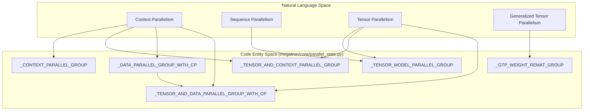
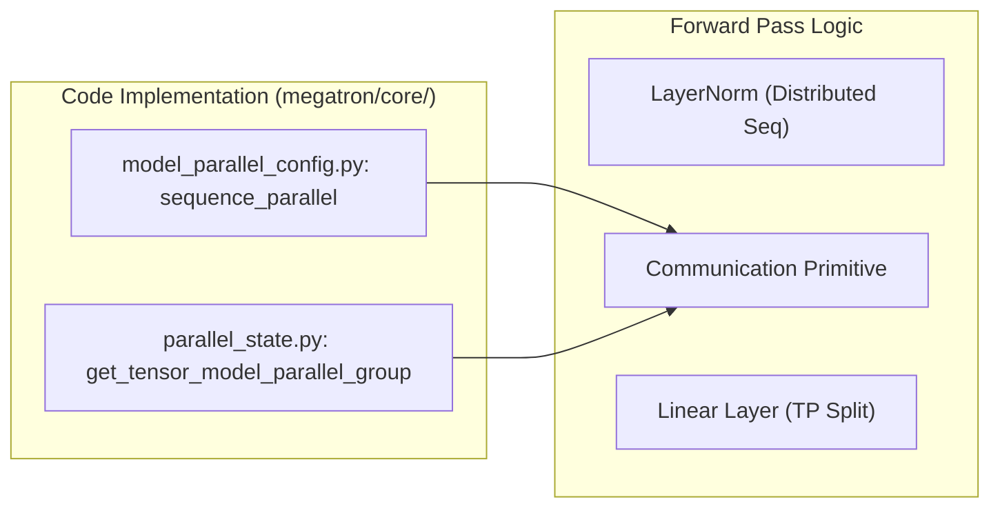
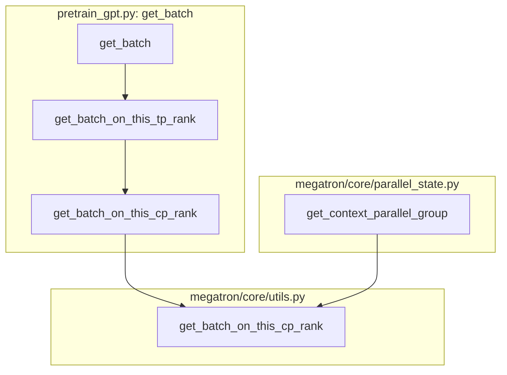

<!-- source: DeepWiki mcp.deepwiki.com · repo NVIDIA/Megatron-LM · page 4.5 Context and Sequence Parallelism · fetched 2026-10-26 -->

# Context and Sequence Parallelism

Relevant source files

The following files were used as context for generating this wiki page:

- [docs/api-guide/core/generalized_tensor_parallel.md](docs/api-guide/core/generalized_tensor_parallel.md)
- [docs/images/generalized_tensor_parallel/0725_gtp_grouped_oneblock_prefetch.png](docs/images/generalized_tensor_parallel/0725_gtp_grouped_oneblock_prefetch.png)
- [megatron/core/dist_checkpointing/strategies/fully_parallel.py](megatron/core/dist_checkpointing/strategies/fully_parallel.py)
- [megatron/core/model_parallel_config.py](megatron/core/model_parallel_config.py)
- [megatron/core/parallel_state.py](megatron/core/parallel_state.py)
- [megatron/core/pipeline_parallel/p2p_communication.py](megatron/core/pipeline_parallel/p2p_communication.py)
- [megatron/core/pipeline_parallel/schedules.py](megatron/core/pipeline_parallel/schedules.py)
- [megatron/core/tensor_parallel/generalized_tensor_parallelism.py](megatron/core/tensor_parallel/generalized_tensor_parallelism.py)
- [megatron/core/tensor_parallel/gtp_api.py](megatron/core/tensor_parallel/gtp_api.py)
- [megatron/core/tensor_parallel/gtp_cuda_graphs.py](megatron/core/tensor_parallel/gtp_cuda_graphs.py)
- [megatron/training/arguments.py](megatron/training/arguments.py)
- [megatron/training/checkpointing.py](megatron/training/checkpointing.py)
- [megatron/training/config/training_config.py](megatron/training/config/training_config.py)
- [megatron/training/initialize.py](megatron/training/initialize.py)
- [megatron/training/training.py](megatron/training/training.py)
- [pretrain_gpt.py](pretrain_gpt.py)
- [pretrain_hybrid.py](pretrain_hybrid.py)
- [pretrain_mamba.py](pretrain_mamba.py)
- [tests/unit_tests/dist_checkpointing/test_pipeline_parallel_layout.py](tests/unit_tests/dist_checkpointing/test_pipeline_parallel_layout.py)
- [tests/unit_tests/dist_checkpointing/utils.py](tests/unit_tests/dist_checkpointing/utils.py)
- [tests/unit_tests/distributed/test_param_readiness.py](tests/unit_tests/distributed/test_param_readiness.py)
- [tests/unit_tests/generalized_tensor_parallel/gtp_test_utils.py](tests/unit_tests/generalized_tensor_parallel/gtp_test_utils.py)
- [tests/unit_tests/generalized_tensor_parallel/test_gtp_basics.py](tests/unit_tests/generalized_tensor_parallel/test_gtp_basics.py)
- [tests/unit_tests/generalized_tensor_parallel/test_gtp_dcp.py](tests/unit_tests/generalized_tensor_parallel/test_gtp_dcp.py)
- [tests/unit_tests/generalized_tensor_parallel/test_gtp_ddp_param_sync_race.py](tests/unit_tests/generalized_tensor_parallel/test_gtp_ddp_param_sync_race.py)
- [tests/unit_tests/generalized_tensor_parallel/test_gtp_grad_correctness.py](tests/unit_tests/generalized_tensor_parallel/test_gtp_grad_correctness.py)
- [tests/unit_tests/generalized_tensor_parallel/test_gtp_mtp.py](tests/unit_tests/generalized_tensor_parallel/test_gtp_mtp.py)
- [tests/unit_tests/generalized_tensor_parallel/test_gtp_muon_dcp.py](tests/unit_tests/generalized_tensor_parallel/test_gtp_muon_dcp.py)
- [tests/unit_tests/generalized_tensor_parallel/test_gtp_partial_cg.py](tests/unit_tests/generalized_tensor_parallel/test_gtp_partial_cg.py)
- [tests/unit_tests/generalized_tensor_parallel/test_gtp_recompute_chain.py](tests/unit_tests/generalized_tensor_parallel/test_gtp_recompute_chain.py)
- [tests/unit_tests/pipeline_parallel/test_pipeline_layout.py](tests/unit_tests/pipeline_parallel/test_pipeline_layout.py)
- [tests/unit_tests/test_checkpointing.py](tests/unit_tests/test_checkpointing.py)
- [tests/unit_tests/test_parallel_state.py](tests/unit_tests/test_parallel_state.py)

## Purpose and Scope

This document describes Context Parallelism (CP) and Sequence Parallelism (SP), two complementary strategies for distributing sequence-length dimensions across GPUs in Megatron-LM. Context Parallelism partitions input sequences to enable training on very long contexts by splitting the sequence across multiple GPUs, while Sequence Parallelism distributes activations along the sequence dimension within a Tensor Parallel group to reduce memory consumption in non-attention layers.

For information about other parallelism strategies, see [Tensor Parallelism](4.2), [Pipeline Parallelism](4.3), [Data Parallelism](4.4), and [Expert Parallelism](4.6). For process group initialization, see [Parallel State Management](4.1).

## Overview

Megatron-LM provides two distinct approaches to parallelizing the sequence dimension:

- **Context Parallelism (CP)**: Splits the input sequence across multiple GPUs, enabling training on sequences longer than what fits on a single GPU. Each GPU processes a chunk of the sequence and communicates with other GPUs during attention computation to access the full context.
- **Sequence Parallelism (SP)**: Distributes activations (but not weights) along the sequence dimension within a Tensor Parallel group. This reduces per-GPU memory for activations in non-attention layers (e.g., LayerNorm, Dropout, MLP) without requiring cross-GPU communication during forward/backward passes [megatron/core/model_parallel_config.py:94-98]().

### Logical to Code Mapping: Parallelism Types

The following diagram maps high-level parallelism concepts to the specific process group variables managed in `megatron/core/parallel_state.py`.

**Sources**: [megatron/core/parallel_state.py:29-32](), [megatron/core/parallel_state.py:124-125](), [megatron/core/parallel_state.py:141-143](), [megatron/core/parallel_state.py:150-153]()

## Context Parallelism (CP)

### Basic Concept

Context Parallelism partitions the sequence length across a set of GPUs called a context parallel group. For a sequence of length `S` and context parallel size `CP`, each GPU processes `S / CP` tokens. This allows training on sequences that exceed single-GPU memory capacity [megatron/core/model_parallel_config.py:100-101]().

During attention computation, GPUs must exchange key-value (KV) pairs to compute attention over the full sequence. This communication is handled within the core attention implementations, often utilizing ring-exchange or all-to-all patterns depending on the backend and configuration.

### Process Group Initialization

Context parallel groups are initialized during the distributed setup phase. The `parallel_state` module manages several CP-related process groups to ensure correct communication during forward/backward passes and gradient reduction.

| Process Group | Purpose | Code Identifier |
|---------------|---------|-----------------|
| Context Parallel Group | Main CP group for sequence splitting | `_CONTEXT_PARALLEL_GROUP` [megatron/core/parallel_state.py:124]() |
| Tensor + Context | Combined TP+CP for joint operations | `_TENSOR_AND_CONTEXT_PARALLEL_GROUP` [megatron/core/parallel_state.py:150]() |
| DP with Context | DP group including CP ranks for weight grads | `_DATA_PARALLEL_GROUP_WITH_CP` [megatron/core/parallel_state.py:141]() |
| Hierarchical CP | Multi-level CP groups for complex topologies | `_HIERARCHICAL_CONTEXT_PARALLEL_GROUPS` [megatron/core/parallel_state.py:129]() |

### Configuration and Hybrid CP

Context parallelism is configured via the `ModelParallelConfig` [megatron/core/model_parallel_config.py:100-125](). A specialized mode called **Hybrid Context Parallel** balances workloads when using packed samples with variable sequence lengths [megatron/core/model_parallel_config.py:120-125]().

| Argument | Type | Description |
|----------|------|-------------|
| `context_parallel_size` | int | Number of GPUs in a CP group [megatron/core/model_parallel_config.py:100](). |
| `hierarchical_context_parallel_sizes` | list | Sizes for multi-level CP communication (e.g., a2a + p2p) [megatron/core/model_parallel_config.py:103-109](). |
| `hybrid_context_parallel` | bool | Enables workload balancing for variable sequence lengths [megatron/core/model_parallel_config.py:120](). |
| `max_seqlen_per_dp_cp_rank` | int | Max sequence length handled per DPxCP rank to avoid OOM [megatron/core/model_parallel_config.py:111-118](). |

**Sources**: [megatron/core/model_parallel_config.py:100-125]()

## Sequence Parallelism (SP)

### Basic Concept

Sequence Parallelism distributes activations along the sequence dimension within a Tensor Parallel group. It is enabled by setting `sequence_parallel=True` in the configuration [megatron/core/model_parallel_config.py:94-98]().

Unlike CP, SP does not split the input sequence at the data loader level for the entire model; rather, it shards the activations specifically in regions where weights are not split (like LayerNorm or Dropout) to save memory [megatron/core/model_parallel_config.py:95-97]().

### Data Flow and Communication

The `megatron/core/pipeline_parallel/schedules.py` logic adjusts tensor shapes when SP is active. Specifically, the sequence length component is updated to `original_sequence_length / tensor_model_parallel_world_size` [megatron/core/pipeline_parallel/schedules.py:66-68]().

**Sources**: [megatron/core/model_parallel_config.py:94-98](), [megatron/core/pipeline_parallel/schedules.py:66-68]()

## Integration with Training and Communication

### ProcessGroupCollection

The `ProcessGroupCollection` class serves as a unified container for all parallelism groups, including CP-specific groups like `cp`, `tp_cp`, `hcp`, and `dp_cp`. This collection can be initialized from the global `parallel_state` using `use_mpu_process_groups()`.

### Communication Overlap

Megatron-LM supports high-performance communication overlap for tensor and context parallelism. During initialization, `_initialize_tp_communicators` in `megatron/training/initialize.py` sets up communicators with user buffers [megatron/training/initialize.py:193-195](). The input shapes for these communicators are adjusted based on the `context_parallel_size` to ensure the correct sequence slice is considered [megatron/training/initialize.py:216-218]().

### Hybrid CP Scheduling

For models utilizing hybrid context parallelism, a specialized forward-backward schedule `hybrid_context_parallel_forward_backward` is used to manage the execution flow [megatron/core/pipeline_parallel/schedules.py:42](). Data loading for this mode is handled by `HybridCPDataLoaderWrapper` [megatron/training/training.py:46]().

### Batch Processing for CP

In the GPT pretraining pipeline, `get_batch` in `pretrain_gpt.py` uses `get_batch_on_this_cp_rank` to partition the batch according to the context parallel rank [pretrain_gpt.py:180-186](). This function handles per-sequence balancing when document masking is enabled [pretrain_gpt.py:185]().

**Sources**: [megatron/training/initialize.py:193-218](), [megatron/core/pipeline_parallel/schedules.py:42](), [pretrain_gpt.py:180-186](), [megatron/training/training.py:46](), [megatron/core/utils.py:134-135]()

## Generalized Tensor Parallelism (GTP)

Megatron-LM introduces **Generalized Tensor Parallelism (GTP)**, which factors the weight-parallel domain into `TP x GTP_remat`. While TP shards activations, `GTP_remat` shards model weights (and optimizer states/gradients) across ranks, rematerializing them via async all-gather just before the GEMM [megatron/core/tensor_parallel/generalized_tensor_parallelism.py:5-13]().

- **Communication**: Uses a per-weight prefetch chain designed for CUDA graph capture [megatron/core/tensor_parallel/generalized_tensor_parallelism.py:18-19]().
- **Memory Efficiency**: Trades extra all-gather traffic for `1/GTP_remat` lower weight memory, functioning as ZeRO-3 on the weights within a TP group [megatron/core/tensor_parallel/generalized_tensor_parallelism.py:12-13]().

**Sources**: [megatron/core/tensor_parallel/generalized_tensor_parallelism.py:3-23](), [megatron/core/model_parallel_config.py:67-76]()

## Summary of Parallel Dimensions

| Parallelism | Dimension Split | Group Variable (Internal) |
|-------------|-----------------|---------------------------|
| **Context (CP)** | Sequence Length | `_CONTEXT_PARALLEL_GROUP` [megatron/core/parallel_state.py:124]() |
| **Sequence (SP)** | Sequence Length (Activations) | `_TENSOR_MODEL_PARALLEL_GROUP` [megatron/core/parallel_state.py:29]() |
| **Tensor (TP)** | Hidden/Intermediate | `_TENSOR_MODEL_PARALLEL_GROUP` [megatron/core/parallel_state.py:29]() |
| **GTP Remat** | Weight Partition Dim | `_GTP_WEIGHT_REMAT_GROUP` [megatron/core/parallel_state.py:31]() |
| **Pipeline (PP)** | Layers | `_PIPELINE_MODEL_PARALLEL_GROUP` [megatron/core/parallel_state.py:34]() |

**Sources**: [megatron/core/parallel_state.py:29-44](), [megatron/core/parallel_state.py:124-127]()

---

