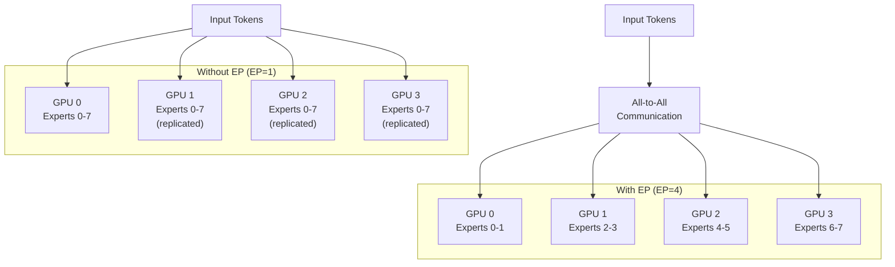
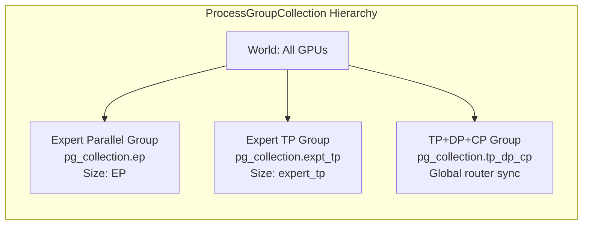
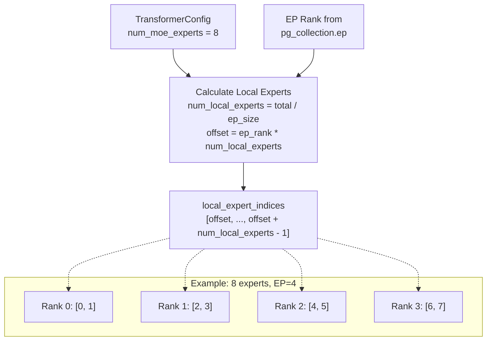
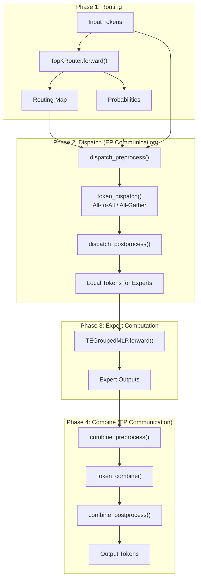
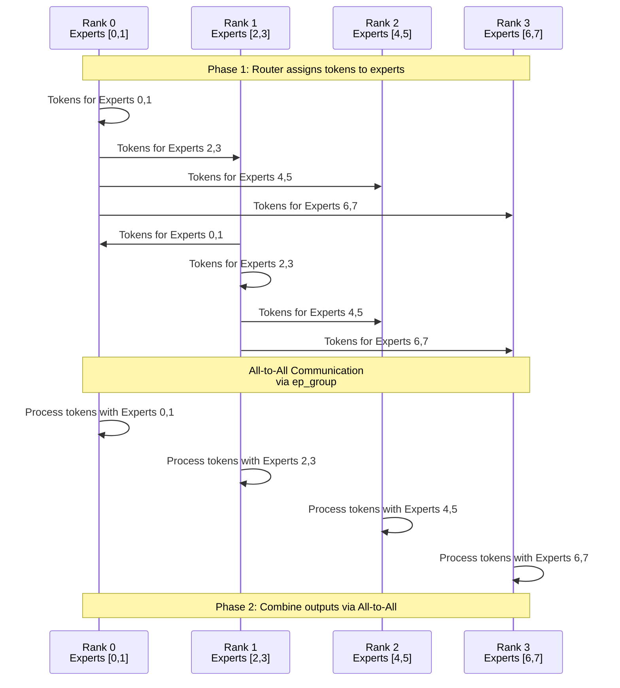
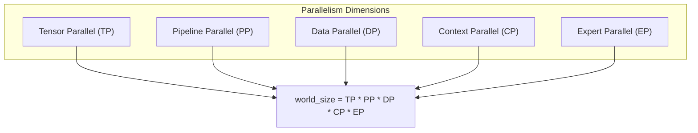
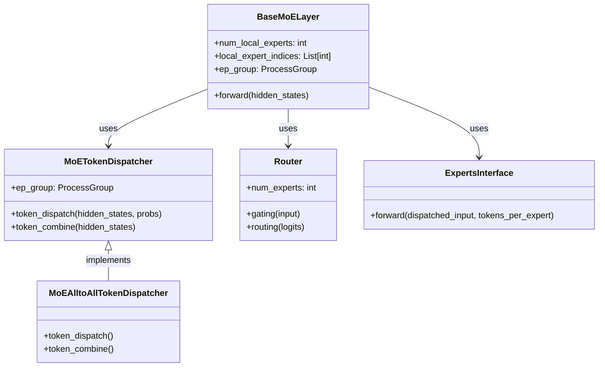

<!-- source: DeepWiki mcp.deepwiki.com · repo NVIDIA/Megatron-LM · page 4.6 Expert Parallelism · fetched 2026-10-26 -->

# Expert Parallelism

Relevant source files

The following files were used as context for generating this wiki page:

- [megatron/core/process_groups_config.py](megatron/core/process_groups_config.py)
- [megatron/core/transformer/moe/README.md](megatron/core/transformer/moe/README.md)
- [megatron/core/transformer/moe/experts.py](megatron/core/transformer/moe/experts.py)
- [megatron/core/transformer/moe/fused_a2a.py](megatron/core/transformer/moe/fused_a2a.py)
- [megatron/core/transformer/moe/moe_layer.py](megatron/core/transformer/moe/moe_layer.py)
- [megatron/core/transformer/moe/moe_utils.py](megatron/core/transformer/moe/moe_utils.py)
- [megatron/core/transformer/moe/paged_stash.py](megatron/core/transformer/moe/paged_stash.py)
- [megatron/core/transformer/moe/router.py](megatron/core/transformer/moe/router.py)
- [megatron/core/transformer/moe/token_dispatcher.py](megatron/core/transformer/moe/token_dispatcher.py)
- [tests/unit_tests/a2a_overlap/utils.py](tests/unit_tests/a2a_overlap/utils.py)
- [tests/unit_tests/distributed/test_distributed_data_parallel.py](tests/unit_tests/distributed/test_distributed_data_parallel.py)
- [tests/unit_tests/inference/test_communication_utils.py](tests/unit_tests/inference/test_communication_utils.py)
- [tests/unit_tests/models/test_hybrid_moe_model.py](tests/unit_tests/models/test_hybrid_moe_model.py)
- [tests/unit_tests/test_hyper_comm_grid.py](tests/unit_tests/test_hyper_comm_grid.py)
- [tests/unit_tests/test_process_groups_config.py](tests/unit_tests/test_process_groups_config.py)
- [tests/unit_tests/transformer/moe/test_aux_loss.py](tests/unit_tests/transformer/moe/test_aux_loss.py)
- [tests/unit_tests/transformer/moe/test_grouped_mlp.py](tests/unit_tests/transformer/moe/test_grouped_mlp.py)
- [tests/unit_tests/transformer/moe/test_paged_stash_runner.py](tests/unit_tests/transformer/moe/test_paged_stash_runner.py)
- [tests/unit_tests/transformer/moe/test_paged_stashing.py](tests/unit_tests/transformer/moe/test_paged_stashing.py)
- [tests/unit_tests/transformer/moe/test_routers.py](tests/unit_tests/transformer/moe/test_routers.py)
- [tests/unit_tests/transformer/moe/test_token_dispatcher.py](tests/unit_tests/transformer/moe/test_token_dispatcher.py)
- [tests/unit_tests/transformer/test_transformer_block_custom_pgs.py](tests/unit_tests/transformer/test_transformer_block_custom_pgs.py)

## Purpose and Scope

This document explains Expert Parallelism (EP), a distributed training strategy specific to Mixture of Experts (MoE) models. EP partitions the expert layers across multiple GPUs, enabling the training of MoE models with large numbers of experts that cannot fit on a single device. 

For information about MoE architecture and routing, see [Mixture of Experts (MoE)](#3.3). For other parallelism strategies, see [Data Parallelism and DistributedDataParallel](#4.4), [Tensor Parallelism](#4.2), and [Pipeline Parallelism](#4.3). For the overall parallelism strategy composition, see [Parallel State Management](#4.1).

Expert Parallelism differs from Data Parallelism in that:
- **Data Parallelism**: Replicates the entire model (including all experts) across devices. [[megatron/core/transformer/moe/README.md:160-162]()]
- **Expert Parallelism**: Partitions experts across devices, with each device hosting a subset of experts. [[megatron/core/transformer/moe/moe_layer.py:185-187]()]

---

## Overview of Expert Parallelism

### Key Concept

In a Mixture of Experts model with `N` experts and expert parallelism size `EP`, each GPU hosts `N/EP` experts. [[megatron/core/transformer/moe/moe_layer.py:185-186]()] Tokens are dynamically routed to their assigned experts via All-to-All communication, where tokens are sent to the device hosting the required expert. [[megatron/core/transformer/moe/token_dispatcher.py:123-135]()]

### Expert Distribution

Title: Expert Distribution with and without EP

The diagram shows how 8 experts are distributed:
- **Without EP**: Each GPU replicates all 8 experts (high memory cost).
- **With EP=4**: Each GPU hosts 2 experts, requiring All-to-All communication to route tokens.

**Sources:** [[megatron/core/transformer/moe/moe_layer.py:181-187]()], [[megatron/core/transformer/moe/token_dispatcher.py:88-91]()]

---

## Process Group Initialization

### EP Process Groups

Expert Parallelism uses several process groups managed through the `ProcessGroupCollection`. [[megatron/core/transformer/moe/moe_utils.py:14]()]

| Process Group Attribute | Purpose |
|------------------------|---------|
| `ep` | Expert Model Parallel Group. Experts distributed across this group. [[megatron/core/transformer/moe/moe_layer.py:179]()] |
| `expt_tp` | Expert Tensor Parallel Group. Tensor parallelism within experts. [[megatron/core/transformer/moe/token_dispatcher.py:85]()] |
| `tp_ep` | Combined expert TP and EP group for complex communication patterns. [[megatron/core/transformer/moe/token_dispatcher.py:86]()] |
| `tp_dp_cp` | Combined TP, DP, and CP group for load balancing calculations. [[megatron/core/transformer/moe/router.py:60]()] |

Title: Rank Hierarchy for Expert Parallelism

**Sources:** [[megatron/core/transformer/moe/moe_layer.py:179-182]()], [[megatron/core/transformer/moe/router.py:57-60]()], [[megatron/core/transformer/moe/experts.py:209-210]()]

---

## Expert Distribution and Local Experts

### Local Expert Indices Calculation

Each GPU determines which experts it hosts based on its EP rank. This logic is implemented in the `BaseMoELayer`. [[megatron/core/transformer/moe/moe_layer.py:161-212]()]

Title: Local Expert Index Assignment in BaseMoELayer

The calculation is performed in `BaseMoELayer.__init__`: [[megatron/core/transformer/moe/moe_layer.py:187-195]()]
- `self.num_local_experts = self.config.num_moe_experts // ep_size` [[megatron/core/transformer/moe/moe_layer.py:187]()]
- `local_expert_indices_offset = ep_rank * self.num_local_experts` [[megatron/core/transformer/moe/moe_layer.py:188]()]
- `self.local_expert_indices = [local_expert_indices_offset + i for i in range(self.num_local_experts)]` [[megatron/core/transformer/moe/moe_layer.py:193-195]()]

**Sources:** [[megatron/core/transformer/moe/moe_layer.py:171-196]()]

---

## Token Dispatching with Expert Parallelism

### Token Dispatch Flow

Token dispatching with EP involves multiple phases of local preprocessing, communication, and post-processing defined in the `MoETokenDispatcher` interface. [[megatron/core/transformer/moe/token_dispatcher.py:63-189]()]

Title: Token Dispatch and Combine Flow in MoETokenDispatcher

**Sources:** [[megatron/core/transformer/moe/token_dispatcher.py:98-189]()], [[megatron/core/transformer/moe/moe_layer.py:214-260]()]

### All-to-All Communication Pattern

The `MoEAlltoAllTokenDispatcher` uses All-to-All communication to distribute tokens across the expert parallel group. [[megatron/core/transformer/moe/moe_layer.py:27]()]

Title: All-to-All Communication for Token Dispatch

**Sources:** [[megatron/core/transformer/moe/token_dispatcher.py:123-136]()], [[megatron/core/transformer/moe/token_dispatcher.py:181-189]()]

---

## EP with Other Parallelism Strategies

### Multi-Dimensional Parallelism

Expert Parallelism is integrated into the multi-dimensional parallelism strategy, constrained by GPU memory and communication overhead. [[megatron/core/transformer/moe/README.md:150-165]()]

Title: EP in Multi-Dimensional Parallelism

### Process Group Collection in MoE

The `ProcessGroupCollection` class provides the specific groups needed for MoE modules. [[megatron/core/transformer/moe/moe_utils.py:14]()]

| Group Attribute | Role in MoE |
|-----------------|-------------|
| `ep` | Token dispatch/combine across experts. [[megatron/core/transformer/moe/moe_layer.py:179]()] |
| `expt_tp` | Tensor parallelism within the experts (e.g., `TEGroupedMLP`). [[megatron/core/transformer/moe/token_dispatcher.py:85]()] |
| `tp_dp_cp` | Used for global router synchronization and load balancing. [[megatron/core/transformer/moe/router.py:60]()] |

**Sources:** [[megatron/core/transformer/moe/moe_layer.py:172-182]()], [[megatron/core/transformer/moe/router.py:53-61]()]

---

## Expert Parallelism vs Data Parallelism

### Communication and Memory Trade-offs

EP reduces weight memory by sharding experts but introduces communication overhead via All-to-All. DP replicates weights but avoids this routing communication. [[megatron/core/transformer/moe/README.md:160-165]()]

Title: Gradient Synchronization: DP vs EP

```mermaid
graph TB
    subgraph "Dense Layers (Data Parallelism)"
        DENSE_FWD["Forward Pass"]
        DENSE_BWD["Backward Pass"]
        DENSE_ALLREDUCE["All-Reduce Gradients<br/>across DP group"]
        
        DENSE_FWD --> DENSE_BWD
        DENSE_BWD --> DENSE_ALLREDUCE
    end
    
    subgraph "Expert Layers (Expert Parallelism)"
        EXPERT_FWD["Forward Pass"]
        EXPERT_A2A_FWD["All-to-All Dispatch"]
        EXPERT_LOCAL["Local Expert Computation"]
        EXPERT_A2A_BWD["All-to-All Combine"]
        EXPERT_BWD["Backward Pass"]
        EXPERT_ALLREDUCE["All-Reduce Gradients<br/>across Expert DP group"]
        
        EXPERT_FWD --> EXPERT_A2A_FWD
        EXPERT_A2A_FWD --> EXPERT_LOCAL
        EXPERT_LOCAL --> EXPERT_A2A_BWD
        EXPERT_A2A_BWD --> EXPERT_BWD
        EXPERT_BWD --> EXPERT_ALLREDUCE
    end
```

**Sources:** [[megatron/core/transformer/moe/README.md:150-165]()], [[megatron/core/transformer/moe/token_dispatcher.py:123-189]()]

---

## Implementation Details

### Key Classes and Their Roles

Title: MoE and Expert Parallelism Class Structure

- **BaseMoELayer**: Manages the high-level flow and expert partitioning. [[megatron/core/transformer/moe/moe_layer.py:161-212]()]
- **MoETokenDispatcher**: Orchestrates token movement between ranks. [[megatron/core/transformer/moe/token_dispatcher.py:63-189]()]
- **TEGroupedMLP**: Implements the expert computation, optimized for executing multiple local experts in parallel using TE's GroupedLinear. [[megatron/core/transformer/moe/experts.py:183-230]()]
- **FusedDispatch / FusedCombine**: Provides high-performance fused operations for MoE routing when using backends like DeepEP. [[megatron/core/transformer/moe/fused_a2a.py:71-206]()]

**Sources:** [[megatron/core/transformer/moe/moe_layer.py:154-212]()], [[megatron/core/transformer/moe/token_dispatcher.py:63-189]()], [[megatron/core/transformer/moe/experts.py:183-210]()], [[megatron/core/transformer/moe/fused_a2a.py:71-206]()]

---

