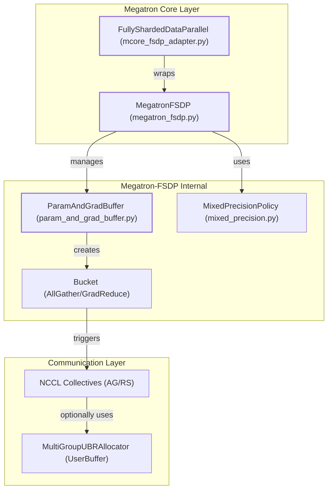
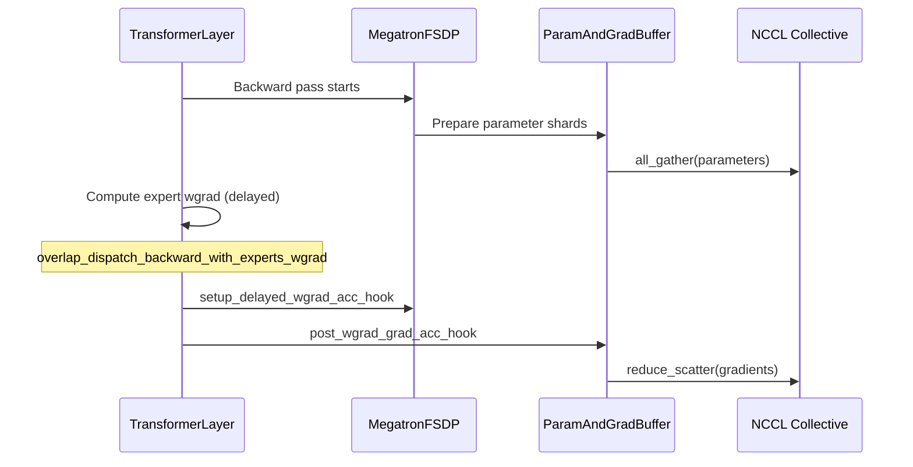
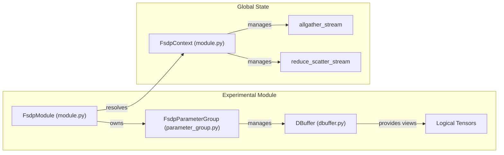

<!-- source: DeepWiki mcp.deepwiki.com · repo NVIDIA/Megatron-LM · page 4.7 Fully Sharded Data Parallelism (FSDP) · fetched 2026-10-26 -->

# Fully Sharded Data Parallelism (FSDP)

Relevant source files

The following files were used as context for generating this wiki page:

- [megatron/core/README_STRAGGLER.md](megatron/core/README_STRAGGLER.md)
- [megatron/core/_rank_utils.py](megatron/core/_rank_utils.py)
- [megatron/core/distributed/__init__.py](megatron/core/distributed/__init__.py)
- [megatron/core/distributed/distributed_data_parallel_config.py](megatron/core/distributed/distributed_data_parallel_config.py)
- [megatron/core/distributed/fsdp/mcore_fsdp_adapter.py](megatron/core/distributed/fsdp/mcore_fsdp_adapter.py)
- [megatron/core/distributed/fsdp/src/README.md](megatron/core/distributed/fsdp/src/README.md)
- [megatron/core/distributed/fsdp/src/megatron_fsdp/distributed_data_parallel_config.py](megatron/core/distributed/fsdp/src/megatron_fsdp/distributed_data_parallel_config.py)
- [megatron/core/distributed/fsdp/src/megatron_fsdp/experimental/__init__.py](megatron/core/distributed/fsdp/src/megatron_fsdp/experimental/__init__.py)
- [megatron/core/distributed/fsdp/src/megatron_fsdp/experimental/checkpoint.py](megatron/core/distributed/fsdp/src/megatron_fsdp/experimental/checkpoint.py)
- [megatron/core/distributed/fsdp/src/megatron_fsdp/experimental/dbuffer.py](megatron/core/distributed/fsdp/src/megatron_fsdp/experimental/dbuffer.py)
- [megatron/core/distributed/fsdp/src/megatron_fsdp/experimental/fully_shard.py](megatron/core/distributed/fsdp/src/megatron_fsdp/experimental/fully_shard.py)
- [megatron/core/distributed/fsdp/src/megatron_fsdp/experimental/indexed_order.py](megatron/core/distributed/fsdp/src/megatron_fsdp/experimental/indexed_order.py)
- [megatron/core/distributed/fsdp/src/megatron_fsdp/experimental/layout.py](megatron/core/distributed/fsdp/src/megatron_fsdp/experimental/layout.py)
- [megatron/core/distributed/fsdp/src/megatron_fsdp/experimental/module.py](megatron/core/distributed/fsdp/src/megatron_fsdp/experimental/module.py)
- [megatron/core/distributed/fsdp/src/megatron_fsdp/experimental/optimizer.py](megatron/core/distributed/fsdp/src/megatron_fsdp/experimental/optimizer.py)
- [megatron/core/distributed/fsdp/src/megatron_fsdp/experimental/parameter_group.py](megatron/core/distributed/fsdp/src/megatron_fsdp/experimental/parameter_group.py)
- [megatron/core/distributed/fsdp/src/megatron_fsdp/experimental/placement.py](megatron/core/distributed/fsdp/src/megatron_fsdp/experimental/placement.py)
- [megatron/core/distributed/fsdp/src/megatron_fsdp/fully_shard.py](megatron/core/distributed/fsdp/src/megatron_fsdp/fully_shard.py)
- [megatron/core/distributed/fsdp/src/megatron_fsdp/megatron_fsdp.py](megatron/core/distributed/fsdp/src/megatron_fsdp/megatron_fsdp.py)
- [megatron/core/distributed/fsdp/src/megatron_fsdp/param_and_grad_buffer.py](megatron/core/distributed/fsdp/src/megatron_fsdp/param_and_grad_buffer.py)
- [megatron/core/distributed/fsdp/src/megatron_fsdp/utils.py](megatron/core/distributed/fsdp/src/megatron_fsdp/utils.py)
- [megatron/core/distributed/torch_fully_sharded_data_parallel.py](megatron/core/distributed/torch_fully_sharded_data_parallel.py)
- [megatron/core/distributed/torch_fully_sharded_data_parallel_config.py](megatron/core/distributed/torch_fully_sharded_data_parallel_config.py)
- [megatron/core/models/huggingface/clip_model.py](megatron/core/models/huggingface/clip_model.py)
- [megatron/core/models/huggingface/module.py](megatron/core/models/huggingface/module.py)
- [megatron/core/models/huggingface/qwen_model.py](megatron/core/models/huggingface/qwen_model.py)
- [megatron/core/optimizer/fully_sharded_optimizer.py](megatron/core/optimizer/fully_sharded_optimizer.py)
- [tests/unit_tests/distributed/mfsdp_v1/test_mcore_tensor_parallelism_detect.py](tests/unit_tests/distributed/mfsdp_v1/test_mcore_tensor_parallelism_detect.py)
- [tests/unit_tests/distributed/mfsdp_v2/conftest.py](tests/unit_tests/distributed/mfsdp_v2/conftest.py)
- [tests/unit_tests/distributed/mfsdp_v2/test_annotation.py](tests/unit_tests/distributed/mfsdp_v2/test_annotation.py)
- [tests/unit_tests/distributed/mfsdp_v2/test_checkpoint.py](tests/unit_tests/distributed/mfsdp_v2/test_checkpoint.py)
- [tests/unit_tests/distributed/mfsdp_v2/test_context.py](tests/unit_tests/distributed/mfsdp_v2/test_context.py)
- [tests/unit_tests/distributed/mfsdp_v2/test_cuda_graph.py](tests/unit_tests/distributed/mfsdp_v2/test_cuda_graph.py)
- [tests/unit_tests/distributed/mfsdp_v2/test_dbuffer.py](tests/unit_tests/distributed/mfsdp_v2/test_dbuffer.py)
- [tests/unit_tests/distributed/mfsdp_v2/test_fully_shard.py](tests/unit_tests/distributed/mfsdp_v2/test_fully_shard.py)
- [tests/unit_tests/distributed/mfsdp_v2/test_mcore_adapter.py](tests/unit_tests/distributed/mfsdp_v2/test_mcore_adapter.py)
- [tests/unit_tests/distributed/mfsdp_v2/test_memory.py](tests/unit_tests/distributed/mfsdp_v2/test_memory.py)
- [tests/unit_tests/distributed/mfsdp_v2/test_optimizer.py](tests/unit_tests/distributed/mfsdp_v2/test_optimizer.py)
- [tests/unit_tests/distributed/mfsdp_v2/test_overlap.py](tests/unit_tests/distributed/mfsdp_v2/test_overlap.py)
- [tests/unit_tests/distributed/mfsdp_v2/test_symmetric_memory.py](tests/unit_tests/distributed/mfsdp_v2/test_symmetric_memory.py)
- [tests/unit_tests/distributed/test_torch_fully_sharded_parallel.py](tests/unit_tests/distributed/test_torch_fully_sharded_parallel.py)
- [tests/unit_tests/test_utils.py](tests/unit_tests/test_utils.py)

Fully Sharded Data Parallelism (FSDP) is a distributed training strategy that shards model parameters, gradients, and optimizer states across data parallel workers to reduce memory overhead. Megatron-LM provides a high-performance implementation, **Megatron-FSDP**, which is optimized for NVIDIA GPUs and integrates with Megatron Core (MCore) features like tensor parallelism and expert parallelism.

## Overview

Megatron-FSDP is an NVIDIA-developed PyTorch extension that provides a high-performance alternative to native FSDP implementations [megatron/core/distributed/fsdp/src/README.md:13-17](). It achieves zero-copy communication by reorganizing the storage of parameters and gradients using a contiguous buffer architecture [megatron/core/distributed/fsdp/src/README.md:13-17]().

### Key Sharding Strategies
Megatron-FSDP supports several sharding modes defined in the sharding strategy configuration [megatron/core/distributed/distributed_data_parallel_config.py:103-105]():
*   **`no_shard`**: Traditional data parallel training; similar to DDP [megatron/core/distributed/fsdp/src/megatron_fsdp/megatron_fsdp.py:114-114]().
*   **`optim`**: Shards only optimizer states; conceptually similar to ZeRO-1 [megatron/core/distributed/fsdp/src/megatron_fsdp/megatron_fsdp.py:115-118]().
*   **`optim_grads`**: Shards optimizer states and gradients; conceptually similar to ZeRO-2 [megatron/core/distributed/fsdp/src/megatron_fsdp/megatron_fsdp.py:119-120]().
*   **`optim_grads_params`**: Shards parameters, gradients, and optimizer states; conceptually similar to ZeRO-3 [megatron/core/distributed/fsdp/src/megatron_fsdp/megatron_fsdp.py:121-122]().

## System Architecture

The Megatron-FSDP implementation is centered around the `MegatronFSDP` class, which wraps a standard `torch.nn.Module`. It uses a `ParamAndGradBuffer` to manage the underlying memory for sharded parameters and their corresponding gradients [megatron/core/distributed/fsdp/src/megatron_fsdp/megatron_fsdp.py:106-130]().

### Code Entity Relationship
The following diagram shows how the user-facing adapter interacts with the core Megatron-FSDP implementation and the buffer management system.

**Megatron-FSDP Core Components**

**Sources:** [megatron/core/distributed/fsdp/mcore_fsdp_adapter.py:72-130](), [megatron/core/distributed/fsdp/src/megatron_fsdp/megatron_fsdp.py:106-155](), [megatron/core/distributed/fsdp/src/megatron_fsdp/param_and_grad_buffer.py:172-194]()

## Implementation Details

### Parameter and Gradient Buffers
The `ParamAndGradBuffer` is the primary mechanism for memory management. It allocates contiguous memory for parameters and gradients to enable efficient collective operations [megatron/core/distributed/fsdp/src/megatron_fsdp/param_and_grad_buffer.py:37-42]().

Key functionalities include:
*   **Storage Management**: Dynamically allocates and frees storage for unsharded parameters during forward/backward passes using `_alloc_storage` and `_free_storage` [megatron/core/distributed/fsdp/src/megatron_fsdp/param_and_grad_buffer.py:120-161]().
*   **Bucketing**: Groups parameters into buckets to overlap communication with computation. The `BucketIndex` and `ShardBucketIndex` track these groupings [megatron/core/distributed/fsdp/src/megatron_fsdp/param_and_grad_buffer.py:165-170]().
*   **DTensor Integration**: Supports PyTorch `DTensor` for distributed tensor management, including converting local buffers to global views via `to_local_if_dtensor` [megatron/core/distributed/fsdp/src/megatron_fsdp/param_and_grad_buffer.py:40-42]().

### Training States
The `TrainingState` enum tracks the lifecycle of parameter groups during a training step, which dictates when parameters should be unsharded or resharded [megatron/core/distributed/fsdp/src/megatron_fsdp/megatron_fsdp.py:63-75]():

| State | Description |
| :--- | :--- |
| `FORWARD` | Parameters are unsharded for the forward pass. |
| `PRE_BACKWARD` | Parameters are unsharded prior to backward computation. |
| `POST_BACKWARD` | Gradients are resharded after backward computation. |
| `IDLE` | No un/sharding activity; occurs between forward/backward passes. |

**Sources:** [megatron/core/distributed/fsdp/src/megatron_fsdp/megatron_fsdp.py:63-75]()

### Mixed Precision Policy
The `MixedPrecisionPolicy` class defines the data types for parameters, gradients, and communications [megatron/core/distributed/fsdp/src/megatron_fsdp/mixed_precision.py:27-35](). In MCore, this is configured via the `DistributedDataParallelConfig` [megatron/core/distributed/fsdp/mcore_fsdp_adapter.py:145-149]():
*   `megatron_fsdp_main_params_dtype`: The dtype for sharded parameters (defaults to FP32) [megatron/core/distributed/distributed_data_parallel_config.py:154-159]().
*   `megatron_fsdp_main_grads_dtype`: The dtype for gradient accumulation [megatron/core/distributed/distributed_data_parallel_config.py:161-166]().
*   `megatron_fsdp_grad_comm_dtype`: The dtype used during collective communications (e.g., BF16) [megatron/core/distributed/distributed_data_parallel_config.py:167-177]().

## Communication and Computation Overlap

Megatron-FSDP implements several optimizations to overlap communication with computation:

1.  **Prefetching**: All-gather operations for parameters are prefetched before they are needed. This is controlled by `suggested_communication_unit_size` [megatron/core/distributed/distributed_data_parallel_config.py:110-117]().
2.  **User Buffer Registration (NCCL UB)**: If `nccl_ub` is enabled, FSDP communication buffers are registered as NCCL user buffers, which can reduce SM usage during collectives [megatron/core/distributed/distributed_data_parallel_config.py:121-136]().
3.  **Multi-Group Allocator**: For Mixture of Experts (MoE) models, the `MultiGroupUBRAllocator` allows registering a single memory pool with multiple process groups (e.g., `dp_cp_group` and `ep_dp_group`) [megatron/core/distributed/fsdp/src/megatron_fsdp/param_and_grad_buffer.py:172-184]().

### Communication Data Flow
The following diagram illustrates the data flow during a backward pass when expert parameters are involved.

**Backward Pass with Delayed Expert WGrad**

**Sources:** [megatron/core/distributed/fsdp/src/megatron_fsdp/megatron_fsdp.py:78-105](), [megatron/core/distributed/fsdp/src/megatron_fsdp/param_and_grad_buffer.py:172-184]()

## Experimental FSDP Path (v2)

Megatron-FSDP is introducing a minimal experimental path (v2) utilizing `DBuffer` and `DTensor` integration for improved performance and flexibility [megatron/core/distributed/fsdp/src/megatron_fsdp/experimental/dbuffer.py:53-60]().

### DBuffer and Parameter Groups
The `DBuffer` class manages a group of logical tensors within a single local storage tensor, analogous to `DTensor` but for groups [megatron/core/distributed/fsdp/src/megatron_fsdp/experimental/dbuffer.py:53-60](). The `FsdpModule` mixin handles the runtime state for this experimental path, including phase tracking (FORWARD, BACKWARD, RESTING) [megatron/core/distributed/fsdp/src/megatron_fsdp/experimental/module.py:144-150]().

**Experimental FSDP Structure**

**Sources:** [megatron/core/distributed/fsdp/src/megatron_fsdp/experimental/module.py:36-72](), [megatron/core/distributed/fsdp/src/megatron_fsdp/experimental/parameter_group.py:72-87](), [megatron/core/distributed/fsdp/src/megatron_fsdp/experimental/dbuffer.py:53-73]()

## Integration with Parallelism Strategies

### Tensor Parallelism (TP)
Megatron-FSDP is "strided sharding" aware when combined with Tensor Parallelism. It ensures that the sharding of parameters across the FSDP dimension does not conflict with the partitioning required by TP, particularly for Column/Row parallel layers [megatron/core/distributed/fsdp/mcore_fsdp_adapter.py:78-101]().

### Expert Parallelism (EP)
For Mixture of Experts (MoE), expert parameters are sharded within an expert data parallel group. The `MultiGroupUBRAllocator` is specifically designed to handle the dual process group requirements of MoE models [megatron/core/distributed/fsdp/src/megatron_fsdp/param_and_grad_buffer.py:172-184](). Additionally, `grad_divisor` is used to correctly average gradients when experts process tokens from multiple ranks [megatron/core/distributed/fsdp/src/megatron_fsdp/experimental/fully_shard.py:95-105]().

### Hybrid Sharded Data Parallelism (HSDP)
HSDP allows for sharding within a node (using FSDP) and replication across nodes (using DDP). This is configured via `dp_axes` in the `Placements` object, which supports complex sharding schemes like HSDP (replicated outer, sharded inner) [tests/unit_tests/distributed/mfsdp_v2/test_fully_shard.py:160-169]().

## Usage in Megatron Core

In the Megatron Core ecosystem, FSDP is initialized via the `FullyShardedDataParallelV1` adapter [megatron/core/distributed/fsdp/mcore_fsdp_adapter.py:72-75]().

### Initialization Flow
1.  **Config Creation**: A `DistributedDataParallelConfig` is created with `use_megatron_fsdp=True` [megatron/core/distributed/distributed_data_parallel_config.py:90-91]().
2.  **Adapter Wrapping**: The model is wrapped in `FullyShardedDataParallelV1` [megatron/core/distributed/fsdp/mcore_fsdp_adapter.py:119-130]().
3.  **Unit Modules**: Modules like `TransformerLayer`, `MoETransformerLayer`, and `MambaLayer` are identified as `fsdp_unit_modules` to define sharding granularity [megatron/core/distributed/fsdp/mcore_fsdp_adapter.py:177-179]().
4.  **Buffer Allocation**: `MegatronFSDP` initializes the `ParamAndGradBuffer` and shards the model parameters [megatron/core/distributed/fsdp/src/megatron_fsdp/megatron_fsdp.py:106-155]().

**Sources:** [megatron/core/distributed/fsdp/mcore_fsdp_adapter.py:72-181](), [megatron/core/distributed/distributed_data_parallel_config.py:90-153]()

---

