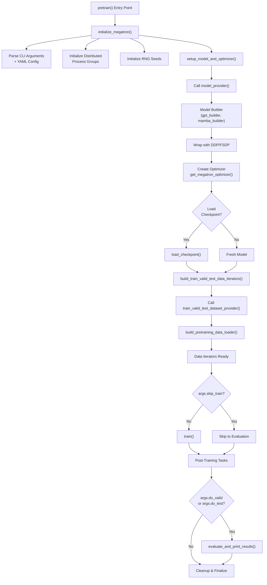
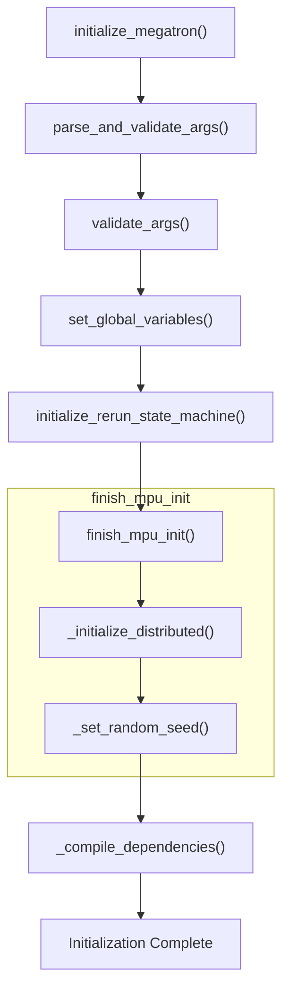
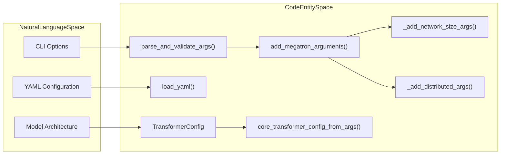
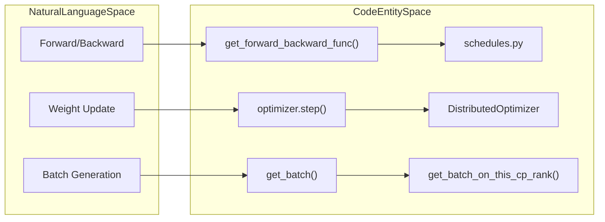

<!-- source: DeepWiki mcp.deepwiki.com · repo NVIDIA/Megatron-LM · page 5 Training System · fetched 2026-10-26 -->

# Training System

Relevant source files

The following files were used as context for generating this wiki page:

- [megatron/core/dist_checkpointing/strategies/fully_parallel.py](megatron/core/dist_checkpointing/strategies/fully_parallel.py)
- [megatron/core/model_parallel_config.py](megatron/core/model_parallel_config.py)
- [megatron/core/parallel_state.py](megatron/core/parallel_state.py)
- [megatron/core/pipeline_parallel/p2p_communication.py](megatron/core/pipeline_parallel/p2p_communication.py)
- [megatron/core/pipeline_parallel/schedules.py](megatron/core/pipeline_parallel/schedules.py)
- [megatron/training/arguments.py](megatron/training/arguments.py)
- [megatron/training/checkpointing.py](megatron/training/checkpointing.py)
- [megatron/training/config/training_config.py](megatron/training/config/training_config.py)
- [megatron/training/initialize.py](megatron/training/initialize.py)
- [megatron/training/training.py](megatron/training/training.py)
- [pretrain_gpt.py](pretrain_gpt.py)
- [pretrain_hybrid.py](pretrain_hybrid.py)
- [pretrain_mamba.py](pretrain_mamba.py)
- [tests/unit_tests/dist_checkpointing/test_pipeline_parallel_layout.py](tests/unit_tests/dist_checkpointing/test_pipeline_parallel_layout.py)
- [tests/unit_tests/dist_checkpointing/utils.py](tests/unit_tests/dist_checkpointing/utils.py)
- [tests/unit_tests/pipeline_parallel/test_pipeline_layout.py](tests/unit_tests/pipeline_parallel/test_pipeline_layout.py)
- [tests/unit_tests/test_checkpointing.py](tests/unit_tests/test_checkpointing.py)
- [tests/unit_tests/test_parallel_state.py](tests/unit_tests/test_parallel_state.py)

## Purpose and Scope

The Training System orchestrates the complete training pipeline in Megatron-LM, from initialization through model construction to the training loop execution. This document covers the high-level training workflow, argument parsing, model building, and the core training loop. For details on specific subsystems, see:
- Arguments and Configuration: [Arguments and Configuration System](#5.1)
- Initialization: [Initialization and Setup](#5.2)
- Model Builders: [Model Builders and Providers](#5.3)
- Training Loop: [Training Loop and Orchestration](#5.4)
- Reinforcement Learning: [Reinforcement Learning Training](#5.5)
- Data loading: [Data Loading and Dataset Pipeline](#5.6)
- Pretraining Workflows: [Pretraining Workflows](#5.7)
- Post-Training: [Post-Training and Model Optimization](#5.8)

The training system is implemented primarily in `megatron/training/training.py` and provides both standard supervised learning (via `pretrain_gpt.py`, `pretrain_bert.py`) and reinforcement learning (via `train_rl.py`).

**Sources**: [megatron/training/training.py:1-67](), [pretrain_gpt.py:1-60](), [megatron/training/arguments.py:1-50]()

---

## Training Entry Point: `pretrain()` Function

The `pretrain()` function in [megatron/training/training.py:575-871]() is the main entry point for all training jobs. It orchestrates initialization, model setup, data loading, and the training loop.

### Training Execution Pipeline
Title: "Training Execution Pipeline"

**Key Parameters**:
- `train_valid_test_dataset_provider`: Function that returns train/valid/test datasets.
- `model_provider`: Function that constructs the model (wraps model builder).
- `forward_step_func`: Function computing loss for a batch.
- `extra_args_provider`: Function adding custom CLI arguments.

**Sources**: [megatron/training/training.py:575-650](), [megatron/training/initialize.py:48-168]()

---

## Initialization Sequence

The `initialize_megatron()` function in [megatron/training/initialize.py:48-168]() sets up the entire training environment, including distributed process groups and random seeds.

### Initialization Logic Flow
Title: "Initialization Logic Flow"

**Critical Global State**:
- `_GLOBAL_ARGS`: Parsed command-line arguments (accessed via `get_args()`).
- `_GLOBAL_TIMERS`: Performance timers (accessed via `get_timers()`).
- `_GLOBAL_TOKENIZER`: Tokenizer instance (accessed via `get_tokenizer()`).

**Sources**: [megatron/training/initialize.py:48-168](), [megatron/training/arguments.py:87-113]()

---

## Argument and Configuration System

Megatron-LM uses a hybrid configuration approach combining command-line arguments (via `argparse`) and YAML files. The `parse_and_validate_args` function handles the lifecycle of argument ingestion, including loading from checkpoints and YAML configurations.

### Configuration Entity Association
Title: "Configuration Mapping"

For details, see [Arguments and Configuration System](#5.1).

**Sources**: [megatron/training/arguments.py:45-85](), [megatron/training/arguments.py:87-113](), [megatron/training/arguments.py:116-168](), [megatron/training/argument_utils.py:41]()

---

## Model Provider and Builders

Megatron uses a model provider pattern to abstract model construction. This enables different model types (GPT, Mamba, BERT) to be built through a uniform interface using model specifications.

- **`model_provider`**: Generic wrapper that calls the specific model builder. Examples in [pretrain_gpt.py:80]() and `pretrain_bert.py`.
- **`GPTModel`**: Constructs GPT models (including MoE and MLA variants). [megatron/core/models/gpt/gpt_model.py]() (referenced in [pretrain_gpt.py:45]()).
- **`gpt_builder`**: Specialized builder logic for GPT architectures. [pretrain_gpt.py:39]().
- **`MambaModel`**: Constructs state-space models, unified under pretraining scripts. [pretrain_mamba.py:1-19]().

For details, see [Model Builders and Providers](#5.3).

**Sources**: [pretrain_gpt.py:80](), [pretrain_gpt.py:39-45](), [pretrain_mamba.py:1-19]()

---

## Training Loop and Orchestration

The main training loop is implemented in the `train()` function at [megatron/training/training.py:1404-1823](). It manages microbatching, forward/backward execution via pipeline schedules, and optimizer steps.

### Training Loop Entity Association
Title: "Training Loop Entities"

For details, see [Training Loop and Orchestration](#5.4).

**Sources**: [megatron/training/training.py:1404-1823](), [pretrain_gpt.py:110-194](), [megatron/core/pipeline_parallel/schedules.py:53-165]()

---

## Reinforcement Learning Training

The RL training path implements algorithms like GRPO (Group Relative Policy Optimization) and reward model training. It uses specialized timers and data preparation phases including sequence packing for variable-length trajectories.

- **RL Timers**: Specialized timers for rollout collection and sequence packing. [megatron/training/training.py:199-201]().
- **Sequence Packing**: Utilities for packing variable-length trajectories to improve throughput. [megatron/training/training.py:195]().
- **Arguments**: RL-specific arguments are added via `_add_rl_args`. [megatron/training/arguments.py:52]().

For details, see [Reinforcement Learning Training](#5.5).

**Sources**: [megatron/training/training.py:195-201](), [megatron/training/arguments.py:52]()

---

## Data Loading and Dataset Pipeline

Megatron-LM supports complex data blending and sharding. The pipeline builds datasets based on provided prefixes and weights, often using the `BlendedMegatronDatasetBuilder`.

- **`BlendedMegatronDatasetBuilder`**: Orchestrates the creation of blended datasets across train, validation, and test splits. [pretrain_gpt.py:41]().
- **`GPTDataset`**: Base dataset implementation for GPT-style models. [pretrain_gpt.py:42]().
- **`MultiStorageClient`**: Integration for loading data from various storage backends like S3. [megatron/training/arguments.py:39](), [megatron/training/arguments.py:146-167]().

For details, see [Data Loading and Dataset Pipeline](#5.6).

**Sources**: [pretrain_gpt.py:41-42](), [megatron/training/arguments.py:146-167](), [megatron/training/arguments.py:39]()

---

## Fault Tolerance and Rerun State Machine

Megatron includes a **Rerun State Machine** to diagnose transient vs. persistent errors (e.g., NaNs or hardware failures) by re-running specific iterations with consistent RNG state.

- **`initialize_rerun_state_machine`**: Sets up the diagnostic and error injection framework. [megatron/training/initialize.py:91-100]().
- **RNG Tracking**: Captures and restores CUDA RNG states to ensure deterministic re-runs. [megatron/training/initialize.py:83-89]().
- **Arguments**: Configured via `--rerun-mode` and `--error-injection-rate`. [megatron/training/arguments.py:78]().

**Sources**: [megatron/training/initialize.py:83-100](), [megatron/training/arguments.py:78]()

---

