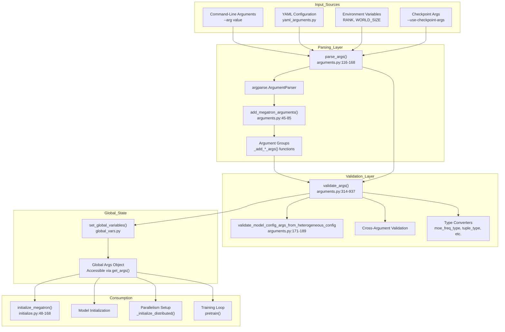
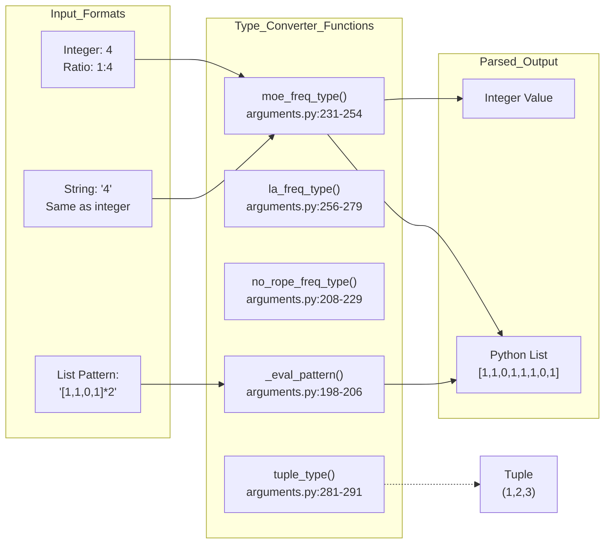
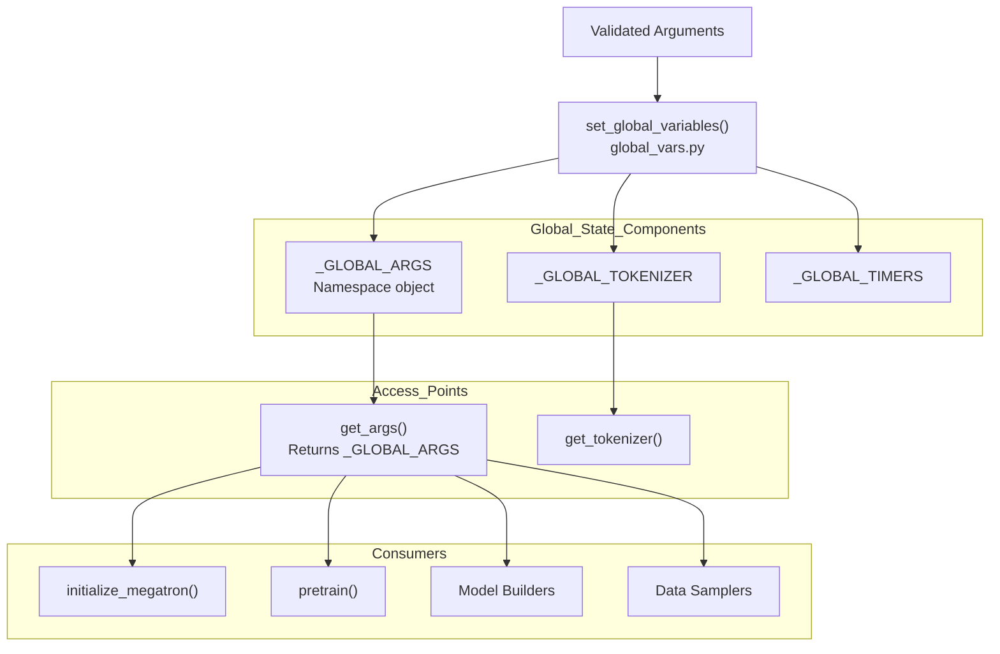
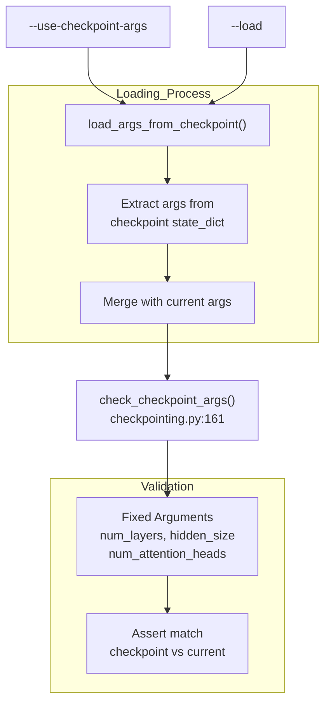

<!-- source: DeepWiki mcp.deepwiki.com · repo NVIDIA/Megatron-LM · page 5.1 Arguments and Configuration System · fetched 2026-10-26 -->

# Arguments and Configuration System

Relevant source files

The following files were used as context for generating this wiki page:

- [megatron/core/dist_checkpointing/strategies/fully_parallel.py](megatron/core/dist_checkpointing/strategies/fully_parallel.py)
- [megatron/core/fault_injector.py](megatron/core/fault_injector.py)
- [megatron/core/model_parallel_config.py](megatron/core/model_parallel_config.py)
- [megatron/core/parallel_state.py](megatron/core/parallel_state.py)
- [megatron/core/pipeline_parallel/p2p_communication.py](megatron/core/pipeline_parallel/p2p_communication.py)
- [megatron/core/pipeline_parallel/schedules.py](megatron/core/pipeline_parallel/schedules.py)
- [megatron/training/argument_utils.py](megatron/training/argument_utils.py)
- [megatron/training/arguments.py](megatron/training/arguments.py)
- [megatron/training/checkpointing.py](megatron/training/checkpointing.py)
- [megatron/training/config/__init__.py](megatron/training/config/__init__.py)
- [megatron/training/config/container.py](megatron/training/config/container.py)
- [megatron/training/config/instantiate_utils.py](megatron/training/config/instantiate_utils.py)
- [megatron/training/config/resilience_config.py](megatron/training/config/resilience_config.py)
- [megatron/training/config/training_config.py](megatron/training/config/training_config.py)
- [megatron/training/config/utils.py](megatron/training/config/utils.py)
- [megatron/training/config/yaml_utils.py](megatron/training/config/yaml_utils.py)
- [megatron/training/distillation/__init__.py](megatron/training/distillation/__init__.py)
- [megatron/training/distillation/cached_logits_loss.py](megatron/training/distillation/cached_logits_loss.py)
- [megatron/training/distillation/logits_saver.py](megatron/training/distillation/logits_saver.py)
- [megatron/training/distillation/utils_logits.py](megatron/training/distillation/utils_logits.py)
- [megatron/training/initialize.py](megatron/training/initialize.py)
- [megatron/training/models/__init__.py](megatron/training/models/__init__.py)
- [megatron/training/training.py](megatron/training/training.py)
- [pretrain_gpt.py](pretrain_gpt.py)
- [pretrain_hybrid.py](pretrain_hybrid.py)
- [pretrain_mamba.py](pretrain_mamba.py)
- [tests/unit_tests/dist_checkpointing/test_pipeline_parallel_layout.py](tests/unit_tests/dist_checkpointing/test_pipeline_parallel_layout.py)
- [tests/unit_tests/dist_checkpointing/utils.py](tests/unit_tests/dist_checkpointing/utils.py)
- [tests/unit_tests/pipeline_parallel/test_pipeline_layout.py](tests/unit_tests/pipeline_parallel/test_pipeline_layout.py)
- [tests/unit_tests/test_argument_utils.py](tests/unit_tests/test_argument_utils.py)
- [tests/unit_tests/test_checkpointing.py](tests/unit_tests/test_checkpointing.py)
- [tests/unit_tests/test_fault_injector.py](tests/unit_tests/test_fault_injector.py)
- [tests/unit_tests/test_parallel_state.py](tests/unit_tests/test_parallel_state.py)
- [tests/unit_tests/training/config/test_container_base.py](tests/unit_tests/training/config/test_container_base.py)
- [tests/unit_tests/training/config/test_instantiate_utils.py](tests/unit_tests/training/config/test_instantiate_utils.py)
- [tests/unit_tests/training/config/test_target_allowlist.py](tests/unit_tests/training/config/test_target_allowlist.py)
- [tests/unit_tests/training/config/test_utils.py](tests/unit_tests/training/config/test_utils.py)
- [tests/unit_tests/training/config/test_yaml_utils.py](tests/unit_tests/training/config/test_yaml_utils.py)

## Purpose and Scope

The Arguments and Configuration System is the entry point for configuring all aspects of Megatron-LM training and inference. This system parses command-line arguments, YAML configurations, and environment variables to control model architecture, parallelism strategies, optimization settings, data loading, checkpointing, and all other runtime behaviors.

This page covers argument parsing, validation, type conversion, and global state management. For details on how arguments control specific subsystems, see [Initialization and Setup](5.2), [Model Builders and Providers](5.3), and [Parallelism Strategies](4).

## System Architecture

The configuration system follows a structured pipeline from input sources through validation to global state. The process begins with `parse_args` which gathers inputs from the CLI and environment, followed by `parse_and_validate_args` which handles checkpoint-based arguments and YAML validation.

Title: Configuration System Data Flow

Sources: [megatron/training/arguments.py:45-189](), [megatron/training/initialize.py:48-168](), [megatron/training/global_vars.py]()

## Argument Parsing Entry Point

The `parse_args()` function is the main entry point for argument parsing, called during initialization [megatron/training/arguments.py:116-168](). It initializes the `argparse.ArgumentParser` and orchestrates the addition of Megatron-specific and custom user arguments.

Title: Argument Parsing Logic

```mermaid
graph LR
    Entry["parse_args()<br/>arguments.py:116"]
    CreateParser["argparse.ArgumentParser<br/>allow_abbrev=False"]
    AddArgs["add_megatron_arguments()"]
    ExtraProvider["extra_args_provider<br/>Custom arguments"]
    Parser["parser.parse_args()"]
    YAMLLoad["load_yaml()<br/>yaml_arguments.py"]
    EnvVars["Environment Variables<br/>RANK, WORLD_SIZE"]
    MSCCheck["MSC Feature Check<br/>--enable-msc"]
    Return["Return args"]
    
    Entry --> CreateParser
    CreateParser --> AddArgs
    AddArgs --> ExtraProvider
    ExtraProvider --> Parser
    Parser --> YAMLLoad
    YAMLLoad --> EnvVars
    EnvVars --> MSCCheck
    MSCCheck --> Return
```

The parsing flow accommodates multiple configuration sources:

| Configuration Source | Priority | Mechanism | Example |
|---------------------|----------|-----------|---------|
| YAML Configuration | Highest | `--yaml-cfg` flag, loaded via `load_yaml` [megatron/training/arguments.py:136-140]() | `--yaml-cfg config.yaml` |
| Command-Line Args | High | Standard argparse [megatron/training/arguments.py:118-131]() | `--num-layers 32 --hidden-size 4096` |
| Environment Variables | Medium | `os.getenv` for `RANK`, `WORLD_SIZE` [megatron/training/arguments.py:143-144]() | `RANK=0 WORLD_SIZE=8` |
| Checkpoint Args | Medium | `--use-checkpoint-args` [megatron/training/arguments.py:90-101]() | `load_args_from_checkpoint` |
| Default Values | Lowest | `args_defaults` dict | Provided to `parse_and_validate_args` |

Sources: [megatron/training/arguments.py:87-168](), [megatron/training/initialize.py:74-152](), [megatron/training/yaml_arguments.py]()

## Argument Categories and Groups

Arguments are organized into logical groups using the `ArgumentGroupFactory` pattern. Each group is added by a dedicated private function within `arguments.py` [megatron/training/arguments.py:45-85]().

Title: Megatron Argument Groups

```mermaid
graph TB
    AddMegatron["add_megatron_arguments()<br/>arguments.py:45-85"]
    
    Network["_add_network_size_args<br/>num_layers, hidden_size<br/>num_attention_heads"]
    Reg["_add_regularization_args<br/>attention_dropout, hidden_dropout"]
    Training["_add_training_args<br/>micro_batch_size, seq_length<br/>train_iters"]
    RL["_add_rl_args<br/>RL-specific settings"]
    Init["_add_initialization_args<br/>init_method_std, seed"]
    LR["_add_learning_rate_args<br/>lr, lr_decay_style, lr_warmup_iters"]
    Ckpt["_add_checkpointing_args<br/>save, load, save_interval"]
    Mixed["_add_mixed_precision_args<br/>fp16, bf16, fp8"]
    Dist["_add_distributed_args<br/>tensor_model_parallel_size<br/>pipeline_model_parallel_size"]
    Valid["_add_validation_args<br/>eval_interval, eval_iters"]
    Data["_add_data_args<br/>data_path, split, vocab_file"]
    Tokenizer["_add_tokenizer_args<br/>tokenizer_type, vocab_size"]
    MoE["_add_moe_args<br/>num_experts, moe_router_topk"]
    MLA["_add_mla_args<br/>Multi-latent attention"]
    Hetero["_add_heterogeneous_args<br/>Heterogeneous layer config"]
    Logging["_add_logging_args<br/>log_interval, tensorboard_dir"]
    Inference["_add_inference_args<br/>Inference-specific settings"]
    TE["_add_transformer_engine_args<br/>FP8 settings"]
    Exp["_add_experimental_args<br/>Experimental features"]
    
    AddMegatron --> Network
    AddMegatron --> Reg
    AddMegatron --> Training
    AddMegatron --> RL
    AddMegatron --> Init
    AddMegatron --> LR
    AddMegatron --> Ckpt
    AddMegatron --> Mixed
    AddMegatron --> Dist
    AddMegatron --> Valid
    AddMegatron --> Data
    AddMegatron --> Tokenizer
    AddMegatron --> MoE
    AddMegatron --> MLA
    AddMegatron --> Hetero
    AddMegatron --> Logging
    AddMegatron --> Inference
    AddMegatron --> TE
    AddMegatron --> Exp
```

Key groups are also managed through `PretrainConfigContainer`, which serves as a unified container for configuration dataclasses like `TrainingConfig` [megatron/training/config/training_config.py:8-110]() and `ValidationConfig` [megatron/training/config/training_config.py:112-163]().

Sources: [megatron/training/arguments.py:45-85](), [megatron/training/config/container.py:10-44](), [megatron/training/config/training_config.py]()

## Validation System

The `validate_args()` function ensures argument consistency and sets derived values [megatron/training/arguments.py:314-937](). It performs critical checks such as verifying that the world size is divisible by the product of parallelism dimensions.

Title: Validation Logic Flow

```mermaid
graph TB
    Validate["validate_args()<br/>arguments.py:314"]
    
    subgraph "Structural_Validation"
        NonPersist["Non-Persistent Checkpoint Type<br/>local vs global"]
        Hetero["Heterogeneous Config Validation<br/>validate_model_config_args_from_heterogeneous_config()"]
        CkptFormat["Checkpoint Format<br/>update_use_dist_ckpt()"]
    end
    
    subgraph "Parallelism_Validation"
        WorldSize["World Size Divisibility<br/>world_size % total_model_size == 0"]
        SetDP["Calculate data_parallel_size<br/>world_size // total_model_size"]
        VPP["Virtual Pipeline Validation<br/>num_layers % vpp_size == 0"]
        CP["Context Parallel Checks<br/>hierarchical_context_parallel_sizes"]
    end
    
    subgraph "Model_Config_Validation"
        MTP["Multi-Token Prediction<br/>MTP pattern parsing"]
        BatchSize["Batch Size Consistency<br/>micro vs global batch size"]
        RLChecks["RL-Specific Validation<br/>KV cache, batch size"]
        MoEFreq["MoE Layer Frequency<br/>Pattern validation"]
    end
    
    subgraph "Optimizer_Validation"
        DistOpt["Distributed Optimizer<br/>overlap_param_gather checks"]
        FSDP["FSDP Validation<br/>FSDP2 vs Megatron FSDP"]
        FP8["FP8/FP4 Checks<br/>Mutually exclusive"]
    end
    
    subgraph "Derived_Values"
        ParamsType["Set params_dtype<br/>fp16 → torch.half<br/>bf16 → torch.bfloat16"]
        PhaseTransition["Phase Transition Iterations<br/>Parse comma-separated list"]
    end
    
    Validate --> NonPersist
    Validate --> Hetero
    Validate --> CkptFormat
    
    Validate --> WorldSize
    WorldSize --> SetDP
    Validate --> VPP
    Validate --> CP
    
    Validate --> MTP
    Validate --> BatchSize
    Validate --> RLChecks
    Validate --> MoEFreq
    
    Validate --> DistOpt
    Validate --> FSDP
    Validate --> FP8
    
    Validate --> ParamsType
    Validate --> PhaseTransition
```

**Key Validation Checks:**

| Validation Type | Check | Code Reference |
|----------------|-------|----------|
| World Size | `args.world_size % (tp * pp * cp) == 0` | [megatron/training/arguments.py:314-319]() |
| Data Parallel Size | `args.data_parallel_size = args.world_size // (tp * pp * cp)` | [megatron/training/arguments.py:328]() |
| Batch Size | `args.global_batch_size % (args.micro_batch_size * args.data_parallel_size) == 0` | [megatron/training/arguments.py:500-505]() |
| Virtual Pipeline | `args.num_layers % args.virtual_pipeline_model_parallel_size == 0` | [megatron/training/arguments.py:621-649]() |
| MoE Frequency | Pattern length must match `args.num_layers` | [megatron/training/arguments.py:362-366]() |
| FP8/FP4 Mutual Exclusion | `not (args.fp8 and args.fp4)` | [megatron/training/arguments.py:738-739]() |

Sources: [megatron/training/arguments.py:314-937]()

## Type Converters and Custom Parsing

The system uses specialized type converters to parse complex command-line inputs into Python structures like lists or tuples [megatron/training/arguments.py:198-291]().

Title: Custom Type Conversion

**Type Converter Details:**

| Function | Purpose | Input Examples |
|----------|---------|----------------|
| `moe_freq_type()` | Parses MoE layer patterns. | `4`, `"[1,1,1,0]*3"` |
| `la_freq_type()` | Parses Linear Attention frequency. | `2`, `"[1,1,0]*4"` |
| `tuple_type()` | Converts comma-separated strings to tuples. | `"1,2,3"`, `"(1,2,3)"` |

Sources: [megatron/training/arguments.py:198-291]()

## Global State Management

Validated arguments are stored in a global singleton accessible via `get_args()` [megatron/training/global_vars.py](). This ensures that configuration is consistent across all modules without needing to pass an `args` object through every function call.

Title: Global Variables Access

Sources: [megatron/training/global_vars.py](), [megatron/training/initialize.py:74](), [megatron/training/training.py:172]()

## Integration with Initialization

The `initialize_megatron` function acts as the orchestrator, consuming parsed arguments to set up the distributed environment, random seeds, and fused kernels [megatron/training/initialize.py:48-168]().

| Initialization Phase | Action | Reference |
|---------------------|--------|-----------|
| Argument Loading | Calls `get_args` to retrieve the global configuration. | [megatron/training/initialize.py:74]() |
| Distributed Setup | Calls `_initialize_distributed` for NCCL/Gloo. | [megatron/training/initialize.py:110]() |
| Randomness | Calls `_set_random_seed` for reproducibility. | [megatron/training/initialize.py:120-131]() |
| Performance | Calls `_compile_dependencies` for dataset helpers. | [megatron/training/initialize.py:161]() |
| TP Communication | Calls `_initialize_tp_communicators` for overlap. | [megatron/training/initialize.py:163-165]() |

Sources: [megatron/training/initialize.py:48-168](), [megatron/training/arguments.py:87-113]()

## Checkpoint-Based Argument Loading

When `--use-checkpoint-args` is enabled, Megatron-LM loads architecture-critical arguments from the checkpoint metadata to prevent configuration mismatches during resumption [megatron/training/arguments.py:90-101]().

Title: Checkpoint Argument Validation

The `check_checkpoint_args` function specifically enforces that parameters like `num_layers`, `hidden_size`, and `num_attention_heads` remain constant between the original run and the resumption run [megatron/training/checkpointing.py:186-188]().

Sources: [megatron/training/checkpointing.py:161-198](), [megatron/training/arguments.py:90-100]()

---

