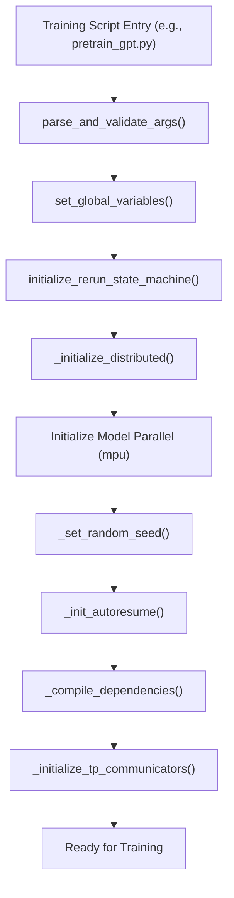
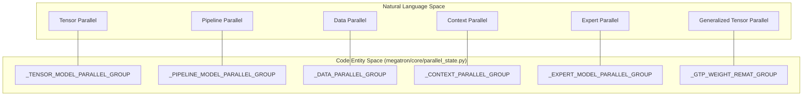

<!-- source: DeepWiki mcp.deepwiki.com · repo NVIDIA/Megatron-LM · page 5.2 Initialization and Setup · fetched 2026-10-26 -->

# Initialization and Setup

<details>
<summary>Relevant source files</summary>

The following files were used as context for generating this wiki page:

- [megatron/core/__init__.py](megatron/core/__init__.py)
- [megatron/core/dist_checkpointing/strategies/fully_parallel.py](megatron/core/dist_checkpointing/strategies/fully_parallel.py)
- [megatron/core/model_parallel_config.py](megatron/core/model_parallel_config.py)
- [megatron/core/num_microbatches_calculator.py](megatron/core/num_microbatches_calculator.py)
- [megatron/core/parallel_state.py](megatron/core/parallel_state.py)
- [megatron/core/pipeline_parallel/p2p_communication.py](megatron/core/pipeline_parallel/p2p_communication.py)
- [megatron/core/pipeline_parallel/schedules.py](megatron/core/pipeline_parallel/schedules.py)
- [megatron/core/safe_globals.py](megatron/core/safe_globals.py)
- [megatron/training/arguments.py](megatron/training/arguments.py)
- [megatron/training/checkpointing.py](megatron/training/checkpointing.py)
- [megatron/training/config/training_config.py](megatron/training/config/training_config.py)
- [megatron/training/global_vars.py](megatron/training/global_vars.py)
- [megatron/training/initialize.py](megatron/training/initialize.py)
- [megatron/training/training.py](megatron/training/training.py)
- [pretrain_gpt.py](pretrain_gpt.py)
- [pretrain_hybrid.py](pretrain_hybrid.py)
- [pretrain_mamba.py](pretrain_mamba.py)
- [tests/unit_tests/dist_checkpointing/test_pipeline_parallel_layout.py](tests/unit_tests/dist_checkpointing/test_pipeline_parallel_layout.py)
- [tests/unit_tests/dist_checkpointing/test_safe_globals.py](tests/unit_tests/dist_checkpointing/test_safe_globals.py)
- [tests/unit_tests/dist_checkpointing/utils.py](tests/unit_tests/dist_checkpointing/utils.py)
- [tests/unit_tests/pipeline_parallel/test_pipeline_layout.py](tests/unit_tests/pipeline_parallel/test_pipeline_layout.py)
- [tests/unit_tests/test_checkpointing.py](tests/unit_tests/test_checkpointing.py)
- [tests/unit_tests/test_num_microbatches_calculator.py](tests/unit_tests/test_num_microbatches_calculator.py)
- [tests/unit_tests/test_parallel_state.py](tests/unit_tests/test_parallel_state.py)

</details>


## Purpose and Scope

This page documents the initialization and setup phase of Megatron-LM training, specifically the `initialize_megatron` function and the foundational environment preparation that occurs before training begins. This includes distributed PyTorch initialization, parallel process group creation, random seed management, and compilation of dependencies.

For information about argument parsing and configuration that occurs before initialization, see **5.1 Arguments and Configuration System**. For information about model construction that occurs after initialization, see **5.3 Model Builders and Providers**.

---

## Overview of Initialization Flow

The initialization phase transforms a collection of command-line arguments into a fully configured distributed training environment. The primary entry point is `initialize_megatron`, which orchestrates multiple setup steps in a specific order to ensure all components are properly configured before training begins.

### High-Level Initialization Sequence


Sources: [megatron/training/initialize.py:48-168](), [megatron/training/arguments.py:87-113](), [pretrain_gpt.py:75-80]()

---

## The `initialize_megatron` Function

The `initialize_megatron` function serves as the single initialization entry point for all Megatron-LM training scripts. It is defined in `megatron/training/initialize.py`.

### Function Signature
[megatron/training/initialize.py:48-61]()
```python
def initialize_megatron(
    allow_no_cuda=False,
    skip_mpu_initialization=False,
    get_embedding_ranks=None,
    get_position_embedding_ranks=None,
    store=None,
    skip_model_parallel_init=False,
    seed_pp_group=None,
    seed_dp_group=None,
    seed_tp_group=None,
    seed_ep_group=None,
    seed_etp_group=None,
    skip_random_seed=False,
):
```

### Core Responsibilities
1.  **CUDA Availability**: Ensures `torch.cuda.is_available()` unless `allow_no_cuda` is specified for CPU-only data processing [megatron/training/initialize.py:70-72]().
2.  **Persistent Async Workers**: If `async_save` and `use_persistent_ckpt_worker` are enabled, it initializes a persistent worker process using `forkserver` [megatron/training/initialize.py:79-80]().
3.  **Rerun State Machine**: Initializes the `rerun_state_machine` to handle transient error detection and iteration re-runs. It registers RNG state saving and restoration functions via `state_save_func` and `state_restore_func` to ensure determinism during retries [megatron/training/initialize.py:83-100]().
4.  **Batch Invariant Mode**: Optionally enables `batch_invariant_mode` for specific kernel optimizations [megatron/training/initialize.py:102-104]().
5.  **Distributed Initialization**: Calls `_initialize_distributed` to set up the PyTorch distributed backend and all model-parallel process groups [megatron/training/initialize.py:110-115]().
6.  **Random Seed Configuration**: Sets reproducible seeds via `_set_random_seed` across TP, DP, and expert dimensions [megatron/training/initialize.py:118-131]().
7.  **MoE Setup**: Configures the `MoEAuxLossAutoScaler` if Mixture-of-Experts (MoE) is enabled [megatron/training/initialize.py:134-137]().
8.  **Dependency Compilation**: Triggers compilation of C++ dataset helpers [megatron/training/initialize.py:161]().
9.  **Communication Overlap**: If `tp_comm_overlap` is enabled, initializes high-performance communicators for GEMM/Communication overlap [megatron/training/initialize.py:163-165]().

Sources: [megatron/training/initialize.py:48-168]()

---

## Distributed and Model Parallel Initialization

### PyTorch Distributed Backend Setup
The `_initialize_distributed` function establishes the distributed environment using `torch.distributed.init_process_group`. It also assigns each rank to a specific GPU using `torch.cuda.set_device` based on the local rank [megatron/training/initialize.py:258-308]().

### Model Parallel Group Initialization
The initialization of parallelism is handled by `megatron.core.parallel_state` (aliased as `mpu` in training scripts [pretrain_gpt.py:40]()). This module manages the creation of orthogonal process groups for various parallelism strategies.

**Parallel Group Hierarchy Mapping:**

Sources: [megatron/core/parallel_state.py:29-146](), [megatron/training/initialize.py:310-361]()

### NCCL Configuration
Process groups can be configured with custom NCCL options via `get_nccl_options`. This allows setting high-priority streams or specific cluster sizes for Hopper architecture (e.g., `max_ctas`, `min_ctas`) [megatron/core/parallel_state.py:168-185]().

---

## Random Seed Management

Megatron-LM uses a sophisticated RNG tracking system to ensure reproducibility across different parallelism configurations, managed via `_set_random_seed` [megatron/training/initialize.py:363-458]().

### Seed Implementation
*   **Standard Seeds**: Configures Python `random`, `numpy.random`, and PyTorch CPU/CUDA manual seeds [megatron/training/initialize.py:375-378]().
*   **CudaRNGStatesTracker**: A custom tracker that maintains separate RNG states for model-parallel regions. It is accessed via `tensor_parallel.get_cuda_rng_tracker()` [megatron/training/initialize.py:407-436]().

### RNG State Distribution
| Tracker Name | Purpose | Seed Logic |
| :--- | :--- | :--- |
| `model-parallel-rng` | Parameter initialization | `args.seed` (Consistent across DP) |
| `tensor-parallel-rng` | Dropout in TP layers | `seed + 2*tp_rank + 1` (Unique per TP rank) |
| `data-parallel-rng` | Data sampling | `seed + dp_rank` (Unique per DP replica) |

Sources: [megatron/training/initialize.py:363-458](), [megatron/core/parallel_state.py:79-84]()

---

## Environment and Compilation

### Dependency Compilation
Megatron-LM compiles performance-critical components during initialization:
1.  **Dataset Helpers**: C++ code for fast indexing of binary datasets is compiled via `compile_helpers()` from `megatron.core.datasets.utils`. This compilation is restricted to rank 0 and synchronized via a barrier [megatron/training/initialize.py:179-191]().
2.  **TP Communication Overlap**: Initializes `transformer_engine` user buffers for GEMM/Communication overlap if `tp_comm_overlap` is set. This setup handles various quantization modes including FP8 [megatron/training/initialize.py:193-256]().

### Serialization Safety
Megatron Core implements a `register_safe_globals()` function to allow specific classes during `torch.load` when `weights_only=True` is enabled. This includes enums like `ModelType`, `AttnBackend`, and configuration classes like `OptimizerConfig`.
Sources: [megatron/core/safe_globals.py:26-54]()

### Rerun State Machine
The `initialize_rerun_state_machine` function is a diagnostic tool for attribution of unexpected results (e.g., NaNs). It captures the program state (including RNG tracker states) and allows for re-running an iteration to distinguish between transient (hardware) and persistent (software/algorithmic) errors [megatron/training/initialize.py:83-100]().

---

## Global Variables Access
After initialization, several global variables are accessible throughout the codebase via `megatron.training.global_vars`:

| Variable | Accessor | Description |
| :--- | :--- | :--- |
| `_GLOBAL_ARGS` | `get_args()` | Parsed command line arguments [megatron/training/global_vars.py:30-33]() |
| `_GLOBAL_TOKENIZER` | `get_tokenizer()` | The active model tokenizer [megatron/training/global_vars.py:36-39]() |
| `_GLOBAL_TIMERS` | `get_timers()` | Performance measurement timers [megatron/training/global_vars.py:65-68]() |
| `_GLOBAL_ADLR_AUTORESUME` | `get_adlr_autoresume()` | Autoresume logic for clusters [megatron/training/global_vars.py:59-62]() |
| `_GLOBAL_ENERGY_MONITOR` | `get_energy_monitor()` | Monitor for GPU energy consumption [megatron/training/global_vars.py:70-73]() |

Sources: [megatron/training/global_vars.py:20-28](), [megatron/training/initialize.py:158]()

---

