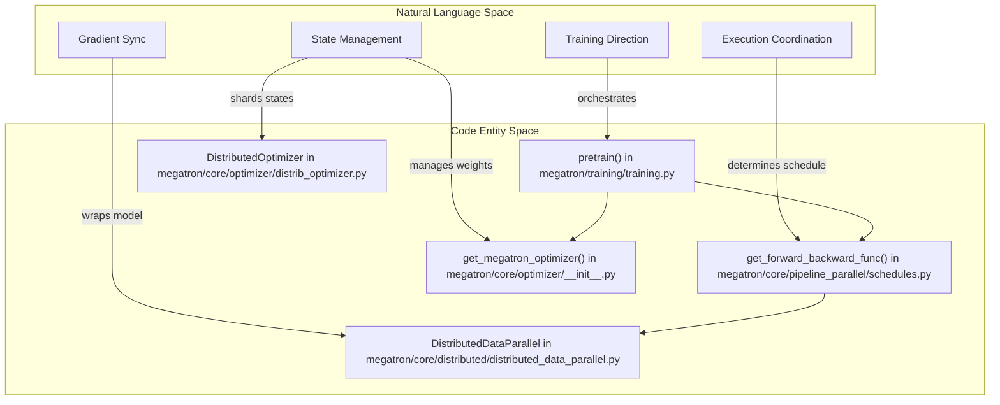
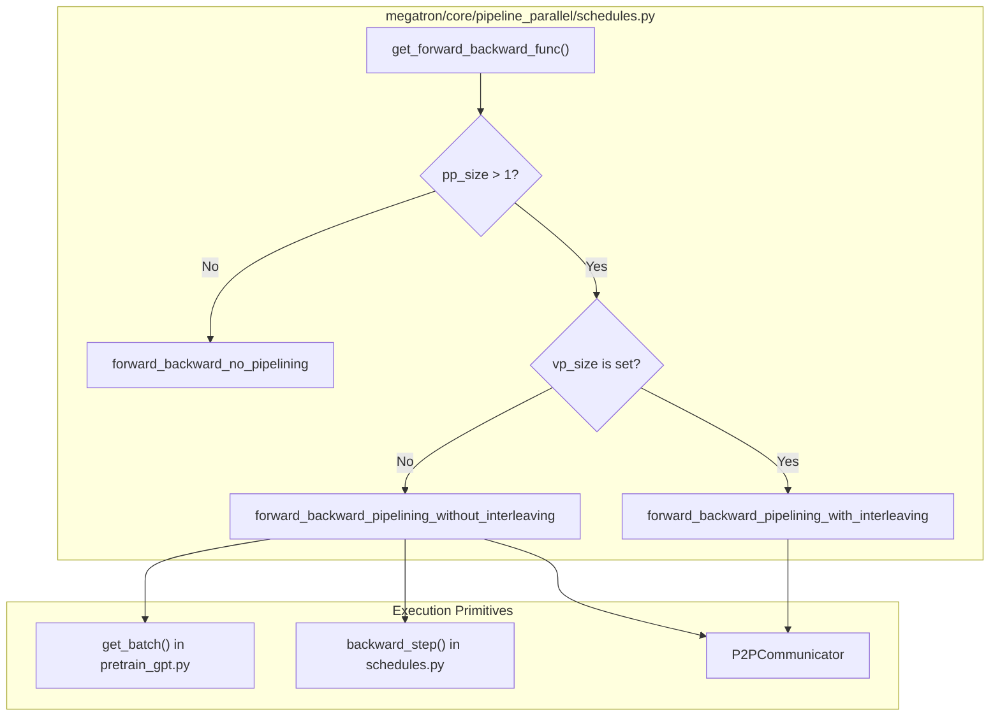

<!-- source: DeepWiki mcp.deepwiki.com · repo NVIDIA/Megatron-LM · page 5.4 Training Loop and Orchestration · fetched 2026-10-26 -->

# Training Loop and Orchestration

Relevant source files

The following files were used as context for generating this wiki page:

- [megatron/core/__init__.py](megatron/core/__init__.py)
- [megatron/core/dist_checkpointing/strategies/fully_parallel.py](megatron/core/dist_checkpointing/strategies/fully_parallel.py)
- [megatron/core/model_parallel_config.py](megatron/core/model_parallel_config.py)
- [megatron/core/num_microbatches_calculator.py](megatron/core/num_microbatches_calculator.py)
- [megatron/core/parallel_state.py](megatron/core/parallel_state.py)
- [megatron/core/pipeline_parallel/p2p_communication.py](megatron/core/pipeline_parallel/p2p_communication.py)
- [megatron/core/pipeline_parallel/schedules.py](megatron/core/pipeline_parallel/schedules.py)
- [megatron/core/safe_globals.py](megatron/core/safe_globals.py)
- [megatron/training/arguments.py](megatron/training/arguments.py)
- [megatron/training/checkpointing.py](megatron/training/checkpointing.py)
- [megatron/training/config/training_config.py](megatron/training/config/training_config.py)
- [megatron/training/datasets/data_samplers.py](megatron/training/datasets/data_samplers.py)
- [megatron/training/global_vars.py](megatron/training/global_vars.py)
- [megatron/training/initialize.py](megatron/training/initialize.py)
- [megatron/training/training.py](megatron/training/training.py)
- [pretrain_gpt.py](pretrain_gpt.py)
- [pretrain_hybrid.py](pretrain_hybrid.py)
- [pretrain_mamba.py](pretrain_mamba.py)
- [tests/unit_tests/dist_checkpointing/test_pipeline_parallel_layout.py](tests/unit_tests/dist_checkpointing/test_pipeline_parallel_layout.py)
- [tests/unit_tests/dist_checkpointing/test_safe_globals.py](tests/unit_tests/dist_checkpointing/test_safe_globals.py)
- [tests/unit_tests/dist_checkpointing/utils.py](tests/unit_tests/dist_checkpointing/utils.py)
- [tests/unit_tests/pipeline_parallel/test_pipeline_layout.py](tests/unit_tests/pipeline_parallel/test_pipeline_layout.py)
- [tests/unit_tests/test_checkpointing.py](tests/unit_tests/test_checkpointing.py)
- [tests/unit_tests/test_eval_batch_size.py](tests/unit_tests/test_eval_batch_size.py)
- [tests/unit_tests/test_frozen_ckpt_resume.py](tests/unit_tests/test_frozen_ckpt_resume.py)
- [tests/unit_tests/test_num_microbatches_calculator.py](tests/unit_tests/test_num_microbatches_calculator.py)
- [tests/unit_tests/test_parallel_state.py](tests/unit_tests/test_parallel_state.py)
- [tests/unit_tests/test_start_eval_at_iter.py](tests/unit_tests/test_start_eval_at_iter.py)
- [tests/unit_tests/test_training.py](tests/unit_tests/test_training.py)
- [tests/unit_tests/training/test_freeze_all_layers.py](tests/unit_tests/training/test_freeze_all_layers.py)

This document details the main training loop orchestration in Megatron-LM, including initialization, the core training iteration, forward/backward execution coordination, optimization, and gradient management. This encompasses the high-level control flow that coordinates all distributed training components.

## Overview

The training loop orchestration in Megatron-LM is built around the `pretrain` function, which manages the complex interplay between distributed execution, pipeline scheduling, optimization, and state management. The system supports multiple execution modes including standard data parallel training, pipeline parallel training, and interleaved virtual pipeline parallel training.

### Orchestration Architecture
The following diagram bridges the natural language concepts of training orchestration to the specific code entities in the Megatron-LM training system.

**Training Orchestration: Concept to Code Mapping**

Sources: [megatron/training/training.py:70-70](), [megatron/core/optimizer/distrib_optimizer.py:82-82](), [megatron/core/pipeline_parallel/schedules.py:53-153]()

## Training Initialization Process

The training initialization follows a structured sequence that establishes distributed communication, parses arguments, and sets up all necessary components via `initialize_megatron`.

| Phase | Function | File Reference | Purpose |
|-------|----------|----------------|---------|
| Argument Parsing | `parse_and_validate_args` | [megatron/training/arguments.py:87-113]() | Parse CLI/YAML, set global variables, and validate training arguments. |
| Global Variables | `set_global_variables` | [megatron/training/arguments.py:111-111]() | Initialize global timers, tensorboard, and data providers. |
| Distributed Setup | `initialize_megatron` | [megatron/training/initialize.py:48-168]() | Initialize PyTorch distributed and MPU process groups. |
| Rerun State | `initialize_rerun_state_machine` | [megatron/training/initialize.py:91-100]() | Setup fault tolerance and error injection tracking. |
| Kernel Compilation | `_compile_dependencies` | [megatron/training/initialize.py:171-192]() | Compile dataset C++ helpers and index builders. |

Sources: [megatron/training/initialize.py:48-168](), [megatron/training/arguments.py:87-113](), [megatron/training/arguments.py:116-168]()

## Main Training Loop Orchestration

The `pretrain()` function in `megatron/training/training.py` is the entry point for all pretraining workflows. It coordinates model building, optimizer initialization, and the iterative training steps.

### The Core Training Iteration
The `train_step` function (called within the training loop in `pretrain`) executes a single global batch iteration. It performs the following sequence:
1.  **Gradient Zeroing**: Clears previous gradients via `optimizer.zero_grad()`.
2.  **Forward/Backward Execution**: Calls the schedule-specific function returned by `get_forward_backward_func`.
3.  **Gradient Finalization**: Synchronizes gradients across data-parallel replicas using `finalize_model_grads`.
4.  **Weight Update**: Performs the optimizer step and updates learning rates using the `OptimizerParamScheduler`.

Sources: [megatron/training/training.py:102-102](), [megatron/core/optimizer_param_scheduler.py:90-93](), [megatron/core/pipeline_parallel/schedules.py:53-167]()

## Forward/Backward Execution Coordination

The system selects the appropriate pipeline schedule based on the pipeline model parallel (PP) and virtual pipeline (VP) configuration.

**Schedule Selection Logic**

The `get_batch` function (e.g., in `pretrain_gpt.py`) generates a batch for the current microbatch, handling broadcast across tensor-parallel ranks and slicing for context-parallel ranks via `get_batch_on_this_tp_rank` and `get_batch_on_this_cp_rank`.

Sources: [pretrain_gpt.py:110-194](), [megatron/core/pipeline_parallel/schedules.py:53-167](), [megatron/core/pipeline_parallel/p2p_communication.py:21-25]()

## Optimization Coordination

Megatron-LM uses specialized optimizers to manage training state, particularly when using distributed data parallelism or mixture-of-experts.

### Distributed Optimizer and Parameter Management
The `DistributedOptimizer` [megatron/core/optimizer/distrib_optimizer.py:82]() manages parameter sharding across data-parallel ranks.

- **Contiguous Buffers**: It interacts with parameter and gradient buffers to enable efficient collective communication.
- **Gradient Finalization**: `finalize_model_grads` [megatron/core/distributed/__init__.py:13]() ensures gradients are reduced across DP, PP, and CP dimensions.
- **L2 Norm Calculation**: `calc_params_l2_norm` [megatron/training/training.py:184-184]() calculates the global parameter norm, accounting for sharded parameters in the distributed optimizer.

### Gradient Clipping and Finalization
Gradient clipping is a critical step before the weight update. The system calculates the global norm and scales gradients if they exceed a threshold. QK clipping can also be applied via `clip_qk` [megatron/core/optimizer/qk_clip.py:52]().

Sources: [megatron/core/optimizer/distrib_optimizer.py:82-82](), [megatron/core/optimizer/qk_clip.py:52](), [megatron/training/training.py:184-184]()

## Checkpointing Integration

Checkpointing is orchestrated by `save_checkpoint` and `load_checkpoint` in `megatron/training/checkpointing.py`.

- **State Aggregation**: The training loop gathers state from the model, optimizer, and learning rate scheduler.
- **Distributed Checkpointing**: Supports sharded state saving through `megatron.core.dist_checkpointing` strategies like `TorchDistSaveShardedStrategy` [megatron/training/checkpointing.py:40-44]() and `FullyParallelSaveStrategyWrapper` [megatron/training/checkpointing.py:36-39]().
- **Iteration Tracking**: `_LOADED_ITERATION` [megatron/training/checkpointing.py:94]() is tracked to ensure the training loop and data loaders resume correctly after a restart.

Sources: [megatron/training/checkpointing.py:93-158](), [megatron/training/checkpointing.py:161-201](), [megatron/training/checkpointing.py:202-207]()

## Training Loop State Management

The loop tracks several metrics for logging and analysis:
- **Timers**: Uses a timing system to track program phases. `_TRAIN_START_TIME` is captured at the very beginning of module import [megatron/training/training.py:9]().
- **Startup Tracking**: The `pretrain_gpt.py` script captures `_PROGRAM_START_TIME` [pretrain_gpt.py:8]() to measure total execution overhead.
- **Rerun Machine**: The `RerunStateMachine` [megatron/core/rerun_state_machine.py:129]() tracks states like `INITIAL_RUN` and `RERUNNING_IN_PLACE` [megatron/core/rerun_state_machine.py:82-112]() to handle diagnostic re-execution of spiky iterations.

Sources: [megatron/training/training.py:5-10](), [pretrain_gpt.py:5-9](), [megatron/core/rerun_state_machine.py:82-112]()

---

