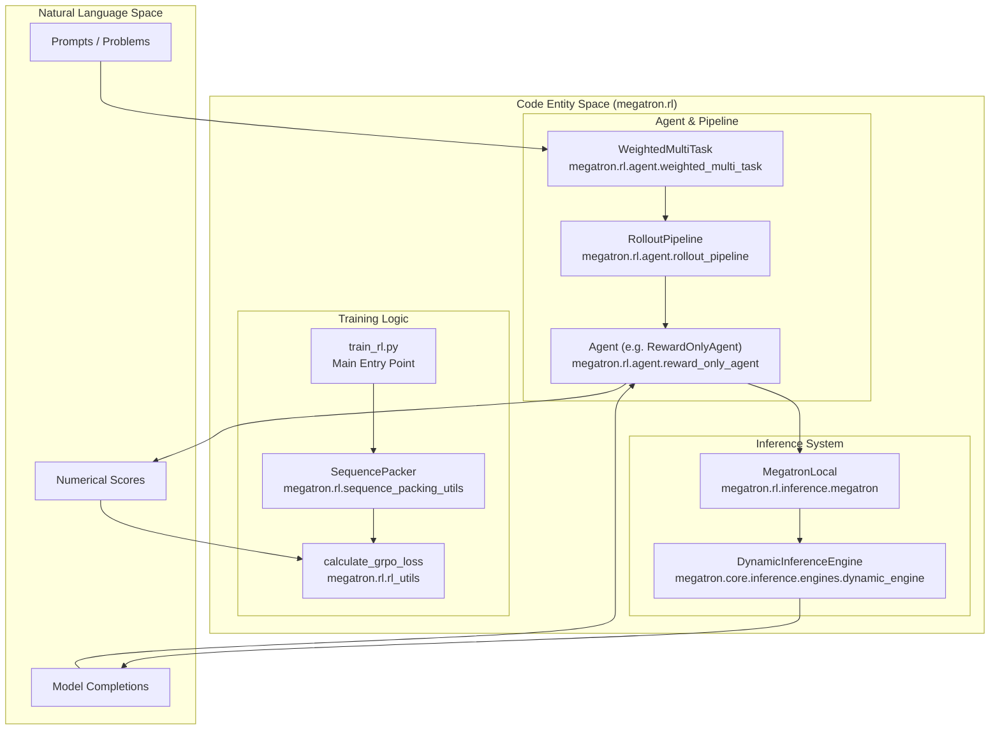
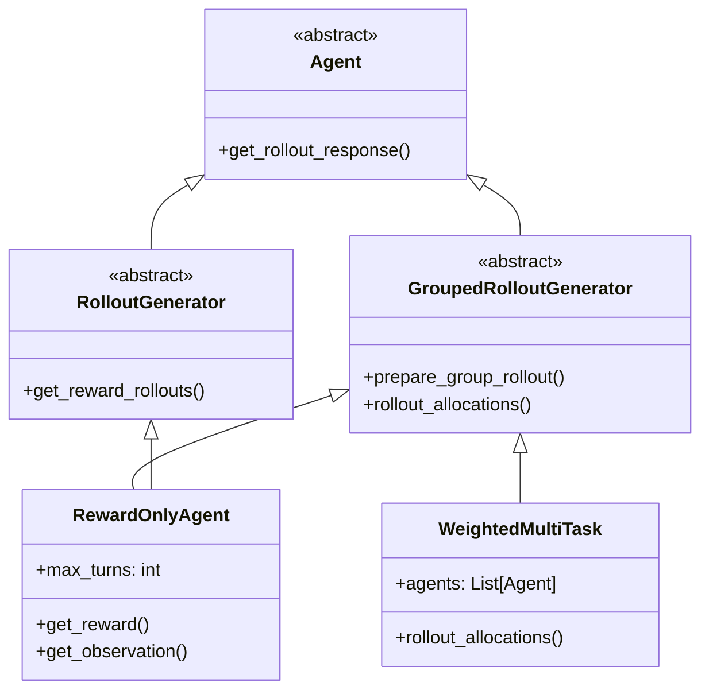

<!-- source: DeepWiki mcp.deepwiki.com · repo NVIDIA/Megatron-LM · page 5.5 Reinforcement Learning Training · fetched 2026-10-26 -->

# Reinforcement Learning Training

Relevant source files

The following files were used as context for generating this wiki page:

- [examples/rl/environment_configs/countdown.yaml](examples/rl/environment_configs/countdown.yaml)
- [examples/rl/environment_configs/dapo.yaml](examples/rl/environment_configs/dapo.yaml)
- [examples/rl/environment_configs/default.yaml](examples/rl/environment_configs/default.yaml)
- [examples/rl/environment_configs/gsm8k.yaml](examples/rl/environment_configs/gsm8k.yaml)
- [examples/rl/environment_configs/gsm8k_nanov3.yaml](examples/rl/environment_configs/gsm8k_nanov3.yaml)
- [examples/rl/environment_configs/math.yaml](examples/rl/environment_configs/math.yaml)
- [examples/rl/environment_configs/openmathinstructv2.yaml](examples/rl/environment_configs/openmathinstructv2.yaml)
- [examples/rl/model_configs/llama3p1_8b_instruct.sh](examples/rl/model_configs/llama3p1_8b_instruct.sh)
- [examples/rl/model_configs/nemotron6_3b_moe.sh](examples/rl/model_configs/nemotron6_3b_moe.sh)
- [examples/rl/model_configs/qwen3_30b_a3b_moe.sh](examples/rl/model_configs/qwen3_30b_a3b_moe.sh)
- [examples/rl/model_configs/qwen3_32b.sh](examples/rl/model_configs/qwen3_32b.sh)
- [examples/rl/model_configs/qwen_2p5_32b.sh](examples/rl/model_configs/qwen_2p5_32b.sh)
- [examples/rl/model_configs/qwen_2p5_3b.sh](examples/rl/model_configs/qwen_2p5_3b.sh)
- [examples/rl/model_configs/qwen_2p5_math_7b.sh](examples/rl/model_configs/qwen_2p5_math_7b.sh)
- [megatron/core/packed_seq_params.py](megatron/core/packed_seq_params.py)
- [megatron/rl/__init__.py](megatron/rl/__init__.py)
- [megatron/rl/agent/api.py](megatron/rl/agent/api.py)
- [megatron/rl/agent/registry.py](megatron/rl/agent/registry.py)
- [megatron/rl/agent/reward_only_agent.py](megatron/rl/agent/reward_only_agent.py)
- [megatron/rl/agent/rollout_pipeline.py](megatron/rl/agent/rollout_pipeline.py)
- [megatron/rl/agent/weighted_multi_task.py](megatron/rl/agent/weighted_multi_task.py)
- [megatron/rl/inference/api.py](megatron/rl/inference/api.py)
- [megatron/rl/inference/megatron.py](megatron/rl/inference/megatron.py)
- [megatron/rl/rl_utils.py](megatron/rl/rl_utils.py)
- [megatron/rl/rollout_granularity.py](megatron/rl/rollout_granularity.py)
- [megatron/rl/sequence_packing_utils.py](megatron/rl/sequence_packing_utils.py)
- [megatron/rl/server/agent/fastapi_env_server.py](megatron/rl/server/agent/fastapi_env_server.py)
- [tests/functional_tests/python_test_utils/test_grpo_training_loop.py](tests/functional_tests/python_test_utils/test_grpo_training_loop.py)
- [tests/unit_tests/rl/test_context_parallel.py](tests/unit_tests/rl/test_context_parallel.py)
- [tests/unit_tests/rl/test_rl_utils.py](tests/unit_tests/rl/test_rl_utils.py)
- [tests/unit_tests/rl/test_rollout_generation.py](tests/unit_tests/rl/test_rollout_generation.py)
- [tests/unit_tests/rl/test_sequence_packing_utils.py](tests/unit_tests/rl/test_sequence_packing_utils.py)
- [train_rl.py](train_rl.py)

## Purpose and Scope

This document covers the Reinforcement Learning (RL) training system in Megatron-LM, specifically focusing on the Group Relative Policy Optimization (GRPO) implementation. The RL training system enables training language models through reinforcement learning by generating rollouts, computing rewards, and optimizing policies. It includes specialized features for sequence packing, reward model integration, and the Megatron-RL agent/environment framework.

For standard supervised pretraining without RL, see [Training Loop and Orchestration](5.4). For inference-only usage without training, see [Inference and Text Generation](8).

## Overview

The RL training system extends Megatron's standard training pipeline to support reinforcement learning workflows. It integrates a dynamic inference engine for generating rollouts during training, implements the GRPO algorithm for policy optimization, and provides an agent/environment framework for defining RL tasks.

Key features:
- **GRPO algorithm**: Group-based policy gradient method with KL divergence regularization and advantage normalization within groups [megatron/rl/rl_utils.py:18-20]().
- **Megatron-RL Agent/Environment Framework**: A multi-agent orchestration system that manages task distribution, multi-turn interactions, and reward calculation [megatron/rl/agent/api.py:159-229]().
- **Rollout Pipeline**: An asynchronous orchestration layer that manages the lifecycle of rollout generation, from prompt preparation to inference and assembly [megatron/rl/agent/rollout_pipeline.py:194-200]().
- **Sequence packing**: Utilities to pack variable-length trajectories into fixed-size bins to maximize GPU utilization [megatron/rl/sequence_packing_utils.py:43-70]().
- **In-place inference**: The `MegatronLocal` interface allows the training process to act as its own inference server for rollout generation [megatron/rl/inference/megatron.py:39-90]().

**Sources**: [megatron/rl/rl_utils.py:1-130](), [megatron/rl/agent/api.py:1-229](), [megatron/rl/agent/rollout_pipeline.py:1-200](), [megatron/rl/sequence_packing_utils.py:1-70](), [megatron/rl/inference/megatron.py:1-90]()

## RL Training Architecture

The RL training system bridges the gap between the generative "Natural Language Space" and the structured "Code Entity Space" by coordinating model generation and policy optimization.

### System Interaction Diagram

**Sources**: [train_rl.py:17-27](), [megatron/rl/agent/api.py:198-222](), [megatron/rl/agent/rollout_pipeline.py:194-200](), [megatron/rl/agent/weighted_multi_task.py:41-46](), [megatron/rl/inference/megatron.py:39-49]()

## GRPO Algorithm and Loss Computation

GRPO (Group Relative Policy Optimization) optimizes the policy by comparing log probabilities between the current policy and a reference policy within groups of trajectories generated from the same prompt.

### GRPO Loss Components

The loss function is implemented in `loss_func` within `train_rl.py` and utilizes `calculate_grpo_loss` from the RL utilities.

| Term | Code Entity / Argument | Purpose |
|------|------------------------|---------|
| **Policy Ratio** | `ratios` | $\frac{\pi_{\theta}(a|s)}{\pi_{old}(a|s)}$ [train_rl.py:87, 98]() |
| **KL Divergence** | `kl_term` | Regularization against reference model [train_rl.py:86, 97]() |
| **Entropy** | `entropy_term` | Encourages exploration [train_rl.py:88, 99]() |
| **Advantage** | `advantages` | Relative quality of completion in group [megatron/rl/rl_utils.py:18-20]() |

### Implementation Details

The `loss_func` handles the aggregation of metrics across data-parallel ranks and provides safety checks for training stability.

- **NaN Checks**: If enabled, the `RerunStateMachine` validates the loss to catch numerical instabilities [train_rl.py:143-151]().
- **Spiky Loss Detection**: Detects sudden variations in loss (default >20%) to trigger potential reruns via `SPIKY_LOSS_PERC` [train_rl.py:81, 153-160]().
- **Micro-batch Handling**: The loss function returns the number of non-padded tokens to correctly normalize gradients across micro-batches [train_rl.py:122-126]().

**Sources**: [train_rl.py:84-176](), [megatron/rl/rl_utils.py:18-20](), [megatron/core/rerun_state_machine.py:15-16]()

## Megatron-RL Agent and Environment Framework

Megatron-LM uses a hierarchical agent system to manage complex RL tasks, including multi-task learning and multi-turn environments.

### Agent Hierarchy and Roles

- **`WeightedMultiTask`**: Distributes rollout requests across multiple sub-agents based on weights. It uses `_quantized_counts` to ensure every weighted environment gets at least one group per batch [megatron/rl/agent/weighted_multi_task.py:41-46, 133-156]().
- **`RewardOnlyAgent`**: A template for standard RL tasks. It manages multi-turn episodes via `_run_episode`, consulting `get_observation` after each turn to determine if the episode continues [megatron/rl/agent/reward_only_agent.py:41-112, 128-178]().
- **`RolloutPipeline`**: Orchestrates the asynchronous execution of `prepare_group_rollout`, inference, and assembly. It uses a `_SubmissionGate` to control the number of rollouts in flight, preventing engine oversubscription [megatron/rl/agent/rollout_pipeline.py:109-167, 194-200]().

**Sources**: [megatron/rl/agent/api.py:159-229](), [megatron/rl/agent/weighted_multi_task.py:41-180](), [megatron/rl/agent/reward_only_agent.py:41-178](), [megatron/rl/agent/rollout_pipeline.py:1-200]()

## Sequence Packing Utilities

RL trajectories vary significantly in length. To avoid massive padding overhead, Megatron-RL uses a sequence packing framework to maximize throughput.

### Packing Logic Flow

- **`PackingContext`**: A dataclass that stores the packed tensors (`packed_trajs`, `packed_position_ids`, `packed_loss_mask`) and pre-computed `PackedSeqParams` for each bin [megatron/rl/sequence_packing_utils.py:43-70]().
- **`load_packed_data_by_index`**: Retrieves a specific bin and prepares it for the transformer forward pass. It handles the shifting of `loss_mask` relative to tokens (predicting the next token) by slicing `loss_mask` from position 1 [megatron/rl/sequence_packing_utils.py:72-135]().
- **`PackedSeqParams`**: Communicates sequence boundaries to Transformer Engine backends. It pre-computes `seq_idx` to support CUDA graph compatibility for models like Mamba [megatron/core/packed_seq_params.py:10-69]().
- **Efficiency Logging**: `log_packing_efficiency` calculates the ratio of actual tokens to total bin capacity across data-parallel ranks [megatron/rl/sequence_packing_utils.py:138-180]().

**Sources**: [megatron/rl/sequence_packing_utils.py:24-180](), [megatron/core/packed_seq_params.py:9-69](), [train_rl.py:29-30]()

## Memory and Performance Optimizations

### Weight Offloading and UVM
To maximize available GPU memory for training, Megatron-RL supports offloading the inference model weights when idle.
- **UVM Offloading**: When enabled, parameters are managed via `advise_managed_module_parameters_preferred_location` and `prefetch_managed_module_parameters` [megatron/rl/rl_utils.py:174-192]().
- **`torch_memory_saver`**: An alternative path that uses `pause()` and `resume()` to transfer weights between CPU and GPU for specific memory regions [megatron/rl/rl_utils.py:141-172]().

### CUDA Graphs for Inference
Megatron-RL leverages CUDA graphs to minimize CPU overhead during the auto-regressive decoding phase of rollout generation.
- **`FullCudaGraphWrapper`**: Wraps the model to capture and replay execution graphs [megatron/rl/rl_utils.py:48]().
- **Inference Mode Management**: The system manages the transition between training and inference states, including toggling CUDA graphs and prefetching weights [megatron/rl/rl_utils.py:67-76]().
- **Expert Padding**: Integration with `set_decode_expert_padding` for MoE models ensures consistent tensor shapes required for CUDA graph compatibility [megatron/rl/rl_utils.py:55]().

**Sources**: [megatron/rl/rl_utils.py:48-192](), [megatron/rl/inference/megatron.py:111-146](), [tests/unit_tests/rl/test_rl_utils.py:31-36]()

---

