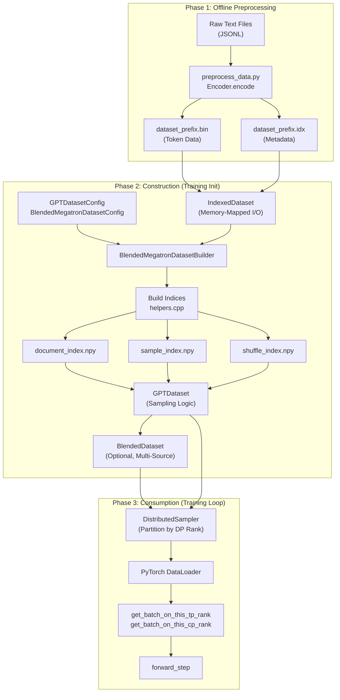
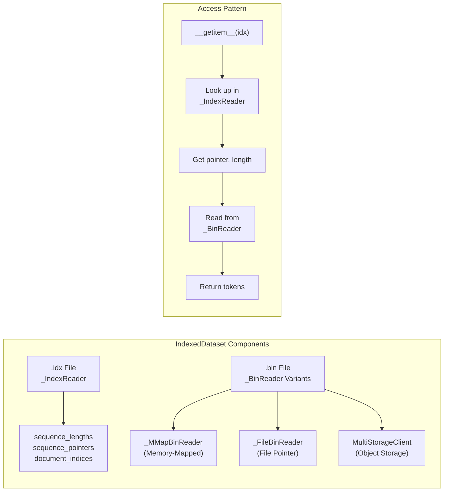
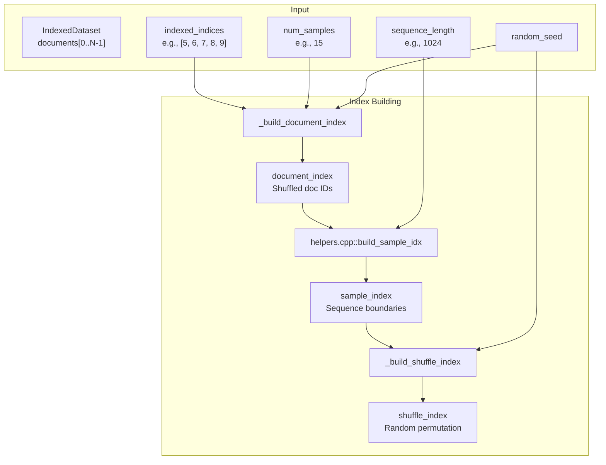
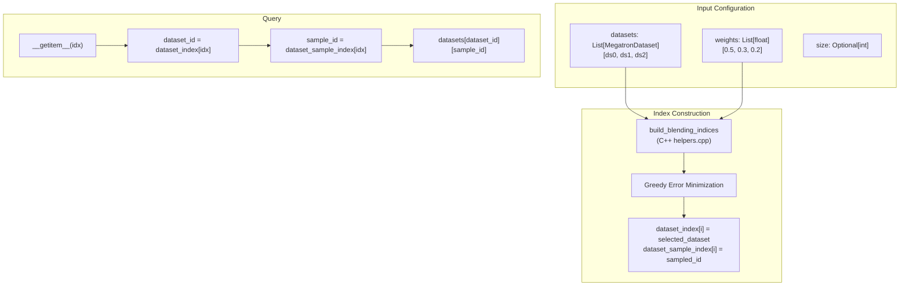

<!-- source: DeepWiki mcp.deepwiki.com · repo NVIDIA/Megatron-LM · page 5.6 Data Loading and Dataset Pipeline · fetched 2026-10-26 -->

# Data Loading and Dataset Pipeline

<details>
<summary>Relevant source files</summary>

The following files were used as context for generating this wiki page:

- [docs/user-guide/data-loading.md](docs/user-guide/data-loading.md)
- [megatron/core/datasets/bert_dataset.py](megatron/core/datasets/bert_dataset.py)
- [megatron/core/datasets/blended_dataset.py](megatron/core/datasets/blended_dataset.py)
- [megatron/core/datasets/blended_megatron_dataset_builder.py](megatron/core/datasets/blended_megatron_dataset_builder.py)
- [megatron/core/datasets/blended_megatron_dataset_config.py](megatron/core/datasets/blended_megatron_dataset_config.py)
- [megatron/core/datasets/gpt_dataset.py](megatron/core/datasets/gpt_dataset.py)
- [megatron/core/datasets/indexed_dataset.py](megatron/core/datasets/indexed_dataset.py)
- [megatron/core/datasets/masked_dataset.py](megatron/core/datasets/masked_dataset.py)
- [megatron/core/datasets/megatron_dataset.py](megatron/core/datasets/megatron_dataset.py)
- [megatron/core/datasets/object_storage_utils.py](megatron/core/datasets/object_storage_utils.py)
- [megatron/core/datasets/readme.md](megatron/core/datasets/readme.md)
- [megatron/core/datasets/t5_dataset.py](megatron/core/datasets/t5_dataset.py)
- [megatron/core/datasets/utils.py](megatron/core/datasets/utils.py)
- [megatron/core/datasets/utils_s3.py](megatron/core/datasets/utils_s3.py)
- [megatron/core/tokenizers/base_tokenizer.py](megatron/core/tokenizers/base_tokenizer.py)
- [megatron/core/tokenizers/megatron_tokenizer.py](megatron/core/tokenizers/megatron_tokenizer.py)
- [megatron/core/tokenizers/text/libraries/huggingface_tokenizer.py](megatron/core/tokenizers/text/libraries/huggingface_tokenizer.py)
- [megatron/core/tokenizers/text/text_tokenizer.py](megatron/core/tokenizers/text/text_tokenizer.py)
- [megatron/core/tokenizers/utils/build_tokenizer.py](megatron/core/tokenizers/utils/build_tokenizer.py)
- [tests/unit_tests/data/test_bin_reader.py](tests/unit_tests/data/test_bin_reader.py)
- [tests/unit_tests/data/test_builder.py](tests/unit_tests/data/test_builder.py)
- [tests/unit_tests/data/test_gpt_dataset.py](tests/unit_tests/data/test_gpt_dataset.py)
- [tests/unit_tests/data/test_prepare_cache.py](tests/unit_tests/data/test_prepare_cache.py)
- [tests/unit_tests/data/test_preprocess_data.py](tests/unit_tests/data/test_preprocess_data.py)
- [tests/unit_tests/dist_checkpointing/models/test_mamba.py](tests/unit_tests/dist_checkpointing/models/test_mamba.py)
- [tests/unit_tests/dist_checkpointing/test_fp8.py](tests/unit_tests/dist_checkpointing/test_fp8.py)
- [tests/unit_tests/dist_checkpointing/test_fully_parallel.py](tests/unit_tests/dist_checkpointing/test_fully_parallel.py)
- [tests/unit_tests/dist_checkpointing/test_global_metadata_reuse.py](tests/unit_tests/dist_checkpointing/test_global_metadata_reuse.py)
- [tests/unit_tests/dist_checkpointing/test_local.py](tests/unit_tests/dist_checkpointing/test_local.py)
- [tests/unit_tests/dist_checkpointing/test_nonpersistent.py](tests/unit_tests/dist_checkpointing/test_nonpersistent.py)
- [tests/unit_tests/dist_checkpointing/test_replication.py](tests/unit_tests/dist_checkpointing/test_replication.py)
- [tests/unit_tests/tokenizers/test_tokenizer.py](tests/unit_tests/tokenizers/test_tokenizer.py)
- [tools/prepare_cache.py](tools/prepare_cache.py)
- [tools/preprocess_data.py](tools/preprocess_data.py)
- [tools/preprocess_data_nmt.py](tools/preprocess_data_nmt.py)
- [tools/preprocess_mmdata.py](tools/preprocess_mmdata.py)

</details>


## Overview

The Data Loading and Dataset Pipeline provides the infrastructure for efficiently loading and sampling training data in Megatron-LM. This system handles preprocessing tokenized text into indexed binary formats, constructing datasets with sophisticated sampling strategies, blending multiple data sources, and integrating with distributed training.

**Scope**: This document covers the data pipeline from preprocessed binary files through to batch consumption in the training loop. For information about the training loop itself, see [Training Loop and Orchestration](#5.4). For model architectures that consume the data, see [Core Model Architecture](#2).

**Key capabilities**:
- Memory-mapped access to multi-terabyte datasets via `IndexedDataset` [megatron/core/datasets/indexed_dataset.py:578-720]()
- Configurable sampling with document/sample/shuffle index mappings [megatron/core/datasets/gpt_dataset.py:143-145]()
- Weighted blending of multiple datasets with precise sampling control [megatron/core/datasets/blended_dataset.py:24-47]()
- Distributed-aware construction with rank coordination and caching [megatron/core/datasets/blended_megatron_dataset_builder.py:77-134]()
- Support for GPT, Mamba, BERT, T5, and SFT dataset types [megatron/core/datasets/gpt_dataset.py:101](), [megatron/core/datasets/bert_dataset.py:28]()
- Integration with the **Multi-Storage Client (MSC)** for object storage and distributed environments [megatron/core/datasets/indexed_dataset.py:141-145]()

**Sources**: [megatron/core/datasets/gpt_dataset.py:101-145](), [megatron/core/datasets/indexed_dataset.py:578-720](), [megatron/core/datasets/blended_megatron_dataset_builder.py:29-134]()

---

## Architecture Overview

The data pipeline consists of three main phases: preprocessing (offline), construction (at training start), and consumption (during training).

### Data Flow Pipeline
Title: Data Pipeline Architecture


**Sources**: [megatron/core/datasets/gpt_dataset.py:101-145](), [megatron/core/datasets/blended_megatron_dataset_builder.py:29-134](), [tools/preprocess_data.py:151-165]()

---

## Indexed Dataset Format

The `IndexedDataset` class provides the low-level interface to tokenized data stored in binary files. It uses a custom index format to allow random access to variable-length documents.

### File Structure

**Index File (`.idx`)**: Stores metadata about documents and sequences.

| Offset | Type | Description |
|--------|------|-------------|
| 0-8 | bytes | Header: `MMIDIDX\x00\x00` [megatron/core/datasets/indexed_dataset.py:47]() |
| 9-16 | uint64 | Version (currently 1) [megatron/core/datasets/indexed_dataset.py:145]() |
| 17 | uint8 | Data type code (e.g., 4 for int32, 8 for uint16) [megatron/core/datasets/indexed_dataset.py:147]() |
| 18-25 | uint64 | Number of sequences [megatron/core/datasets/indexed_dataset.py:190]() |
| 26-33 | uint64 | Number of documents [megatron/core/datasets/indexed_dataset.py:194]() |
| 34+ | int32[] | Sequence lengths (one per sequence) [megatron/core/datasets/indexed_dataset.py:197]() |
| + | int64[] | Sequence pointers (byte offsets into .bin) [megatron/core/datasets/indexed_dataset.py:200]() |
| + | int64[] | Document indices (sequence boundaries) [megatron/core/datasets/indexed_dataset.py:203]() |

**Data File (`.bin`)**: Stores the actual tokenized sequences as a flat array of integers.

Title: IndexedDataset Access Patterns


### Multi-Storage Client (MSC) Integration
Megatron-LM supports a **Multi-Storage Client** for cloud-native data loading. When `MultiStorageClientFeature` is used, the `_IndexWriter` and `_BinReader` classes use the MSC API (e.g., `maybe_msc.open`) instead of standard Python file handles [megatron/core/datasets/indexed_dataset.py:141-145](). This allows for transparent access to S3 or other object storage backends while maintaining the `IndexedDataset` interface [megatron/core/datasets/indexed_dataset.py:33-41]().

**Sources**: [megatron/core/datasets/indexed_dataset.py:46-212](), [megatron/core/datasets/indexed_dataset.py:578-720](), [megatron/core/datasets/object_storage_utils.py:10-40]()

---

## Dataset Construction Pipeline

The `BlendedMegatronDatasetBuilder` orchestrates the construction of dataset hierarchies from configuration to consumable datasets.

### Builder Pattern

The `BlendedMegatronDatasetBuilder` ([megatron/core/datasets/blended_megatron_dataset_builder.py:30-51]()) implements a distributed-aware builder pattern:

```python
class BlendedMegatronDatasetBuilder(object):
    def __init__(
        self,
        cls: Type[MidLevelDataset],  # e.g., GPTDataset
        sizes: List[int],             # [train_size, valid_size, test_size]
        is_built_on_rank: Callable,   # Determines which ranks build
        config: BlendedMegatronDatasetConfig,
    )
```

**Key methods**:
- `build()`: Orchestrates the creation of all dataset splits (Train, Valid, Test) [megatron/core/datasets/blended_megatron_dataset_builder.py:81-138]().
- `_build_blended_dataset_splits`: Logic for splitting data across distributions [megatron/core/datasets/blended_megatron_dataset_builder.py:140-218]().
- `_build_megatron_datasets_parallel`: Uses a `ThreadPoolExecutor` to instantiate multiple mid-level datasets concurrently [megatron/core/datasets/blended_megatron_dataset_builder.py:331-414]().

**Sources**: [megatron/core/datasets/blended_megatron_dataset_builder.py:30-138](), [megatron/core/datasets/blended_megatron_dataset_builder.py:331-414]()

---

## GPTDataset and Index Mappings

The `GPTDataset` class builds three index mappings to enable efficient sampling of sequences from documents across multiple epochs.

### Index Mapping Architecture

Title: GPTDataset Sampling Pipeline


### Index Implementation Details
- **Document Index**: Repeats and shuffles document IDs to satisfy the requested `num_samples` [megatron/core/datasets/gpt_dataset.py:149-152]().
- **Sample Index**: Determines the starting point for each sample. It ensures that samples are drawn such that the input and output tokens both meet the required sequence length [megatron/core/datasets/gpt_dataset.py:46-49]().
- **Shuffle Index**: Provides global shuffling of samples across the entire dataset to improve training stability [megatron/core/datasets/gpt_dataset.py:159-167]().

**Sources**: [megatron/core/datasets/gpt_dataset.py:141-185](), [megatron/core/datasets/gpt_dataset.py:619-682]()

---

## Blended Datasets

The `BlendedDataset` class combines multiple `MegatronDataset` instances with configurable weights.

### Blending Logic

Title: BlendedDataset Sampling Mechanism


### BlendedDataset Implementation
The `BlendedDataset` ([megatron/core/datasets/blended_dataset.py:25-47]()) uses C++ helpers to build indices that minimize the error between target weights and actual sampling ratios. It supports:
- **Weighted Blending**: Specific ratios for different datasets [megatron/core/datasets/blended_megatron_dataset_config.py:25-30]().
- **Exhaustive Blending**: Drawing exactly all samples from contributing datasets [megatron/core/datasets/blended_dataset.py:180-184]().
- **Caching**: Storing built indices as `.npy` files to skip re-computation in subsequent runs [megatron/core/datasets/blended_dataset.py:131-150]().

**Sources**: [megatron/core/datasets/blended_dataset.py:25-108](), [megatron/core/datasets/blended_megatron_dataset_config.py:25-35]()

---

## Tokenizers

Megatron-LM uses a modular tokenizer interface defined by `MegatronTokenizerBase`.

### Supported Tokenizers
- **HuggingFace Tokenizer**: Wrapper for the `transformers` library tokenizers [megatron/core/tokenizers/text/libraries/huggingface_tokenizer.py:19]().
- **SentencePiece**: Support for `.model` files via `SentencePieceTokenizer` [tests/unit_tests/tokenizers/test_tokenizer.py:71-75]().
- **ByteLevelTokenizer**: Byte-level BPE implementation [megatron/core/tokenizers/text/libraries/bytelevel_tokenizer.py:13]().

The tokenizer is responsible for:
- Mapping text to token IDs [tools/preprocess_data.py:99]().
- Handling special tokens like `EOD` (End of Document) and `PAD` [megatron/core/datasets/megatron_dataset.py:73-78]().
- Providing vocabulary size for determining optimal integer types for indices [megatron/core/datasets/gpt_dataset.py:129-133]().

**Sources**: [megatron/core/tokenizers/utils/build_tokenizer.py:24](), [megatron/core/datasets/megatron_dataset.py:73-114](), [tools/preprocess_data.py:86-108]()

---

## Advanced Features

### Fast Cache Loading and Deferred MMap
To optimize startup time on large clusters:
- **Fast Cache Load**: Skips validation of dataset caches if they are known to be complete [megatron/core/datasets/blended_megatron_dataset_config.py:91-92]().
- **Deferred MMap**: Defers the memory mapping of `.npy` index files until the first access, allowing DataLoader workers to handle the I/O initialization independently [megatron/core/datasets/blended_megatron_dataset_config.py:94-95]().

### Preprocessing Tooling
The `tools/preprocess_data.py` script provides a multi-processed pipeline for converting raw text into the `IndexedDataset` format [tools/preprocess_data.py:151-160](). It handles:
- **NLTK Sentence Splitting**: Optional splitting of documents into sentences [tools/preprocess_data.py:54-71]().
- **Binarization**: Writing tokens into `.bin` files using optimal data types based on vocabulary size [tools/preprocess_data.py:177]().
- **Multi-modal Support**: `tools/preprocess_mmdata.py` extends this for vision-language data, including image path handling.

**Sources**: [megatron/core/datasets/blended_megatron_dataset_config.py:91-113](), [tools/preprocess_data.py:54-71](), [tools/preprocess_data.py:151-160]()

---

