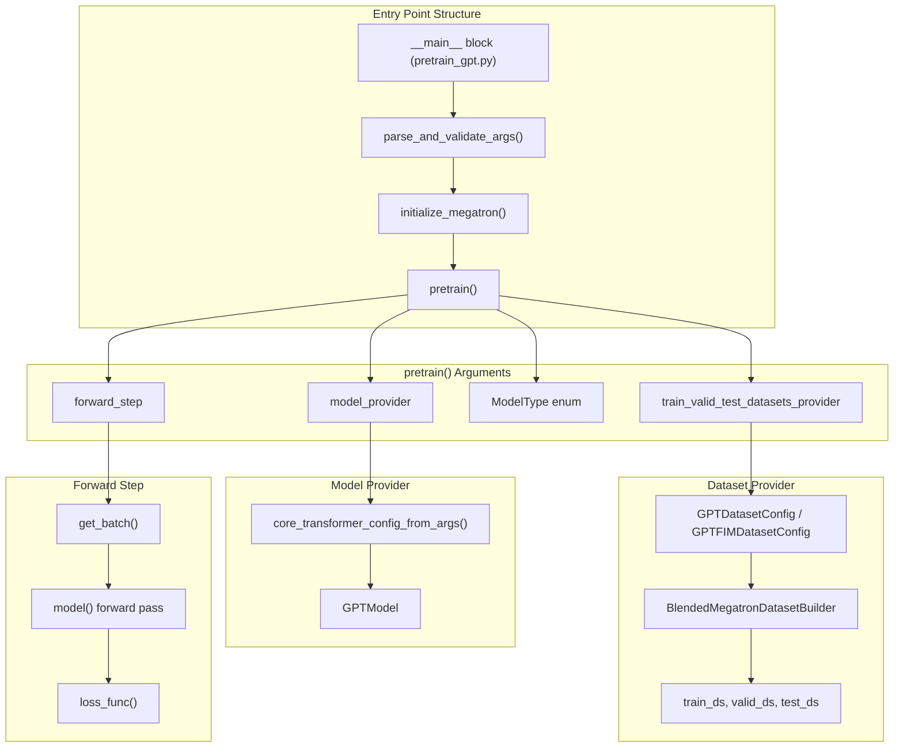
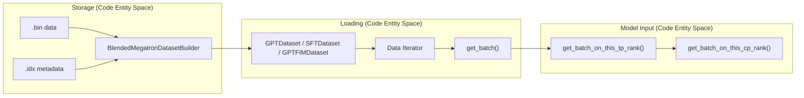

<!-- source: DeepWiki mcp.deepwiki.com · repo NVIDIA/Megatron-LM · page 5.7 Pretraining Workflows · fetched 2026-10-26 -->

# Pretraining Workflows

Relevant source files

The following files were used as context for generating this wiki page:

- [examples/bert/README.md](examples/bert/README.md)
- [examples/bert/train_bert_340m_distributed.sh](examples/bert/train_bert_340m_distributed.sh)
- [examples/gpt3/README.md](examples/gpt3/README.md)
- [examples/gpt3/train_gpt3_175b_distributed.sh](examples/gpt3/train_gpt3_175b_distributed.sh)
- [examples/t5/train_t5_220m_distributed.sh](examples/t5/train_t5_220m_distributed.sh)
- [megatron/core/dist_checkpointing/strategies/fully_parallel.py](megatron/core/dist_checkpointing/strategies/fully_parallel.py)
- [megatron/core/model_parallel_config.py](megatron/core/model_parallel_config.py)
- [megatron/core/parallel_state.py](megatron/core/parallel_state.py)
- [megatron/core/pipeline_parallel/p2p_communication.py](megatron/core/pipeline_parallel/p2p_communication.py)
- [megatron/core/pipeline_parallel/schedules.py](megatron/core/pipeline_parallel/schedules.py)
- [megatron/training/arguments.py](megatron/training/arguments.py)
- [megatron/training/checkpointing.py](megatron/training/checkpointing.py)
- [megatron/training/config/training_config.py](megatron/training/config/training_config.py)
- [megatron/training/initialize.py](megatron/training/initialize.py)
- [megatron/training/training.py](megatron/training/training.py)
- [pretrain_gpt.py](pretrain_gpt.py)
- [pretrain_hybrid.py](pretrain_hybrid.py)
- [pretrain_mamba.py](pretrain_mamba.py)
- [tasks/eval_utils.py](tasks/eval_utils.py)
- [tasks/finetune_utils.py](tasks/finetune_utils.py)
- [tests/unit_tests/__init__.py](tests/unit_tests/__init__.py)
- [tests/unit_tests/dist_checkpointing/test_pipeline_parallel_layout.py](tests/unit_tests/dist_checkpointing/test_pipeline_parallel_layout.py)
- [tests/unit_tests/dist_checkpointing/utils.py](tests/unit_tests/dist_checkpointing/utils.py)
- [tests/unit_tests/pipeline_parallel/test_pipeline_layout.py](tests/unit_tests/pipeline_parallel/test_pipeline_layout.py)
- [tests/unit_tests/test_checkpointing.py](tests/unit_tests/test_checkpointing.py)
- [tests/unit_tests/test_parallel_state.py](tests/unit_tests/test_parallel_state.py)

## Purpose and Scope

This document describes the complete pretraining workflows for GPT, BERT, T5, and Mamba models in Megatron-LM. It covers the structure of pretraining scripts, data loading mechanics, and the specific configurations and procedures for each model architecture.

For the underlying training loop mechanics, see [Training Loop and Orchestration](5.4). For dataset implementation details, see [Data Loading and Dataset Pipeline](5.6). For model architectures, see [Model Implementations](3).

**Sources:** [pretrain_gpt.py:1-41](), [megatron/training/training.py:1-46](), [pretrain_mamba.py:1-19]()

---

## Pretraining Workflow Overview

All pretraining scripts follow a common workflow pattern centered around the `pretrain()` orchestration function located in `megatron/training/training.py` [megatron/training/training.py:211-257]().

### Workflow Execution Flow
The following diagram bridges the high-level workflow to specific code entities in the pretraining scripts and core training utilities.

Title: Pretraining Entry Point and Orchestration

**Common Components Across All Models:**

| Component | Description | Location |
|-----------|-------------|----------|
| `initialize_megatron` | Sets global variables, distributed env, and seeds | [megatron/training/initialize.py:48-168]() |
| `parse_and_validate_args` | Argument parsing and YAML validation | [megatron/training/arguments.py:87-113]() |
| `pretrain()` | Main orchestration function for the training loop | [megatron/training/training.py:211-257]() |
| `model_provider` | Factory function to build the specific model | [pretrain_gpt.py:80]() |

**Sources:** [pretrain_gpt.py:75-80](), [megatron/training/training.py:211-257](), [megatron/training/initialize.py:48-168](), [megatron/training/arguments.py:87-113]()

---

## Dataset Preparation and Format

Megatron-LM uses the `BlendedMegatronDatasetBuilder` to create training, validation, and test sets from one or more data sources [pretrain_gpt.py:41-42]().

### Data Flow: From Storage to Microbatches
This diagram maps the natural language space (Raw Tokens) to the code entities responsible for processing it during pretraining.

Title: Data Pipeline from Storage to GPU Ranks

**Sources:** [pretrain_gpt.py:41-43](), [pretrain_gpt.py:110-194](), [megatron/core/utils.py:129-140]()

---

## GPT Pretraining Workflow

The GPT workflow focuses on causal language modeling and supports advanced features like Context Parallelism (CP) and Multi-Token Prediction (MTP).

### GPT Batch Processing
GPT's `get_batch` function handles the distribution of data across model parallel ranks [pretrain_gpt.py:110-194]().

1. **TP Rank Fetch**: Rank 0 of each Tensor Parallel (TP) group fetches data from the iterator [pretrain_gpt.py:137-138]().
2. **TP Broadcast**: Data is broadcast to all ranks within the TP group using `get_batch_on_this_tp_rank` [pretrain_gpt.py:146-161]().
3. **MTP Handling**: Checks if MTP is active on the current rank via `mtp_on_this_rank_func` to adjust batch requirements [pretrain_gpt.py:121-126]().
4. **Context Parallel Slicing**: The batch is sliced along the sequence dimension for CP ranks using `get_batch_on_this_cp_rank` [pretrain_gpt.py:180-186]().

### Loss Computation
The `loss_func` computes cross-entropy loss and performs validation:
- **NaN/Inf Check**: If `args.check_for_nan_in_loss_and_grad` is set, the `rerun_state_machine` validates the loss scalar [pretrain_gpt.py:268-280]().
- **Spiky Loss Detection**: Checks if current loss exceeds `SPIKY_LOSS_FACTOR` (10x) of observed max loss [pretrain_gpt.py:200](), [pretrain_gpt.py:283-290]().

**Sources:** [pretrain_gpt.py:110-290](), [megatron/core/transformer/multi_token_prediction.py:53-56]()

---

## Mamba Pretraining Workflow

The `pretrain_mamba.py` script serves as a backward-compatible wrapper for hybrid pretraining workflows.

### Transition to Hybrid Pretraining
Modern Mamba/SSM (State Space Model) training in Megatron-LM is unified under the hybrid pretraining infrastructure. The `pretrain_mamba.py` script uses `runpy` to execute `pretrain_hybrid.py` [pretrain_mamba.py:16-19](). This allows Mamba models to leverage the same parallelism and data loading optimizations as GPT models.

**Sources:** [pretrain_mamba.py:1-19]()

---

## Parallelism and Configuration

The pretraining workflow is driven by `ModelParallelConfig` and `TransformerConfig`.

| Configuration Class | Role |
|---------------------|------|
| `ModelParallelConfig` | Defines TP, PP, CP, and Expert Parallel sizes [megatron/core/model_parallel_config.py:46]() |
| `TransformerConfig` | Defines architecture hyperparameters (hidden size, layers, etc.) [megatron/core/transformer/transformer_config.py:16]() |
| `PipelineParallelLayerLayout` | Manages the mapping of layers to pipeline stages [megatron/core/transformer/pipeline_parallel_layer_layout.py:17]() |

### Pipeline Schedules
The training loop uses schedules like `1F1B` (one forward, one backward) to manage microbatches across pipeline stages, retrieved via `get_forward_backward_func` [megatron/core/pipeline_parallel/schedules.py:53-170]().

**Sources:** [megatron/core/model_parallel_config.py:46-145](), [megatron/core/pipeline_parallel/schedules.py:53-170]()

---

## Execution and Checkpointing

Pretraining involves periodic state saving to ensure fault tolerance.

### Checkpoint Lifecycle
1. **Loading**: `load_checkpoint` is called during initialization to resume from the latest iteration [megatron/training/checkpointing.py:144]().
2. **Saving**: `save_checkpoint` is triggered at intervals defined by `args.save_interval` [megatron/training/checkpointing.py:145]().
3. **Verification**: Arguments from the checkpoint are compared against runtime arguments to ensure architectural consistency via `check_checkpoint_args` [megatron/training/checkpointing.py:161-201]().

### Fully Parallel Strategies
Megatron supports distributed checkpointing strategies that minimize metadata overhead. `FullyParallelSaveStrategyWrapper` distributes the save process across ranks by exchanging metadata without redundant data communication [megatron/core/dist_checkpointing/strategies/fully_parallel.py:46-82]().

**Sources:** [megatron/training/checkpointing.py:141-201](), [megatron/core/dist_checkpointing/strategies/fully_parallel.py:46-103]()

---

