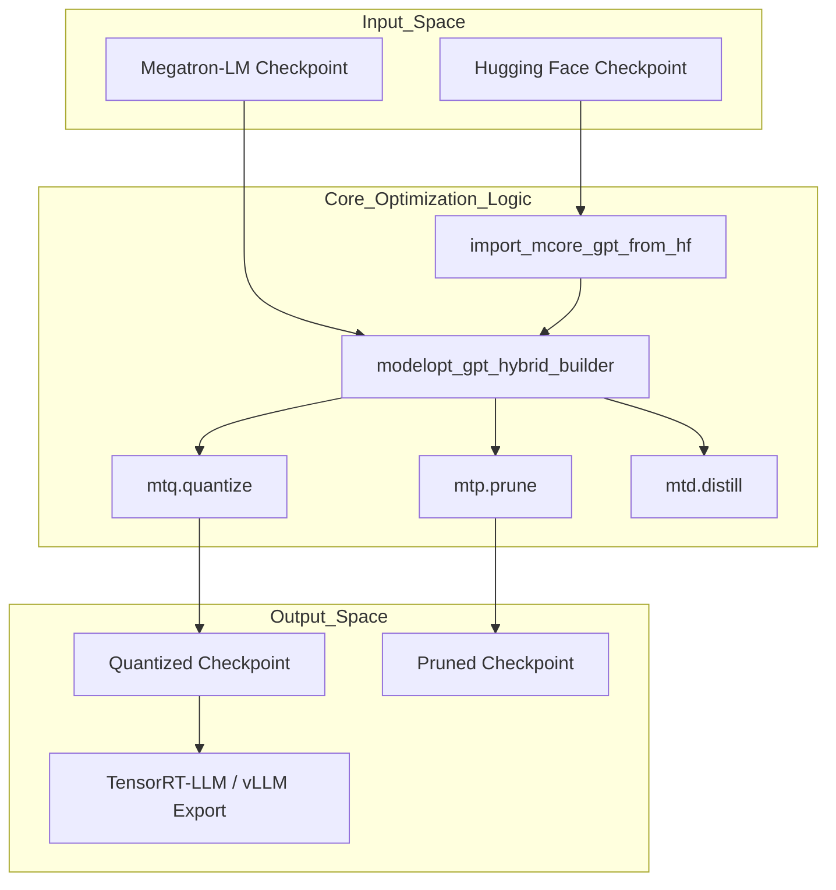
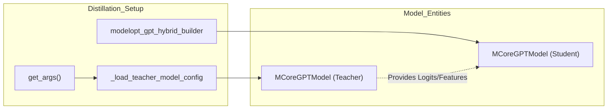

<!-- source: DeepWiki mcp.deepwiki.com · repo NVIDIA/Megatron-LM · page 5.8 Post-Training and Model Optimization · fetched 2026-10-26 -->

# Post-Training and Model Optimization

Relevant source files

The following files were used as context for generating this wiki page:

- [examples/export/README.md](examples/export/README.md)
- [examples/post_training/modelopt/README.md](examples/post_training/modelopt/README.md)
- [examples/post_training/modelopt/conf/arguments.sh](examples/post_training/modelopt/conf/arguments.sh)
- [examples/post_training/modelopt/conf/deepseek-ai/DeepSeek-R1.sh](examples/post_training/modelopt/conf/deepseek-ai/DeepSeek-R1.sh)
- [examples/post_training/modelopt/convert.sh](examples/post_training/modelopt/convert.sh)
- [examples/post_training/modelopt/convert_model.py](examples/post_training/modelopt/convert_model.py)
- [examples/post_training/modelopt/export.py](examples/post_training/modelopt/export.py)
- [examples/post_training/modelopt/export.sh](examples/post_training/modelopt/export.sh)
- [examples/post_training/modelopt/finetune.py](examples/post_training/modelopt/finetune.py)
- [examples/post_training/modelopt/finetune.sh](examples/post_training/modelopt/finetune.sh)
- [examples/post_training/modelopt/generate.py](examples/post_training/modelopt/generate.py)
- [examples/post_training/modelopt/generate.sh](examples/post_training/modelopt/generate.sh)
- [examples/post_training/modelopt/mmlu.py](examples/post_training/modelopt/mmlu.py)
- [examples/post_training/modelopt/mmlu.sh](examples/post_training/modelopt/mmlu.sh)
- [examples/post_training/modelopt/offline_feature_extract.py](examples/post_training/modelopt/offline_feature_extract.py)
- [examples/post_training/modelopt/prune.py](examples/post_training/modelopt/prune.py)
- [examples/post_training/modelopt/prune.sh](examples/post_training/modelopt/prune.sh)
- [examples/post_training/modelopt/quantize.py](examples/post_training/modelopt/quantize.py)
- [examples/post_training/modelopt/quantize.sh](examples/post_training/modelopt/quantize.sh)
- [examples/post_training/modelopt/requirements.txt](examples/post_training/modelopt/requirements.txt)
- [examples/post_training/modelopt/utils.py](examples/post_training/modelopt/utils.py)
- [examples/post_training/modelopt/validate.py](examples/post_training/modelopt/validate.py)
- [examples/post_training/modelopt/validate.sh](examples/post_training/modelopt/validate.sh)
- [megatron/core/post_training/modelopt/__init__.py](megatron/core/post_training/modelopt/__init__.py)
- [megatron/core/post_training/modelopt/gpt/model_specs.py](megatron/core/post_training/modelopt/gpt/model_specs.py)
- [megatron/core/post_training/modelopt/hybrid/model_specs.py](megatron/core/post_training/modelopt/hybrid/model_specs.py)
- [megatron/core/post_training/modelopt/layers.py](megatron/core/post_training/modelopt/layers.py)
- [megatron/core/post_training/modelopt/mamba/model_specs.py](megatron/core/post_training/modelopt/mamba/model_specs.py)
- [megatron/post_training/arguments.py](megatron/post_training/arguments.py)
- [megatron/post_training/checkpointing.py](megatron/post_training/checkpointing.py)
- [megatron/post_training/generate.py](megatron/post_training/generate.py)
- [megatron/post_training/loss_func.py](megatron/post_training/loss_func.py)
- [megatron/post_training/model_builder.py](megatron/post_training/model_builder.py)
- [megatron/post_training/non_loss_data_func.py](megatron/post_training/non_loss_data_func.py)
- [megatron/post_training/utils.py](megatron/post_training/utils.py)
- [tests/unit_tests/distributed/test_grad_sync_with_expert_parallel.py](tests/unit_tests/distributed/test_grad_sync_with_expert_parallel.py)
- [tests/unit_tests/post_training/test_modelopt_finetune_dataset.py](tests/unit_tests/post_training/test_modelopt_finetune_dataset.py)
- [tests/unit_tests/post_training/test_modelopt_module_spec.py](tests/unit_tests/post_training/test_modelopt_module_spec.py)
- [tests/unit_tests/training/test_param_norm.py](tests/unit_tests/training/test_param_norm.py)

Post-training in Megatron-LM is facilitated through integration with the **NVIDIA Model Optimizer (ModelOpt)**. This framework provides end-to-end workflows for model compression and efficiency improvements, including quantization (PTQ/QAT), structural pruning, knowledge distillation, and speculative decoding (EAGLE3).

## Overview and Integration Architecture

The post-training system bridges Megatron-LM's distributed training capabilities with ModelOpt's optimization algorithms. It supports on-the-fly conversion from Hugging Face checkpoints to Megatron-LM formats and handles various model parallelism strategies (TP, PP, EP, CP) during the optimization process [examples/post_training/modelopt/README.md:16-25]().

### Key Components
*   **Model Builders**: Specialized builders like `modelopt_gpt_hybrid_builder` create models using ModelOpt-compatible specifications [megatron/post_training/model_builder.py:68-86]().
*   **Layer Substitutions**: Standard Megatron layers are replaced with optimized variants (e.g., `megatron.core.post_training.modelopt.layers.Linear`) to support local execution and specific quantization requirements [megatron/core/post_training/modelopt/layers.py:105-129]().
*   **Workflow Scripts**: Entry points for quantization (`quantize.py`), pruning (`prune.py`), speculative decoding (`convert_model.py`), and distillation/finetuning (`finetune.py`).

### Data Flow: Post-Training Optimization Pipeline

The following diagram illustrates the flow from a pretrained checkpoint to an optimized, deployable model.

Title: Post-Training Data Flow

Sources: [examples/post_training/modelopt/quantize.py:23-25](), [megatron/post_training/model_builder.py:80-86](), [examples/post_training/modelopt/README.md:57-84]().

---

## Quantization

Megatron-LM supports Post-Training Quantization (PTQ) and Quantization-Aware Training (QAT) for various formats, including FP8, INT8, and NVFP4 [examples/post_training/modelopt/quantize.py:74-87]().

### Implementation Details
Quantization is managed by the `mtq` (ModelOpt Torch Quantization) module. The process typically involves:
1.  **Calibration**: Running a small dataset through the model to determine dynamic ranges for activations and weights. Users can specify `calib-size` and `calib-dataset-path-or-name` [examples/post_training/modelopt/quantize.py:99-110]().
2.  **Auto-Quantize**: Per-layer mixed-precision search using `mtq.auto_quantize` to assign different formats (e.g., NVFP4 vs FP8) to different layers based on a target bit-width [examples/post_training/modelopt/README.md:100-113]().
3.  **Real Quantization**: Transitioning from simulated (fake) quantization to actual low-bit storage. Supported configs include `fp8_real_quant` and `fp8_blockwise_real_quant` [megatron/post_training/arguments.py:50-55]().

### KV Cache Quantization
KV cache can be quantized to `fp8`, `fp8_affine`, `nvfp4`, `nvfp4_affine`, and `nvfp4_rotate` to reduce memory footprint during inference [megatron/post_training/arguments.py:44-48]().

Sources: [examples/post_training/modelopt/quantize.py:74-110](), [megatron/post_training/arguments.py:42-62](), [examples/post_training/modelopt/README.md:100-113]().

---

## Pruning and Distillation

Structural pruning and knowledge distillation are used to create smaller, faster "student" models from large "teacher" models.

### Structural Pruning
The `prune.py` script utilizes the `mtp` (ModelOpt Torch Prune) plugin to reduce model dimensions.
*   **Target Metrics**: Users specify targets for `hidden_size`, `ffn_hidden_size`, and other hyperparameters via `--prune-export-config` [examples/post_training/modelopt/prune.py:107-116]().
*   **SequentialMLP Requirement**: Pruning operates on per-expert linears, requiring the model to be built with `disable_moe_grouped_gemm=True` to force the use of `SequentialMLP` instead of `TEGroupedMLP` [examples/post_training/modelopt/prune.py:190-192]().

### Knowledge Distillation (KD)
The system supports both online and offline distillation.
*   **Teacher Loading**: The teacher model is loaded via `_build_teacher_model`, which handles architecture differences from the student (e.g., layer counts, hidden sizes) [megatron/post_training/model_builder.py:164-188]().
*   **Offline Feature Extraction**: For offline KD, base model features (hidden states) are precomputed and dumped to disk, then loaded during student training using `OfflineDataset` [examples/post_training/modelopt/finetune.py:44-62]().

Title: Distillation Model Building

Sources: [megatron/post_training/model_builder.py:117-161](), [megatron/post_training/model_builder.py:164-188](), [examples/post_training/modelopt/finetune.py:44-62]().

---

## Speculative Decoding (EAGLE3)

Integration with EAGLE3 allows training a "draft" model that predicts the next token's hidden states to accelerate inference.

*   **Conversion**: The `convert_model.py` script uses `mtsp.convert` to transform a standard GPT model into an EAGLE-augmented model [examples/post_training/modelopt/convert_model.py:166]().
*   **Algorithms**: Supports `eagle3` and `eagle-mtp` [examples/post_training/modelopt/convert_model.py:32-35]().
*   **Training Target**: In MTP (Multi-Token Prediction) QAT, users can select whether to train the `base` model, the `mtp` heads, or `both` via `--qad-train-target` [megatron/post_training/arguments.py:106-116]().

Sources: [examples/post_training/modelopt/convert_model.py:32-35](), [examples/post_training/modelopt/convert_model.py:154-166](), [megatron/post_training/arguments.py:106-116]().

---

## Configuration and Execution

Post-training workflows are configured through specialized arguments added to the Megatron parser via `add_modelopt_args` [megatron/post_training/arguments.py:4-159]().

### Key Arguments
| Argument | Purpose |
| :--- | :--- |
| `--export-quant-cfg` | Specifies the ModelOpt quantization configuration (e.g., `NVFP4_DEFAULT_CFG`) [megatron/post_training/arguments.py:57-62](). |
| `--export-kd-teacher-load` | Path to the teacher checkpoint for distillation [megatron/post_training/arguments.py:64-68](). |
| `--auto-quantize-bits` | Target effective bits for mixed-precision search [examples/post_training/modelopt/quantize.py:177-185](). |
| `--export-te-mcore-model` | Remaps state dict keys for Transformer Engine compatibility [megatron/post_training/arguments.py:23-29](). |

### Execution Workflow
Post-training tasks follow a standard pattern:
1.  Initialize the distributed environment via `initialize_megatron` [examples/post_training/modelopt/quantize.py:65]().
2.  Build the model using `modelopt_gpt_hybrid_builder` [megatron/post_training/model_builder.py:80]().
3.  Load weights from HF or Megatron checkpoints using `load_modelopt_checkpoint` [megatron/post_training/checkpointing.py:140-147]().
4.  Apply transformations and optionally evaluate using `mmlu.py` [examples/post_training/modelopt/mmlu.py:136-142]() or `generate.py` [examples/post_training/modelopt/generate.py:164-166]().
5.  Save the optimized checkpoint using `save_checkpoint` [examples/post_training/modelopt/convert_model.py:177]().

Sources: [megatron/post_training/arguments.py:4-159](), [examples/post_training/modelopt/quantize.py:61-69](), [examples/post_training/modelopt/convert_model.py:104-179](), [megatron/post_training/checkpointing.py:140-181]().

---

