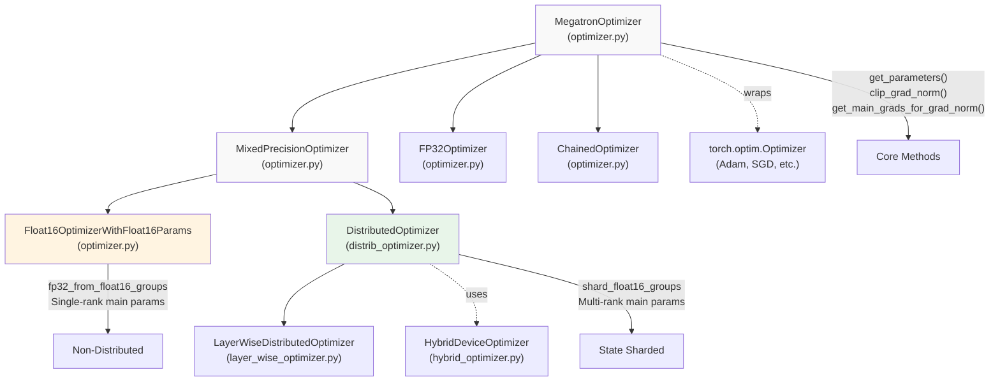
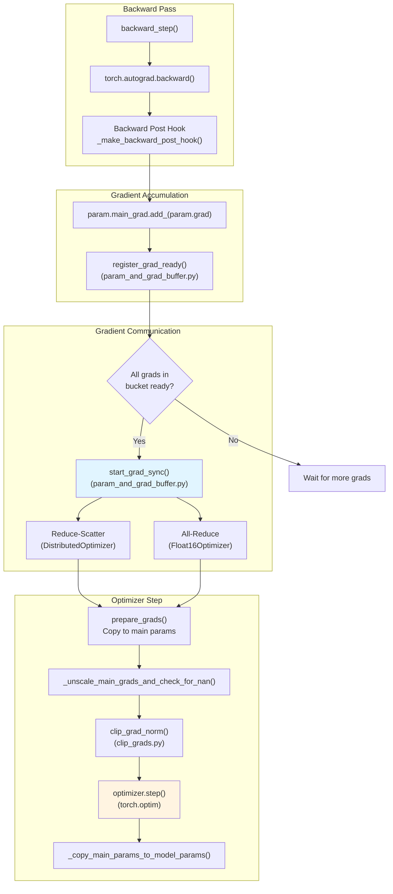

<!-- source: DeepWiki mcp.deepwiki.com · repo NVIDIA/Megatron-LM · page 6 Optimization and Gradient Management · fetched 2026-10-26 -->

# Optimization and Gradient Management

Relevant source files

The following files were used as context for generating this wiki page:

- [megatron/core/distributed/distributed_data_parallel.py](megatron/core/distributed/distributed_data_parallel.py)
- [megatron/core/distributed/param_and_grad_buffer.py](megatron/core/distributed/param_and_grad_buffer.py)
- [megatron/core/fp8_utils.py](megatron/core/fp8_utils.py)
- [megatron/core/optimizer/__init__.py](megatron/core/optimizer/__init__.py)
- [megatron/core/optimizer/clip_grads.py](megatron/core/optimizer/clip_grads.py)
- [megatron/core/optimizer/cpu_offloading/README.md](megatron/core/optimizer/cpu_offloading/README.md)
- [megatron/core/optimizer/cpu_offloading/__init__.py](megatron/core/optimizer/cpu_offloading/__init__.py)
- [megatron/core/optimizer/cpu_offloading/hybrid_optimizer.py](megatron/core/optimizer/cpu_offloading/hybrid_optimizer.py)
- [megatron/core/optimizer/distrib_optimizer.py](megatron/core/optimizer/distrib_optimizer.py)
- [megatron/core/optimizer/optimizer.py](megatron/core/optimizer/optimizer.py)
- [megatron/core/optimizer/optimizer_config.py](megatron/core/optimizer/optimizer_config.py)
- [tests/unit_tests/distributed/test_param_and_grad_buffer.py](tests/unit_tests/distributed/test_param_and_grad_buffer.py)
- [tests/unit_tests/test_fp8_param.py](tests/unit_tests/test_fp8_param.py)
- [tests/unit_tests/test_fp8_utils.py](tests/unit_tests/test_fp8_utils.py)
- [tests/unit_tests/test_optimizer.py](tests/unit_tests/test_optimizer.py)
- [tests/unit_tests/test_optimizer_cpu_offloading.py](tests/unit_tests/test_optimizer_cpu_offloading.py)
- [tests/unit_tests/transformer/test_module.py](tests/unit_tests/transformer/test_module.py)

This page documents Megatron-LM's optimization system, which manages parameter updates, gradient communication, and state sharding across distributed processes. The system provides efficient gradient handling through contiguous buffers, overlapped communication, and distributed optimizer state management.

**Scope:** This page covers the optimizer architecture, gradient buffer management, communication patterns, and clipping strategies. For training loop orchestration that calls these optimizers, see [Training Loop and Orchestration](#5.4). For pipeline scheduling that interleaves computation and optimizer steps, see [Pipeline Parallelism](#4.3).

---

## System Overview

Megatron-LM's optimization system consists of four main components:

1.  **Optimizer Hierarchy**: Base classes (`MegatronOptimizer`, `MixedPrecisionOptimizer`) that handle mixed-precision training, gradient scaling, and parameter updates.
2.  **Gradient Buffers**: Contiguous memory structures (`_ParamAndGradBuffer`) that store gradients for efficient communication.
3.  **Communication Layer**: Asynchronous gradient reduction (all-reduce/reduce-scatter) and parameter gathering (all-gather) operations.
4.  **Gradient Finalization**: Cross-rank synchronization for embeddings and sequence-parallel parameters.

### Optimizer Class Hierarchy

The optimizer architecture is built around the `MegatronOptimizer` abstract base class, which wraps standard PyTorch optimizers (like `Adam` or `SGD`) and provides Megatron-specific functionality for distributed training.

**Optimizer Entity Mapping**

**Sources:** [megatron/core/optimizer/optimizer.py:133-161](), [megatron/core/optimizer/distrib_optimizer.py:113-131](), [megatron/core/optimizer/__init__.py:63-79](), [megatron/core/optimizer/cpu_offloading/hybrid_optimizer.py:14-43]()

---

## Gradient Flow: Backward to Optimizer Step

The system coordinates the transition from autograd-computed gradients to updated model parameters. This involves accumulating gradients into contiguous buffers, synchronizing them across the data-parallel group, and applying the optimizer update.

**Gradient Management Logic**

**Sources:** [megatron/core/optimizer/optimizer.py:59-78](), [megatron/core/distributed/param_and_grad_buffer.py:179-183](), [megatron/core/optimizer/distrib_optimizer.py:113-131](), [megatron/core/distributed/distributed_data_parallel.py:87-107]()

---

## Parameter and Gradient Buffer Organization

Megatron-LM organizes gradients into contiguous buffers (`_ParamAndGradBuffer`) to minimize communication overhead. These buffers are partitioned into buckets, which serve as the unit of communication (e.g., all-reduce or reduce-scatter).

### Buffer Structure

| Component | Role | Code Entity |
| :--- | :--- | :--- |
| **Global Buffer** | Contiguous storage for all params/grads | `_ParamAndGradBuffer` |
| **Communication Unit** | Subset of parameters for overlapped sync | `_ParamAndGradBucket` |
| **Aggregator** | Groups buckets for collective calls | `_ParamAndGradBucketGroup` |
| **Layout Manager** | Maps model params to buffer offsets | `FullParamLayout` / `PerBufferParamLayout` |

**Key Concepts:**
*   **Contiguous Allocation**: Parameters and gradients are mapped to large contiguous tensors to enable single-kernel communication operations [megatron/core/distributed/param_and_grad_buffer.py:69-90]().
*   **Bucketing**: Buffers are split into buckets (controlled by `bucket_size` in `OptimizerConfig`) to allow overlapping communication with computation [megatron/core/distributed/distributed_data_parallel.py:133-138]().
*   **Quantized Storage**: Support for TE quantized storage (FP8/FP4) within buffers [megatron/core/distributed/param_and_grad_buffer.py:81-90]().

**Sources:** [megatron/core/distributed/param_and_grad_buffer.py:92-141](), [megatron/core/distributed/distributed_data_parallel.py:109-153](), [megatron/core/optimizer/optimizer_config.py:139-200](), [megatron/core/optimizer/param_layout.py:73-74]()

---

## Distributed Optimizer State Sharding

The `DistributedOptimizer` implements state sharding (ZeRO-1/2 style) by distributing optimizer states (like Adam's momentum and variance) across the data-parallel group.

### Parameter Range Mapping

The `DistributedOptimizer` calculates the exact slice of each parameter that a specific DP rank is responsible for updating. This is managed through the `Range` class [megatron/core/optimizer/distrib_optimizer.py:78-111]().

**Key Functions:**
*   **`_build_model_gbuf_param_range_map()`**: Computes the mapping between model parameters and the sharded gradient buffer owned by the current rank [megatron/core/optimizer/distrib_optimizer.py:134-200]().
*   **`shard_buffer()`**: Helper to split a contiguous buffer into equal chunks for DP ranks [megatron/core/distributed/param_and_grad_buffer.py:69-78]().

**Sources:** [megatron/core/optimizer/distrib_optimizer.py:78-200](), [megatron/core/distributed/param_and_grad_buffer.py:69-78]()

---

## Gradient Finalization and Clipping

Before the optimizer step, gradients must be finalized (synchronized across specific parallel groups) and clipped to prevent exploding gradients.

### Gradient Clipping Process
Gradient clipping is performed in FP32. The total norm is calculated across all model-parallel ranks before scaling.

| Feature | Description | Code Pointer |
| :--- | :--- | :--- |
| **Norm Calculation** | Calculates p-norm (default L2) across parallel groups | `get_grad_norm_fp32` [megatron/core/optimizer/clip_grads.py:55-140]() |
| **Clipping Execution** | Scales gradients in-place based on `max_norm` | `clip_grad_by_total_norm_fp32` [megatron/core/optimizer/clip_grads.py:143-183]() |
| **Separate Groups** | Special clipping groups for MTP (Multi-Token Prediction) | `SEPARATE_GRAD_NORM_GROUPS` [megatron/core/optimizer/optimizer.py:150-153]() |

**Sources:** [megatron/core/optimizer/clip_grads.py:55-183](), [megatron/core/optimizer/optimizer.py:150-168]()

---

## Mixed Precision and Gradient Scaling

Megatron supports multiple precision formats including FP16, BF16, and FP8. For formats that require it (like FP16), a `MegatronGradScaler` is used to manage loss scaling.

*   **`ConstantGradScaler`**: Uses a fixed scale factor [megatron/core/optimizer/grad_scaler.py:70-70]().
*   **`DynamicGradScaler`**: Adjusts the scale factor based on the presence of NaNs or Infs in gradients using a hysteresis and growth interval strategy [megatron/core/optimizer/grad_scaler.py:70-70]().
*   **Precision Aware Optimizer**: Allows master parameters and optimizer states to be stored in lower precision to save memory [megatron/core/optimizer/optimizer_config.py:187-191]().

**Sources:** [megatron/core/optimizer/grad_scaler.py:70-70](), [megatron/core/optimizer/optimizer.py:53-53](), [megatron/core/optimizer/optimizer_config.py:171-200]()

---

## Detailed Component Documentation

For more detailed information on specific subsystems, see the following child pages:

*   [Optimizer Architecture](#6.1) — Explain the optimizer base classes, initialization, parameter grouping logic, and emerging optimizers like Muon.
*   [Distributed Optimizer](#6.2) — Detail the `DistributedOptimizer` implementation with parameter sharding and state management.
*   [Gradient Scaling and Mixed Precision](#6.3) — Document gradient scaling, loss scaling, and mixed precision training (FP16, BF16, FP8, FP4).
*   [Parameter and Gradient Buffers](#6.4) — Explain the contiguous buffer architecture for parameters and gradients including bucketing.
*   [Gradient Clipping and Finalization](#6.5) — Document gradient clipping strategies, QK clipping, and the `finalize_model_grads` function.
*   [Optimizer CPU Offload and Learning Rate Scheduling](#6.6) — Document optimizer CPU offloading for memory reduction, the optimizer parameter scheduler, and learning rate scheduling strategies.

---

