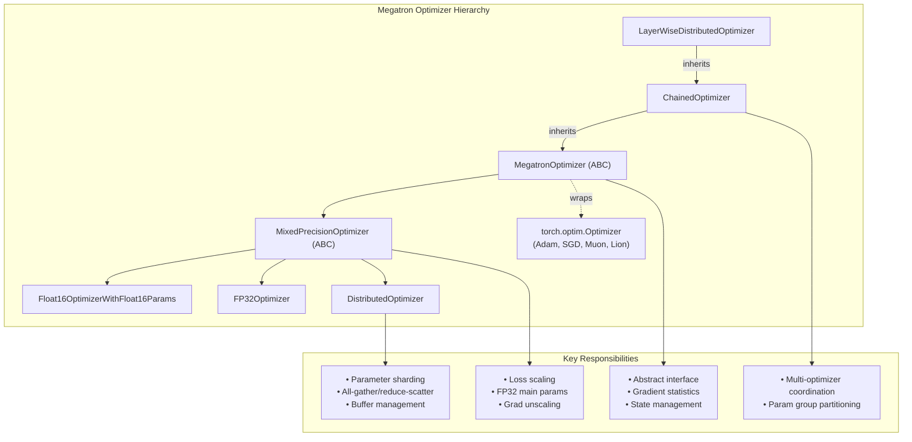
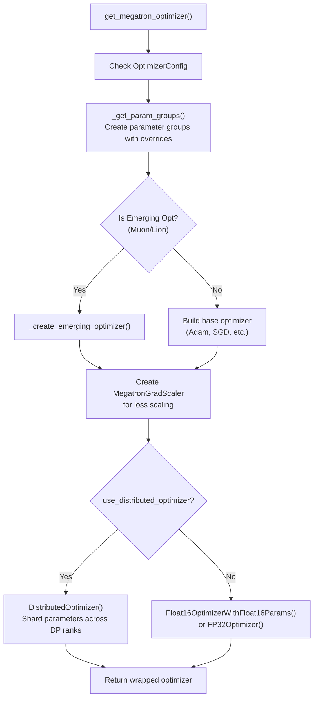
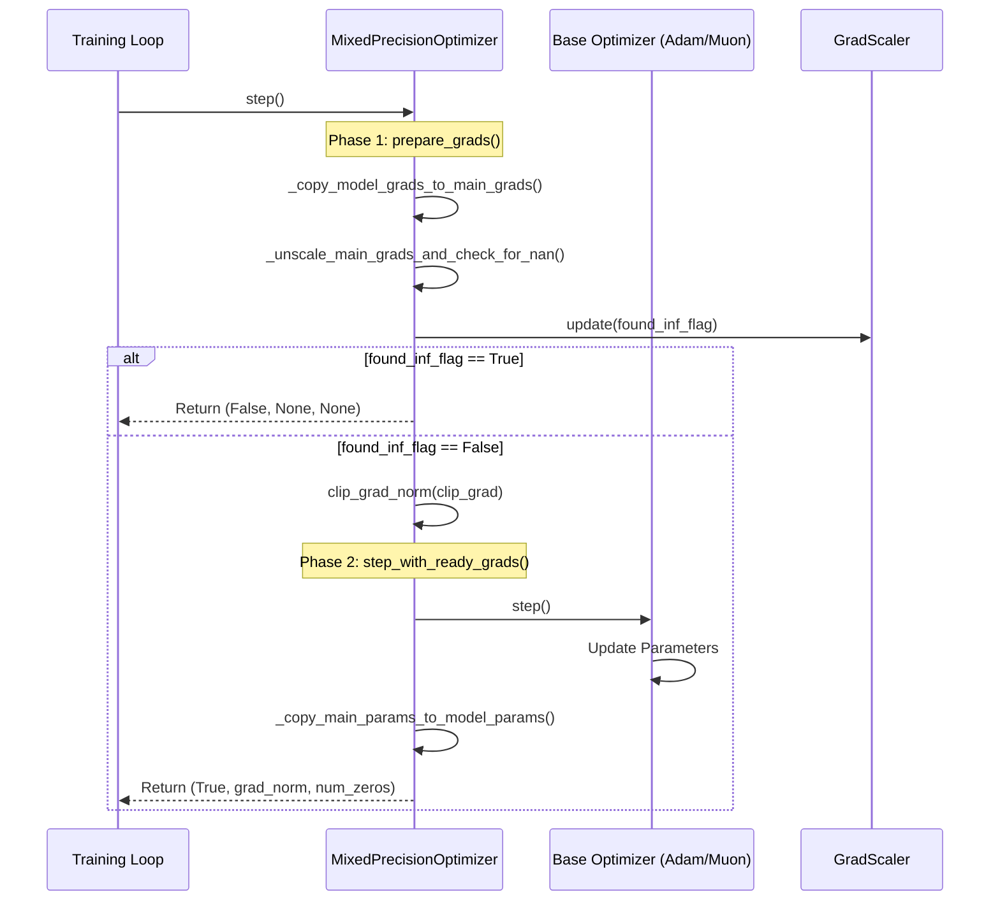

<!-- source: DeepWiki mcp.deepwiki.com · repo NVIDIA/Megatron-LM · page 6.1 Optimizer Architecture · fetched 2026-10-26 -->

# Optimizer Architecture

Relevant source files

The following files were used as context for generating this wiki page:

- [megatron/core/distributed/distributed_data_parallel.py](megatron/core/distributed/distributed_data_parallel.py)
- [megatron/core/distributed/param_and_grad_buffer.py](megatron/core/distributed/param_and_grad_buffer.py)
- [megatron/core/fp8_utils.py](megatron/core/fp8_utils.py)
- [megatron/core/optimizer/__init__.py](megatron/core/optimizer/__init__.py)
- [megatron/core/optimizer/clip_grads.py](megatron/core/optimizer/clip_grads.py)
- [megatron/core/optimizer/cpu_offloading/README.md](megatron/core/optimizer/cpu_offloading/README.md)
- [megatron/core/optimizer/cpu_offloading/__init__.py](megatron/core/optimizer/cpu_offloading/__init__.py)
- [megatron/core/optimizer/cpu_offloading/hybrid_optimizer.py](megatron/core/optimizer/cpu_offloading/hybrid_optimizer.py)
- [megatron/core/optimizer/distrib_optimizer.py](megatron/core/optimizer/distrib_optimizer.py)
- [megatron/core/optimizer/emerging_optimizers.py](megatron/core/optimizer/emerging_optimizers.py)
- [megatron/core/optimizer/layer_wise_optimizer.py](megatron/core/optimizer/layer_wise_optimizer.py)
- [megatron/core/optimizer/muon.py](megatron/core/optimizer/muon.py)
- [megatron/core/optimizer/optimizer.py](megatron/core/optimizer/optimizer.py)
- [megatron/core/optimizer/optimizer_config.py](megatron/core/optimizer/optimizer_config.py)
- [megatron/core/optimizer/param_layout.py](megatron/core/optimizer/param_layout.py)
- [tests/unit_tests/distributed/test_layer_wise_param_layout.py](tests/unit_tests/distributed/test_layer_wise_param_layout.py)
- [tests/unit_tests/distributed/test_param_and_grad_buffer.py](tests/unit_tests/distributed/test_param_and_grad_buffer.py)
- [tests/unit_tests/test_emerging_optimizers.py](tests/unit_tests/test_emerging_optimizers.py)
- [tests/unit_tests/test_fp8_param.py](tests/unit_tests/test_fp8_param.py)
- [tests/unit_tests/test_fp8_utils.py](tests/unit_tests/test_fp8_utils.py)
- [tests/unit_tests/test_layer_wise_optimizer.py](tests/unit_tests/test_layer_wise_optimizer.py)
- [tests/unit_tests/test_lion_optimizer.py](tests/unit_tests/test_lion_optimizer.py)
- [tests/unit_tests/test_optimizer.py](tests/unit_tests/test_optimizer.py)
- [tests/unit_tests/test_optimizer_cpu_offloading.py](tests/unit_tests/test_optimizer_cpu_offloading.py)
- [tests/unit_tests/transformer/test_module.py](tests/unit_tests/transformer/test_module.py)

This page documents the base optimizer architecture in Megatron-LM, including the class hierarchy, initialization flow, parameter grouping system, and emerging optimizer integrations like Muon.

## Class Hierarchy

Megatron-LM implements a multi-tier optimizer architecture that separates concerns for mixed precision, distributed training, and custom optimization strategies.

### Core Optimizer Classes

The system uses a wrapper-based architecture where specialized optimizers wrap standard PyTorch optimizers to handle model parallelism and precision requirements.

| Class Name | File Path | Role |
| :--- | :--- | :--- |
| `MegatronOptimizer` | [megatron/core/optimizer/optimizer.py:133]() | Abstract base class defining the standard interface for all Megatron optimizers. |
| `MixedPrecisionOptimizer` | [megatron/core/optimizer/optimizer.py:471]() | Handles FP16/BF16 mixed precision by maintaining FP32 "main" parameters. |
| `DistributedOptimizer` | [megatron/core/optimizer/distrib_optimizer.py:113]() | Shards optimizer state across Data Parallel (DP) ranks to save memory. |
| `Float16OptimizerWithFloat16Params` | [megatron/core/optimizer/optimizer.py:666]() | Concrete implementation of `MixedPrecisionOptimizer` for half-precision training. |
| `ChainedOptimizer` | [megatron/core/optimizer/optimizer.py:770]() | A container for multiple optimizers, used when different model chunks require different optimizers. |
| `LayerWiseDistributedOptimizer` | [megatron/core/optimizer/layer_wise_optimizer.py:72]() | Experimental optimizer that distributes weights to DP ranks by layer rather than buffer shards. |

### Logic and Data Flow

Megatron Optimizer Entity Relationship:

**Sources:** [megatron/core/optimizer/optimizer.py:133-171](), [megatron/core/optimizer/optimizer.py:471-493](), [megatron/core/optimizer/distrib_optimizer.py:113-125](), [megatron/core/optimizer/layer_wise_optimizer.py:72-88]()

## Optimizer Initialization Flow

The `get_megatron_optimizer()` function orchestrates the creation of the optimizer. It processes the `OptimizerConfig`, groups parameters, and wraps them in the appropriate precision and distribution handlers.

### Initialization Sequence

1.  **Config Validation**: Validates the `OptimizerConfig` [megatron/core/optimizer/optimizer_config.py:139]() and checks for consistency between overrides via `check_config_overrides_consistency` [megatron/core/optimizer/__init__.py:25]().
2.  **Parameter Grouping**: Organizes model parameters into groups based on weight decay, learning rate multipliers, and parallelism settings using `_get_param_groups` [megatron/core/optimizer/__init__.py:24]().
3.  **Base Optimizer Creation**: Instantiates the underlying optimizer (e.g., `FusedAdam` from Transformer Engine [megatron/core/optimizer/__init__.py:14]() or Apex [megatron/core/optimizer/__init__.py:20]()).
4.  **Specialized Optimizers**: If the config specifies emerging optimizers like `muon` or `lion`, it creates specific implementations via `_create_emerging_optimizer` [megatron/core/optimizer/emerging_optimizers.py:67]().
5.  **Wrapping**:
    *   If `use_distributed_optimizer` is set, it wraps the base optimizer in a `DistributedOptimizer` [megatron/core/optimizer/distrib_optimizer.py:113]().
    *   Otherwise, it uses `Float16OptimizerWithFloat16Params` [megatron/core/optimizer/optimizer.py:666]() for mixed precision.

Optimizer Creation Workflow:

**Sources:** [megatron/core/optimizer/optimizer_config.py:139-200](), [megatron/core/optimizer/emerging_optimizers.py:67](), [megatron/core/optimizer/distrib_optimizer.py:113-125](), [megatron/core/optimizer/__init__.py:24-90]()

## Parameter Grouping Logic

Megatron-LM uses a flexible grouping system to apply different optimization hyperparameters to specific subsets of parameters.

### ParamKey and Overrides

A `ParamKey` [megatron/core/optimizer/optimizer_config.py:65]() can match parameters by:
*   **Name**: Glob patterns (e.g., `*.bias`) [megatron/core/optimizer/optimizer_config.py:71]().
*   **Attribute**: Boolean flags on the parameter (e.g., `is_expert_parallel`) [megatron/core/optimizer/optimizer_config.py:74]().
*   **Predicate**: Custom `ParamPredicate` lambda functions [megatron/core/optimizer/optimizer_config.py:13]().
*   **WithNamePredicate**: Predicates that receive both the parameter and its name [megatron/core/optimizer/optimizer_config.py:37]().

The `ParamGroupOverride` [megatron/core/optimizer_param_scheduler.py:52]() dictionary defines what to change for matched parameters (e.g., `wd_mult: 0.0` to disable weight decay).

### Standard and MuP Overrides
*   **Standard**: `get_standard_config_overrides()` [megatron/core/optimizer/__init__.py:94]() disables weight decay for 1D parameters and applies decoupled learning rates for embedding/output layers [megatron/core/optimizer/__init__.py:122]().
*   **MuP**: `get_mup_config_overrides()` [megatron/core/optimizer/__init__.py:132]() scales learning rates and Adam epsilon based on the width multiplier `mup_width_mult` [megatron/core/optimizer/__init__.py:160]().

**Sources:** [megatron/core/optimizer/optimizer_config.py:65-135](), [megatron/core/optimizer/__init__.py:94-129](), [megatron/core/optimizer/__init__.py:132-164]()

## Emerging Optimizers: Muon and Lion

Megatron-LM integrates high-performance optimizers via the `emerging-optimizers` package [megatron/core/optimizer/__init__.py:45]().

### Muon Optimizer
Muon is an orthogonal optimizer typically applied to internal 2D matrix parameters, while standard Adam/Lion is used for vector-like parameters (biases, layernorms).
*   **Tensor Parallel Support**: Implemented via `TensorParallelMuon` and `TensorParallelAdaptiveMuon` [megatron/core/optimizer/emerging_optimizers.py:47-68]().
*   **Routing**: The `is_managed_by_layer_wise_optimizer` function [megatron/core/optimizer/layer_wise_optimizer.py:38]() identifies parameters suitable for Muon, specifically internal 2D matrix weights that are not embeddings or output parameters.
*   **Chaining**: When Muon is enabled, Megatron often uses a `ChainedOptimizer` to manage Muon for matrices and Adam/Lion for other parameters [megatron/core/optimizer/optimizer.py:770]().

### Lion Optimizer
Lion is a memory-efficient alternative to Adam. Megatron provides plumbing to use Lion either as the primary optimizer or as the scalar optimizer paired with Muon [megatron/core/optimizer/__init__.py:48]().

**Sources:** [megatron/core/optimizer/__init__.py:45-48](), [megatron/core/optimizer/emerging_optimizers.py:47-68](), [megatron/core/optimizer/optimizer.py:770](), [megatron/core/optimizer/layer_wise_optimizer.py:38-53]()

## Optimizer Step Execution

The `MixedPrecisionOptimizer` [megatron/core/optimizer/optimizer.py:471]() manages the lifecycle of a training step, handling gradient unscaling and parameter updates.

### The Two-Phase Step

1.  **`prepare_grads()`**: 
    *   Copies model gradients (half-precision) to main gradients (FP32) via `_copy_model_grads_to_main_grads` [megatron/core/optimizer/optimizer.py:526]().
    *   Unscales the gradients using the `MegatronGradScaler` in `_unscale_main_grads_and_check_for_nan` [megatron/core/optimizer/optimizer.py:570]().
    *   Checks for `NaN` or `Inf` across the model parallel group [megatron/core/optimizer/optimizer.py:574]().
2.  **`step_with_ready_grads()`**:
    *   Calls the underlying `optimizer.step()` [megatron/core/optimizer/optimizer.py:608]().
    *   Copies the updated FP32 "main" parameters back to the model's half-precision parameters via `_copy_main_params_to_model_params` [megatron/core/optimizer/optimizer.py:620]().

Optimizer Step Sequence:

**Sources:** [megatron/core/optimizer/optimizer.py:557-658](), [megatron/core/optimizer/grad_scaler.py:70]()

## Layer-Wise Distributed Optimizer

The `LayerWiseDistributedOptimizer` [megatron/core/optimizer/layer_wise_optimizer.py:72]() is designed to distribute model parameters to DP ranks at the layer level rather than across contiguous buffer shards.

*   **Parameter Sharding**: Assigns parameters to shards within each bucket so that parameters are not split across shard boundaries where possible.
*   **Routing Logic**: The `tag_params_for_buffer_routing` function [megatron/core/optimizer/layer_wise_optimizer.py:74]() tags every parameter with `is_managed_by_layer_wise_optimizer`. This tag is used by `group_params_for_buffers` to route parameters to either a shard-aligned LayerWise buffer or a standard DistOpt byte-level buffer.
*   **Checkpointing Integration**: Includes logic for folding replica IDs for GTP-replicated parameters [megatron/core/optimizer/layer_wise_optimizer.py:90]() to ensure correct distributed checkpointing behavior by disambiguating writers across DP ranks.

**Sources:** [megatron/core/optimizer/layer_wise_optimizer.py:72-88](), [megatron/core/optimizer/layer_wise_optimizer.py:38-53](), [megatron/core/optimizer/layer_wise_optimizer.py:90-142]()

---

