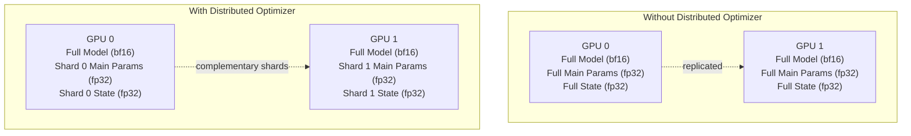
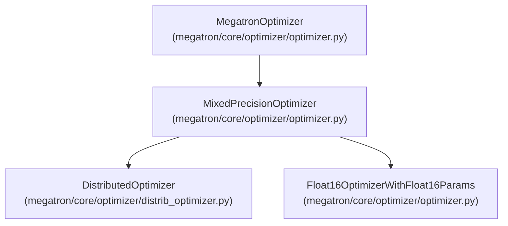
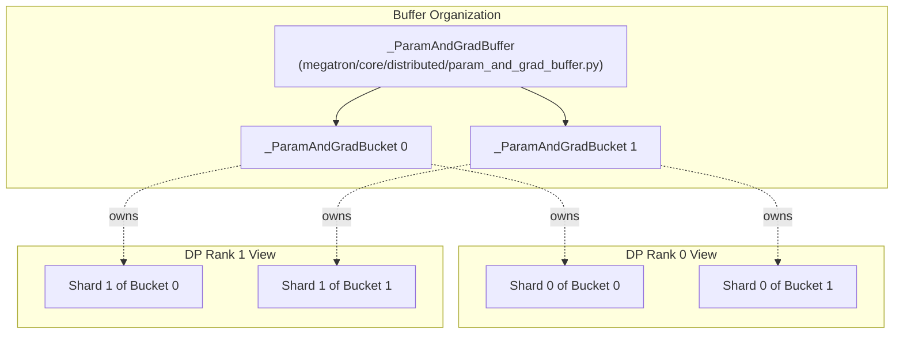
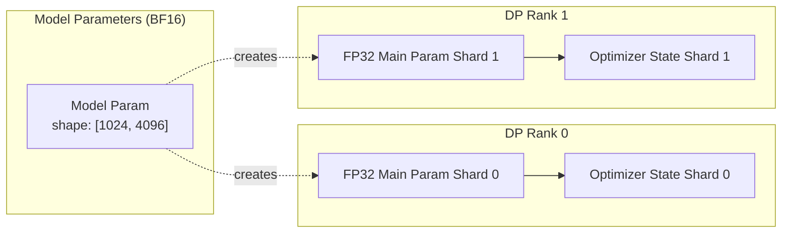
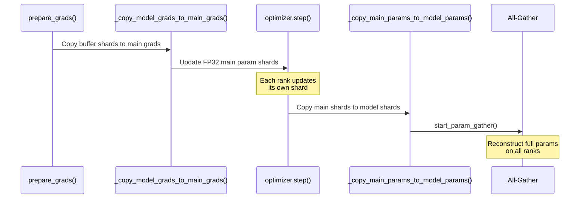
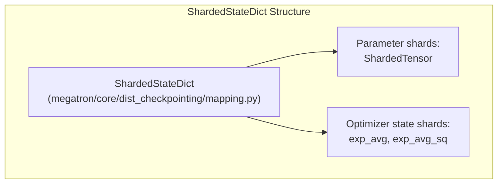

<!-- source: DeepWiki mcp.deepwiki.com · repo NVIDIA/Megatron-LM · page 6.2 Distributed Optimizer · fetched 2026-10-26 -->

# Distributed Optimizer

Relevant source files

The following files were used as context for generating this wiki page:

- [megatron/core/distributed/distributed_data_parallel.py](megatron/core/distributed/distributed_data_parallel.py)
- [megatron/core/distributed/param_and_grad_buffer.py](megatron/core/distributed/param_and_grad_buffer.py)
- [megatron/core/fp8_utils.py](megatron/core/fp8_utils.py)
- [megatron/core/optimizer/__init__.py](megatron/core/optimizer/__init__.py)
- [megatron/core/optimizer/clip_grads.py](megatron/core/optimizer/clip_grads.py)
- [megatron/core/optimizer/cpu_offloading/README.md](megatron/core/optimizer/cpu_offloading/README.md)
- [megatron/core/optimizer/cpu_offloading/__init__.py](megatron/core/optimizer/cpu_offloading/__init__.py)
- [megatron/core/optimizer/cpu_offloading/hybrid_optimizer.py](megatron/core/optimizer/cpu_offloading/hybrid_optimizer.py)
- [megatron/core/optimizer/distrib_optimizer.py](megatron/core/optimizer/distrib_optimizer.py)
- [megatron/core/optimizer/optimizer.py](megatron/core/optimizer/optimizer.py)
- [megatron/core/optimizer/optimizer_config.py](megatron/core/optimizer/optimizer_config.py)
- [tests/unit_tests/distributed/test_param_and_grad_buffer.py](tests/unit_tests/distributed/test_param_and_grad_buffer.py)
- [tests/unit_tests/test_fp8_param.py](tests/unit_tests/test_fp8_param.py)
- [tests/unit_tests/test_fp8_utils.py](tests/unit_tests/test_fp8_utils.py)
- [tests/unit_tests/test_optimizer.py](tests/unit_tests/test_optimizer.py)
- [tests/unit_tests/test_optimizer_cpu_offloading.py](tests/unit_tests/test_optimizer_cpu_offloading.py)
- [tests/unit_tests/transformer/test_module.py](tests/unit_tests/transformer/test_module.py)

## Purpose and Scope

The Distributed Optimizer is a memory-efficient optimizer implementation that shards optimizer state (master parameters, momentum, and variance) across data-parallel ranks. This reduces per-GPU memory consumption and enables training of larger models. The system is tightly integrated with the gradient buffer infrastructure and `DistributedDataParallel` (DDP) to coordinate parameter updates across ranks.

For information about the base optimizer architecture and non-distributed optimizers, see [Optimizer Architecture](6.1). For gradient scaling and mixed precision, see [Gradient Scaling and Mixed Precision](6.3). For the parameter and gradient buffer infrastructure, see [Parameter and Gradient Buffers](6.4).

**Sources:** [megatron/core/optimizer/distrib_optimizer.py:1-123](), [megatron/core/optimizer/optimizer.py:1-55]()

---

## Overview

The Distributed Optimizer reduces memory by distributing optimizer state across data-parallel ranks rather than replicating it on every GPU. Each rank owns a shard of the optimizer state and is responsible for:
1. Reducing its shard of gradients via reduce-scatter.
2. Updating its shard of FP32 main parameters.
3. Broadcasting updated parameters back to all ranks via all-gather.

This approach is particularly effective for Adam-like optimizers which maintain two state tensors (momentum and variance) per parameter, effectively requiring 3x the model parameter memory (FP32 main params + 2x FP32 state).

### Distributed Memory Diagram

**Memory Savings:** With data parallelism size N, the distributed optimizer reduces optimizer state memory by approximately N×, as each rank stores only 1/N of the state.

**Sources:** [megatron/core/optimizer/distrib_optimizer.py:114-123](), [megatron/core/optimizer/distrib_optimizer.py:459-600]()

---

## Architecture and Key Components

### Class Hierarchy

The `DistributedOptimizer` inherits from `MixedPrecisionOptimizer` to handle mixed-precision logic while adding sharding capabilities.

**Sources:** [megatron/core/optimizer/optimizer.py:182-205](), [megatron/core/optimizer/optimizer.py:438-442](), [megatron/core/optimizer/distrib_optimizer.py:113-131]()

### Core Data Structures

The Distributed Optimizer uses several key data structures to manage parameter sharding:

| Data Structure | Purpose | Location |
|---------------|---------|----------|
| `Range` | Represents start/end indices for a shard from a full tensor | [megatron/core/optimizer/distrib_optimizer.py:78-111]() |
| `gbuf_ranges` | Maps parameters to gradient buffer shard ranges per bucket | [megatron/core/optimizer/distrib_optimizer.py:551-571]() |
| `param_gbuf_map` | Maps parameters to (buffer_idx, dtype, bucket_idx) | [megatron/core/optimizer/distrib_optimizer.py:240-258]() |
| `model_float16_groups` | Original BF16/FP16 model parameters | [megatron/core/optimizer/distrib_optimizer.py:592-600]() |
| `shard_float16_groups` | Shards of model parameters owned by this rank | [megatron/core/optimizer/distrib_optimizer.py:593-600]() |
| `shard_fp32_from_float16_groups` | FP32 main parameter shards updated by optimizer | [megatron/core/optimizer/distrib_optimizer.py:597-600]() |

**Sources:** [megatron/core/optimizer/distrib_optimizer.py:78-111](), [megatron/core/optimizer/distrib_optimizer.py:459-600]()

---

## Parameter and Gradient Buffer Infrastructure

The Distributed Optimizer operates on contiguous parameter and gradient buffers managed by `_ParamAndGradBuffer`. This infrastructure organizes parameters into buckets for efficient communication.

### Buffer Sharding Strategy

Each `_ParamAndGradBuffer` is conceptually divided into `data_parallel_world_size` contiguous regions. The `DistributedOptimizer` determines which parameters (or parameter sub-ranges) each DP rank owns:

1. **Bucket Division:** Each bucket in the buffer is divided into equal-sized shards via `shard_buffer` [megatron/core/distributed/param_and_grad_buffer.py:69-78]().
2. **Parameter Mapping:** Parameters may span bucket boundaries; each rank computes which sub-range it owns.
3. **Range Calculation:** The `_build_model_gbuf_param_range_map` method computes four ranges per parameter [megatron/core/optimizer/distrib_optimizer.py:134-231]():
   - `gbuf_world`: Parameter's range in the global buffer.
   - `gbuf_world_in_bucket`: Parameter's range within its bucket.
   - `gbuf_local`: Parameter's range in the local rank's shard.
   - `param`: The sub-range within the parameter itself.

**Sources:** [megatron/core/optimizer/distrib_optimizer.py:134-231](), [megatron/core/distributed/param_and_grad_buffer.py:69-78]()

---

## Main Parameter Sharding

The Distributed Optimizer creates FP32 "main parameters" for each FP16/BF16 model parameter, sharded across DP ranks. This is handled by `_build_model_and_main_param_groups`.

### Shard Creation Process

The `_build_model_and_main_param_groups` method [megatron/core/optimizer/distrib_optimizer.py:306-457]():

1. **Iterates through optimizer groups:** Processes each parameter group defined in the optimizer config.
2. **Extracts parameter shard:** Uses the `param_range` from `gbuf_ranges` to slice the parameter [megatron/core/optimizer/distrib_optimizer.py:368-370]().
3. **Creates FP32 main param shard:** Clones and converts the shard to FP32 [megatron/core/optimizer/distrib_optimizer.py:377-399]().
4. **Links model param to main param:** Sets `model_param.main_param = shard_main_param` [megatron/core/optimizer/distrib_optimizer.py:411-412]().
5. **Updates optimizer param groups:** Replaces model params with main param shards in the underlying base optimizer.

**Sources:** [megatron/core/optimizer/distrib_optimizer.py:306-457]()

---

## Training Workflow

### Optimizer Step

The optimizer step is executed after gradient reduction. Each rank updates only its shard of parameters.

**Key Methods:**

1. **`prepare_grads()`** [megatron/core/optimizer/optimizer.py:524-558](): Prepares gradients for the optimizer step, including scaling and clipping.
2. **`_copy_model_grads_to_main_grads()`** [megatron/core/optimizer/distrib_optimizer.py:935-1035](): Copies gradient shards from the communication buffer to main param shards.
3. **`_copy_main_params_to_model_params()`** [megatron/core/optimizer/distrib_optimizer.py:1037-1154](): Copies updated main param shards back to model params and initiates all-gather.

**Sources:** [megatron/core/optimizer/optimizer.py:524-625](), [megatron/core/optimizer/distrib_optimizer.py:935-1154]()

---

## State Management and Checkpointing

### Sharded State Dict

The Distributed Optimizer's `sharded_state_dict()` provides a view of the optimizer state mapped to the model's parameter structure, enabling flexible resharding during checkpoint loading.

**Key Methods:**

- **`sharded_state_dict()`** [megatron/core/optimizer/distrib_optimizer.py:1156-1364](): Returns fully distributed state dict for distributed checkpointing. It uses `ShardedTensor` to describe how each optimizer state shard maps to the global model state.
- **`load_state_dict()`** [megatron/core/optimizer/distrib_optimizer.py:690-819](): Loads standard state dict (parameter state loaded separately).

**Sources:** [megatron/core/optimizer/distrib_optimizer.py:628-819](), [megatron/core/optimizer/distrib_optimizer.py:1156-1364]()

---

## Advanced Features

### FP8 and FP4 Parameter Support

The Distributed Optimizer handles specialized quantization formats during parameter management. When using FP8 or NVFP4 parameters, the optimizer maintains FP32 master weights but updates the sharded model weights in their target precision.

- **FP8 Quantization:** Handled via `quantize_param_shard` [megatron/core/optimizer/distrib_optimizer.py:61]() and [megatron/core/fp8_utils.py:203-292]().
- **NVFP4 Quantization:** Handled via `quantize_nvfp4_param_shard` [megatron/core/optimizer/distrib_optimizer.py:55]().

**Sources:** [megatron/core/optimizer/distrib_optimizer.py:55-61](), [megatron/core/optimizer/distrib_optimizer.py:1099-1123](), [megatron/core/fp8_utils.py:203-292]()

### Gradient Clipping

Gradient clipping is performed in FP32 precision. The `DistributedOptimizer` ensures gradient norms are reduced across the appropriate process group since gradients are sharded.

- **`clip_grad_by_total_norm_fp32`**: Clips gradients in-place based on a calculated total norm [megatron/core/optimizer/clip_grads.py:143-183]().
- **`get_grad_norm_fp32`**: Calculates the p-norm of gradients, handling model-parallel and data-parallel reductions [megatron/core/optimizer/clip_grads.py:55-140]().

**Sources:** [megatron/core/optimizer/clip_grads.py:55-183](), [megatron/core/optimizer/distrib_optimizer.py:821-837]()

### Precision-Aware Optimizer

If `use_precision_aware_optimizer` is enabled in `OptimizerConfig`, the optimizer allows related tensors like master parameters and optimizer states to be set to lower precision to further reduce memory footprint [megatron/core/optimizer/optimizer_config.py:187-190]().

**Sources:** [megatron/core/optimizer/optimizer_config.py:187-190](), [megatron/core/optimizer/optimizer.py:153-157]()

### CPU Offloading

The `HybridDeviceOptimizer` allows for offloading a fraction of the optimizer updates to the CPU. It manages two sub-optimizers (one for GPU, one for CPU) and handles the necessary data transfers (D2H for gradients, H2D for updated parameters) asynchronously to overlap computation and communication [megatron/core/optimizer/cpu_offloading/hybrid_optimizer.py:14-43]().

**Sources:** [megatron/core/optimizer/cpu_offloading/hybrid_optimizer.py:14-165]()

---

