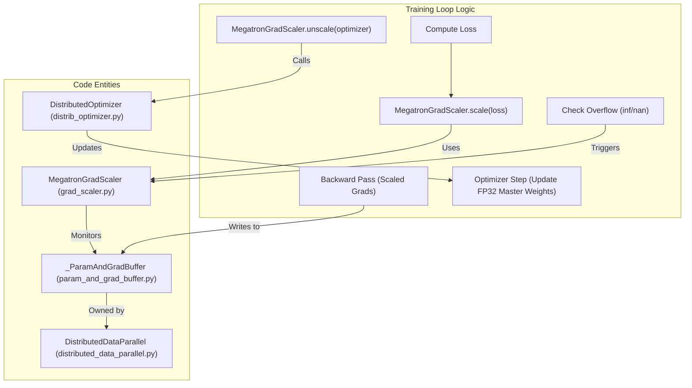
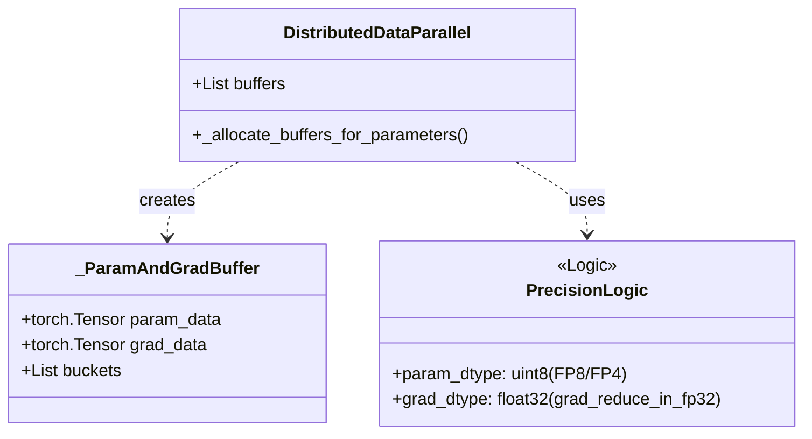

<!-- source: DeepWiki mcp.deepwiki.com · repo NVIDIA/Megatron-LM · page 6.3 Gradient Scaling and Mixed Precision · fetched 2026-10-26 -->

# Gradient Scaling and Mixed Precision

Relevant source files

The following files were used as context for generating this wiki page:

- [megatron/core/distributed/distributed_data_parallel.py](megatron/core/distributed/distributed_data_parallel.py)
- [megatron/core/distributed/param_and_grad_buffer.py](megatron/core/distributed/param_and_grad_buffer.py)
- [megatron/core/enums.py](megatron/core/enums.py)
- [megatron/core/fp4_utils.py](megatron/core/fp4_utils.py)
- [megatron/core/fp8_utils.py](megatron/core/fp8_utils.py)
- [megatron/core/optimizer/__init__.py](megatron/core/optimizer/__init__.py)
- [megatron/core/optimizer/clip_grads.py](megatron/core/optimizer/clip_grads.py)
- [megatron/core/optimizer/cpu_offloading/README.md](megatron/core/optimizer/cpu_offloading/README.md)
- [megatron/core/optimizer/cpu_offloading/__init__.py](megatron/core/optimizer/cpu_offloading/__init__.py)
- [megatron/core/optimizer/cpu_offloading/hybrid_optimizer.py](megatron/core/optimizer/cpu_offloading/hybrid_optimizer.py)
- [megatron/core/optimizer/distrib_optimizer.py](megatron/core/optimizer/distrib_optimizer.py)
- [megatron/core/optimizer/optimizer.py](megatron/core/optimizer/optimizer.py)
- [megatron/core/optimizer/optimizer_config.py](megatron/core/optimizer/optimizer_config.py)
- [megatron/core/transformer/enums.py](megatron/core/transformer/enums.py)
- [tests/unit_tests/distributed/test_param_and_grad_buffer.py](tests/unit_tests/distributed/test_param_and_grad_buffer.py)
- [tests/unit_tests/optimizer/test_distrib_optimizer_grouped_quantized.py](tests/unit_tests/optimizer/test_distrib_optimizer_grouped_quantized.py)
- [tests/unit_tests/test_fp8_param.py](tests/unit_tests/test_fp8_param.py)
- [tests/unit_tests/test_fp8_utils.py](tests/unit_tests/test_fp8_utils.py)
- [tests/unit_tests/test_optimizer.py](tests/unit_tests/test_optimizer.py)
- [tests/unit_tests/test_optimizer_cpu_offloading.py](tests/unit_tests/test_optimizer_cpu_offloading.py)
- [tests/unit_tests/transformer/test_module.py](tests/unit_tests/transformer/test_module.py)

## Purpose and Scope

This page documents gradient scaling mechanisms and mixed precision training support in Megatron-LM. It covers the implementation of gradient scalers, support for various floating-point formats (FP16, BF16, FP8, FP4), and the integration between the training loop, distributed optimizer, and contiguous buffers.

## Overview

Gradient scaling is a technique used primarily in FP16 mixed precision training to prevent gradient underflow. Megatron-LM provides robust scaling strategies and extensive support for lower-precision formats to reduce memory footprint and increase throughput while maintaining numerical stability.

### Gradient Scaling Strategy
1.  **Constant Scaling**: Uses a fixed scaling factor throughout training, typically used for BF16 or FP32 where dynamic range is less of a concern [megatron/core/optimizer/grad_scaler.py:50-90]().
2.  **Dynamic Scaling**: Automatically adjusts the scaling factor based on gradient overflow (inf/NaN) detection, essential for FP16 [megatron/core/optimizer/grad_scaler.py:93-165]().

Title: Mixed Precision Training Data Flow

Sources: [megatron/core/optimizer/grad_scaler.py:12-47](), [megatron/core/optimizer/optimizer.py:53-54](), [megatron/core/distributed/distributed_data_parallel.py:87-107]()

## Gradient Scaler Implementations

### MegatronGradScaler Base Class
The `MegatronGradScaler` abstract base class defines the interface for all gradient scalers in Megatron Core [megatron/core/optimizer/grad_scaler.py:12-47]().

| Method | Purpose |
|--------|---------|
| `scale(loss)` | Multiplies the loss by the current scale factor before the backward pass [megatron/core/optimizer/grad_scaler.py:27-31](). |
| `unscale(optimizer)` | Divides gradients by the scale factor before the optimizer step. Returns `True` if overflow is found [megatron/core/optimizer/grad_scaler.py:33-39](). |
| `update()` | Updates the scaling factor based on the presence of overflows in the current step [megatron/core/optimizer/grad_scaler.py:41-43](). |

### DynamicGradScaler
The `DynamicGradScaler` manages a dynamic `loss_scale`. If an overflow is detected during `unscale`, the optimizer step is skipped, and the scale is reduced by a `backoff_factor`. Conversely, if no overflows occur for a `loss_scale_window`, the scale is increased by a `growth_factor` [megatron/core/optimizer/grad_scaler.py:93-165]().

Sources: [megatron/core/optimizer/grad_scaler.py:12-165]()

## Mixed Precision Training Modes

Megatron-LM supports multiple precisions configured via `OptimizerConfig` [megatron/core/optimizer/optimizer_config.py:139-200]().

### FP16 and BF16
- **FP16**: 16-bit precision with a narrow dynamic range. Requires `DynamicGradScaler` to prevent underflow [megatron/core/optimizer/optimizer_config.py:174-176]().
- **BF16**: 16-bit precision with the same exponent range as FP32. Often uses a `ConstantGradScaler` with a factor of 1.0 [megatron/core/optimizer/optimizer_config.py:177-179]().

### FP8 and FP4 (Transformer Engine Integration)
Megatron-LM utilizes NVIDIA Transformer Engine (TE) for ultra-low precision support.
- **FP8**: Supports recipes like `delayed` and `mxfp8` [megatron/core/enums.py:12-19](). Megatron Core provides utility functions to identify these tensors such as `is_float8tensor` and `is_mxfp8tensor` [megatron/core/fp8_utils.py:122-136]().
- **FP4**: Support for `nvfp4` formats, including row-wise packed shapes for parameter shards [megatron/core/fp4_utils.py:23-29](), [megatron/core/distributed/param_and_grad_buffer.py:23-29](), [megatron/core/enums.py:22-26]().

Title: Precision Mapping in Parameter and Gradient Buffers

Sources: [megatron/core/distributed/distributed_data_parallel.py:109-152](), [megatron/core/distributed/param_and_grad_buffer.py:92-141]()

## Precision and Buffer Management

### Contiguous Buffers and DDP
The `DistributedDataParallel` (DDP) class manages contiguous buffers for parameters and gradients via `_ParamAndGradBuffer`. 
- **Grad Reduction Precision**: Controlled by `grad_reduce_in_fp32`. If true, gradients are accumulated and reduced in FP32 even if parameters are in lower precision [megatron/core/distributed/distributed_data_parallel.py:92-93]().
- **Low-Precision Parameters**: For FP8 and FP4, parameters are stored in the buffer with special handling for their underlying storage via `modify_underlying_storage` and `modify_nvfp4_rowwise_storage` [megatron/core/distributed/param_and_grad_buffer.py:23-40]().

### Distributed Optimizer Sharding
The `DistributedOptimizer` shards optimizer states across data-parallel ranks [megatron/core/optimizer/distrib_optimizer.py:113-123]().
- **Precision-Aware Optimizer**: If `use_precision_aware_optimizer` is enabled, optimizer states and master parameters can be stored in lower precision to save memory [megatron/core/optimizer/optimizer_config.py:187-190]().
- **Remainder Storage**: `store_param_remainders` allows storing the 16-bit FP32 remainders in the optimizer state when using BF16 master weights to maintain FP32 accuracy [megatron/core/optimizer/optimizer_config.py:192-195]().
- **FP8/FP4 Quantization**: The optimizer handles quantization of parameter shards for FP8 and FP4 during the update step using `quantize_param_shard` and `quantize_nvfp4_param_shard` [megatron/core/optimizer/distrib_optimizer.py:55-62]().

## Gradient Finalization and Clipping

### Finalizing Gradients
Before the optimizer step, gradients are finalized across parallel groups.
- **Shared Parameters**: The optimizer filters shared parameters using `param_is_not_shared` to avoid double-counting gradients during norm calculation [megatron/core/optimizer/optimizer.py:50-50](), [megatron/core/optimizer/clip_grads.py:51-51]().
- **TP Duplicate Filtering**: Gradients from tensor-parallel replicas are filtered out using `param_is_not_tensor_parallel_duplicate` [megatron/core/optimizer/clip_grads.py:50-50]().

### Gradient Clipping
Megatron-LM supports clipping gradients by their total norm in FP32 to ensure stability.
- **`get_grad_norm_fp32`**: Calculates the p-norm across all parallel groups (TP, DP, PP). It handles DTensors by reducing across the appropriate process groups [megatron/core/optimizer/clip_grads.py:55-140]().
- **`clip_grad_by_total_norm_fp32`**: Scales gradients in-place if the total norm exceeds `max_norm`. It supports both standard `.grad` and `.decoupled_grad` attributes [megatron/core/optimizer/clip_grads.py:143-183]().

Sources:
- [megatron/core/optimizer/grad_scaler.py:1-165]()
- [megatron/core/optimizer/optimizer.py:50-80]()
- [megatron/core/optimizer/distrib_optimizer.py:50-123]()
- [megatron/core/distributed/distributed_data_parallel.py:87-152]()
- [megatron/core/distributed/param_and_grad_buffer.py:23-141]()
- [megatron/core/optimizer/clip_grads.py:50-183]()
- [megatron/core/optimizer/optimizer_config.py:139-200]()
- [megatron/core/enums.py:12-26]()
- [megatron/core/fp8_utils.py:122-151]()

---

