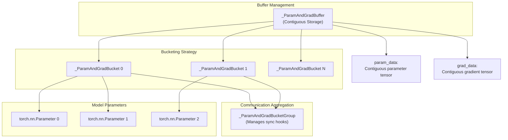
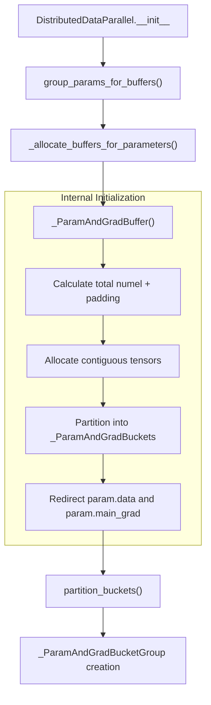

<!-- source: DeepWiki mcp.deepwiki.com · repo NVIDIA/Megatron-LM · page 6.4 Parameter and Gradient Buffers · fetched 2026-10-26 -->

# Parameter and Gradient Buffers

Relevant source files

The following files were used as context for generating this wiki page:

- [megatron/core/distributed/distributed_data_parallel.py](megatron/core/distributed/distributed_data_parallel.py)
- [megatron/core/distributed/finalize_model_grads.py](megatron/core/distributed/finalize_model_grads.py)
- [megatron/core/distributed/param_and_grad_buffer.py](megatron/core/distributed/param_and_grad_buffer.py)
- [megatron/core/fp8_utils.py](megatron/core/fp8_utils.py)
- [megatron/core/optimizer/__init__.py](megatron/core/optimizer/__init__.py)
- [megatron/core/optimizer/clip_grads.py](megatron/core/optimizer/clip_grads.py)
- [megatron/core/optimizer/cpu_offloading/README.md](megatron/core/optimizer/cpu_offloading/README.md)
- [megatron/core/optimizer/cpu_offloading/__init__.py](megatron/core/optimizer/cpu_offloading/__init__.py)
- [megatron/core/optimizer/cpu_offloading/hybrid_optimizer.py](megatron/core/optimizer/cpu_offloading/hybrid_optimizer.py)
- [megatron/core/optimizer/distrib_optimizer.py](megatron/core/optimizer/distrib_optimizer.py)
- [megatron/core/optimizer/optimizer.py](megatron/core/optimizer/optimizer.py)
- [megatron/core/optimizer/optimizer_config.py](megatron/core/optimizer/optimizer_config.py)
- [tests/unit_tests/distributed/test_finalize_model_grads.py](tests/unit_tests/distributed/test_finalize_model_grads.py)
- [tests/unit_tests/distributed/test_param_and_grad_buffer.py](tests/unit_tests/distributed/test_param_and_grad_buffer.py)
- [tests/unit_tests/test_fp8_param.py](tests/unit_tests/test_fp8_param.py)
- [tests/unit_tests/test_fp8_utils.py](tests/unit_tests/test_fp8_utils.py)
- [tests/unit_tests/test_optimizer.py](tests/unit_tests/test_optimizer.py)
- [tests/unit_tests/test_optimizer_cpu_offloading.py](tests/unit_tests/test_optimizer_cpu_offloading.py)
- [tests/unit_tests/transformer/test_module.py](tests/unit_tests/transformer/test_module.py)

## Purpose and Scope

This document describes the contiguous buffer architecture used in Megatron-LM for efficient storage and communication of model parameters and gradients. The buffer system is fundamental to data-parallel gradient reduction, the distributed optimizer's sharding strategy, and memory-efficient mixed-precision training.

**Scope**: This page covers the `_ParamAndGradBuffer`, `_ParamAndGradBucket`, and `_ParamAndGradBucketGroup` classes, their organization, and how they integrate with distributed training. For information about:
- Gradient scaling and mixed precision: see [6.3 Gradient Scaling and Mixed Precision]()
- Distributed optimizer state management: see [6.2 Distributed Optimizer]()
- Data parallelism strategies: see [4.4 Data Parallelism and DistributedDataParallel]()

## Overview

The parameter and gradient buffer system stores model parameters and their gradients in **contiguous memory buffers** rather than leaving them scattered across individual parameter tensors. This design enables:

1. **Efficient Communication**: Contiguous buffers allow for single, large communication operations instead of many small ones. [megatron/core/distributed/param_and_grad_buffer.py:69-78]()
2. **Overlap Opportunities**: Large buffers are partitioned into buckets to overlap communication with computation during backpropagation. [megatron/core/distributed/distributed_data_parallel.py:89-93]()
3. **Memory Efficiency**: Reduces fragmentation and enables gradient accumulation in a type other than the parameter type (e.g., FP32 accumulation for BF16 models). [megatron/core/distributed/distributed_data_parallel.py:91-93]()
4. **Distributed Optimizer Support**: Provides clean parameter sharding and range-based indexing for optimizer state distribution. [megatron/core/distributed/distrib_optimizer.py:140-157]()

**Key Design Principle**: Each buffer manages parameters and gradients of a **single dtype pair** (parameter dtype + gradient dtype). Multiple buffers coexist when a model contains mixed precision components or Mixture of Experts (MoE) parameters. [megatron/core/distributed/distributed_data_parallel.py:126-129]()

Sources: [megatron/core/distributed/param_and_grad_buffer.py:60-78](), [megatron/core/distributed/distributed_data_parallel.py:87-107]()

## Buffer Architecture

The buffer system uses a three-level hierarchy to manage the lifecycle of parameters and gradients.

### Code Entity Space to System Architecture
This diagram associates the internal classes in `megatron/core/distributed/param_and_grad_buffer.py` with the logical hierarchy of the training system.

**Hierarchy Explanation**:

- **`_ParamAndGradBuffer`**: Top-level container managing all parameters of a specific dtype pair. It allocates two large contiguous tensors (`param_data` and `grad_data`) and organizes them into buckets. [megatron/core/distributed/param_and_grad_buffer.py:648-662]()
- **`_ParamAndGradBucket`**: A contiguous slice of the buffer containing a subset of parameters. Buckets enable bucketing policies for communication overlap. Each bucket tracks views into the larger buffer and per-parameter offsets. [megatron/core/distributed/param_and_grad_buffer.py:92-123]()
- **`_ParamAndGradBucketGroup`**: Aggregates multiple buckets (potentially from different buffers) to enable coalesced communication. This is critical for MoE where expert and non-expert parameters reside in different buffers but require synchronized sync calls. [megatron/core/distributed/param_and_grad_buffer.py:179-183]()

Sources: [megatron/core/distributed/param_and_grad_buffer.py:92-123](), [megatron/core/distributed/param_and_grad_buffer.py:179-200](), [megatron/core/distributed/param_and_grad_buffer.py:648-665]()

### Key Data Structures

#### _ParamAndGradBuffer Fields
Defined in [megatron/core/distributed/param_and_grad_buffer.py:648-760]().

| Field | Type | Description |
|-------|------|-------------|
| `param_data` | `torch.Tensor` | Contiguous buffer storing flattened parameters. [megatron/core/distributed/param_and_grad_buffer.py:650]() |
| `grad_data` | `torch.Tensor` | Contiguous buffer storing flattened gradients. [megatron/core/distributed/param_and_grad_buffer.py:651]() |
| `buckets` | `List[_ParamAndGradBucket]` | List of bucket objects partitioning the buffer. [megatron/core/distributed/param_and_grad_buffer.py:652]() |
| `param_index_map` | `Dict[Parameter, Tuple]` | Maps each parameter to (start, end, bucket_id) indices in the global buffer. [megatron/core/distributed/param_and_grad_buffer.py:653]() |
| `param_dtype` | `torch.dtype` | Data type of parameters in this buffer. [megatron/core/distributed/param_and_grad_buffer.py:656]() |
| `grad_dtype` | `torch.dtype` | Data type of gradients in this buffer. [megatron/core/distributed/param_and_grad_buffer.py:657]() |

#### _ParamAndGradBucket Fields
Defined in [megatron/core/distributed/param_and_grad_buffer.py:92-123]().

| Field | Type | Description |
|-------|------|-------------|
| `params_list` | `List[Parameter]` | Original model parameters in this bucket. [megatron/core/distributed/param_and_grad_buffer.py:124]() |
| `param_data` | `torch.Tensor` | View into buffer's `param_data` for this bucket. [megatron/core/distributed/param_and_grad_buffer.py:128]() |
| `grad_data` | `torch.Tensor` | View into buffer's `grad_data` for this bucket. [megatron/core/distributed/param_and_grad_buffer.py:129]() |
| `offset` | `int` | Starting offset of this bucket in the full buffer. [megatron/core/distributed/param_and_grad_buffer.py:132]() |
| `numel_unpadded` | `int` | Number of unpadded elements in bucket. [megatron/core/distributed/param_and_grad_buffer.py:133]() |
| `param_to_index` | `Dict[Parameter, Tuple]` | Bucket-local offsets: `param -> (start, end)`. [megatron/core/distributed/param_and_grad_buffer.py:137-140]() |

Sources: [megatron/core/distributed/param_and_grad_buffer.py:92-123](), [megatron/core/distributed/param_and_grad_buffer.py:648-662]()

## Buffer Creation and Initialization

The initialization process transforms standard `torch.nn.Module` parameters into a contiguous memory layout managed by `DistributedDataParallel`.

### Initialization Flow

1. **Parameter Grouping**: Parameters are grouped by their `(param_dtype, grad_dtype, is_expert_parallel)` triplet using `group_params_for_buffers`. [megatron/core/distributed/distributed_data_parallel.py:127]()
2. **Buffer Allocation**: `_ParamAndGradBuffer` calculates total size needed, padded to ensure divisibility by the Data Parallel (DP) world size and alignment requirements. [megatron/core/distributed/param_and_grad_buffer.py:770-784]()
3. **Bucket Creation**: The buffer is partitioned based on `ddp_config.bucket_size`. If `overlap_grad_reduce` is disabled, `bucket_size` is set to `None` (infinity), forcing parameters into a single bucket. [megatron/core/distributed/distributed_data_parallel.py:133-137]()
4. **Gradient Redirection**: For each parameter, `param.main_grad` is set to point to the corresponding slice in the contiguous `grad_data`. This ensures that when gradients are accumulated, they write directly into the buffer. [megatron/core/distributed/param_and_grad_buffer.py:910-916]()
5. **Bucket Group Formation**: `partition_buckets` aggregates buckets across different buffers to allow coalesced communication. [megatron/core/distributed/param_and_grad_buffer.py:1288-1300]()

Sources: [megatron/core/distributed/distributed_data_parallel.py:109-151](), [megatron/core/distributed/param_and_grad_buffer.py:770-790](), [megatron/core/distributed/param_and_grad_buffer.py:1288-1354]()

## Gradient Accumulation and Communication

### Backward Hook Mechanism

Each parameter has a backward hook registered during DDP initialization via `_register_grad_accumulation_hooks`. [megatron/core/distributed/distributed_data_parallel.py:440-448]()

1. **Accumulation**: When a gradient is computed, the hook `_make_param_hook` is triggered. It adds `param.grad` to `param.main_grad` (the buffer slice). [megatron/core/distributed/distributed_data_parallel.py:317-325]()
2. **Cleanup**: `param.grad` is set to `None` to free the temporary gradient memory. [megatron/core/distributed/distributed_data_parallel.py:326]()
3. **Registration**: The hook calls `bucket_group.register_grad_ready(param)`. [megatron/core/distributed/distributed_data_parallel.py:345]()
4. **Communication Dispatch**: When the count of ready parameters matches the total parameters in a `_ParamAndGradBucketGroup`, `start_grad_sync()` is automatically launched. [megatron/core/distributed/param_and_grad_buffer.py:550-570]()

### Communication Operations

The `start_grad_sync()` method handles the collective operations: [megatron/core/distributed/param_and_grad_buffer.py:387-395]()

- **Distributed Optimizer**: Uses `reduce_scatter` to shard gradients across DP ranks. This is often optimized using `reduce_scatter_tensor` (or `_reduce_scatter_base` in older Torch versions). [megatron/core/distributed/param_and_grad_buffer.py:428-431](), [megatron/core/distributed/param_and_grad_buffer.py:50-57]()
- **Standard Optimizer**: Uses `all_reduce` to replicate full gradients on all ranks. [megatron/core/distributed/param_and_grad_buffer.py:448-450]()
- **Scaling**: Applies `gradient_scaling_factor` (e.g., `1/dp_size`) before communication to perform averaging. [megatron/core/distributed/param_and_grad_buffer.py:411-416]()

Sources: [megatron/core/distributed/distributed_data_parallel.py:317-345](), [megatron/core/distributed/param_and_grad_buffer.py:387-452](), [megatron/core/distributed/param_and_grad_buffer.py:550-570]()

## Advanced Optimization Features

### Communication Overlap
- **`overlap_grad_reduce`**: Overlaps gradient reduction with backward computation by partitioning parameters into multiple buckets. [megatron/core/distributed/distributed_data_parallel.py:89-93]()
- **Layer-wise Optimizer**: Supports async parameter all-gather during the forward pass by tracking per-rank parameter lists in `_ParamAndGradBucket`. [megatron/core/distributed/param_and_grad_buffer.py:148-160]()

### Numerical Stability and Performance
- **FP32 Accumulation**: `reduce_scatter_with_fp32_accumulation` allows lower-precision parameters while performing accumulation in FP32 locally for higher numerical stability. [megatron/core/distributed/param_and_grad_buffer.py:44-44]()
- **NCCL Allocator**: Uses `nccl_allocator` for memory management when specialized communication buffers are required. [megatron/core/distributed/param_and_grad_buffer.py:17-17]()
- **Alignment**: 
    - **FP8**: Parameters and buffers are padded to satisfy alignment requirements for optimized kernels (e.g., 32 for MXFP8). [megatron/core/fp8_utils.py:181-190]()
    - **Distributed Optimizer**: Buffers are padded to be even multiples of the DP world size and aligned to 128 bytes to ensure clean sharding and performance. [megatron/core/distributed/param_and_grad_buffer.py:770-784](), [megatron/core/optimizer/distrib_optimizer.py:133-138]()

Sources: [megatron/core/distributed/param_and_grad_buffer.py:17-46](), [megatron/core/distributed/param_and_grad_buffer.py:148-160](), [megatron/core/optimizer/distrib_optimizer.py:133-162](), [megatron/core/fp8_utils.py:181-190]()

---

