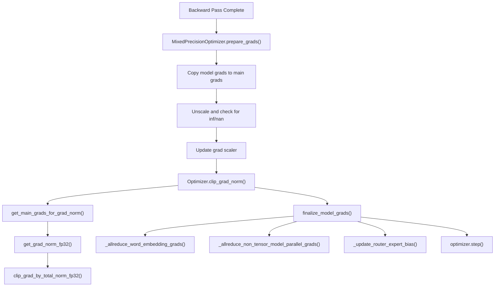
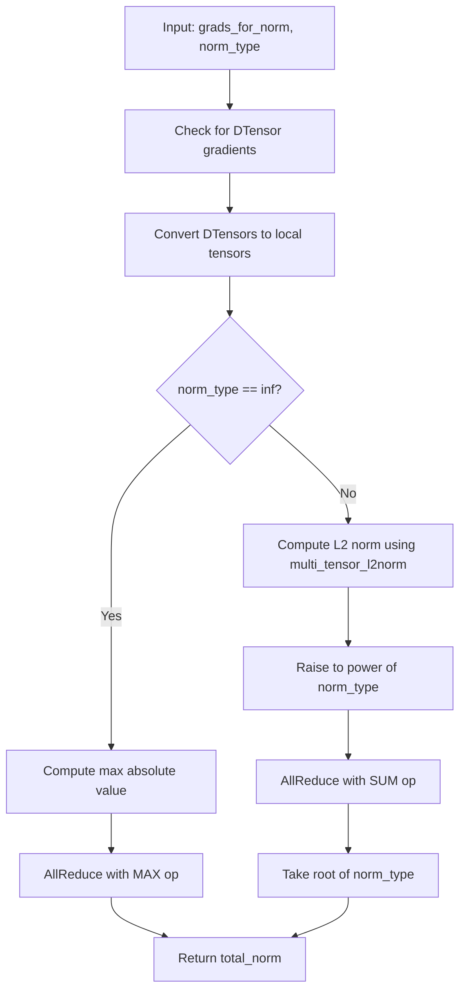
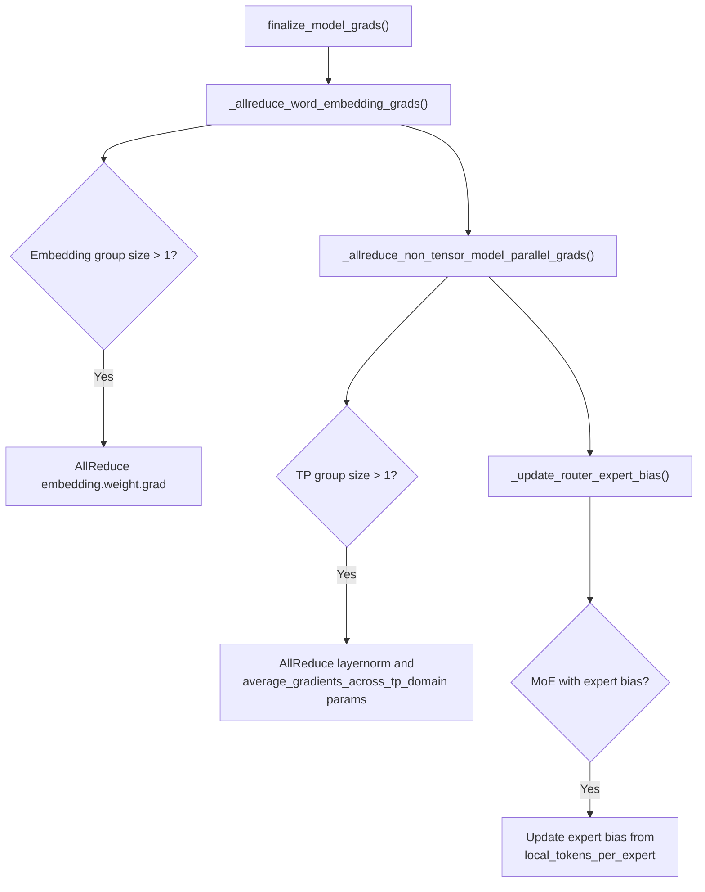

<!-- source: DeepWiki mcp.deepwiki.com · repo NVIDIA/Megatron-LM · page 6.5 Gradient Clipping and Finalization · fetched 2026-10-26 -->

# Gradient Clipping and Finalization

Relevant source files

The following files were used as context for generating this wiki page:

- [megatron/core/distributed/distributed_data_parallel.py](megatron/core/distributed/distributed_data_parallel.py)
- [megatron/core/distributed/finalize_model_grads.py](megatron/core/distributed/finalize_model_grads.py)
- [megatron/core/distributed/param_and_grad_buffer.py](megatron/core/distributed/param_and_grad_buffer.py)
- [megatron/core/fp8_utils.py](megatron/core/fp8_utils.py)
- [megatron/core/optimizer/__init__.py](megatron/core/optimizer/__init__.py)
- [megatron/core/optimizer/clip_grads.py](megatron/core/optimizer/clip_grads.py)
- [megatron/core/optimizer/cpu_offloading/README.md](megatron/core/optimizer/cpu_offloading/README.md)
- [megatron/core/optimizer/cpu_offloading/__init__.py](megatron/core/optimizer/cpu_offloading/__init__.py)
- [megatron/core/optimizer/cpu_offloading/hybrid_optimizer.py](megatron/core/optimizer/cpu_offloading/hybrid_optimizer.py)
- [megatron/core/optimizer/distrib_optimizer.py](megatron/core/optimizer/distrib_optimizer.py)
- [megatron/core/optimizer/optimizer.py](megatron/core/optimizer/optimizer.py)
- [megatron/core/optimizer/optimizer_config.py](megatron/core/optimizer/optimizer_config.py)
- [tests/unit_tests/distributed/test_finalize_model_grads.py](tests/unit_tests/distributed/test_finalize_model_grads.py)
- [tests/unit_tests/distributed/test_param_and_grad_buffer.py](tests/unit_tests/distributed/test_param_and_grad_buffer.py)
- [tests/unit_tests/test_fp8_param.py](tests/unit_tests/test_fp8_param.py)
- [tests/unit_tests/test_fp8_utils.py](tests/unit_tests/test_fp8_utils.py)
- [tests/unit_tests/test_optimizer.py](tests/unit_tests/test_optimizer.py)
- [tests/unit_tests/test_optimizer_cpu_offloading.py](tests/unit_tests/test_optimizer_cpu_offloading.py)
- [tests/unit_tests/transformer/test_module.py](tests/unit_tests/transformer/test_module.py)

This document describes the gradient clipping and finalization mechanisms in Megatron-LM. These operations occur after the backward pass but before the optimizer step, ensuring gradients are properly synchronized across parallel dimensions and scaled appropriately to prevent training instability.

For information about the optimizer architecture and gradient scaling, see [Optimizer Architecture](6.1) and [Gradient Scaling and Mixed Precision](6.3). For details on distributed optimizer state management, see [Distributed Optimizer](6.2).

## Overview

Gradient clipping and finalization involves several critical steps:

1.  **Gradient Norm Computation**: Computing the total norm of gradients across all parameters and parallel ranks.
2.  **Gradient Clipping**: Scaling gradients when the total norm exceeds a threshold.
3.  **Gradient Finalization**: Synchronizing gradients across various parallelism dimensions (TP, PP, DP).
4.  **Embedding Gradient Reduction**: Special handling for shared word or position embedding parameters.
5.  **Expert Bias Updates**: Updating router bias for Mixture-of-Experts (MoE) models based on global token distribution.
6.  **Precision Handling**: Managing `DTensor` sharding for FSDP and precision-aware optimizer gradients.

These operations are coordinated by the optimizer classes and the `finalize_model_grads` function callback mechanism.

Sources: [megatron/core/optimizer/clip_grads.py:1-249](), [megatron/core/distributed/finalize_model_grads.py:1-400](), [megatron/core/optimizer/optimizer.py:196-233]()

## Gradient Clipping Flow

The following diagram illustrates the sequence from the end of the backward pass to the optimizer update.

Title: Gradient Clipping and Finalization Workflow

Sources: [megatron/core/optimizer/optimizer.py:524-625](), [megatron/core/distributed/finalize_model_grads.py:164-187]()

## Gradient Norm Computation

The `get_grad_norm_fp32()` function computes the total norm of gradients. It supports L2 norm and infinity norm.

### Key Components

| Component | Purpose |
| :--- | :--- |
| `get_main_grads_for_grad_norm()` | Filters gradients to include in norm computation, excluding shared params and TP duplicates [megatron/core/optimizer/optimizer.py:140-179](). |
| `get_grad_norm_fp32()` | Computes norm in FP32 and all-reduces across the `grad_stats_parallel_group` [megatron/core/optimizer/clip_grads.py:55-144](). |
| `multi_tensor_l2norm` | Efficient fused kernel for computing L2 norm across multiple tensors [megatron/core/optimizer/optimizer.py:18-38](). |

Title: Gradient Norm Computation Process

Sources: [megatron/core/optimizer/clip_grads.py:55-144](), [megatron/core/optimizer/optimizer.py:140-179]()

## Gradient Clipping

Gradient clipping scales gradients when their total norm exceeds a threshold defined in `OptimizerConfig`.

### Implementation Details
The `clip_grad_by_total_norm_fp32()` function uses `multi_tensor_scale` to perform the scaling.

*   **Coefficient Calculation**: `clip_coeff = max_norm / (total_norm + 1.0e-6)` [megatron/core/optimizer/clip_grads.py:183]().
*   **Application**: If `clip_coeff < 1.0`, all gradients are multiplied by this coefficient using `multi_tensor_applier` [megatron/core/optimizer/clip_grads.py:185-195]().
*   **Decoupled Grads**: Support for `decoupled_grad` (used in Distributed Optimizer or FSDP) is integrated via the `use_decoupled_grad` flag [megatron/core/optimizer/clip_grads.py:171-175]().
*   **Precision Aware Gradients**: For precision-aware optimizers, the gradient is retrieved from `param.decoupled_grad` and handled specifically if it is a DTensor local tensor [megatron/core/optimizer/optimizer.py:153-165]().

Sources: [megatron/core/optimizer/clip_grads.py:147-200](), [megatron/core/optimizer/optimizer.py:153-165](), [megatron/core/optimizer/optimizer.py:204-223]()

## QK Clipping and Separate Norm Groups

Megatron-LM supports separate gradient clipping for specific parameter groups, such as those used in Multi-Token Prediction (MTP).

*   **Separate Norm Groups**: Parameters can be tagged with `GRAD_NORM_GROUP_ATTR`. If tagged, the optimizer computes a separate norm for these groups rather than including them in the global total norm [megatron/core/optimizer/optimizer.py:150-168]().
*   **QK Clipping**: A specialized clipping strategy for Query and Key projections to prevent attention score instability, often used in conjunction with `apply_wd_to_qk_layernorm` in `OptimizerConfig` [megatron/core/optimizer/__init__.py:107-114]().

Sources: [megatron/core/optimizer/optimizer.py:150-168](), [megatron/core/optimizer/__init__.py:107-114]()

## Gradient Finalization

Gradient finalization ensures gradients are properly synchronized across all parallelism dimensions. This is handled by `finalize_model_grads` [megatron/core/distributed/finalize_model_grads.py:164-400]().

### Operations and Logic

Title: Gradient Finalization Logic

### Word Embedding Synchronization
When word embeddings are shared between input and output layers (common in GPT-style models), their gradients must be synchronized across the first and last pipeline stages.
*   **Process Group**: Uses `parallel_state.get_embedding_group()` or a provided `embd_group` [megatron/core/distributed/finalize_model_grads.py:164-202]().
*   **MTP Support**: Also handles Multi-Token Prediction (MTP) where embeddings are shared differently [megatron/core/distributed/finalize_model_grads.py:132-148]().
*   **Conditional Embeddings**: Synchronizes gradients for replicated embedders (e.g., in diffusion models) across PP stages using `_allreduce_conditional_embedding_grads` [megatron/core/distributed/finalize_model_grads.py:89-131]().

Sources: [megatron/core/distributed/finalize_model_grads.py:164-202](), [megatron/core/distributed/finalize_model_grads.py:89-131](), [megatron/core/distributed/finalize_model_grads.py:132-148]()

### Tensor Parallel Gradient Reduction
Parameters that are not tensor-parallelized (like LayerNorm weights) but exist on all TP ranks must have their gradients reduced.
*   **Average Reduction**: Used for parameters with `average_gradients_across_tp_domain=True` [megatron/core/distributed/finalize_model_grads.py:355]().
*   **Sum Reduction**: Used for parameters when `sequence_parallel` is enabled [megatron/core/distributed/finalize_model_grads.py:358]().

Sources: [megatron/core/distributed/finalize_model_grads.py:322-399]()

## MoE Router Bias Update

For MoE models, the router bias is updated based on the global token distribution to prevent expert collapse and improve load balancing.
*   **Update Mechanism**: The function `_update_router_expert_bias` collects `local_tokens_per_expert` from all MoE layers, all-reduces them globally, and computes the new bias using `get_updated_expert_bias` [megatron/core/distributed/finalize_model_grads.py:293-320]().
*   **EMA Update**: Uses an exponential moving average (EMA) controlled by the `moe_router_bias_update_rate` parameter [megatron/core/transformer/moe/moe_utils.py:24-25]().

Sources: [megatron/core/distributed/finalize_model_grads.py:293-320](), [megatron/core/transformer/moe/moe_utils.py:24-25]()

## DTensor and FSDP Handling

Megatron-LM provides specialized logic for handling `DTensor` (Distributed Tensor) gradients, often used with FSDP.
*   **Unsharding**: `_unshard_if_dtensor` is used to gather the full tensor from a sharded DTensor before reduction [megatron/core/distributed/finalize_model_grads.py:40-57]().
*   **Resharding**: `_reshard_if_dtensor` restores the sharding state after synchronization [megatron/core/distributed/finalize_model_grads.py:60-86]().

Sources: [megatron/core/distributed/finalize_model_grads.py:40-86]()

---

