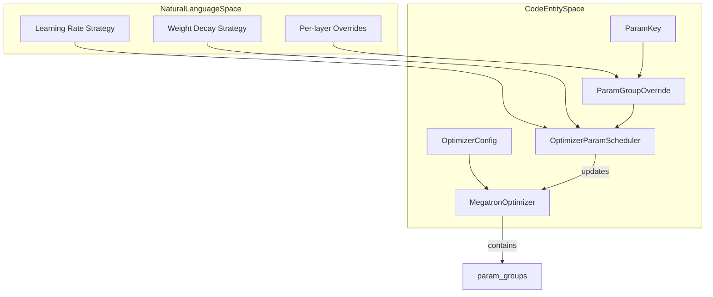
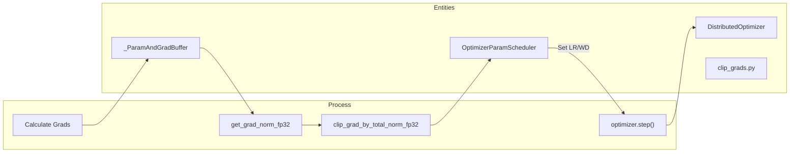

<!-- source: DeepWiki mcp.deepwiki.com · repo NVIDIA/Megatron-LM · page 6.6 Optimizer CPU Offload and Learning Rate Scheduling · fetched 2026-10-26 -->

# Optimizer CPU Offload and Learning Rate Scheduling

Relevant source files

The following files were used as context for generating this wiki page:

- [megatron/core/distributed/distributed_data_parallel.py](megatron/core/distributed/distributed_data_parallel.py)
- [megatron/core/distributed/param_and_grad_buffer.py](megatron/core/distributed/param_and_grad_buffer.py)
- [megatron/core/fp8_utils.py](megatron/core/fp8_utils.py)
- [megatron/core/optimizer/__init__.py](megatron/core/optimizer/__init__.py)
- [megatron/core/optimizer/clip_grads.py](megatron/core/optimizer/clip_grads.py)
- [megatron/core/optimizer/cpu_offloading/README.md](megatron/core/optimizer/cpu_offloading/README.md)
- [megatron/core/optimizer/cpu_offloading/__init__.py](megatron/core/optimizer/cpu_offloading/__init__.py)
- [megatron/core/optimizer/cpu_offloading/hybrid_optimizer.py](megatron/core/optimizer/cpu_offloading/hybrid_optimizer.py)
- [megatron/core/optimizer/distrib_optimizer.py](megatron/core/optimizer/distrib_optimizer.py)
- [megatron/core/optimizer/emerging_optimizers.py](megatron/core/optimizer/emerging_optimizers.py)
- [megatron/core/optimizer/layer_wise_optimizer.py](megatron/core/optimizer/layer_wise_optimizer.py)
- [megatron/core/optimizer/muon.py](megatron/core/optimizer/muon.py)
- [megatron/core/optimizer/optimizer.py](megatron/core/optimizer/optimizer.py)
- [megatron/core/optimizer/optimizer_config.py](megatron/core/optimizer/optimizer_config.py)
- [megatron/core/optimizer/param_layout.py](megatron/core/optimizer/param_layout.py)
- [tests/unit_tests/distributed/test_layer_wise_param_layout.py](tests/unit_tests/distributed/test_layer_wise_param_layout.py)
- [tests/unit_tests/distributed/test_param_and_grad_buffer.py](tests/unit_tests/distributed/test_param_and_grad_buffer.py)
- [tests/unit_tests/test_emerging_optimizers.py](tests/unit_tests/test_emerging_optimizers.py)
- [tests/unit_tests/test_fp8_param.py](tests/unit_tests/test_fp8_param.py)
- [tests/unit_tests/test_fp8_utils.py](tests/unit_tests/test_fp8_utils.py)
- [tests/unit_tests/test_layer_wise_optimizer.py](tests/unit_tests/test_layer_wise_optimizer.py)
- [tests/unit_tests/test_lion_optimizer.py](tests/unit_tests/test_lion_optimizer.py)
- [tests/unit_tests/test_optimizer.py](tests/unit_tests/test_optimizer.py)
- [tests/unit_tests/test_optimizer_cpu_offloading.py](tests/unit_tests/test_optimizer_cpu_offloading.py)
- [tests/unit_tests/transformer/test_module.py](tests/unit_tests/transformer/test_module.py)

This page documents the mechanisms for reducing GPU memory pressure through optimizer state offloading, the sophisticated learning rate and weight decay scheduling systems, and the specialized optimization strategies for matrix-like parameters in Megatron-LM.

## Optimizer CPU Offloading

To train increasingly large models, Megatron-LM provides a mechanism to offload optimizer states (such as momentum and variance buffers in Adam) to CPU memory. This is primarily managed by the `HybridDeviceOptimizer` class [megatron/core/optimizer/cpu_offloading/hybrid_optimizer.py:11]().

### HybridDeviceOptimizer
The `HybridDeviceOptimizer` manages the distribution of parameters and states between the GPU and CPU. It allows the model parameters and gradients to remain on the GPU for fast computation while keeping the bulky optimizer states on the host system.

Key characteristics:
- **Memory Savings**: Significant reduction in GPU memory consumption, as Adam optimizer states typically require 2-3x the memory of the parameters themselves.
- **Data Flow**: During the optimizer step, gradients are moved to the CPU, the update is computed on the CPU using CPU-optimized kernels (like `CPUAdam` [megatron/core/optimizer/__init__.py:11]()), and updated parameters are copied back to the GPU.
- **Integration**: It is utilized within the `DistributedOptimizer` when CPU offloading is enabled via the `OptimizerConfig` [megatron/core/optimizer/distrib_optimizer.py:37-38]().

Sources: [megatron/core/optimizer/cpu_offloading/hybrid_optimizer.py:11](), [megatron/core/optimizer/distrib_optimizer.py:37-38](), [megatron/core/optimizer/__init__.py:11-51]().

## Learning Rate and Parameter Scheduling

Megatron-LM uses the `OptimizerParamScheduler` to manage the annealing of learning rates (LR) and the increment of weight decay (WD) over the course of training [megatron/core/optimizer_param_scheduler.py:100]().

### Scheduling Strategies
The scheduler supports several decay and increment styles [megatron/core/optimizer_param_scheduler.py:133-137]():
- **Linear**: Constant rate of change until the target value is reached.
- **Cosine**: Follows a cosine curve, often used for smoother convergence.
- **WSD (Warmup-Stable-Decay)**: A three-stage schedule consisting of a warmup phase, a stable phase at maximum LR, and a final decay phase [megatron/core/optimizer_param_scheduler.py:163-164]().

### Parameter Group Overrides
The system allows for fine-grained control over specific parameters through `ParamGroupOverride` [megatron/core/optimizer_param_scheduler.py:19](). This is used to apply different LR or WD logic to specific layers:
- **Decoupled LR**: Assigning a different learning rate to embedding or output layers using the `decoupled_lr` and `decoupled_min_lr` configurations [megatron/core/optimizer/optimizer_config.py:154-161](). This is implemented by matching parameters with the `is_embedding_or_output_parameter` attribute [megatron/core/optimizer/__init__.py:123-126]().
- **Weight Decay Exclusion**: Automatically skipping weight decay for bias terms and LayerNorm parameters (or parameters with shape length 1) [megatron/core/optimizer/__init__.py:103-119]().
- **MuP Scaling**: When using Maximal Update Parameterization (MuP), the LR and Adam epsilon are scaled based on width multipliers (`mup_width_mult`) for hidden matrix-like parameters [megatron/core/optimizer/__init__.py:132-164]().

### Logical Flow of LR Update
The scheduler's `step()` method is called every iteration to calculate the new values based on the current `num_steps` and update the `optimizer.param_groups` [megatron/core/optimizer_param_scheduler.py:270-305]().

**Optimizer Parameter Scheduling Data Flow**

Sources: [megatron/core/optimizer_param_scheduler.py:19-123](), [megatron/core/optimizer/optimizer.py:133-171](), [megatron/core/optimizer/optimizer_config.py:65-135](), [megatron/core/optimizer/__init__.py:94-164]().

## Layer-Wise and Muon Optimization

Megatron-LM introduces specialized handling for matrix-like weights through the `LayerWiseDistributedOptimizer` [megatron/core/optimizer/layer_wise_optimizer.py:39](). This is specifically designed to support optimizers like **Muon**, which applies orthogonalization via Newton-Schulz to 2D parameters.

### Routing Logic
Parameters are tagged using `tag_params_for_buffer_routing` [megatron/core/optimizer/layer_wise_optimizer.py:74]() to decide their destination buffer:
1.  **LayerWise Buffer**: For 2D matrix-like weights (excluding embeddings and output layers) that Muon orthogonalizes [megatron/core/optimizer/layer_wise_optimizer.py:38-53]().
2.  **Standard Buffer**: For vector-like parameters (biases, layernorms) and embeddings, which use a scalar fallback optimizer (e.g., Adam or SGD).

### Implementation Details
- **Buffer Alignment**: The `LayerWiseDistributedOptimizer` requires shard-aligned buffers to ensure that the 2D weights can be orthogonalized efficiently across distributed ranks [megatron/core/optimizer/layer_wise_optimizer.py:76-88]().
- **GTP Replica Folding**: To handle checkpointing for (E)GTP-replicated parameters, `_build_gtp_replica_fold` manages replica IDs to ensure unique writers during distributed saves [megatron/core/optimizer/layer_wise_optimizer.py:90-142]().

Sources: [megatron/core/optimizer/layer_wise_optimizer.py:38-142](), [megatron/core/optimizer/muon.py:1](), [megatron/core/optimizer/emerging_optimizers.py:1]().

## Gradient Management and Clipping
Before the optimizer update, Megatron-LM performs gradient clipping to ensure stability.
- **Global Norm Clipping**: `get_grad_norm_fp32` calculates the total norm across all model-parallel and data-parallel ranks [megatron/core/optimizer/clip_grads.py:55-140]().
- **In-place Scaling**: `clip_grad_by_total_norm_fp32` modifies gradients in-place if the total norm exceeds `max_norm` [megatron/core/optimizer/clip_grads.py:143-183]().
- **Separate Norm Groups**: Parameters can be tagged with `grad_norm_group` (e.g., `mtp`) to be clipped separately from the main model parameters [megatron/core/optimizer/optimizer.py:150-168]().

**Gradient Clipping and Optimization Flow**

Sources: [megatron/core/optimizer/clip_grads.py:55-183](), [megatron/core/optimizer/distrib_optimizer.py:113-131](), [megatron/core/distributed/param_and_grad_buffer.py:92-123]().

## Precision-Aware Optimization
Megatron-LM supports `use_precision_aware_optimizer`, which allows optimizer-related tensors (master parameters, gradients, and states) to be set to lower precision (e.g., BF16 or FP8) to further reduce memory footprint [megatron/core/optimizer/optimizer_config.py:187-191]().

When enabled, the optimizer often uses `decoupled_grad` attributes on parameters to manage gradients separately from the standard PyTorch `.grad` attribute, facilitating high-precision accumulation or low-precision updates [megatron/core/optimizer/optimizer.py:67-77](). For example, `_zero_grad_group_helper` explicitly checks for `decoupled_grad` [megatron/core/optimizer/optimizer.py:59-79]().

Sources: [megatron/core/optimizer/optimizer_config.py:187-195](), [megatron/core/optimizer/optimizer.py:59-79](), [megatron/core/optimizer/optimizer.py:133-171]().

---

