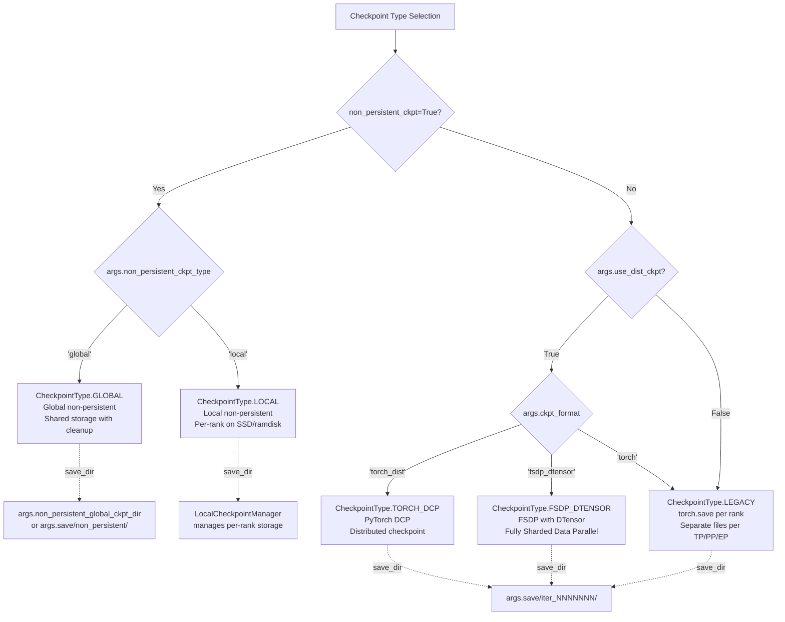
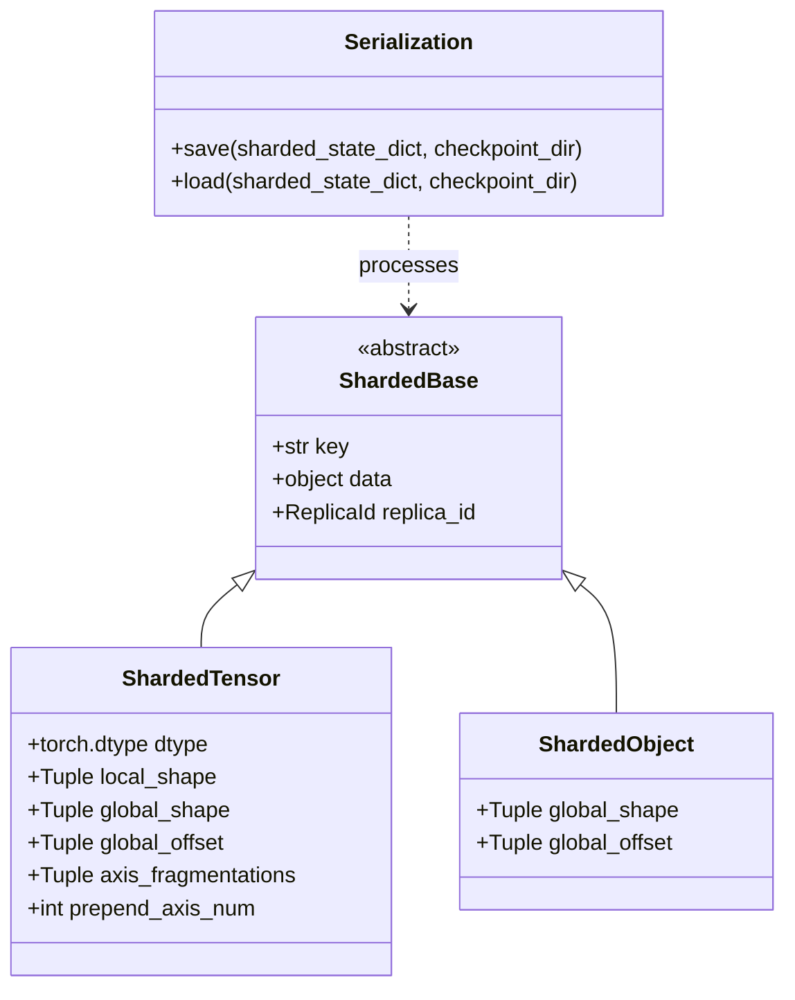

<!-- source: DeepWiki mcp.deepwiki.com · repo NVIDIA/Megatron-LM · page 7 Checkpointing and State Management · fetched 2026-10-26 -->

# Checkpointing and State Management

Relevant source files

The following files were used as context for generating this wiki page:

- [megatron/core/dist_checkpointing/__init__.py](megatron/core/dist_checkpointing/__init__.py)
- [megatron/core/dist_checkpointing/core.py](megatron/core/dist_checkpointing/core.py)
- [megatron/core/dist_checkpointing/dict_utils.py](megatron/core/dist_checkpointing/dict_utils.py)
- [megatron/core/dist_checkpointing/mapping.py](megatron/core/dist_checkpointing/mapping.py)
- [megatron/core/dist_checkpointing/optimizer.py](megatron/core/dist_checkpointing/optimizer.py)
- [megatron/core/dist_checkpointing/serialization.py](megatron/core/dist_checkpointing/serialization.py)
- [megatron/core/dist_checkpointing/strategies/__init__.py](megatron/core/dist_checkpointing/strategies/__init__.py)
- [megatron/core/dist_checkpointing/strategies/common.py](megatron/core/dist_checkpointing/strategies/common.py)
- [megatron/core/dist_checkpointing/strategies/torch.py](megatron/core/dist_checkpointing/strategies/torch.py)
- [megatron/core/dist_checkpointing/utils.py](megatron/core/dist_checkpointing/utils.py)
- [megatron/core/dist_checkpointing/validation.py](megatron/core/dist_checkpointing/validation.py)
- [megatron/core/msc_utils.py](megatron/core/msc_utils.py)
- [tests/unit_tests/dist_checkpointing/__init__.py](tests/unit_tests/dist_checkpointing/__init__.py)
- [tests/unit_tests/dist_checkpointing/conftest.py](tests/unit_tests/dist_checkpointing/conftest.py)
- [tests/unit_tests/dist_checkpointing/test_mapping.py](tests/unit_tests/dist_checkpointing/test_mapping.py)
- [tests/unit_tests/dist_checkpointing/test_optimizer.py](tests/unit_tests/dist_checkpointing/test_optimizer.py)
- [tests/unit_tests/dist_checkpointing/test_serialization.py](tests/unit_tests/dist_checkpointing/test_serialization.py)
- [tests/unit_tests/dist_checkpointing/test_validation.py](tests/unit_tests/dist_checkpointing/test_validation.py)

## Purpose and Scope

This document provides an overview of Megatron-LM's checkpointing system, which enables saving and restoring the complete training state to support fault tolerance, training resumption, and model distribution. The checkpointing system handles model parameters, optimizer state, random number generator (RNG) states, data iterator position, and training metadata.

Megatron-LM has transitioned towards a **Distributed Checkpointing** architecture that decouples the model's parallel configuration (TP/PP/DP) from the physical storage on disk. This allows for seamless resharding—loading a checkpoint into a different number of GPUs or a different parallelism configuration than it was saved with.

For detailed information about specific aspects:
- Distributed checkpoint architecture and sharded state dictionaries: see [Distributed Checkpointing System](#7.1)
- Storage formats (torch, torch_dist, fsdp_dtensor) and backend implementations: see [Checkpoint Formats and Backends](#7.2)
- Optimizer state persistence in distributed settings: see [Optimizer State Checkpointing](#7.3)
- Local SSD and non-persistent checkpoint strategies: see [Local and Non-Persistent Checkpointing](#7.4)
- Model resharding and parallelism conversion: see [Model Resharding and Parallelism Conversion](#7.5)
- Conversion tools for external formats (HuggingFace): see [Checkpoint Conversion Tools](#7.6)

## Checkpoint Components

A Megatron checkpoint consists of multiple state components that together capture the complete training snapshot. The `save_checkpoint` function in `megatron/training/checkpointing.py` orchestrates the collection of these components [megatron/training/checkpointing.py:559-612]().

### Checkpoint Structure Diagram
Title: Megatron Checkpoint Composition

```mermaid
graph TB
    CKPT["Checkpoint<br/>(iteration N)"]
    
    subgraph "Model State"
        MODEL["model['module']<br/>Parameter tensors"]
        ARGS["args<br/>Configuration namespace"]
        ITER["iteration<br/>Training step number"]
        VERSION["checkpoint_version<br/>Format version"]
    end
    
    subgraph "Optimizer State"
        OPT_STATE["optimizer['optimizer']<br/>Inner optimizer state"]
        PARAM_GROUPS["param_groups<br/>Parameter group configs"]
        FP32_PARAMS["fp32_from_fp16_params<br/>(if mixed precision)"]
        DISTRIB_STATE["DistributedOptimizer state<br/>(if use_distributed_optimizer)"]
    end
    
    subgraph "RNG State"
        RNG_RANDOM["random_rng_state<br/>Python random"]
        RNG_NP["np_rng_state<br/>NumPy random"]
        RNG_TORCH["torch_rng_state<br/>PyTorch CPU RNG"]
        RNG_CUDA["cuda_rng_state<br/>PyTorch CUDA RNG"]
        RNG_TRACKER["rng_tracker_states<br/>Tensor parallel RNG"]
    end
    
    subgraph "Training Metadata"
        NUM_FLOAT_OPS["num_floating_point_operations_so_far<br/>FLOPs counter"]
        LR_SCHEDULER["opt_param_scheduler<br/>Learning rate state"]
        DATA_ITER["train_data_iterator<br/>Dataset position (optional)"]
    end
    
    CKPT --> MODEL
    CKPT --> ARGS
    CKPT --> ITER
    CKPT --> VERSION
    CKPT --> OPT_STATE
    CKPT --> PARAM_GROUPS
    CKPT --> FP32_PARAMS
    CKPT --> DISTRIB_STATE
    CKPT --> RNG_RANDOM
    CKPT --> RNG_NP
    CKPT --> RNG_TORCH
    CKPT --> RNG_CUDA
    CKPT --> RNG_TRACKER
    CKPT --> NUM_FLOAT_OPS
    CKPT --> LR_SCHEDULER
    CKPT --> DATA_ITER
```

**Sources:** [megatron/training/checkpointing.py:559-612](), [megatron/core/dist_checkpointing/mapping.py:25-27]()

### State Dictionary Structure

In the distributed checkpointing flow, the system differentiates between `CommonStateDict` (metadata/replicated state) and `ShardedStateDict` (large tensors) [megatron/core/dist_checkpointing/mapping.py:25-27]().

| Component | Key | Description |
|-----------|-----|-------------|
| Model Parameters | `'model'` | Module state dict with parameter tensors |
| Arguments | `'args'` | Complete argparse namespace with all config |
| Iteration | `'iteration'` | Current training step number |
| Optimizer | `'optimizer'` | Optimizer state dict (parameters, momentum, etc.) |
| Learning Rate | `'opt_param_scheduler'` | LR scheduler state |
| RNG States | `'rng_state'` | All random number generator states |
| FLOPs Counter | `'num_floating_point_operations_so_far'` | Total FLOPs for throughput tracking |
| Data Iterator | `'train_data_iterator'` | Dataset position (when supported) |

**Sources:** [megatron/training/checkpointing.py:559-612](), [megatron/core/dist_checkpointing/mapping.py:25-27]()

## Checkpoint Type System

Megatron supports multiple checkpoint types optimized for different use cases, defined primarily by arguments like `--use-dist-ckpt` and `--ckpt-format` [megatron/training/arguments.py:55-55]().

### Checkpoint Selection Logic
Title: Checkpoint Strategy Selection

**Sources:** [megatron/training/arguments.py:55-55](), [megatron/training/checkpointing.py:402-408](), [megatron/training/checkpointing.py:517-531]()

## Core Checkpoint Entities

The distributed checkpointing system introduces specific abstractions in `megatron/core/dist_checkpointing/mapping.py` to handle sharded data:

- `ShardedTensor`: Represents a mapping between a local tensor shard and a global tensor. It contains metadata such as `global_offset`, `global_shape`, and `replica_id` [megatron/core/dist_checkpointing/mapping.py:52-91]().
- `ShardedObject`: Similar to `ShardedTensor` but for picklable Python objects that are replicated or partitioned across ranks [megatron/core/dist_checkpointing/mapping.py:236-250]().
- `ShardedStateDict`: A nested dictionary where leaf values are `ShardedTensor` or `ShardedObject` instances [megatron/core/dist_checkpointing/mapping.py:27-27]().

### Checkpoint Class Relationships
Title: Distributed Checkpointing Class Diagram

**Sources:** [megatron/core/dist_checkpointing/mapping.py:34-91](), [megatron/core/dist_checkpointing/serialization.py:69-77]()

## Save and Load Operations

### Saving Flow
The `save` entrypoint in `megatron.core.dist_checkpointing.serialization` handles the orchestration of distributed saving.

1. **Preprocessing**: Tensors are preprocessed, and FP8 tensors are forced to high precision via `force_all_tensors_to_non_fp8` to avoid quantization artifacts in the checkpoint [megatron/core/dist_checkpointing/serialization.py:135-135]().
2. **Metadata Generation**: The system determines global metadata to validate access integrity across ranks and generates integrity manifests if requested [megatron/core/dist_checkpointing/serialization.py:44-47]().
3. **Strategy Execution**: The `sharded_strategy.save` method is called to write the shards to disk [megatron/core/dist_checkpointing/serialization.py:58-60]().

### Loading Flow
The `load` entrypoint requires a `sharded_state_dict` from the current model to act as a "template" for what needs to be loaded.

1. **Common State**: Non-sharded objects (like `args`) are loaded first via `load_common_state_dict` [megatron/core/dist_checkpointing/serialization.py:143-143]().
2. **Integrity Check**: The system validates that the requested sharded state dict matches the checkpoint's content via `validate_integrity_and_strict_load`, handling missing or unexpected keys based on the `StrictHandling` policy [megatron/core/dist_checkpointing/validation.py:125-132]().
3. **Sharded Load**: The strategy (e.g., `TorchDistLoadShardedStrategy`) reads the required shards and populates the model's tensors [megatron/core/dist_checkpointing/serialization.py:72-76]().

**Sources:** [megatron/core/dist_checkpointing/serialization.py:69-118](), [megatron/core/dist_checkpointing/strategies/torch.py:34-36](), [megatron/core/dist_checkpointing/validation.py:125-162]()

## Optimizer State Management

Optimizer states (like Adam's `exp_avg` and `exp_avg_sq`) are automatically sharded based on the model parameter sharding. The system creates a mapping between optimizer parameter IDs and the corresponding `ShardedTensor` definitions from the model [megatron/core/dist_checkpointing/optimizer.py:45-59]().

When saving, the system transforms the standard optimizer state dict into a `ShardedStateDict` by wrapping each state tensor in a `ShardedTensor` with an appropriate prefix (e.g., `optimizer.state.exp_avg`) [megatron/core/dist_checkpointing/optimizer.py:111-150]().

**Sources:** [megatron/core/dist_checkpointing/optimizer.py:45-150]()

## Asynchronous Checkpointing

To minimize training downtime, Megatron supports asynchronous checkpointing. This is facilitated by `AsyncRequest` objects and specialized strategies.

- **Persistent Worker**: If `args.async_save` and `args.use_persistent_ckpt_worker` are set, a persistent background worker is initialized [megatron/training/initialize.py:73-74]().
- **Async Strategy**: The distributed checkpointing system uses `AsyncRequest` to track background saving operations [megatron/core/dist_checkpointing/serialization.py:32-32]().
- **Torch Dist Async**: Support for asynchronous requests is integrated into the `torch_dist` strategies, potentially leveraging `nvidia_resiliency_ext` (NVRx) if available [megatron/core/dist_checkpointing/strategies/torch.py:52-54]().

**Sources:** [megatron/core/dist_checkpointing/serialization.py:32-32](), [megatron/core/dist_checkpointing/strategies/torch.py:52-54](), [megatron/training/initialize.py:73-74]()

---

**Sources:**
- [megatron/training/checkpointing.py]()
- [megatron/core/dist_checkpointing/serialization.py]()
- [megatron/core/dist_checkpointing/mapping.py]()
- [megatron/core/dist_checkpointing/strategies/torch.py]()
- [megatron/core/dist_checkpointing/optimizer.py]()
- [megatron/core/dist_checkpointing/validation.py]()
- [megatron/training/initialize.py]()

---

