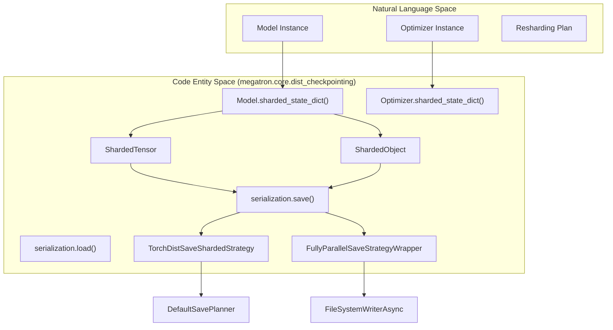
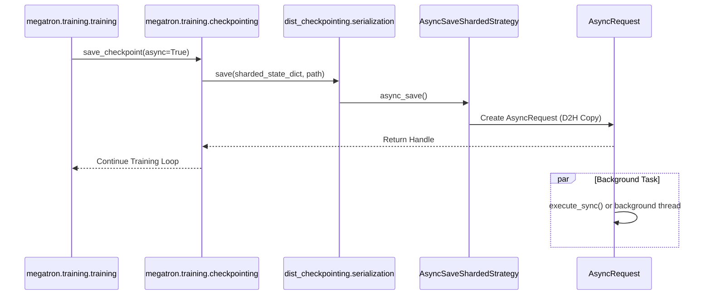

<!-- source: DeepWiki mcp.deepwiki.com · repo NVIDIA/Megatron-LM · page 7.1 Distributed Checkpointing System · fetched 2026-10-26 -->

# Distributed Checkpointing System

<details>
<summary>Relevant source files</summary>

The following files were used as context for generating this wiki page:

- [megatron/core/dist_checkpointing/__init__.py](megatron/core/dist_checkpointing/__init__.py)
- [megatron/core/dist_checkpointing/core.py](megatron/core/dist_checkpointing/core.py)
- [megatron/core/dist_checkpointing/dict_utils.py](megatron/core/dist_checkpointing/dict_utils.py)
- [megatron/core/dist_checkpointing/mapping.py](megatron/core/dist_checkpointing/mapping.py)
- [megatron/core/dist_checkpointing/optimizer.py](megatron/core/dist_checkpointing/optimizer.py)
- [megatron/core/dist_checkpointing/serialization.py](megatron/core/dist_checkpointing/serialization.py)
- [megatron/core/dist_checkpointing/strategies/__init__.py](megatron/core/dist_checkpointing/strategies/__init__.py)
- [megatron/core/dist_checkpointing/strategies/common.py](megatron/core/dist_checkpointing/strategies/common.py)
- [megatron/core/dist_checkpointing/strategies/fully_parallel.py](megatron/core/dist_checkpointing/strategies/fully_parallel.py)
- [megatron/core/dist_checkpointing/strategies/torch.py](megatron/core/dist_checkpointing/strategies/torch.py)
- [megatron/core/dist_checkpointing/utils.py](megatron/core/dist_checkpointing/utils.py)
- [megatron/core/dist_checkpointing/validation.py](megatron/core/dist_checkpointing/validation.py)
- [megatron/core/model_parallel_config.py](megatron/core/model_parallel_config.py)
- [megatron/core/msc_utils.py](megatron/core/msc_utils.py)
- [megatron/core/parallel_state.py](megatron/core/parallel_state.py)
- [megatron/core/pipeline_parallel/p2p_communication.py](megatron/core/pipeline_parallel/p2p_communication.py)
- [megatron/core/pipeline_parallel/schedules.py](megatron/core/pipeline_parallel/schedules.py)
- [megatron/training/arguments.py](megatron/training/arguments.py)
- [megatron/training/checkpointing.py](megatron/training/checkpointing.py)
- [megatron/training/config/training_config.py](megatron/training/config/training_config.py)
- [megatron/training/initialize.py](megatron/training/initialize.py)
- [megatron/training/training.py](megatron/training/training.py)
- [pretrain_gpt.py](pretrain_gpt.py)
- [pretrain_hybrid.py](pretrain_hybrid.py)
- [pretrain_mamba.py](pretrain_mamba.py)
- [tests/unit_tests/dist_checkpointing/__init__.py](tests/unit_tests/dist_checkpointing/__init__.py)
- [tests/unit_tests/dist_checkpointing/conftest.py](tests/unit_tests/dist_checkpointing/conftest.py)
- [tests/unit_tests/dist_checkpointing/test_mapping.py](tests/unit_tests/dist_checkpointing/test_mapping.py)
- [tests/unit_tests/dist_checkpointing/test_optimizer.py](tests/unit_tests/dist_checkpointing/test_optimizer.py)
- [tests/unit_tests/dist_checkpointing/test_pipeline_parallel_layout.py](tests/unit_tests/dist_checkpointing/test_pipeline_parallel_layout.py)
- [tests/unit_tests/dist_checkpointing/test_serialization.py](tests/unit_tests/dist_checkpointing/test_serialization.py)
- [tests/unit_tests/dist_checkpointing/test_validation.py](tests/unit_tests/dist_checkpointing/test_validation.py)
- [tests/unit_tests/dist_checkpointing/utils.py](tests/unit_tests/dist_checkpointing/utils.py)
- [tests/unit_tests/pipeline_parallel/test_pipeline_layout.py](tests/unit_tests/pipeline_parallel/test_pipeline_layout.py)
- [tests/unit_tests/test_checkpointing.py](tests/unit_tests/test_checkpointing.py)
- [tests/unit_tests/test_parallel_state.py](tests/unit_tests/test_parallel_state.py)

</details>


## Purpose and Scope

The Distributed Checkpointing System in Megatron-LM provides a scalable infrastructure for saving and loading model and optimizer states. It is designed to handle massive models that cannot fit on a single rank and must be sharded across thousands of GPUs. The core of this system is the `sharded_state_dict` mechanism, which abstracts the physical storage from the logical distribution of data, enabling automatic resharding when changing parallelism configurations (TP, PP, DP, EP, CP, FSDP).

The system supports various backends, including standard PyTorch Distributed Checkpoint (`torch_dist`), and specialized strategies for Fully Sharded Data Parallelism (FSDP), asynchronous I/O, and integration with `nvidia-resiliency-ext` (NVRx).

Sources: [megatron/core/dist_checkpointing/serialization.py:3-9](), [megatron/training/checkpointing.py:32-44]()

## Core Concepts

### Sharded State Dict

A **sharded state dict** is a dictionary where values are metadata wrappers (`ShardedTensor` or `ShardedObject`) instead of raw `torch.Tensor` objects. These wrappers describe the global shape, local offsets, and replication properties of the data, allowing the checkpointing engine to reconstruct the global state or redistribute it to a different number of ranks.

Sources: [megatron/core/dist_checkpointing/mapping.py:22-28](), [megatron/core/dist_checkpointing/serialization.py:64-65]()

### ShardedBase Primitives

The system uses two primary classes to represent distributed data:

- **`ShardedTensor`**: Describes a mapping between a local tensor and a global tensor. It includes metadata such as `global_shape`, `global_offset`, `axis_fragmentations`, and `replica_id`. [megatron/core/dist_checkpointing/mapping.py:52-91]()
- **`ShardedObject`**: Describes non-tensor picklable objects (e.g., RNG states, configuration dicts) that might be replicated or partitioned across ranks. [megatron/core/dist_checkpointing/mapping.py:207-228]()

### Metadata and Strategy Registry

Checkpointing behavior is governed by **Strategies**. The system maintains a registry of default strategies for different backends. For example, `TorchDistSaveShardedStrategy` leverages PyTorch's native distributed checkpointing format.

Sources: [megatron/core/dist_checkpointing/strategies/torch.py:27-35](), [megatron/core/dist_checkpointing/serialization.py:58-60]()

## Architecture Overview

The system bridges the gap between the high-level training loop and low-level storage backends. It handles the transformation of local model parameters into a globally consistent sharded representation.

### System Data Flow


**Diagram: Distributed Checkpointing Architecture**
Sources: [megatron/core/dist_checkpointing/serialization.py:69-118](), [megatron/core/dist_checkpointing/mapping.py:52-207](), [megatron/core/dist_checkpointing/strategies/torch.py:27-35](), [megatron/core/dist_checkpointing/strategies/fully_parallel.py:46-71]()

## Implementation Details

### Sharded State Dict Construction

The construction of the sharded state dict typically happens via constructors like `from_rank_offsets`, which calculates global offsets based on the current process's rank within a specific process group (e.g., Tensor Parallel or Pipeline Parallel group).

```python
# Conceptual usage in mapping.py
sh_ten = ShardedTensor.from_rank_offsets(
    key,
    data,
    (partition_dim, rank, world_size),
    replica_id=replica_id
)
```
Sources: [megatron/core/dist_checkpointing/mapping.py:188-205]()

### Serialization Flow

The `save` and `load` functions in `serialization.py` are the main entry points. They perform several critical preprocessing steps:
1. **Dequantization**: Converts FP8 tensors to high precision using `force_all_tensors_to_non_fp8` to prevent issues with delayed scaling or initialization during future loads. [megatron/core/dist_checkpointing/serialization.py:126-135]()
2. **Preprocessing**: Dispatches to `load_preprocess` or `save_preprocess` to handle nested dictionaries, non-persistent states, and factories. [megatron/core/dist_checkpointing/serialization.py:137-139](), [megatron/core/dist_checkpointing/serialization.py:217-219]()
3. **Common Data Handling**: Loads non-tensor data (like training arguments) up front via `load_common_state_dict`. [megatron/core/dist_checkpointing/serialization.py:143]()

### Fully Parallel Strategy

The `FullyParallelSaveStrategyWrapper` and `FullyParallelLoadStrategyWrapper` are used to maximize I/O throughput. They distribute the saving/loading workload uniformly across ranks by exchanging metadata without communicating actual tensor data during the planning phase.

Sources: [megatron/core/dist_checkpointing/strategies/fully_parallel.py:46-71](), [megatron/core/dist_checkpointing/strategies/fully_parallel.py:119-149]()

## Distributed Saving and Loading

### Async Saving
To minimize training downtime, Megatron-LM supports asynchronous checkpointing. The system moves tensors to CPU (D2H) or pinned memory synchronously and then offloads the actual file I/O to a separate process or thread using an `AsyncRequest`.


**Diagram: Asynchronous Save Sequence**
Sources: [megatron/core/dist_checkpointing/serialization.py:192-200](), [megatron/core/dist_checkpointing/strategies/torch.py:52](), [megatron/core/dist_checkpointing/strategies/async_utils.py:32]()

### Optimizer State Checkpointing
Optimizer states are sharded based on the model parameter sharding. The system maps optimizer parameter IDs to `ShardedTensor` objects using `optim_state_to_sharding_state`.

Sources: [megatron/core/dist_checkpointing/optimizer.py:45-80](), [megatron/core/dist_checkpointing/optimizer.py:16-19]()

## Key Classes and Functions

| Entity | Location | Role |
| :--- | :--- | :--- |
| `ShardedTensor` | `megatron/core/dist_checkpointing/mapping.py` | Metadata for a distributed tensor shard. |
| `ShardedObject` | `megatron/core/dist_checkpointing/mapping.py` | Metadata for distributed picklable objects. |
| `save` / `load` | `megatron/core/dist_checkpointing/serialization.py` | High-level API for distributed checkpointing. |
| `TorchDistSaveShardedStrategy` | `megatron/core/dist_checkpointing/strategies/torch.py` | Implementation using PyTorch Distributed Checkpoint. |
| `FullyParallelSaveStrategyWrapper` | `megatron/core/dist_checkpointing/strategies/fully_parallel.py` | Wrapper to balance I/O load across ranks. |
| `StrictHandling` | `megatron/core/dist_checkpointing/validation.py` | Defines behavior for missing/unexpected keys. |
| `AsyncRequest` | `megatron/core/dist_checkpointing/strategies/async_utils.py` | Represents the async save function and finalization. |
| `get_param_id_to_sharded_param_map` | `megatron/core/dist_checkpointing/optimizer.py` | Generates mapping from optimizer params to state IDs. |

Sources: [megatron/core/dist_checkpointing/mapping.py:52](), [megatron/core/dist_checkpointing/mapping.py:207](), [megatron/core/dist_checkpointing/serialization.py:69](), [megatron/core/dist_checkpointing/strategies/torch.py:27](), [megatron/core/dist_checkpointing/strategies/fully_parallel.py:46](), [megatron/core/dist_checkpointing/validation.py:41](), [megatron/core/dist_checkpointing/strategies/async_utils.py:32](), [megatron/core/dist_checkpointing/optimizer.py:16]()

## Validation and Integrity

The system includes rigorous validation to ensure checkpoint consistency:
- **Integrity Validation**: The `validate_integrity_and_strict_load` function checks if each tensor shard is accessed exactly once by a "main replica" process, preventing data loss or silent corruption. [megatron/core/dist_checkpointing/validation.py:126-150]()
- **Strict Loading**: Controlled by the `StrictHandling` enum, which determines if the system should ignore, log, or raise errors for unexpected or missing keys in the state dict. [megatron/core/dist_checkpointing/validation.py:41-85]()
- **Dequantization Safety**: FP8 tensors are dequantized during load to ensure compatibility and prevent corruption of TE `amax_history` buffers. [megatron/core/dist_checkpointing/serialization.py:126-135]()
- **Metadata Consistency**: `determine_global_metadata` aggregates sharding info from all ranks to validate that the union of shards covers the global tensor shape correctly. [megatron/core/dist_checkpointing/validation.py:149]()

Sources: [megatron/core/dist_checkpointing/validation.py:17-43](), [megatron/core/dist_checkpointing/serialization.py:120-158]()

---

