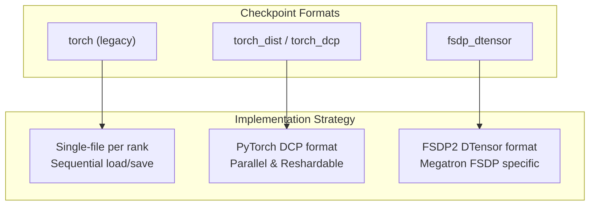
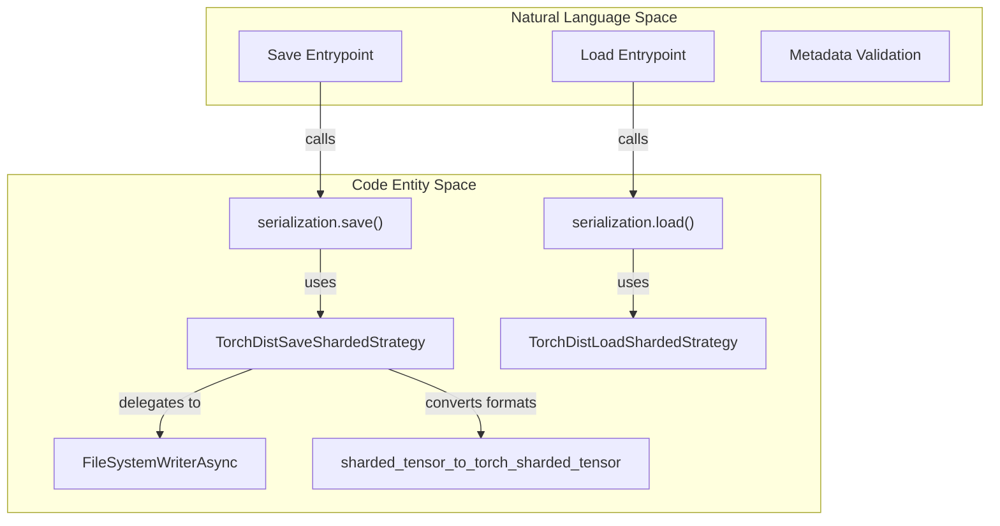
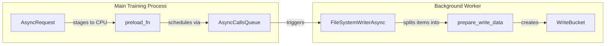

<!-- source: DeepWiki mcp.deepwiki.com · repo NVIDIA/Megatron-LM · page 7.2 Checkpoint Formats and Backends · fetched 2026-10-26 -->

# Checkpoint Formats and Backends

Relevant source files

The following files were used as context for generating this wiki page:

- [megatron/core/dist_checkpointing/__init__.py](megatron/core/dist_checkpointing/__init__.py)
- [megatron/core/dist_checkpointing/core.py](megatron/core/dist_checkpointing/core.py)
- [megatron/core/dist_checkpointing/dict_utils.py](megatron/core/dist_checkpointing/dict_utils.py)
- [megatron/core/dist_checkpointing/mapping.py](megatron/core/dist_checkpointing/mapping.py)
- [megatron/core/dist_checkpointing/optimizer.py](megatron/core/dist_checkpointing/optimizer.py)
- [megatron/core/dist_checkpointing/serialization.py](megatron/core/dist_checkpointing/serialization.py)
- [megatron/core/dist_checkpointing/strategies/__init__.py](megatron/core/dist_checkpointing/strategies/__init__.py)
- [megatron/core/dist_checkpointing/strategies/async_utils.py](megatron/core/dist_checkpointing/strategies/async_utils.py)
- [megatron/core/dist_checkpointing/strategies/cached_metadata_filesystem_reader.py](megatron/core/dist_checkpointing/strategies/cached_metadata_filesystem_reader.py)
- [megatron/core/dist_checkpointing/strategies/common.py](megatron/core/dist_checkpointing/strategies/common.py)
- [megatron/core/dist_checkpointing/strategies/filesystem_async.py](megatron/core/dist_checkpointing/strategies/filesystem_async.py)
- [megatron/core/dist_checkpointing/strategies/nvrx.py](megatron/core/dist_checkpointing/strategies/nvrx.py)
- [megatron/core/dist_checkpointing/strategies/state_dict_saver.py](megatron/core/dist_checkpointing/strategies/state_dict_saver.py)
- [megatron/core/dist_checkpointing/strategies/torch.py](megatron/core/dist_checkpointing/strategies/torch.py)
- [megatron/core/dist_checkpointing/utils.py](megatron/core/dist_checkpointing/utils.py)
- [megatron/core/dist_checkpointing/validation.py](megatron/core/dist_checkpointing/validation.py)
- [megatron/core/msc_utils.py](megatron/core/msc_utils.py)
- [megatron/training/async_utils.py](megatron/training/async_utils.py)
- [megatron/training/inprocess_restart.py](megatron/training/inprocess_restart.py)
- [tests/unit_tests/dist_checkpointing/__init__.py](tests/unit_tests/dist_checkpointing/__init__.py)
- [tests/unit_tests/dist_checkpointing/conftest.py](tests/unit_tests/dist_checkpointing/conftest.py)
- [tests/unit_tests/dist_checkpointing/test_async_save.py](tests/unit_tests/dist_checkpointing/test_async_save.py)
- [tests/unit_tests/dist_checkpointing/test_mapping.py](tests/unit_tests/dist_checkpointing/test_mapping.py)
- [tests/unit_tests/dist_checkpointing/test_optimizer.py](tests/unit_tests/dist_checkpointing/test_optimizer.py)
- [tests/unit_tests/dist_checkpointing/test_serialization.py](tests/unit_tests/dist_checkpointing/test_serialization.py)
- [tests/unit_tests/dist_checkpointing/test_torch_dist.py](tests/unit_tests/dist_checkpointing/test_torch_dist.py)
- [tests/unit_tests/dist_checkpointing/test_validation.py](tests/unit_tests/dist_checkpointing/test_validation.py)

This document covers the checkpoint formats and storage backends available in Megatron-LM for saving and loading distributed model state. The focus is on the practical checkpoint formats (`torch_dist`, `fsdp_dtensor`, legacy `torch`), asynchronous saving mechanisms, and checkpoint resharding capabilities.

For information about the core distributed checkpointing architecture and `ShardedTensor`/`ShardedObject` system, see [7.1 Distributed Checkpointing System]().

## Checkpoint Format Overview

Megatron-LM supports multiple checkpoint formats. The format determines how model state, optimizer state, and metadata are serialized and distributed across ranks.

**Supported Checkpoint Formats**

**Format Selection and Use Cases**

The internal representation of checkpoint types is managed through various strategies. The `torch_dist` backend is the primary modern implementation for large-scale distributed training.

| Format String | Strategy Class | Use Case |
|---------------|----------------|----------|
| `torch` | Legacy | Single-file checkpoints, one per rank |
| `torch_dist` | `TorchDistSaveShardedStrategy` | PyTorch distributed checkpoint format (recommended) |
| `fsdp_dtensor`| `TorchDistLoadShardedStrategy` | Megatron FSDP with DTensor sharding |

**Sources:** [megatron/core/dist_checkpointing/strategies/torch.py:34-36](), [megatron/core/dist_checkpointing/serialization.py:53-60]()

## torch_dist Format (PyTorch Distributed Checkpoint)

The `torch_dist` format is the recommended checkpoint format, using PyTorch's native distributed checkpointing infrastructure (`torch.distributed.checkpoint`) with Megatron-Core extensions. This format enables efficient parallel saving/loading and supports checkpoint resharding across different parallelism configurations.

**torch_dist Architecture**

**Implementation Details**

The `torch_dist` backend is implemented in `megatron/core/dist_checkpointing/strategies/torch.py`. It provides the `TorchDistSaveShardedStrategy` and `TorchDistLoadShardedStrategy` classes [megatron/core/dist_checkpointing/strategies/torch.py:34-36]().

Key features include:
- **Flattening**: The `flatten_state_dict` function converts nested state dicts into a single-level mapping for PyTorch DCP compatibility while accepting `ShardedBase` tensors as terminal objects [megatron/core/dist_checkpointing/strategies/torch.py:108-133]().
- **Tensor Conversion**: `sharded_tensor_to_torch_sharded_tensor` converts MCore `ShardedTensor` objects into PyTorch `ShardedTensor` (DCP) types. It handles global shape adjustment for efficiency, treating N-D flattened tensors as partitioned along the last axis [megatron/core/dist_checkpointing/strategies/torch.py:136-203]().
- **Resharding Support**: By converting to the native PyTorch `TorchShardedTensor`, the system leverages the PyTorch DCP `LoadPlanner` and `SavePlanner` to calculate intersections between the checkpoint shards and the requested model shards [megatron/core/dist_checkpointing/strategies/torch.py:24-35]().

**Sources:** [megatron/core/dist_checkpointing/strategies/torch.py:108-203](), [megatron/core/dist_checkpointing/serialization.py:53-118]()

## fsdp_dtensor Format (Megatron FSDP)

The `fsdp_dtensor` format is designed for Megatron's FSDP implementation, which uses PyTorch DTensors for parameter sharding. 

**FSDP-Specific Handling**

FSDP checkpoints require specific handling of DTensor metadata. The system integrates `torch.distributed._tensor.DTensor` when available [megatron/core/dist_checkpointing/strategies/torch.py:77-81](). 

When loading into FSDP models, the `TorchDistLoadShardedStrategy` handles the restoration of `DTensor` objects from the underlying DCP storage. In unit tests, this is verified by using `DeviceMesh` configurations to map shards to the correct ranks [tests/unit_tests/dist_checkpointing/test_serialization.py:73-81]().

**Sources:** [megatron/core/dist_checkpointing/strategies/torch.py:77-81](), [tests/unit_tests/dist_checkpointing/test_serialization.py:73-81]()

## Asynchronous Checkpoint Saving

Asynchronous saving allows training to continue while checkpoint data is written to storage in the background. This is implemented via a proxy mechanism and a persistent worker process.

**Async Data Flow**

**Implementation Components**

- **AsyncRequest**: Represents the async save and finalization functions. It includes a `preload_fn` to stage tensors from GPU to Host memory before background writing begins [megatron/core/dist_checkpointing/strategies/async_utils.py:98-123]().
- **FileSystemWriterAsync**: An async-enabled implementation of PyTorch's `FileSystemWriter`. It splits write items into buckets and moves tensors from GPU to CPU synchronously during `prepare_write_data` (D2H) before starting background I/O [megatron/core/dist_checkpointing/strategies/filesystem_async.py:69-188]().
- **QoS Management**: The system can set CPU and I/O priority (ionice) for background writer processes to ensure they do not interfere with training throughput [megatron/core/dist_checkpointing/strategies/async_utils.py:29-83]().
- **NVRX Support**: Integration with `nvidia-resiliency-ext` (NVRX) provides advanced asynchronous checkpointing capabilities if the library is installed [megatron/core/dist_checkpointing/strategies/torch.py:54-65]().

**Sources:** [megatron/core/dist_checkpointing/strategies/async_utils.py:98-171](), [megatron/core/dist_checkpointing/strategies/filesystem_async.py:69-188](), [megatron/core/dist_checkpointing/strategies/torch.py:54-65]()

## Checkpoint Resharding and Validation

The resharding system allows loading checkpoints into different parallelism configurations by matching global tensor keys and calculating shard intersections.

**Validation Logic**

The `validate_integrity_and_strict_load` function ensures that the requested `ShardedStateDict` matches the checkpoint content [megatron/core/dist_checkpointing/validation.py:125-162]().

| Strictness Level | Behavior |
|------------------|----------|
| `ASSUME_OK_UNEXPECTED` | Underlying strategy handles errors; fastest performance [megatron/core/dist_checkpointing/validation.py:65](). |
| `RAISE_ALL` | Error on any mismatch; requires metadata exchange [megatron/core/dist_checkpointing/validation.py:77](). |
| `RETURN_ALL` | Returns missing and unexpected keys along with the state dict [megatron/core/dist_checkpointing/validation.py:82](). |

**Strict Handling Logic**

The `StrictHandling` enum determines how to treat "unexpected" (present in checkpoint but not in model) or "missing" (present in model but not in checkpoint) keys [megatron/core/dist_checkpointing/validation.py:45-84](). Functions like `requires_explicit_ckpt_mismatch_check` determine if extra disk access is needed to load sharded metadata before loading [megatron/core/dist_checkpointing/validation.py:87-89]().

**Sources:** [megatron/core/dist_checkpointing/validation.py:45-162](), [megatron/core/dist_checkpointing/serialization.py:150-160]()

## Storage Backends

Megatron-LM supports various storage backends through PyTorch DCP abstractions:

- **Local Filesystem**: Default backend using `FileSystemWriter` and `FileSystemReader` [megatron/core/dist_checkpointing/strategies/torch.py:28-29]().
- **Multi-Storage Client (MSC)**: Support for cloud and object stores via the `msc://` prefix [megatron/core/dist_checkpointing/strategies/torch.py:85](). 
- **Common State Backend**: Non-sharded objects are typically stored in `common.pt`, though modern `torch_dist` integrates this into the main DCP flow [megatron/core/dist_checkpointing/strategies/common.py:15-32]().

**Sources:** [megatron/core/dist_checkpointing/strategies/torch.py:28-85](), [megatron/core/dist_checkpointing/strategies/common.py:15-32]()

---

