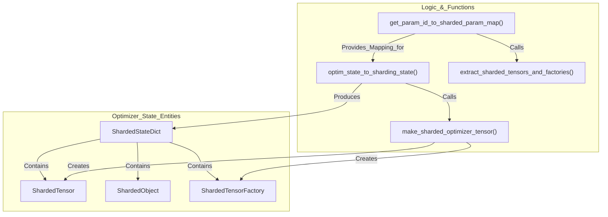
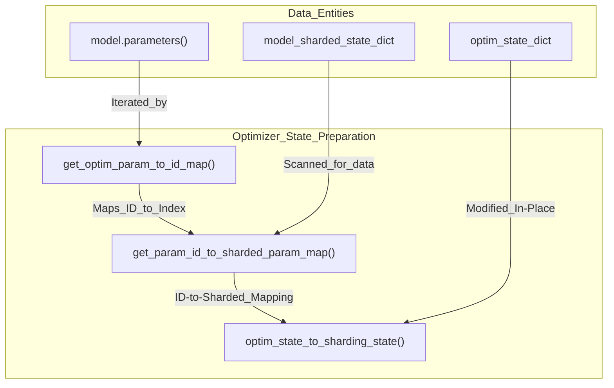

<!-- source: DeepWiki mcp.deepwiki.com · repo NVIDIA/Megatron-LM · page 7.3 Optimizer State Checkpointing · fetched 2026-10-26 -->

# Optimizer State Checkpointing

Relevant source files

The following files were used as context for generating this wiki page:

- [megatron/core/dist_checkpointing/__init__.py](megatron/core/dist_checkpointing/__init__.py)
- [megatron/core/dist_checkpointing/core.py](megatron/core/dist_checkpointing/core.py)
- [megatron/core/dist_checkpointing/dict_utils.py](megatron/core/dist_checkpointing/dict_utils.py)
- [megatron/core/dist_checkpointing/exchange_utils.py](megatron/core/dist_checkpointing/exchange_utils.py)
- [megatron/core/dist_checkpointing/mapping.py](megatron/core/dist_checkpointing/mapping.py)
- [megatron/core/dist_checkpointing/optimizer.py](megatron/core/dist_checkpointing/optimizer.py)
- [megatron/core/dist_checkpointing/serialization.py](megatron/core/dist_checkpointing/serialization.py)
- [megatron/core/dist_checkpointing/strategies/__init__.py](megatron/core/dist_checkpointing/strategies/__init__.py)
- [megatron/core/dist_checkpointing/strategies/common.py](megatron/core/dist_checkpointing/strategies/common.py)
- [megatron/core/dist_checkpointing/strategies/torch.py](megatron/core/dist_checkpointing/strategies/torch.py)
- [megatron/core/dist_checkpointing/utils.py](megatron/core/dist_checkpointing/utils.py)
- [megatron/core/dist_checkpointing/validation.py](megatron/core/dist_checkpointing/validation.py)
- [megatron/core/msc_utils.py](megatron/core/msc_utils.py)
- [megatron/core/typed_torch.py](megatron/core/typed_torch.py)
- [tests/unit_tests/dist_checkpointing/__init__.py](tests/unit_tests/dist_checkpointing/__init__.py)
- [tests/unit_tests/dist_checkpointing/conftest.py](tests/unit_tests/dist_checkpointing/conftest.py)
- [tests/unit_tests/dist_checkpointing/models/common.py](tests/unit_tests/dist_checkpointing/models/common.py)
- [tests/unit_tests/dist_checkpointing/models/test_bert_model.py](tests/unit_tests/dist_checkpointing/models/test_bert_model.py)
- [tests/unit_tests/dist_checkpointing/models/test_gpt_model.py](tests/unit_tests/dist_checkpointing/models/test_gpt_model.py)
- [tests/unit_tests/dist_checkpointing/models/test_moe_experts.py](tests/unit_tests/dist_checkpointing/models/test_moe_experts.py)
- [tests/unit_tests/dist_checkpointing/test_mapping.py](tests/unit_tests/dist_checkpointing/test_mapping.py)
- [tests/unit_tests/dist_checkpointing/test_optimizer.py](tests/unit_tests/dist_checkpointing/test_optimizer.py)
- [tests/unit_tests/dist_checkpointing/test_pg_distribution_cache.py](tests/unit_tests/dist_checkpointing/test_pg_distribution_cache.py)
- [tests/unit_tests/dist_checkpointing/test_serialization.py](tests/unit_tests/dist_checkpointing/test_serialization.py)
- [tests/unit_tests/dist_checkpointing/test_validation.py](tests/unit_tests/dist_checkpointing/test_validation.py)
- [tests/unit_tests/test_typed_torch.py](tests/unit_tests/test_typed_torch.py)

## Purpose and Scope

Optimizer State Checkpointing handles the saving and loading of optimizer state during training, including optimizer hyperparameters, per-parameter state (momentum, variance, etc.), and training step counters. This is critical for resuming training from checkpoints and for maintaining training stability across interruptions.

In distributed settings, especially with the `DistributedOptimizer`, the state is sharded across multiple GPUs. This page documents how these sharded states are mapped to global tensors, how they are serialized using different strategies, and how they are correctly restored even when the degree of parallelism changes.

---

## Optimizer State Components

Optimizer state in Megatron-LM consists of three primary components that must be persisted across checkpoints:

| Component | Description | Example Content |
|-----------|-------------|-----------------|
| **`state`** | Per-parameter optimizer state tensors | Momentum buffers (`exp_avg`), variance buffers (`exp_avg_sq`), per-param step counters |
| **`param_groups`** | Optimizer hyperparameters organized by parameter group | Learning rates, weight decay multipliers, betas, expert parallelism flags |
| **Common metadata** | Global optimizer metadata | Common step counter, loss scale, optimizer configuration |

### Optimizer State Mapping to Code Entities

The following diagram bridges the logical components of an optimizer state to the specific classes and functions in the codebase.

**Sources:** [megatron/core/dist_checkpointing/mapping.py:27-31](), [megatron/core/dist_checkpointing/mapping.py:52-92](), [megatron/core/dist_checkpointing/optimizer.py:45-80](), [megatron/core/dist_checkpointing/optimizer.py:83-108](), [megatron/core/dist_checkpointing/optimizer.py:111-150]()

---

## Distributed Optimizer State Management

Optimizer state management in Megatron-LM is designed to handle complex sharding patterns introduced by various parallelism strategies.

### Distributed Optimizer Sharding
The system tracks the relationship between model parameters and optimizer states using unique IDs.
- **ID Mapping**: `get_optim_param_to_id_map` generates a mapping from the parameter object `id()` to an integer index [megatron/core/dist_checkpointing/optimizer.py:35-42]().
- **Sharded Parameter Mapping**: `get_param_id_to_sharded_param_map` links these IDs to `ShardedTensor` objects within the model's state dict [megatron/core/dist_checkpointing/optimizer.py:45-80]().
- **Optimizer Shard Creation**: `make_sharded_optimizer_tensor` constructs new `ShardedTensor` instances for optimizer states (e.g., `exp_avg`) by cloning the sharding metadata of the parent model parameter [megatron/core/dist_checkpointing/optimizer.py:83-108]().

### Sharding Logic and Data Flow

**Sources:** [megatron/core/dist_checkpointing/optimizer.py:35-42](), [megatron/core/dist_checkpointing/optimizer.py:45-59](), [megatron/core/dist_checkpointing/optimizer.py:111-133]()

---

## Serialization and Strategy Execution

### Serialization Entrypoints
The primary entrypoints for distributed checkpointing are `megatron.core.dist_checkpointing.serialization.save` and `load`.
- **Loading Process**: `load` performs several steps: loading common state, applying factories, extracting non-persistent objects, and finally performing the sharded load via a strategy [megatron/core/dist_checkpointing/serialization.py:69-118]().
- **Mixed Precision**: Before loading, `force_all_tensors_to_non_fp8` is called to dequantize FP8 tensors, preventing precision loss when initializing main parameters [megatron/core/dist_checkpointing/serialization.py:126-135]().

### Checkpoint Strategies
Strategies define the actual I/O behavior.
- **Default Strategies**: The system provides `get_default_load_sharded_strategy` and `get_default_save_sharded_strategy` which default to the `torch_dist` backend [megatron/core/dist_checkpointing/serialization.py:53-60]().
- **Torch Distributed Strategy**: `TorchDistSaveShardedStrategy` and `TorchDistLoadShardedStrategy` leverage PyTorch's `distributed.checkpoint` for handling N-dimensional sharded tensors [megatron/core/dist_checkpointing/strategies/torch.py:34-41]().
- **Flattened Tensors**: The system handles legacy 1D flattened tensors by converting them to `TorchShardedTensor` during load [megatron/core/dist_checkpointing/strategies/torch.py:136-171]().

---

## Loading and Validation

### Strictness and Integrity
The `StrictHandling` enum determines how the system reacts to mismatches between the requested state dict and the checkpoint [megatron/core/dist_checkpointing/validation.py:45-84]().
- **Validation**: `validate_integrity_and_strict_load` verifies sharding integrity (ensuring every shard is accessed) and handles "missing" or "unexpected" keys based on the `strict` flag [megatron/core/dist_checkpointing/validation.py:125-162]().
- **Metadata Exchange**: Some strict modes (e.g., `RAISE_ALL`) require global metadata exchange between ranks to verify the completeness of the checkpoint across the entire distributed setup [megatron/core/dist_checkpointing/validation.py:92-99]().

### Uniform Distribution and Caching
To optimize checkpointing at scale, the system can cache the shard distribution.
- **Distribution Logic**: `distribute_shards_to_ranks` greedily assigns shards to ranks to achieve maximal uniformity based on shard size and coverage [megatron/core/dist_checkpointing/exchange_utils.py:121-174]().
- **PG Distribution Cache**: Distribution information can be cached to disk using the `PG_DIST_CACHE_FILE_PREFIX` to skip the expensive `all_gather` of metadata in subsequent runs [megatron/core/dist_checkpointing/exchange_utils.py:177-185]().

**Sources:**
- [megatron/core/dist_checkpointing/optimizer.py:1-150]()
- [megatron/core/dist_checkpointing/serialization.py:53-165]()
- [megatron/core/dist_checkpointing/validation.py:45-163]()
- [megatron/core/dist_checkpointing/mapping.py:52-135]()
- [megatron/core/dist_checkpointing/utils.py:68-104]()
- [megatron/core/dist_checkpointing/strategies/torch.py:1-171]()
- [megatron/core/dist_checkpointing/exchange_utils.py:121-185]()

---

